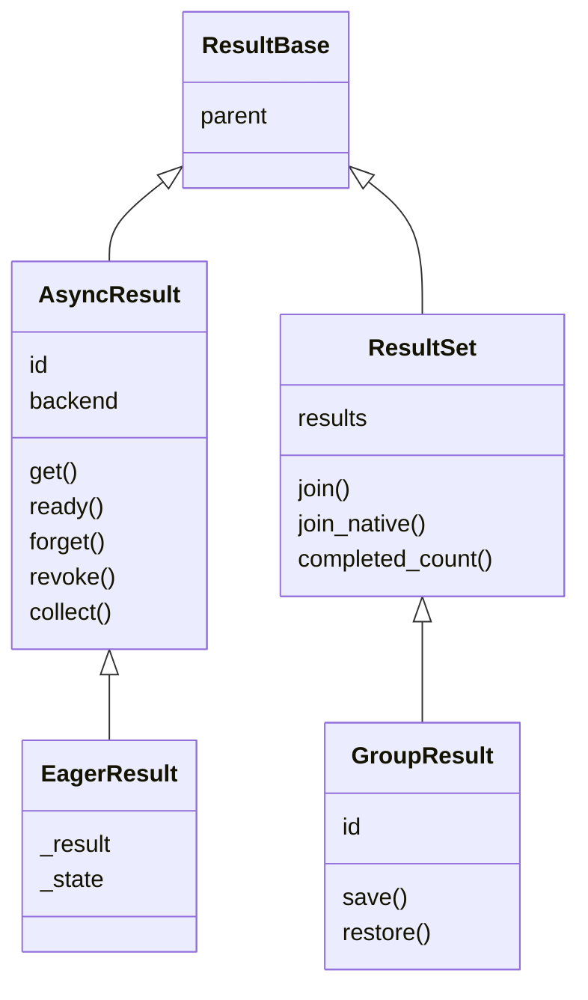
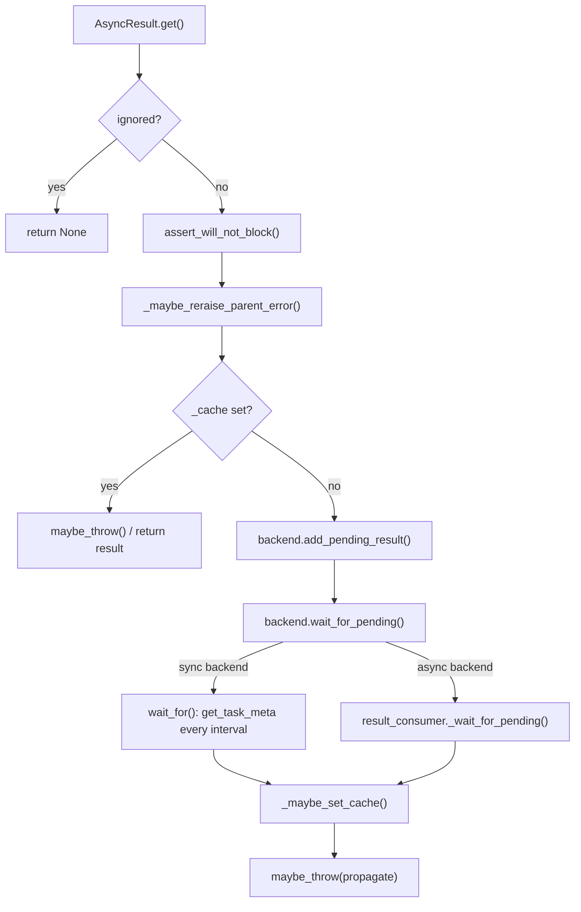

## Overview

Calling a task returns immediately with a result handle rather than the return value. `celery/result.py` defines those handles: `AsyncResult` for one task, `ResultSet` and `GroupResult` for many, and `EagerResult` for tasks run in-process. Each handle stores only an id (plus links to parents and children) and asks the configured result backend for state and value when needed, so a handle can be built anywhere from a bare task id.

Sources: [celery/result.py:25-28](repo://celery/result.py#L25-L28), [celery/result.py:62-102](repo://celery/result.py#L62-L102)

`app.send_task` builds the handle from `app.AsyncResult` (or the task's `result_cls`) and sets `result.ignored` from `ignore_result`, so `get()` on a task whose result is not stored returns `None` straight away instead of waiting forever. The storage side, meaning how `get_task_meta`, `wait_for_pending` and `iter_native` are served, is described in [[Result Backends]]; the state names a handle reports are listed in [[Task States and Exceptions]].

Sources: [celery/app/base.py:1030-1040](repo://celery/app/base.py#L1030-L1040), [celery/result.py:103-113](repo://celery/result.py#L103-L113)

## Result classes

`AsyncResult`, `ResultSet`, `GroupResult` and `EagerResult` are all registered as `vine.Thenable`, so each exposes an `on_ready` promise and a `then()` method that callers (including the canvas and async backends) can chain onto. The app exposes app-bound subclasses through `subclass_with_self`, which is why code inside Celery creates results with `app.AsyncResult(id)` and `app.GroupResult(id, results)` rather than importing the classes directly.

Sources: [celery/result.py:62-70](repo://celery/result.py#L62-L70), [celery/result.py:578-597](repo://celery/result.py#L578-L597), [celery/result.py:928-956](repo://celery/result.py#L928-L956), [celery/result.py:1024-1037](repo://celery/result.py#L1024-L1037), [celery/app/base.py:1466-1486](repo://celery/app/base.py#L1466-L1486)



Sources: [celery/result.py:62-102](repo://celery/result.py#L62-L102), [celery/result.py:578-597](repo://celery/result.py#L578-L597), [celery/result.py:928-956](repo://celery/result.py#L928-L956), [celery/result.py:1024-1037](repo://celery/result.py#L1024-L1037)

## AsyncResult

### Construction and identity

`AsyncResult.__init__` refuses a `None` id with `ValueError`, resolves the app with `app_or_default`, takes `backend or self.app.backend`, and creates `on_ready` as a weak promise bound to `_on_fulfilled`. Equality and hashing use only the id, and a result compares equal to its id string, so results can be used as dictionary keys or tested against plain ids. Pickling goes through `__reduce_args__`, which carries the id, backend and parent but not the cached metadata.

Sources: [celery/result.py:89-102](repo://celery/result.py#L89-L102), [celery/result.py:415-442](repo://celery/result.py#L415-L442)

`__del__` calls `backend.remove_pending_result(self)`, so dropping a handle that was registered for asynchronous delivery stops the backend from consuming its messages. `then()` does the inverse: it registers the result with `add_pending_result` before attaching the callback, and `_on_fulfilled` unregisters it once the promise fires.

Sources: [celery/result.py:115-121](repo://celery/result.py#L115-L121), [celery/result.py:444-447](repo://celery/result.py#L444-L447)

### Metadata cache

Every property (`state`, `result`, `traceback`, `children`, `name`, `args`, ...) reads from `_get_task_meta()`. While `_cache` is empty it calls `backend.get_task_meta(self.id)` and passes the answer to `_maybe_set_cache`, which caches the metadata only when its `status` is in `states.READY_STATES`. On caching, `_set_cache` turns the stored `children` tuples back into result objects with `result_from_tuple`, and `on_ready(self)` fires. Unready states are therefore re-fetched on every access, and a finished result costs at most one backend read.

Sources: [celery/result.py:461-485](repo://celery/result.py#L461-L485)

```python
    def _maybe_set_cache(self, meta):
        if meta:
            state = meta['status']
            if state in states.READY_STATES:
                d = self._set_cache(self.backend.meta_from_decoded(meta))
                self.on_ready(self)
                return d
        return meta
```

Sources: [celery/result.py:461-468](repo://celery/result.py#L461-L468)

`result` (alias `info`) holds the return value, or the exception instance if the task failed. `state` (alias `status`) is the raw status string. `date_done` parses ISO strings with `dateutil.parser.isoparse`. The `name`, `args`, `kwargs`, `worker`, `retries` and `queue` properties are only filled when the backend writes extended metadata, which `_get_result_meta` does when `result_extended` is enabled.

Sources: [celery/result.py:487-576](repo://celery/result.py#L487-L576), [celery/backends/base.py:604-625](repo://celery/backends/base.py#L604-L625), [celery/app/defaults.py:221-221](repo://celery/app/defaults.py#L221-L221)

### Readiness predicates

| Method | Returns `True` when |
| --- | --- |
| `ready()` | `state` is in `backend.READY_STATES` (`SUCCESS`, `FAILURE`, `REVOKED`) |
| `successful()` | `state == states.SUCCESS` |
| `failed()` | `state == states.FAILURE` |
| `exists()` | `backend.task_result_exists(id)`: the backend holds any record (status not `PENDING`) |

Sources: [celery/result.py:351-383](repo://celery/result.py#L351-L383), [celery/backends/base.py:774-783](repo://celery/backends/base.py#L774-L783)

An unknown id and a queued task both report `PENDING`, because a key/value backend answers a missing key with `{'status': PENDING, 'result': None}`. `exists()` (added in 5.7.0) is the way to tell a task that really is pending from an id that was never sent or whose result has expired.

Sources: [celery/backends/base.py:1148-1153](repo://celery/backends/base.py#L1148-L1153), [celery/result.py:351-367](repo://celery/result.py#L351-L367)

### Waiting with get()

`get()`, also available under the deprecated alias `wait`, runs five steps in order.

Sources: [celery/result.py:191-196](repo://celery/result.py#L191-L196), [celery/result.py:270-270](repo://celery/result.py#L270-L270)

1. Return `None` at once if `self.ignored` is set.
2. If `disable_sync_subtasks` is true (the default), call `assert_will_not_block()`, which raises inside a worker task (see the deadlock guard below).
3. With `follow_parents` and `propagate`, walk the parent chain from the root and re-raise the first parent failure. The same check is also attached to `on_interval`, so a parent that fails while the caller is waiting interrupts the wait.
4. If the metadata is already cached, re-raise or return it without touching the backend.
5. Otherwise register with `backend.add_pending_result(self)` and delegate to `backend.wait_for_pending`.

Sources: [celery/result.py:191-280](repo://celery/result.py#L191-L280)



Sources: [celery/result.py:247-270](repo://celery/result.py#L247-L270), [celery/backends/base.py:900-944](repo://celery/backends/base.py#L900-L944), [celery/backends/asynchronous.py:295-313](repo://celery/backends/asynchronous.py#L295-L313)

On a polling backend (`SyncBackendMixin`), `wait_for` loops on `get_task_meta`, sleeps `interval` seconds between reads, calls `on_interval` each time, and raises `celery.exceptions.TimeoutError('The operation timed out.')` once the summed intervals reach `timeout`. Passing `on_message` raises `ImproperlyConfigured` there, because only the asynchronous backends (Redis, RPC) deliver individual messages. Those backends ignore `interval` and wait on their result consumer instead, then call `maybe_throw`.

Sources: [celery/backends/base.py:900-954](repo://celery/backends/base.py#L900-L954), [celery/backends/asynchronous.py:260-313](repo://celery/backends/asynchronous.py#L260-L313)

`maybe_throw` reads the cached (or freshly fetched) metadata, and when the state is in `states.PROPAGATE_STATES` (`FAILURE`, `REVOKED`) and `propagate` is true it raises the stored exception through `on_ready.throw`. With `task_remote_tracebacks` enabled and `tblib` installed, `_to_remote_traceback` rebuilds the worker's traceback so the re-raised exception points at the remote frames. With `propagate=False`, `get()` returns the exception instance instead.

Sources: [celery/result.py:385-401](repo://celery/result.py#L385-L401), [celery/result.py:20-23](repo://celery/result.py#L20-L23), [celery/app/defaults.py:309-309](repo://celery/app/defaults.py#L309-L309)

> [!WARNING]
> The `timeout` argument of `get()` only bounds how long the caller waits. The task keeps running on the worker when the wait times out.

Sources: [celery/result.py:212-217](repo://celery/result.py#L212-L217)

### forget and revoke

`forget()` clears the local cache, recurses into `parent.forget()`, unregisters the pending result and calls `backend.forget(id)` to delete the stored metadata. `revoke()` does not touch the backend: it broadcasts through `app.control.revoke(id, terminate=..., signal=..., reply=wait, timeout=...)`, so every worker adds the id to its revoked set. `revoke_by_stamped_headers()` does the same through `app.control.revoke_by_stamped_headers`, matching tasks by stamp values instead of id. The worker side of revocation is covered in [[Remote Control and Inspection]] and [[Task Execution and Tracing]].

Sources: [celery/result.py:136-189](repo://celery/result.py#L136-L189)

## Parents, children and collect

### Parent links

`ResultBase.parent` points to the result of the previous step in a chain. While freezing a chain, `_chain.prepare_steps` sets `prev_res.parent = res`, so the handle returned for a chain is the last task's result and `.parent` leads back to the first. `as_list()` flattens that chain into ids (last first), and `_parents()` walks it so that `get()` can surface an earlier failure. See [[Canvas: Signatures and Workflows]] for how chains and chords are built.

Sources: [celery/result.py:62-67](repo://celery/result.py#L62-L67), [celery/result.py:127-134](repo://celery/result.py#L127-L134), [celery/result.py:272-280](repo://celery/result.py#L272-L280), [celery/canvas.py:1262-1265](repo://celery/canvas.py#L1262-L1265)

### Children and collect

`Task.trail` (default `True`) makes `send_task` call `parent.add_trail(result)` for each subtask sent from inside a running task, appending it to `request.children`. When the parent's result is stored, `_get_result_meta` saves those as tuples in the `children` field, which `AsyncResult.children` exposes once rebuilt by `_set_cache`.

Sources: [celery/app/task.py:257-260](repo://celery/app/task.py#L257-L260), [celery/app/task.py:1229-1232](repo://celery/app/task.py#L1229-L1232), [celery/app/base.py:1036-1040](repo://celery/app/base.py#L1036-L1040), [celery/backends/base.py:591-597](repo://celery/backends/base.py#L591-L597), [celery/backends/base.py:869-872](repo://celery/backends/base.py#L869-L872)

`iterdeps()` walks that tree breadth-first from `self`, yielding `(parent, node)` pairs and queuing a node's children only once `node.ready()`. When it meets an unfinished node it raises `IncompleteStream`, unless `intermediate=True`. `collect()` yields `(result, value)` for each node by calling `get()` on it, `get_leaf()` returns the value of the last node visited, and `build_graph()` turns the same walk into a `DependencyGraph` (cached as `graph`).

Sources: [celery/result.py:282-349](repo://celery/result.py#L282-L349), [celery/result.py:403-411](repo://celery/result.py#L403-L411), [celery/result.py:449-451](repo://celery/result.py#L449-L451)

```python
    def iterdeps(self, intermediate=False):
        stack = deque([(None, self)])

        is_incomplete_stream = not intermediate

        while stack:
            parent, node = stack.popleft()
            yield parent, node
            if node.ready():
                stack.extend((node, child) for child in node.children or [])
            else:
                if is_incomplete_stream:
                    raise IncompleteStream()
```

Sources: [celery/result.py:337-349](repo://celery/result.py#L337-L349)

## Result sets and groups

### ResultSet

`ResultSet` wraps a list of results. Its `_on_full` is a `vine.barrier` over the members, and it fires `on_ready` only when the backend is asynchronous. `add`, `remove`, `discard`, `update` and `clear` change the list in place, keeping the barrier in sync on `add`. The aggregate predicates in the table below combine the members' answers.

Sources: [celery/result.py:591-642](repo://celery/result.py#L591-L642)

| Method | Meaning |
| --- | --- |
| `successful()` | every member `successful()` |
| `failed()` | any member `failed()` |
| `waiting()` | any member not `ready()` |
| `ready()` | every member `ready()` |
| `completed_count()` | number of members that are `successful()` (not merely ready) |
| `forget()` | `forget()` on every member |
| `revoke()` | one `app.control.revoke` call with all member ids |

Sources: [celery/result.py:644-717](repo://celery/result.py#L644-L717)

`get()` dispatches to `join_native` when `supports_native_join` (taken from the first member's backend) is true, and to `join` otherwise. `join` calls `get()` on each member in order, subtracting elapsed time from `timeout` and raising `TimeoutError('join operation timed out')` once nothing is left. That costs one wait per member, which is slow on polling backends. `join_native` instead calls `backend.iter_native`, which fetches many ids per round trip (`get_many` on key/value stores, the result consumer on async backends). It places each value at the member's original index and raises the first stored exception when `propagate` is set.

Sources: [celery/result.py:726-825](repo://celery/result.py#L726-L825), [celery/result.py:830-882](repo://celery/result.py#L830-L882), [celery/result.py:905-910](repo://celery/result.py#L905-L910), [celery/backends/base.py:879-898](repo://celery/backends/base.py#L879-L898)

With a `callback`, both join variants call `callback(task_id, value)` per member in arrival order and collect nothing: `join` returns an empty list and `join_native` returns `None`. `_failed_join_report` yields the cached members in a propagating state; chord unlock code uses it to name the dependency that broke a join.

Sources: [celery/result.py:806-825](repo://celery/result.py#L806-L825), [celery/result.py:860-892](repo://celery/result.py#L860-L892), [celery/backends/base.py:1226-1240](repo://celery/backends/base.py#L1226-L1240)

### GroupResult

`GroupResult` adds an `id` (the group id) and a `parent` to `ResultSet`, and is what calling a `group` returns. `save()` stores the group's member list through `backend.save_group(id, self)` and `GroupResult.restore(id)` reads it back with `backend.restore_group`, so a process that only knows the group id can rebuild the full set. `delete()` removes the saved record. Its `children` property is simply `results`, and its `_on_ready` also unregisters the group from the backend's pending results.

Sources: [celery/result.py:949-1022](repo://celery/result.py#L949-L1022), [celery/backends/base.py:802-816](repo://celery/backends/base.py#L802-L816)

## EagerResult

`task.apply()` and `task_always_eager` produce `EagerResult`, which holds the return value, state, traceback and name directly and resolves `on_ready` in its constructor. It never contacts a backend: `_cache` is a property built from its own fields, `ready()` is always `True`, `forget()` does nothing, `revoke()` only sets the local state to `REVOKED`, and `supports_native_join` is `False`. `get()` still applies the deadlock guard, returns the value on success, and for a propagating state raises the stored exception, wrapping a non-exception value in `Exception`.

Sources: [celery/result.py:1024-1109](repo://celery/result.py#L1024-L1109)

## Serializing results

`as_tuple()` encodes a result as nested tuples: `((id, parent_tuple), None)` for an `AsyncResult` and `((id, parent_tuple), [member tuples])` for a `GroupResult`. Backends store `children` and group members in this form. `result_from_tuple` reverses it recursively: a non-`None` second element makes an `app.GroupResult`, otherwise it builds an `app.AsyncResult`, and parents are rebuilt the same way. An object that is already a `ResultBase` (written by old backends that pickled results) is returned unchanged.

Sources: [celery/result.py:123-125](repo://celery/result.py#L123-L125), [celery/result.py:1004-1008](repo://celery/result.py#L1004-L1008), [celery/result.py:1112-1131](repo://celery/result.py#L1112-L1131)

```python
    if not isinstance(r, ResultBase):
        res, nodes = r
        id, parent = res if isinstance(res, (list, tuple)) else (res, None)
        if parent:
            parent = result_from_tuple(parent, app)

        if nodes is not None:
            return app.GroupResult(
                id, [result_from_tuple(child, app) for child in nodes],
                parent=parent,
            )

        return Result(id, parent=parent)
    return r
```

Sources: [celery/result.py:1118-1131](repo://celery/result.py#L1118-L1131)

## Deadlock guard

A task that blocks on another task's result can hold a pool slot that the awaited task needs, and with every slot blocked the worker deadlocks. Celery tracks whether joining would block in the process-wide flag `celery._state._task_join_will_block`. `assert_will_not_block()` raises `RuntimeError(E_WOULDBLOCK)` ("Never call result.get() within a task!") when the flag is set, and every `get`/`join`/`join_native` calls it unless `disable_sync_subtasks=False`.

Sources: [celery/result.py:30-40](repo://celery/result.py#L30-L40), [celery/_state.py:40-61](repo://celery/_state.py#L40-L61)

The worker sets the flag from its pool. `concurrency.base.BasePool.task_join_will_block` is `True` and the eventlet and gevent pools override it to `False`, because a blocked green thread yields instead of holding a process. The `Pool` bootstep copies the value with `_set_task_join_will_block(pool.task_join_will_block)`, and prefork children set it to `True` in `process_initializer`.

Sources: [celery/concurrency/base.py:70-70](repo://celery/concurrency/base.py#L70-L70), [celery/concurrency/eventlet.py:95-95](repo://celery/concurrency/eventlet.py#L95-L95), [celery/concurrency/gevent.py:92-92](repo://celery/concurrency/gevent.py#L92-L92), [celery/worker/components.py:171-172](repo://celery/worker/components.py#L171-L172), [celery/concurrency/prefork.py:41-49](repo://celery/concurrency/prefork.py#L41-L49)

Two context managers flip the flag temporarily and restore the previous value on exit.

Sources: [celery/result.py:42-59](repo://celery/result.py#L42-L59)

| Context manager | Sets flag to | Used by |
| --- | --- | --- |
| `allow_join_result()` | `False` | `celery.chord_unlock` and the key/value chord counter, which must join the header inside a task; the test worker in `celery.contrib.testing` |
| `denied_join_result()` | `True` | `Task.apply_async` under `task_always_eager`, so eager tasks hit the same guard they would hit in a worker |

Sources: [celery/result.py:42-59](repo://celery/result.py#L42-L59), [celery/app/builtins.py:76-81](repo://celery/app/builtins.py#L76-L81), [celery/backends/base.py:1226-1231](repo://celery/backends/base.py#L1226-L1231), [celery/app/task.py:699-701](repo://celery/app/task.py#L699-L701), [celery/contrib/testing/worker.py:128-133](repo://celery/contrib/testing/worker.py#L128-L133)

> [!TIP]
> Instead of calling `get()` in a task, link the next step as a callback (a chain or chord) so the worker never blocks. Use `allow_join_result()` only when the awaited tasks are guaranteed to run on a different pool.

Sources: [celery/result.py:30-34](repo://celery/result.py#L30-L34)

## Errors

| Exception | Raised by |
| --- | --- |
| `ValueError` | `AsyncResult(None)` |
| `RuntimeError` (`E_WOULDBLOCK`) | `assert_will_not_block()` inside a task |
| `celery.exceptions.TimeoutError` | `wait_for` and `ResultSet.join` when `timeout` elapses |
| `celery.exceptions.IncompleteStream` | `iterdeps`/`collect` reaching an unfinished node without `intermediate=True` |
| `ImproperlyConfigured` | passing `on_message` to `join` or to a polling backend's `wait_for_pending` |
| `KeyError` | `ResultSet.remove` for a non-member |
| the task's own exception | `get()`/`maybe_throw` for `FAILURE` or `REVOKED` with `propagate=True` |

Sources: [celery/result.py:89-94](repo://celery/result.py#L89-L94), [celery/result.py:37-40](repo://celery/result.py#L37-L40), [celery/result.py:337-349](repo://celery/result.py#L337-L349), [celery/result.py:613-624](repo://celery/result.py#L613-L624), [celery/result.py:801-814](repo://celery/result.py#L801-L814), [celery/result.py:388-397](repo://celery/result.py#L388-L397), [celery/backends/base.py:900-944](repo://celery/backends/base.py#L900-L944)
