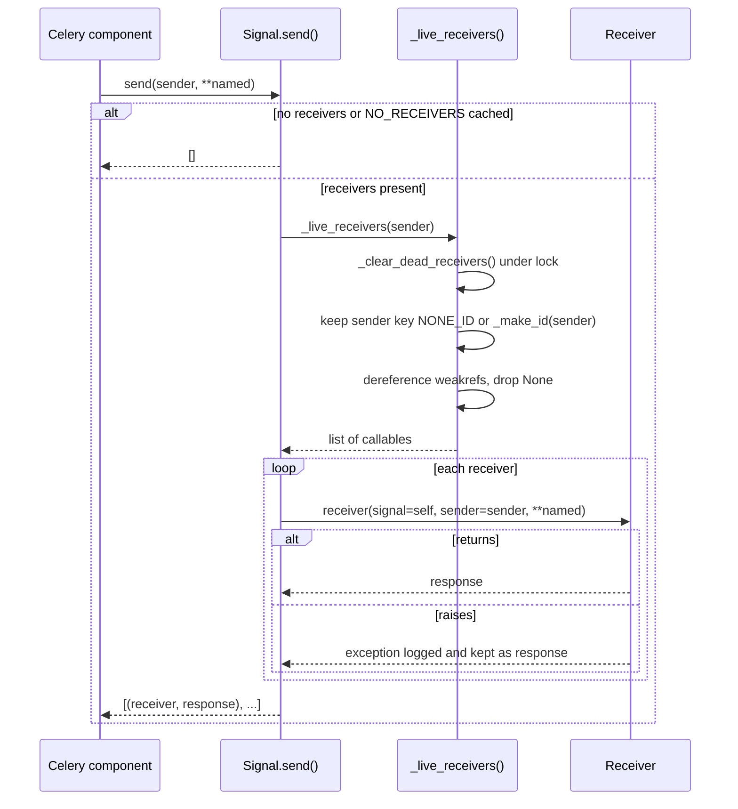

## Overview

Signals let code outside Celery react to things that happen inside it (a task message being published, a task starting or failing, a worker child process booting, logging being configured) without subclassing or patching the component that does the work. `celery.signals` defines one module-level `Signal` instance per event, and the component that owns the event calls `send()` on it at the right moment; any function connected to that signal is then called with keyword arguments describing the event.

Sources: [celery/signals.py:1-28](repo://celery/signals.py#L1-L28)

The dispatcher itself lives in `celery.utils.dispatch` and is an adaptation of Django's signal dispatcher: receivers are held by weak reference by default, can be limited to one sender, and can be de-duplicated with a `dispatch_uid`. Unlike Django, Celery's `send` already catches receiver exceptions, so `send_robust` is just an alias. Signals are how the Django fixup hooks database cleanup into task execution, how [[Logging]] can be replaced wholesale, and how the worker lifecycle described in [[Worker Architecture and Bootsteps]] exposes its milestones.

Sources: [celery/utils/dispatch/__init__.py:1-4](repo://celery/utils/dispatch/__init__.py#L1-L4), [celery/utils/dispatch/signal.py:256-290](repo://celery/utils/dispatch/signal.py#L256-L290)

## The Signal class

### Construction and receiver storage

`Signal.__init__` takes three optional arguments: `providing_args` (a set of argument names, kept only for documentation and `repr`), `use_caching`, and `name`. Every receiver lives in the `receivers` list as a `(lookup_key, receiver)` tuple, guarded by a `threading.Lock`. When `use_caching` is on, `sender_receivers_cache` is a `weakref.WeakKeyDictionary` that maps each sender to its resolved receivers; otherwise it is a plain dict that is only ever cleared. None of the built-in signals turn caching on.

Sources: [celery/utils/dispatch/signal.py:73-102](repo://celery/utils/dispatch/signal.py#L73-L102), [celery/utils/dispatch/signal.py:350-358](repo://celery/utils/dispatch/signal.py#L350-L358)

### Connecting receivers

`connect` works both as a direct call and as a decorator. If the first positional argument is callable, it is the receiver and is registered at once; otherwise the arguments (`sender`, `weak`, `dispatch_uid`, `retry`) are captured and a decorator is returned. Either way the real work happens in `_connect_signal`, which asserts the receiver is callable and raises `ValueError` if it cannot accept `**kwargs`, because `send` always passes `signal` and `sender` as keywords along with the event's own arguments.

Sources: [celery/utils/dispatch/signal.py:110-190](repo://celery/utils/dispatch/signal.py#L110-L190)

```python
        if args and callable(args[0]):
            return _handle_options(*args[1:], **kwargs)(args[0])
        return _handle_options(*args, **kwargs)

    def _connect_signal(self, receiver, sender, weak, dispatch_uid):
        assert callable(receiver), 'Signal receivers must be callable'
        if not fun_accepts_kwargs(receiver):
            raise ValueError(
                'Signal receiver must accept keyword arguments.')
```

Sources: [celery/utils/dispatch/signal.py:184-192](repo://celery/utils/dispatch/signal.py#L184-L192)

With `retry=True`, the receiver is wrapped in `_try_receiver_over_time`, which calls kombu's `retry_over_time` and logs `RECEIVER_RETRY_ERROR` before each wait, so a receiver that raises (a `ConnectionError`, for example) is retried until it succeeds. The wrapper is a fresh closure, so the original would be lost to a weak reference: `weak` is forced to `False`, and if no `dispatch_uid` was given the id of the original function becomes the uid and is stored on the wrapper as `_dispatch_uid`. That lets a later `disconnect(original_fun)` still find the wrapped entry (Issue #9119).

Sources: [celery/utils/dispatch/signal.py:144-180](repo://celery/utils/dispatch/signal.py#L144-L180), [celery/utils/dispatch/signal.py:54-61](repo://celery/utils/dispatch/signal.py#L54-L61)

If the sender is a `PromiseProxy` (a lazy object such as a task that has not been evaluated yet), connecting is deferred: `sender.__then__` schedules `_connect_proxy`, which connects again with the real object once the proxy is evaluated. See [[App State, Proxies and Lazy Objects]] for how those proxies resolve.

Sources: [celery/utils/dispatch/signal.py:104-108](repo://celery/utils/dispatch/signal.py#L104-L108), [celery/utils/dispatch/signal.py:194-198](repo://celery/utils/dispatch/signal.py#L194-L198)

### Lookup keys and sender filtering

Each registration is keyed by a `(receiver id, sender id)` pair built by `_make_lookup_key`. The receiver part is the `dispatch_uid` if given, then a retry wrapper's `_dispatch_uid`, then `_make_id(receiver)`. `_make_id` unwraps `Proxy` objects, returns strings and bytes as-is (so a task name used as sender compares by value, Issue #2475), and uses the `__func__` id for bound methods so that two bound-method objects of the same function produce the same key. `_connect_signal` appends the entry only if no existing entry has the same key, which makes repeated `connect` calls idempotent.

Sources: [celery/utils/dispatch/signal.py:21-29](repo://celery/utils/dispatch/signal.py#L21-L29), [celery/utils/dispatch/signal.py:54-64](repo://celery/utils/dispatch/signal.py#L54-L64), [celery/utils/dispatch/signal.py:200-216](repo://celery/utils/dispatch/signal.py#L200-L216)

At send time `_live_receivers(sender)` computes `_make_id(sender)` and keeps every receiver whose stored sender key is either `NONE_ID` (connected with `sender=None`, meaning "any sender") or equal to it. Because senders differ per signal (a task object, a task name string, a hostname, the consumer), the right value to filter on depends on the signal: the tables below list it.

Sources: [celery/utils/dispatch/signal.py:303-340](repo://celery/utils/dispatch/signal.py#L303-L340)

```python
from celery.signals import after_task_publish

@after_task_publish.connect(sender='tasks.add')
def on_add_published(sender=None, headers=None, body=None, **kwargs):
    print('published', headers['id'])
```

Sources: [celery/utils/dispatch/signal.py:144-187](repo://celery/utils/dispatch/signal.py#L144-L187), [celery/app/amqp.py:577-579](repo://celery/app/amqp.py#L577-L579)

### Weak references and dead receivers

With the default `weak=True`, `_connect_signal` stores a weak reference instead of the receiver. `_boundmethod_safe_weakref` picks `weakref.WeakMethod` for bound methods, since a bound-method object is usually garbage collected right away even while its instance lives, and `weakref.ref` for everything else. A `weakref.finalize` on the target object (the instance, for a bound method) calls `_remove_receiver` when it dies.

Sources: [celery/utils/dispatch/signal.py:32-51](repo://celery/utils/dispatch/signal.py#L32-L51), [celery/utils/dispatch/signal.py:202-205](repo://celery/utils/dispatch/signal.py#L202-L205)

`_remove_receiver` only sets `_dead_receivers = True`: it can run as a side effect of garbage collection while the lock is already held, so pruning there could deadlock. The actual cleanup is `_clear_dead_receivers`, called under the lock from `_connect_signal`, `disconnect` and `_live_receivers`, which rebuilds `receivers` without the dead weak references. `_live_receivers` also dereferences each weak reference and skips any that return `None`.

Sources: [celery/utils/dispatch/signal.py:292-301](repo://celery/utils/dispatch/signal.py#L292-L301), [celery/utils/dispatch/signal.py:331-350](repo://celery/utils/dispatch/signal.py#L331-L350)

> [!WARNING]
> A receiver defined inside a function (a closure or lambda) and connected with the default `weak=True` disappears as soon as the enclosing scope drops it. Connect such receivers with `weak=False`, or keep a strong reference to them.

Sources: [celery/utils/dispatch/signal.py:130-133](repo://celery/utils/dispatch/signal.py#L130-L133), [celery/utils/dispatch/signal.py:202-205](repo://celery/utils/dispatch/signal.py#L202-L205)

### Sending and receiver errors

`send(sender, **named)` returns early with an empty list when there are no receivers at all, or when the cache marks this sender with `NO_RECEIVERS`. Otherwise it calls each live receiver as `receiver(signal=self, sender=sender, **named)`. An exception raised by a receiver is logged with `logger.exception` and stored as that receiver's response; it never stops the other receivers or reaches the code that sent the signal. The return value is a list of `(receiver, response)` pairs.

Sources: [celery/utils/dispatch/signal.py:258-290](repo://celery/utils/dispatch/signal.py#L258-L290)

Callers that need receiver failures to be fatal check the responses themselves. `BaseLoader.import_default_modules` does this for `import_modules`: it raises any `Exception` found in the responses, because logging is not set up yet at that point and a swallowed error would be invisible. `has_listeners(sender)` reports whether any live receiver would get a given sender.

Sources: [celery/loaders/base.py:97-105](repo://celery/loaders/base.py#L97-L105), [celery/utils/dispatch/signal.py:255-256](repo://celery/utils/dispatch/signal.py#L255-L256)

### Disconnecting

`disconnect(receiver=None, sender=None, dispatch_uid=None)` builds the same lookup key as `connect`, removes the first matching entry under the lock, clears the per-sender cache and returns whether something was removed. So a receiver connected with a specific `sender` or `dispatch_uid` must be disconnected with the same values. Passing `weak` only raises a `CDeprecationWarning`.

Sources: [celery/utils/dispatch/signal.py:218-253](repo://celery/utils/dispatch/signal.py#L218-L253)

## Dispatch flow

The diagram follows one `send()` call from the sender through filtering and weak-reference resolution to the receivers.

Sources: [celery/utils/dispatch/signal.py:258-340](repo://celery/utils/dispatch/signal.py#L258-L340)



Sources: [celery/utils/dispatch/signal.py:258-340](repo://celery/utils/dispatch/signal.py#L258-L340)

## Built-in signals

### Task signals

These fire on the client while publishing and in the worker while receiving and executing a task. The execution-side ones are sent from the tracer described in [[Task Execution and Tracing]]; the publish-side ones from `AMQP.send_task_message`, covered in [[Calling Tasks and Message Protocol]].

Sources: [celery/signals.py:30-94](repo://celery/signals.py#L30-L94)

| Signal | Sender | Keyword arguments | Sent from |
| --- | --- | --- | --- |
| `before_task_publish` | task name (str) | `body`, `exchange`, `routing_key`, `declare`, `headers`, `properties`, `retry_policy` | `AMQP.send_task_message`, before `producer.publish`: [celery/app/amqp.py:558-564](repo://celery/app/amqp.py#L558-L564) |
| `after_task_publish` | task name (str) | `body`, `headers`, `exchange`, `routing_key` | `AMQP.send_task_message`, after publish: [celery/app/amqp.py:577-579](repo://celery/app/amqp.py#L577-L579) |
| `task_sent` (deprecated) | task name (str) | `task_id`, `task`, `args`, `kwargs`, `eta`, `taskset` | `AMQP.send_task_message`, protocol 1 and 2 forms: [celery/app/amqp.py:580-592](repo://celery/app/amqp.py#L580-L592) |
| `task_received` | consumer | `request` | `task_message_handler` in the default strategy, after the revoked check: [celery/worker/strategy.py:163-165](repo://celery/worker/strategy.py#L163-L165) |
| `task_prerun` | task | `task_id`, `task`, `args`, `kwargs` | `trace_task` in `build_tracer`, before the task body: [celery/app/trace.py:570-572](repo://celery/app/trace.py#L570-L572) |
| `task_success` | task | `result` | `trace_task`, after `on_success`: [celery/app/trace.py:635-638](repo://celery/app/trace.py#L635-L638) |
| `task_postrun` | task | `task_id`, `task`, `args`, `kwargs`, `retval`, `state` | `trace_task`, in the `finally` block so it runs for any outcome: [celery/app/trace.py:655-660](repo://celery/app/trace.py#L655-L660) |
| `task_retry` | task | `request`, `reason`, `einfo` | `TraceInfo.handle_retry`: [celery/app/trace.py:226-227](repo://celery/app/trace.py#L226-L227) |
| `task_failure` | task | `task_id`, `exception`, `args`, `kwargs`, `traceback`, `einfo` | `TraceInfo.handle_failure`: [celery/app/trace.py:267-271](repo://celery/app/trace.py#L267-L271)<br>`Request.on_timeout` (hard time limit): [celery/worker/request.py:564-572](repo://celery/worker/request.py#L564-L572)<br>`Request.on_failure` (`Reject` without requeue): [celery/worker/request.py:659-663](repo://celery/worker/request.py#L659-L663)<br>`Request.on_failure` (worker lost or failed return): [celery/worker/request.py:713-717](repo://celery/worker/request.py#L713-L717) |
| `task_internal_error` | task | `task_id`, `args`, `kwargs`, `request`, `exception`, `traceback`, `einfo` | `_signal_internal_error`, for errors outside the task body: [celery/app/trace.py:703-720](repo://celery/app/trace.py#L703-L720) |
| `task_revoked` | task | `request`, `terminated`, `signum`, `expired` | `Request._announce_revoked`: [celery/worker/request.py:457-468](repo://celery/worker/request.py#L457-L468) |
| `task_rejected` | consumer | `message`, `exc` | `Consumer.on_unknown_message` (`exc=None`): [celery/worker/consumer/consumer.py:672-675](repo://celery/worker/consumer/consumer.py#L672-L675)<br>`Consumer.on_invalid_task`: [celery/worker/consumer/consumer.py:710-714](repo://celery/worker/consumer/consumer.py#L710-L714) |
| `task_unknown` | consumer | `message`, `exc`, `name`, `id` | `Consumer.on_unknown_task`, after marking the result as `NotRegistered`: [celery/worker/consumer/consumer.py:677-708](repo://celery/worker/consumer/consumer.py#L677-L708) |

Sources: [celery/app/amqp.py:555-592](repo://celery/app/amqp.py#L555-L592), [celery/worker/strategy.py:163-165](repo://celery/worker/strategy.py#L163-L165), [celery/app/trace.py:220-271](repo://celery/app/trace.py#L220-L271), [celery/app/trace.py:566-660](repo://celery/app/trace.py#L566-L660), [celery/app/trace.py:703-720](repo://celery/app/trace.py#L703-L720), [celery/worker/request.py:457-468](repo://celery/worker/request.py#L457-L468), [celery/worker/request.py:555-570](repo://celery/worker/request.py#L555-L570), [celery/worker/request.py:650-717](repo://celery/worker/request.py#L650-L717), [celery/worker/consumer/consumer.py:672-714](repo://celery/worker/consumer/consumer.py#L672-L714)

> [!NOTE]
> `task_postrun` also receives `state`, which is not listed in its `providing_args`. Since `providing_args` is informational only, receivers should always accept `**kwargs` to stay compatible with arguments added later.

Sources: [celery/signals.py:50-53](repo://celery/signals.py#L50-L53), [celery/app/trace.py:657-659](repo://celery/app/trace.py#L657-L659)

### Worker signals

These mark the stages of a worker's life. The program-level `Worker` in `celery.apps.worker` sends the `celeryd_*` signals and `worker_ready`, the `WorkController` sends `worker_init` and `worker_shutdown`, and the pools send the per-process ones.

Sources: [celery/signals.py:96-115](repo://celery/signals.py#L96-L115)

| Signal | Sender | Keyword arguments | Sent from |
| --- | --- | --- | --- |
| `celeryd_init` | worker hostname (str) | `instance`, `conf`, `options` | `Worker.on_before_init`, the first thing a `celery worker` does: [celery/apps/worker.py:94-103](repo://celery/apps/worker.py#L94-L103) |
| `celeryd_after_setup` | worker hostname (str) | `instance`, `conf` | `Worker.on_start`, after queues from `-Q` are applied: [celery/apps/worker.py:128-136](repo://celery/apps/worker.py#L128-L136) |
| `import_modules` | app | none | `BaseLoader.import_default_modules`: [celery/loaders/base.py:97-98](repo://celery/loaders/base.py#L97-L98) |
| `worker_init` | `WorkController` | none | `WorkController.setup_instance`, before bootsteps are built: [celery/worker/worker.py:127](repo://celery/worker/worker.py#L127-L127) |
| `worker_before_create_process` | `AsynPool` | none | `AsynPool._create_worker_process`, in the parent before each fork: [celery/concurrency/asynpool.py:490-493](repo://celery/concurrency/asynpool.py#L490-L493) |
| `worker_process_init` | `None` | none | `process_initializer` in each prefork child: [celery/concurrency/prefork.py:80-82](repo://celery/concurrency/prefork.py#L80-L82)<br>`solo` `TaskPool.__init__`: [celery/concurrency/solo.py:16-20](repo://celery/concurrency/solo.py#L16-L20) |
| `worker_process_shutdown` | `None` | `pid`, `exitcode` | `process_destructor` for prefork children: [celery/concurrency/prefork.py:85-92](repo://celery/concurrency/prefork.py#L85-L92) |
| `worker_ready` | consumer | none | `Worker.on_consumer_ready`: [celery/apps/worker.py:180-181](repo://celery/apps/worker.py#L180-L181) |
| `worker_shutting_down` | worker hostname (str) | `sig`, `how`, `exitcode` | `_handle_request` from `_shutdown_handler`, in the MainProcess signal handler: [celery/apps/worker.py:301-312](repo://celery/apps/worker.py#L301-L312) |
| `worker_shutdown` | `WorkController` | none | `WorkController._send_worker_shutdown`, called by `stop`: [celery/worker/worker.py:198-199](repo://celery/worker/worker.py#L198-L199), [celery/worker/worker.py:244-252](repo://celery/worker/worker.py#L244-L252) |
| `heartbeat_sent` | `Heart` | none | `Heart._send`, before each `worker-heartbeat` event: [celery/worker/heartbeat.py:35-41](repo://celery/worker/heartbeat.py#L35-L41) |

Sources: [celery/apps/worker.py:94-136](repo://celery/apps/worker.py#L94-L136), [celery/apps/worker.py:180-181](repo://celery/apps/worker.py#L180-L181), [celery/apps/worker.py:288-312](repo://celery/apps/worker.py#L288-L312), [celery/loaders/base.py:97-105](repo://celery/loaders/base.py#L97-L105), [celery/worker/worker.py:120-127](repo://celery/worker/worker.py#L120-L127), [celery/worker/worker.py:198-252](repo://celery/worker/worker.py#L198-L252), [celery/concurrency/asynpool.py:490-493](repo://celery/concurrency/asynpool.py#L490-L493), [celery/concurrency/prefork.py:41-92](repo://celery/concurrency/prefork.py#L41-L92), [celery/concurrency/solo.py:11-20](repo://celery/concurrency/solo.py#L11-L20), [celery/worker/heartbeat.py:25-41](repo://celery/worker/heartbeat.py#L25-L41)

`worker_process_init` is the place to open per-process resources such as database connections, because it runs in the child after the fork and after `process_initializer` has rebuilt every task's tracer. The Django fixup connects to it, and to `task_prerun`, `task_postrun` and `beat_embedded_init`, for exactly this kind of connection housekeeping (see [[Django Integration]]).

Sources: [celery/concurrency/prefork.py:73-82](repo://celery/concurrency/prefork.py#L73-L82), [celery/fixups/django.py:156-163](repo://celery/fixups/django.py#L156-L163)

```python
    def install(self) -> "DjangoWorkerFixup":
        signals.beat_embedded_init.connect(self.close_database)
        signals.task_prerun.connect(self.on_task_prerun)
        signals.task_postrun.connect(self.on_task_postrun)
        signals.worker_process_init.connect(self.on_worker_process_init)
        self.close_database()
        self.close_cache()
        return self
```

Sources: [celery/fixups/django.py:156-163](repo://celery/fixups/django.py#L156-L163)

### Logging signals

All three are sent by `Logging` in `celery.app.log` with `sender=None`. `setup_logging` doubles as an override switch: if `send` returns any responses (that is, if any receiver is connected), `setup_logging_subsystem` skips configuring the root and multiprocessing loggers entirely, and `after_setup_logger` is never sent. See [[Logging]] for the rest of that setup.

Sources: [celery/signals.py:117-135](repo://celery/signals.py#L117-L135), [celery/app/log.py:87-131](repo://celery/app/log.py#L87-L131)

| Signal | Keyword arguments | Sent from |
| --- | --- | --- |
| `setup_logging` | `loglevel`, `logfile`, `format`, `colorize` | `Logging.setup_logging_subsystem`: [celery/app/log.py:98-101](repo://celery/app/log.py#L98-L101) |
| `after_setup_logger` | `logger`, `loglevel`, `logfile`, `format`, `colorize` | `Logging.setup_logging_subsystem`, only when no `setup_logging` receiver exists: [celery/app/log.py:103-128](repo://celery/app/log.py#L103-L128) |
| `after_setup_task_logger` | `logger`, `loglevel`, `logfile`, `format`, `colorize` | `Logging.setup_task_loggers`, after the `celery.task` logger gets its `TaskFormatter`: [celery/app/log.py:168-180](repo://celery/app/log.py#L168-L180) |

Sources: [celery/app/log.py:98-131](repo://celery/app/log.py#L98-L131), [celery/app/log.py:165-181](repo://celery/app/log.py#L165-L181)

### Beat, eventlet and command-line signals

The remaining module-level signals come from the beat service, the eventlet pool and the `celery` command line. None of them is filtered by a meaningful sender in practice, since each process has only one beat service or pool.

Sources: [celery/signals.py:137-154](repo://celery/signals.py#L137-L154)

| Signal | Sender | Keyword arguments | Sent from |
| --- | --- | --- | --- |
| `beat_init` | beat `Service` | none | `Service.start`: [celery/beat.py:638](repo://celery/beat.py#L638-L638) |
| `beat_embedded_init` | beat `Service` | none | `Service.start` when `embedded_process` is true (beat inside a worker with `-B`): [celery/beat.py:639-640](repo://celery/beat.py#L639-L640) |
| `eventlet_pool_started` | eventlet `TaskPool` | none | `TaskPool.on_start`: [celery/concurrency/eventlet.py:110-113](repo://celery/concurrency/eventlet.py#L110-L113) |
| `eventlet_pool_apply` | eventlet `TaskPool` | `target`, `args`, `kwargs` | `TaskPool.on_apply`, through `_quick_apply_sig` bound in `on_start`: [celery/concurrency/eventlet.py:115](repo://celery/concurrency/eventlet.py#L115-L115), [celery/concurrency/eventlet.py:123-126](repo://celery/concurrency/eventlet.py#L123-L126) |
| `eventlet_pool_preshutdown` | eventlet `TaskPool` | none | `TaskPool.on_stop`, before `waitall()`: [celery/concurrency/eventlet.py:117-118](repo://celery/concurrency/eventlet.py#L117-L118) |
| `eventlet_pool_postshutdown` | eventlet `TaskPool` | none | `TaskPool.on_stop`, after all greenthreads finish: [celery/concurrency/eventlet.py:119-121](repo://celery/concurrency/eventlet.py#L119-L121) |
| `user_preload_options` | the wrapped click command function | `app`, `options` | `handle_preload_options`, when the app defines preload options: [celery/bin/base.py:143-156](repo://celery/bin/base.py#L143-L156) |

Sources: [celery/beat.py:633-641](repo://celery/beat.py#L633-L641), [celery/concurrency/eventlet.py:110-133](repo://celery/concurrency/eventlet.py#L110-L133), [celery/bin/base.py:143-160](repo://celery/bin/base.py#L143-L160)

Beat itself is covered in [[Periodic Tasks with Beat]]; `beat_embedded_init` is how the Django fixup closes inherited database connections in an embedded beat process.

Sources: [celery/beat.py:633-641](repo://celery/beat.py#L633-L641), [celery/fixups/django.py:157](repo://celery/fixups/django.py#L157-L157)

### Application signals

Each `Celery` instance also creates four `Signal` objects of its own in `__init__`. They are attributes of the app, not of `celery.signals`, so a receiver only hears about that one app. `on_configure` is kept as a plain method if a subclass defined one, for compatibility with versions before 4.0.

Sources: [celery/app/base.py:418-427](repo://celery/app/base.py#L418-L427)

| Signal | Keyword arguments | Sent from |
| --- | --- | --- |
| `app.on_configure` | none | `Celery._load_config`, before the config source is loaded: [celery/app/base.py:1247-1252](repo://celery/app/base.py#L1247-L1252) |
| `app.on_after_configure` | `source` (the finished `conf`) | `Celery._load_config`, after defaults and pending periodic tasks are applied: [celery/app/base.py:1279](repo://celery/app/base.py#L1279-L1279) |
| `app.on_after_finalize` | none | `Celery.finalize`, after every task is bound to the app: [celery/app/base.py:672-677](repo://celery/app/base.py#L672-L677) |
| `app.on_after_fork` | none | `Celery._after_fork`, after the connection pool is dropped in the child: [celery/app/base.py:1282-1288](repo://celery/app/base.py#L1282-L1288) |

Sources: [celery/app/base.py:657-677](repo://celery/app/base.py#L657-L677), [celery/app/base.py:1247-1288](repo://celery/app/base.py#L1247-L1288)

## Sender-side optimisations

Hot paths avoid the cost of `send` when nobody is listening. `build_tracer` binds `signals.task_prerun.receivers`, `task_postrun.receivers` and `task_success.receivers` to locals and only calls the module-level `send_prerun`, `send_postrun` and `send_success` aliases when those lists are non-empty. `AMQP.send_task_message` does the same for `before_task_publish`, `after_task_publish` and the deprecated `task_sent`.

Sources: [celery/app/trace.py:104-106](repo://celery/app/trace.py#L104-L106), [celery/app/trace.py:410-412](repo://celery/app/trace.py#L410-L412), [celery/app/amqp.py:491-497](repo://celery/app/amqp.py#L491-L497)

These locals hold the `receivers` list object itself, so a receiver connected later is still seen as long as `connect` appends to that same list. `Heart` goes further: it decides once in `__init__` whether `heartbeat_sent` has any receivers and stores `None` instead of `send` if not.

Sources: [celery/utils/dispatch/signal.py:207-214](repo://celery/utils/dispatch/signal.py#L207-L214), [celery/worker/heartbeat.py:35-41](repo://celery/worker/heartbeat.py#L35-L41)

> [!TIP]
> Connect receivers at import time of a module the worker loads (for example the module that defines the app or the tasks), before the worker starts. `_clear_dead_receivers` replaces `receivers` with a new list, which detaches lists captured by a tracer that was already built, and a `heartbeat_sent` receiver connected after `Heart` is created is never called.

Sources: [celery/utils/dispatch/signal.py:292-301](repo://celery/utils/dispatch/signal.py#L292-L301), [celery/app/trace.py:410-412](repo://celery/app/trace.py#L410-L412), [celery/worker/heartbeat.py:35-37](repo://celery/worker/heartbeat.py#L35-L37)
