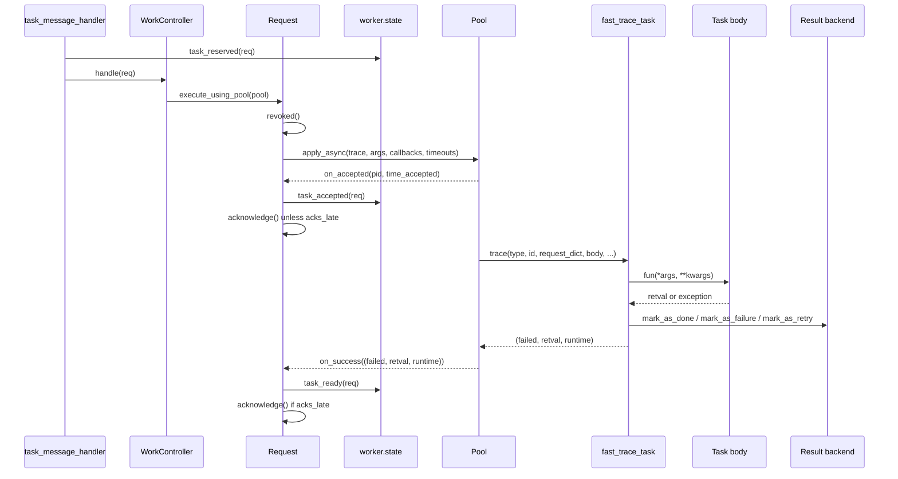
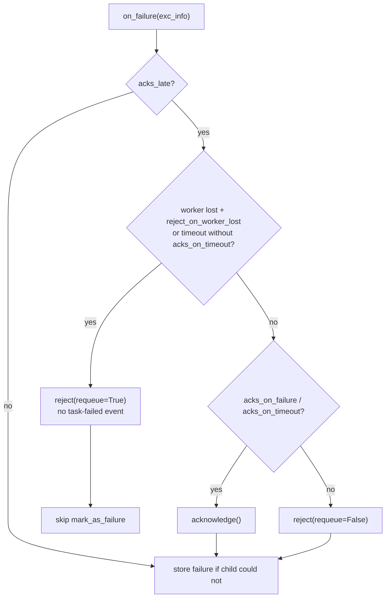

## Overview

Once the consumer has decoded a task message (see [[Consumer and Message Handling]]), the worker needs three things to run it safely: an object in the main process that owns the message and decides when to acknowledge it, a function running inside the pool that calls the task body and records its outcome, and process-wide bookkeeping of which tasks are reserved, active or revoked. Celery splits these across `celery.worker.request.Request`, the tracer built by `celery.app.trace.build_tracer`, and the module-level registries in `celery.worker.state`.

Sources: [celery/worker/request.py:67-131](repo://celery/worker/request.py#L67-L131), [celery/app/trace.py:344-370](repo://celery/app/trace.py#L344-L370), [celery/worker/state.py:1-25](repo://celery/worker/state.py#L1-L25)

The `Request` lives in the parent process and never runs user code itself: it hands a plain tuple of message fields to the pool (see [[Concurrency Pools and Autoscaling]]) and receives callbacks back. The tracer runs in the pool child, stores the result through the backend ([[Result Backends]]), fires the task signals ([[Signals]]) and returns a small tuple that tells the parent whether the task failed. States such as `STARTED`, `RETRY` and `REJECTED` are described in [[Task States and Exceptions]].

Sources: [celery/worker/request.py:341-372](repo://celery/worker/request.py#L341-L372), [celery/app/trace.py:757-788](repo://celery/app/trace.py#L757-L788)

## Execution lifecycle

The strategy registers the request as reserved, the worker calls `execute_using_pool`, the pool reports acceptance, the child runs `fast_trace_task` (or `trace_task_ret`), and the pool delivers the returned tuple to `Request.on_success`.

Sources: [celery/worker/strategy.py:190-209](repo://celery/worker/strategy.py#L190-L209), [celery/worker/worker.py:223-231](repo://celery/worker/worker.py#L223-L231)



Sources: [celery/worker/request.py:341-372](repo://celery/worker/request.py#L341-L372), [celery/worker/request.py:515-527](repo://celery/worker/request.py#L515-L527), [celery/worker/request.py:596-611](repo://celery/worker/request.py#L596-L611), [celery/app/trace.py:563-627](repo://celery/app/trace.py#L563-L627), [celery/app/trace.py:757-788](repo://celery/app/trace.py#L757-L788)

## The Request object

### Building a Request from a message

`Request.__init__` copies the message headers into `_request_dict`, keeps the raw body, and reads `id`, `task`, `shadow`, `root_id`, `parent_id`, `timelimit`, `argsrepr` and `kwargsrepr` from the headers. The task instance is looked up in `app.tasks` unless one is passed, and `ignore_result` from the headers overrides the task attribute when present. The class uses `__slots__` on CPython to keep the many in-flight requests small.

Sources: [celery/worker/request.py:80-131](repo://celery/worker/request.py#L80-L131)

`eta` and `expires` are parsed with `maybe_iso8601` and made timezone-aware; an unparsable value raises `InvalidTaskError`, so a malformed message is refused before it is ever queued. The constructor then flattens `delivery_info` (exchange, routing key, priority, redelivered) and the AMQP properties (`reply_to`, `correlation_id`) into `_request_dict`, and splits the decoded payload into `args` and `kwargs` by reference to avoid copying large arguments.

Sources: [celery/worker/request.py:133-175](repo://celery/worker/request.py#L133-L175)

### Per-task Request classes

The strategy does not use `Request` directly: `create_request_cls` builds a subclass per task that closes over the task's default time limits, `pool.apply_async`, `acks_late` and whether events are enabled. Its `execute_using_pool` and `on_success` are the same logic as the base class with those attribute lookups hoisted out of the hot path, and the trace function is chosen once from `app.use_fast_trace_task`.

Sources: [celery/worker/request.py:818-874](repo://celery/worker/request.py#L818-L874), [celery/worker/strategy.py:126-131](repo://celery/worker/strategy.py#L126-L131)

### Sending the request to the pool

`execute_using_pool` first calls `revoked()` and raises `TaskRevokedError` if the task must not run; `WorkController._process_task` catches that and releases the concurrency semaphore. Otherwise it calls `pool.apply_async` with the trace function and only serialisable arguments (task type, id, request dict, body, content type and encoding), wiring four callbacks back to the request. A weak reference to the pool's result is kept so `terminate` and `cancel` can reach the job later.

Sources: [celery/worker/request.py:341-372](repo://celery/worker/request.py#L341-L372), [celery/worker/worker.py:223-231](repo://celery/worker/worker.py#L223-L231)

```python
        result = pool.apply_async(
            trace,
            args=(self._type, task_id, self._request_dict, self._body,
                  self._content_type, self._content_encoding),
            accept_callback=self.on_accepted,
            timeout_callback=self.on_timeout,
            callback=self.on_success,
            error_callback=self.on_failure,
            soft_timeout=soft_time_limit or task.soft_time_limit,
            timeout=time_limit or task.time_limit,
            correlation_id=task_id,
        )
```

Sources: [celery/worker/request.py:358-369](repo://celery/worker/request.py#L358-L369)

### Time limits

The pair `time_limits` defaults to `(None, None)` and is replaced by the message's `timelimit` header, which holds the hard and soft limits set by the caller. Each missing value falls back to the task attribute, and the pool enforces both.

Sources: [celery/worker/request.py:73-73](repo://celery/worker/request.py#L73-L73), [celery/worker/request.py:117-119](repo://celery/worker/request.py#L117-L119), [celery/worker/request.py:356-367](repo://celery/worker/request.py#L356-L367)

| Limit | Source order | Pool argument | Effect when exceeded |
| --- | --- | --- | --- |
| Hard | `timelimit[0]` header, then `task.time_limit` | `timeout` | Child is killed; `on_timeout(soft=False)` marks `TimeLimitExceeded` as the result |
| Soft | `timelimit[1]` header, then `task.soft_time_limit` | `soft_timeout` | `SoftTimeLimitExceeded` is raised inside the task; `on_timeout(soft=True)` only logs a warning |

Sources: [celery/worker/request.py:356-367](repo://celery/worker/request.py#L356-L367), [celery/worker/request.py:529-545](repo://celery/worker/request.py#L529-L545)

### Executing inline

`Request.execute` runs the task in the current process through `trace_task` instead of a pool. It skips revoked tasks, acknowledges up front unless `acks_late` is set, merges the embedded `callbacks`/`chain`/`chord` options into the request dict, and afterwards rejects the message without requeue if the trace returned a `TraceInfo` (any non-success outcome) or acknowledges it otherwise.

Sources: [celery/worker/request.py:374-406](repo://celery/worker/request.py#L374-L406)

## Revocation and expiry

`revoked()` is the gate checked before a task is sent to the pool. It returns early if the request already announced its revocation, calls `maybe_expire` (which adds the id to `state.revoked` once `expires` has passed), checks the id against `state.revoked`, and finally compares the message's stamped headers with `state.revoked_stamps` so tasks can be revoked by stamp value rather than id.

Sources: [celery/worker/request.py:408-414](repo://celery/worker/request.py#L408-L414), [celery/worker/request.py:470-509](repo://celery/worker/request.py#L470-L509)

A positive check calls `_announce_revoked`, which calls `task_ready`, sends a `task-revoked` event, stores `REVOKED` through `backend.mark_as_revoked`, acknowledges the message so it is not redelivered, and fires the `task_revoked` signal. The revoke commands that fill these sets are covered in [[Remote Control and Inspection]].

Sources: [celery/worker/request.py:457-468](repo://celery/worker/request.py#L457-L468)

`terminate` and `cancel` act on a request that may already be running. If the job has started (`time_start` is set) they signal the child with `pool.terminate_job`. If not, `terminate` stores the pool and signal in `_terminate_on_ack`, and `on_accepted` replays the call as soon as the pool reports the job started. `cancel` is used when the connection is lost: `_announce_cancelled` sends `task-cancelled` and, by default, marks the task as `RETRY` and fires `task_retry` instead of revoking it.

Sources: [celery/worker/request.py:416-455](repo://celery/worker/request.py#L416-L455), [celery/worker/request.py:526-527](repo://celery/worker/request.py#L526-L527)

## Pool callbacks and acknowledgement

### on_accepted

The pool calls `on_accepted` when a child picks up the job. It records `worker_pid`, converts the monotonic acceptance time to wall-clock `time_start`, moves the request into the active set with `task_accepted`, acknowledges the message when `acks_late` is off, and sends `task-started`.

Sources: [celery/worker/request.py:515-527](repo://celery/worker/request.py#L515-L527)

### on_success

Every completed job, successful or not, comes back through `on_success` with the `(failed, retval, runtime)` tuple built by the tracer. A failed tuple is forwarded to `on_failure(retval, return_ok=True)`, since the child already stored the result; `SystemExit` and `KeyboardInterrupt` are re-raised in the parent. A successful one calls `task_ready(successful=True)`, acknowledges when `acks_late` is on, and sends `task-succeeded`.

Sources: [celery/worker/request.py:596-611](repo://celery/worker/request.py#L596-L611), [celery/app/trace.py:788-788](repo://celery/app/trace.py#L788-L788)

### on_failure

`on_failure` is reached two ways: from `on_success` for exceptions the tracer already handled, and as the pool's `error_callback` when the job itself died (worker lost, hard time limit, termination). It unwraps `ExceptionWithTraceback` and dispatches on the exception type.

Sources: [celery/worker/request.py:622-675](repo://celery/worker/request.py#L622-L675)

| Exception | Action in the parent |
| --- | --- |
| `Terminated` | Announce revoked (`terminated`) unless already cancelled or revoked |
| `MemoryError` | Re-raised as `MemoryError('Process got: ...')` |
| `Reject` | Without requeue: store `FAILURE`, send `task_failure` and `task-failed`; then `reject(requeue=exc.requeue)` |
| `Ignore` | `acknowledge()` |
| `Retry` | `on_retry`: acknowledge if `acks_late`, send `task-retried` |
| Anything else | acks_late handling (below), then store `FAILURE` if the child could not, send `task-failed`, log when `return_ok` is false |

Sources: [celery/worker/request.py:630-728](repo://celery/worker/request.py#L630-L728), [celery/worker/request.py:613-620](repo://celery/worker/request.py#L613-L620)

For `acks_late` tasks the generic branch chooses between requeue, acknowledge and drop. A `WorkerLostError` with `reject_on_worker_lost`, or a time limit with `acks_on_timeout` off, rejects with requeue and suppresses the `task-failed` event. Otherwise `acks_on_failure` (or `acks_on_timeout` for timeouts) decides between acknowledging and rejecting without requeue. The failure is stored in the parent only when the task was not requeued and either the worker was lost or the child never returned a result; during a cold shutdown (`state.should_terminate`) this storage and the event are skipped.

Sources: [celery/worker/request.py:677-717](repo://celery/worker/request.py#L677-L717)



Sources: [celery/worker/request.py:677-711](repo://celery/worker/request.py#L677-L711)

### on_timeout

A soft timeout only logs a warning, because the child raises `SoftTimeLimitExceeded` in the task. A hard timeout calls `task_ready` and, unless the worker is in cold shutdown, stores `TimeLimitExceeded` as the result and runs the same hooks as a normal failure: `task.on_failure`, a custom `after_return`, the `task_failure` signal and a `task-failed` event. Its traceback frames are then cleared to break reference cycles. An `acks_late` task is then acknowledged or requeued according to `acks_on_timeout`.

Sources: [celery/worker/request.py:529-594](repo://celery/worker/request.py#L529-L594)

### acknowledge and reject

Both are idempotent through the `acknowledged` flag, so the many code paths above can call them without double-acking. They delegate to the `on_ack` and `on_reject` callables supplied by the consumer, and `reject` also sends a `task-rejected` event.

Sources: [celery/worker/request.py:730-740](repo://celery/worker/request.py#L730-L740)

## The tracer

### Entry points in the pool child

The pool calls one of two module-level functions with the plain arguments from `execute_using_pool`. `trace_task_ret` resolves the current app, decodes the body with `loads_message` against `accept_content`, and calls `trace_task`. `fast_trace_task` skips all of that by reading the task registry, accepted content types and hostname from `_localized`, and calls the task's prebuilt `__trace__` directly. Both merge the embedded options into the request dict and return `(1, R, T)` when a `TraceInfo` was produced, otherwise `(0, Rstr, T)`.

Sources: [celery/app/trace.py:735-788](repo://celery/app/trace.py#L735-L788)

`setup_worker_optimizations` fills `_localized`, finalizes the app, makes it current and default for every thread, installs the `__call__` stack protection, and sets `app.use_fast_trace_task = True`. It runs in the worker and in each prefork child; when it has not run (a spawned rather than forked child), `fast_trace_task` raises a `RuntimeError` that suggests `--pool=solo` or `--pool=threads`.

Sources: [celery/app/trace.py:804-831](repo://celery/app/trace.py#L804-L831), [celery/app/trace.py:762-774](repo://celery/app/trace.py#L762-L774), [celery/concurrency/prefork.py:69-69](repo://celery/concurrency/prefork.py#L69-L69)

`trace_task(task, uuid, args, kwargs, request)` builds `task.__trace__` lazily on first use. Any exception that escapes the tracer, except `Reject`, sends `task_internal_error` and returns a `FAILURE` `TraceInfo` with the exception info from `report_internal_error`.

Sources: [celery/app/trace.py:689-700](repo://celery/app/trace.py#L689-L700), [celery/app/trace.py:791-801](repo://celery/app/trace.py#L791-L801)

### build_tracer

`build_tracer` does as much work as possible once per task so the per-call function has little to look up. It calls `task.run` directly unless the task overrides `__call__`, keeps references to `before_start`, `on_success` and `after_return` only when the task overrides them (`task_has_custom`), and caches the request and task stacks, the loader hooks, and the receiver lists of `task_prerun`, `task_postrun` and `task_success` so signals with no receivers cost nothing.

Sources: [celery/app/trace.py:377-415](repo://celery/app/trace.py#L377-L415), [celery/app/trace.py:131-134](repo://celery/app/trace.py#L131-L134)

It also decides whether redelivered tasks are deduplicated: only when `acks_late` is enabled (globally or on the task), `worker_deduplicate_successful_tasks` is set and the result backend is persistent.

Sources: [celery/app/trace.py:380-382](repo://celery/app/trace.py#L380-L382)

### The traced call

The inner `trace_task` validates that `kwargs` is a mapping, wraps the request dict in a `Context`, and works out `track_started` and `publish_result` from `ignore_result`, eager mode and `store_eager_result`. It then pushes the task and request onto their stacks, sends `task_prerun`, calls `loader.on_task_init`, and stores `STARTED` with the pid and hostname when `track_started` is on.

Sources: [celery/app/trace.py:487-507](repo://celery/app/trace.py#L487-L507), [celery/app/trace.py:563-578](repo://celery/app/trace.py#L563-L578)

The body runs inside a `try` whose `except` clauses map each outcome to a state:

Sources: [celery/app/trace.py:580-647](repo://celery/app/trace.py#L580-L647)

| Outcome | State | Handling |
| --- | --- | --- |
| Returns normally | `SUCCESS` | Dispatch link callbacks and the next chain step, then `backend.mark_as_done`; run custom `on_success`, send `task_success`, log `LOG_SUCCESS` |
| Raises `Reject` | `REJECTED` | `TraceInfo.handle_reject` logs it; the parent rejects the message |
| Raises `Ignore` | `IGNORED` | `TraceInfo.handle_ignore` logs it; nothing is stored |
| Raises `Retry` | `RETRY` | `on_error(..., RETRY, call_errbacks=False)` |
| Raises another `Exception` | `FAILURE` | `on_error` |
| Result fails to encode (`EncodeError`) | `FAILURE` | `on_error` after the callbacks were sent |
| Raises `BaseException` | none | Re-raised |

Sources: [celery/app/trace.py:580-632](repo://celery/app/trace.py#L580-L632)

Callbacks are sent before `mark_as_done` so that `result.children` is populated when the result is stored. `_dispatch_callbacks_and_chain` sends a single callback directly, groups multiple plain signatures into one `group`, applies group callbacks individually, and sends the last element of `chain` with the rest of the chain attached. Every message carries `parent_id`, `root_id` and, with `task_inherit_parent_priority`, the parent's priority.

Sources: [celery/app/trace.py:426-473](repo://celery/app/trace.py#L426-L473), [celery/app/trace.py:611-627](repo://celery/app/trace.py#L611-L627)

After the body, a custom `after_return` runs for every state except those in `IGNORE_STATES` (`IGNORED`, `RETRY`, `REJECTED`). The `finally` block always sends `task_postrun`, pops both stacks, and outside eager mode calls `backend.process_cleanup` and `loader.on_process_cleanup`, logging rather than raising cleanup errors.

Sources: [celery/app/trace.py:649-672](repo://celery/app/trace.py#L649-L672), [celery/app/trace.py:114-114](repo://celery/app/trace.py#L114-L114)

### Deduplicating redelivered tasks

When deduplication is enabled and the message is marked `redelivered`, the tracer first checks the in-process `successful_requests` set and then the backend state. A task already in `SUCCESS` is not run again: it logs `LOG_IGNORED`, and if the stored metadata has no `children` it re-dispatches the callbacks and chain using the stored return value. A failure to dispatch raises `Reject(requeue=True)` so the message is retried.

Sources: [celery/app/trace.py:508-561](repo://celery/app/trace.py#L508-L561)

> [!NOTE]
> Detecting already-dispatched callbacks relies on the `children` field, which the backend only keeps when it stores extended result metadata (`result_extended`).

Sources: [celery/app/trace.py:532-545](repo://celery/app/trace.py#L532-L545)

### Errors outside the task body

An exception raised by the tracer itself rather than the task (for example a failing backend while storing `STARTED`) is caught by the outermost handler. It sends `task_internal_error`, re-raises in eager mode, and otherwise returns the exception info from `report_internal_error`, which warns `Exception raised outside body` and marks the info `internal=True` so it is logged with the `INTERNAL ERROR` policy. `MemoryError` and `Reject` propagate unchanged.

Sources: [celery/app/trace.py:673-684](repo://celery/app/trace.py#L673-L684), [celery/app/trace.py:703-721](repo://celery/app/trace.py#L703-L721), [celery/app/trace.py:791-801](repo://celery/app/trace.py#L791-L801)

## TraceInfo and error handling

### handle_error_state

`TraceInfo` holds the resulting `state` and `retval` (the exception). `on_error` creates one and calls `handle_error_state`, which re-raises instead when the tracer was built with `propagate=True`. `handle_error_state` decides whether to store the error: tasks that ignore results store it only with `store_errors_even_if_ignored`, eager calls only with `store_eager_result`, and normal worker calls always. It then dispatches to `handle_retry` or `handle_failure`.

Sources: [celery/app/trace.py:179-204](repo://celery/app/trace.py#L179-L204), [celery/app/trace.py:417-424](repo://celery/app/trace.py#L417-L424)

`get_actual_ignore_result` lets the request override the task's `ignore_result`, and checks `Context.__dict__` so that the class-level default of `False` is not mistaken for an explicit override.

Sources: [celery/app/trace.py:157-176](repo://celery/app/trace.py#L157-L176)

### handle_retry and handle_failure

`handle_retry` treats the raised `Retry` as a marker whose `exc` attribute is the original error. It stores `RETRY` with that error, calls `task.on_retry`, sends `task_retry` and logs `LOG_RETRY`. The re-sent message was already published by `Task.retry` (see [[Defining Tasks]]).

Sources: [celery/app/trace.py:212-240](repo://celery/app/trace.py#L212-L240)

`handle_failure` converts the exception with `get_pickleable_exception` so only picklable data crosses back to the parent, builds an `ExceptionInfo`, and calls `backend.mark_as_failure` (which also runs errbacks unless `call_errbacks` is false), `task.on_failure` and the `task_failure` signal before logging. Both handlers call `traceback_clear` and drop local traceback references to release frame locals that would otherwise keep large objects alive.

Sources: [celery/app/trace.py:242-282](repo://celery/app/trace.py#L242-L282), [celery/app/trace.py:314-341](repo://celery/app/trace.py#L314-L341)

### Log policies

`_log_error` picks a `log_policy_t` with `get_log_policy`. Exceptions listed in the task's `throws` are logged as expected, at `INFO` and without a traceback.

Sources: [celery/app/trace.py:284-311](repo://celery/app/trace.py#L284-L311), [celery/app/trace.py:137-147](repo://celery/app/trace.py#L137-L147)

| Policy | Chosen when | Severity | Traceback |
| --- | --- | --- | --- |
| `log_policy_reject` | exception is `Reject` | `WARN` | yes |
| `log_policy_ignore` | exception is `Ignore` | `INFO` | no |
| `log_policy_internal` | `einfo.internal` is set | `CRITICAL` | yes |
| `log_policy_expected` | exception is in `task.throws` | `INFO` | no |
| `log_policy_unexpected` | any other exception | `ERROR` | yes |

Sources: [celery/app/trace.py:87-102](repo://celery/app/trace.py#L87-L102), [celery/app/trace.py:137-147](repo://celery/app/trace.py#L137-L147)

## Worker state

### Request registries

`celery.worker.state` holds module-level globals shared by the consumer, the request callbacks and the remote control commands. The `inspect reserved`, `inspect active` and `inspect revoked` commands read these registries (see [[Remote Control and Inspection]]).

Sources: [celery/worker/state.py:48-74](repo://celery/worker/state.py#L48-L74)

| Name | Type | Updated by |
| --- | --- | --- |
| `requests` | dict of id to `Request` | `task_reserved`, `task_accepted`; popped by `task_ready` |
| `reserved_requests` | `weakref.WeakSet` | `task_reserved`; discarded by `task_ready` |
| `active_requests` | `weakref.WeakSet` | `task_accepted`; discarded by `task_ready` |
| `successful_requests` | `LimitedSet` | `task_ready(successful=True)`; read by the deduplication check |
| `total_count`, `all_total_count` | `Counter`, one-item list | `task_accepted` |
| `revoked` | `LimitedSet` | revoke commands, `maybe_expire`; persisted by `Persistent` |
| `revoked_stamps` | dict | revoke-by-stamp commands |
| `should_stop`, `should_terminate` | flags | shutdown handling; read by `maybe_shutdown` and the request callbacks |

Sources: [celery/worker/state.py:48-129](repo://celery/worker/state.py#L48-L129)

The reserved and active sets are weak, so a request disappears from them once nothing else references it. `task_reserved` is called by the strategy for tasks that run right away; tasks with an ETA or a rate limit are reserved later, when they are released. `task_accepted` is called from `Request.on_accepted`, and `task_ready` from each terminal callback.

Sources: [celery/worker/state.py:96-129](repo://celery/worker/state.py#L96-L129), [celery/worker/strategy.py:190-209](repo://celery/worker/strategy.py#L190-L209), [celery/worker/consumer/consumer.py:329-331](repo://celery/worker/consumer/consumer.py#L329-L331), [celery/worker/consumer/consumer.py:659-663](repo://celery/worker/consumer/consumer.py#L659-L663)

### Size limits

The revoked and successful sets are bounded `LimitedSet`s whose sizes come from environment variables read at import time.

Sources: [celery/worker/state.py:34-46](repo://celery/worker/state.py#L34-L46)

| Environment variable | Default | Controls |
| --- | --- | --- |
| `CELERY_WORKER_REVOKES_MAX` | `50000` | Maximum entries in `revoked` |
| `CELERY_WORKER_REVOKE_EXPIRES` | `10800` seconds | Lifetime of a revoke once the maximum is exceeded |
| `CELERY_WORKER_SUCCESSFUL_MAX` | `1000` | Maximum entries in `successful_requests` |
| `CELERY_WORKER_SUCCESSFUL_EXPIRES` | `10800` seconds | Lifetime of a successful id once the maximum is exceeded |

Sources: [celery/worker/state.py:34-46](repo://celery/worker/state.py#L34-L46)

### Persistent state

With `celery worker --statedb`, the `StateDB` bootstep creates a `Persistent` object and registers `save` to run at exit. `Persistent` opens a `shelve` file, merges the stored revoked ids into `state.revoked` at start, and adjusts the app's logical clock. Only revoked ids and the clock are stored.

Sources: [celery/worker/components.py:208-218](repo://celery/worker/components.py#L208-L218), [celery/worker/state.py:192-237](repo://celery/worker/state.py#L192-L237)

`sync` purges expired revokes and writes protocol version 3: the `LimitedSet` pickled and `zlib`-compressed under `zrevoked`, plus the forwarded clock value. On load, `_merge_revoked` reads `zrevoked` first and falls back to the older `revoked` key, which may hold a `LimitedSet` (v2) or a plain iterable from before 3.0.18 (v1), then purges expired entries.

Sources: [celery/worker/state.py:239-283](repo://celery/worker/state.py#L239-L283)
