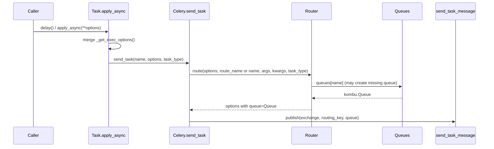
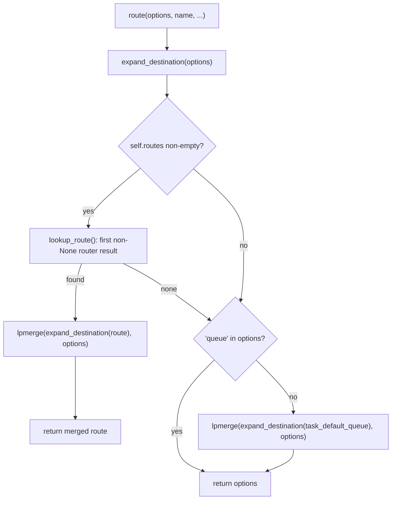

## Overview

Routing decides which broker queue, exchange and routing key a task message is published to. It runs on the client side, every time a task is sent: `Celery.send_task` hands the merged execution options to a `Router`, which consults the `task_routes` setting and resolves queue names into `kombu.Queue` declarations held by the `Queues` mapping. The same `Queues` mapping is what a worker consumes from, so producers and consumers agree on one table of declarations.

Sources: [celery/app/base.py:846-868](repo://celery/app/base.py#L846-L868), [celery/app/base.py:930-932](repo://celery/app/base.py#L930-L932), [celery/app/amqp.py:41-84](repo://celery/app/amqp.py#L41-L84)

The code lives in three places: `celery/app/routes.py` holds `MapRoute`, `Router`, `expand_router_string` and `prepare`; `celery/app/amqp.py` holds the `Queues` class and the `AMQP` factories (`app.amqp.Queues`, `app.amqp.Router`, `app.amqp.queues`, `app.amqp.router`) that build them from configuration; `celery/utils/quorum_queues.py` detects RabbitMQ quorum queues among the declared queues. How the routed options become a message is covered in [[Calling Tasks and Message Protocol]]; the countdown rewrite for quorum queues is covered in [[Delayed Delivery with Quorum Queues]].

Sources: [celery/app/routes.py:23-23](repo://celery/app/routes.py#L23-L23), [celery/app/amqp.py:21-21](repo://celery/app/amqp.py#L21-L21), [celery/utils/quorum_queues.py:1-20](repo://celery/utils/quorum_queues.py#L1-L20)

## Where routing happens

`Task.apply_async` first merges the task's own publishing attributes into the call options. `extract_exec_options` reads `queue`, `routing_key`, `exchange`, `priority` and the other publishing attributes from the task, and explicit call options override them. A plain `send_task("name")` call with a locally registered task does the same merge with the registry's task, keeping only non-`None` values.

Sources: [celery/app/task.py:31-36](repo://celery/app/task.py#L31-L36), [celery/app/task.py:675-676](repo://celery/app/task.py#L675-L676), [celery/app/base.py:885-909](repo://celery/app/base.py#L885-L909)

`send_task` then calls `router.route(options, route_name or name, args, kwargs, task_type)`. The router defaults to `app.amqp.router`, but a caller can pass `router=` explicitly. `route_name` lets a wrapper task route as if it were another task: `xmap`/`xstarmap` and `chunks` pass `route_name=task_name_from(...)` so the built-in map task is routed like the task it maps over.

Sources: [celery/app/base.py:867-867](repo://celery/app/base.py#L867-L867), [celery/app/base.py:931-932](repo://celery/app/base.py#L931-L932), [celery/canvas.py:1398-1406](repo://celery/canvas.py#L1398-L1406)



Sources: [celery/app/task.py:675-676](repo://celery/app/task.py#L675-L676), [celery/app/base.py:931-932](repo://celery/app/base.py#L931-L932), [celery/app/routes.py:66-96](repo://celery/app/routes.py#L66-L96), [celery/app/amqp.py:506-551](repo://celery/app/amqp.py#L506-L551)

## The Router

### Router.route step by step

`Router` is constructed with the prepared route list, the `Queues` mapping, the `create_missing` flag and the app. `route` works in three steps:

Sources: [celery/app/routes.py:59-64](repo://celery/app/routes.py#L59-L64)

1. `expand_destination(options)` turns a `queue` name already present in the caller's options into its `kombu.Queue`.
2. If any routes are configured, `lookup_route` asks each router in turn and takes the first non-`None` answer. The answer is expanded the same way and merged with `lpmerge(route, options)`.
3. If nothing set a `queue`, the router expands `app.conf.task_default_queue` and merges it under the options.

Sources: [celery/app/routes.py:66-76](repo://celery/app/routes.py#L66-L76)



Sources: [celery/app/routes.py:66-111](repo://celery/app/routes.py#L66-L111)

`lpmerge` keeps values from the left mapping when the right-hand value is `None`, and otherwise overwrites them. Since the route is on the left and the caller's options are on the right, any option the caller set explicitly (such as `routing_key` or `priority`) beats the route, while options left at `None` fall back to the route's values.

Sources: [celery/utils/collections.py:47-55](repo://celery/utils/collections.py#L47-L55), [celery/app/routes.py:71-72](repo://celery/app/routes.py#L71-L72)

### Expanding destinations

`expand_destination` accepts either a bare string, which is treated as a queue name ("convenient for direct exchanges"), or a dict whose `queue` key is popped. A `kombu.Queue` value is used as is. A string name is looked up in `self.queues`, and a `KeyError` is re-raised as `QueueNotFound('Queue ... missing from task_queues')`. A route dict without a `queue` key keeps its other keys, which is how a route can override only the `routing_key` or `exchange` for topic exchanges.

Sources: [celery/app/routes.py:78-96](repo://celery/app/routes.py#L78-L96), [celery/exceptions.py:218-219](repo://celery/exceptions.py#L218-L219)

> [!NOTE]
> `Router.create_missing` is stored but `route` never reads it. Whether an unknown queue name raises `QueueNotFound` or is created on the fly depends on `Queues.__missing__`, which `self.queues[queue]` triggers.

Sources: [celery/app/routes.py:59-64](repo://celery/app/routes.py#L59-L64), [celery/app/amqp.py:99-102](repo://celery/app/amqp.py#L99-L102)

### Querying individual routers

`query_router` evaluates lazy routers with `maybe_evaluate`, then supports two calling conventions. Objects with a `route_for_task` method (pre-4.0 router classes) are called as `route_for_task(task, args, kwargs)`. Everything else is called as `router(task, args, kwargs, options, task=task_type)`, so a router function receives the task name, its arguments, the current options and the task class (or `None` for unregistered names).

Sources: [celery/app/routes.py:98-111](repo://celery/app/routes.py#L98-L111)

## The task_routes setting

### Preparing routes

`prepare` normalizes `task_routes` into a list of callables. A single value is wrapped in a tuple first. Each item is then expanded by type:

Sources: [celery/app/routes.py:122-136](repo://celery/app/routes.py#L122-L136)

| `task_routes` item | Becomes | Notes |
| --- | --- | --- |
| `dict`, other `Mapping`, `list` or `tuple` | `MapRoute(route)` | Exact names, glob patterns and compiled regexes |
| `str` | `mlazy(expand_router_string, route)` | Imported lazily on first use |
| Anything else (function, router instance) | used unchanged | Called with `(name, args, kwargs, options, task=...)` |
| `None` | `()` | No routes: default queue applies |

Sources: [celery/app/routes.py:125-136](repo://celery/app/routes.py#L125-L136)

`expand_router_string` resolves a dotted path such as `"myapp.routers:route_task"` with `symbol_by_name`. If the resolved object has `route_for_task`, it is assumed to be an old-style router class and is instantiated.

Sources: [celery/app/routes.py:114-119](repo://celery/app/routes.py#L114-L119)

`AMQP.routes` caches the prepared list in `_rtable` and builds it on first access through `flush_routes`. `AMQP` binds `_handle_conf_update` to the configuration, so changing `task_routes` at runtime flushes the table and replaces `app.amqp.router` with a new `Router`.

Sources: [celery/app/amqp.py:263-263](repo://celery/app/amqp.py#L263-L263), [celery/app/amqp.py:314-315](repo://celery/app/amqp.py#L314-L315), [celery/app/amqp.py:621-633](repo://celery/app/amqp.py#L621-L633), [celery/app/amqp.py:659-663](repo://celery/app/amqp.py#L659-L663)

### MapRoute: exact, glob and regex keys

`MapRoute` sorts each key into one of two tables. A compiled `re.Pattern` goes into `patterns` as is. A string containing `*` is converted with `fnmatch.translate` and compiled, so `"feed.tasks.*"` matches any task under that prefix. Every other string is an exact name in `map`. `patterns` is an `OrderedDict`, so patterns are tried in the order they were declared.

Sources: [celery/app/routes.py:17-21](repo://celery/app/routes.py#L17-L21), [celery/app/routes.py:26-39](repo://celery/app/routes.py#L26-L39)

When called, `MapRoute` tries the exact map first, then each pattern. A value can be a dict of options, returned as a copy, or a plain queue name: `dict(value)` raises `ValueError` for a string, and the route then becomes `{'queue': value}`. A name that matches nothing returns `None`, which lets `Router.lookup_route` move on to the next router.

Sources: [celery/app/routes.py:41-53](repo://celery/app/routes.py#L41-L53)

## The Queues mapping

### Building Queues from configuration

`app.amqp.queues` is a cached `Queues` built from `task_queues` by the `AMQP.Queues` factory. The factory fills in every unset argument from configuration: `task_create_missing_queues`, `task_create_missing_queue_type`, `task_create_missing_queue_exchange_type`, `task_queue_max_priority`, and `task_default_routing_key`. When `task_queues` is empty, it declares a single queue named `task_default_queue` on the default exchange, with `x-queue-type: quorum` if `task_default_queue_type` is `'quorum'`.

Sources: [celery/app/amqp.py:272-305](repo://celery/app/amqp.py#L272-L305), [celery/app/amqp.py:612-619](repo://celery/app/amqp.py#L612-L619)

The default exchange is `Exchange(task_default_exchange, task_default_exchange_type)`. Both `task_default_exchange` and `task_default_routing_key` default to `None` in `defaults.py`, but the `Settings` properties fall back to `task_default_queue`. Out of the box, that gives a direct exchange named `celery`, bound with routing key `celery` to the `celery` queue.

Sources: [celery/app/amqp.py:644-647](repo://celery/app/amqp.py#L644-L647), [celery/app/utils.py:114-126](repo://celery/app/utils.py#L114-L126), [celery/app/defaults.py:283-287](repo://celery/app/defaults.py#L283-L287)

### Adding and normalizing queues

`Queues.__init__` accepts a list of `kombu.Queue` objects (keyed by `q.name`) or a dict. Dict values that are not `Queue` instances go through `add_compat(name, **options)`, which accepts the legacy `binding_key` spelling and falls back to the queue name as the routing key. Every queue passes through `_add`, which:

Sources: [celery/app/amqp.py:63-84](repo://celery/app/amqp.py#L63-L84), [celery/app/amqp.py:125-130](repo://celery/app/amqp.py#L125-L130)

- sets the default exchange when the queue has none or has the nameless exchange `''`
- sets `default_routing_key` when the queue has no routing key
- adds `x-max-priority` from `max_priority` unless the queue already declares one

Sources: [celery/app/amqp.py:132-146](repo://celery/app/amqp.py#L132-L146)

Lookups go through `aliases` first: a `WeakValueDictionary` populated by `__setitem__` for queues that declare an `alias`. `__setitem__` also assigns the default exchange to a queue stored without one.

Sources: [celery/app/amqp.py:86-97](repo://celery/app/amqp.py#L86-L97)

### Creating missing queues

`__missing__` runs for any unknown name. With `create_missing` enabled (the `task_create_missing_queues` default is `True`), it builds a queue with `new_missing(name)` and adds it. Otherwise it raises `KeyError`, which the router turns into `QueueNotFound`. `new_missing` declares a queue, exchange and routing key that all share the queue's name:

Sources: [celery/app/amqp.py:99-102](repo://celery/app/amqp.py#L99-L102), [celery/app/defaults.py:278-280](repo://celery/app/defaults.py#L278-L280)

```python
    def new_missing(self, name):
        queue_arguments = None
        if self.create_missing_queue_type and self.create_missing_queue_type != "classic":
            if self.create_missing_queue_type not in ("classic", "quorum"):
                raise ValueError(
                    f"Invalid queue type '{self.create_missing_queue_type}'. "
                    "Valid types are 'classic' and 'quorum'."
                )
            queue_arguments = {"x-queue-type": self.create_missing_queue_type}

        if self.create_missing_queue_exchange_type:
            exchange = Exchange(name, self.create_missing_queue_exchange_type)
        else:
            exchange = self.autoexchange(name)

        return Queue(name, exchange, name, queue_arguments=queue_arguments)
```

Sources: [celery/app/amqp.py:201-216](repo://celery/app/amqp.py#L201-L216)

`autoexchange` defaults to `kombu.Exchange`, which makes a direct exchange. `AMQP.autoexchange` can be overridden: the source comment suggests `lambda n: None` to publish through the AMQP default exchange straight to the named queue.

Sources: [celery/app/amqp.py:76-76](repo://celery/app/amqp.py#L76-L76), [celery/app/amqp.py:244-248](repo://celery/app/amqp.py#L244-L248)

> [!WARNING]
> Because `__missing__` creates queues on lookup, code that only wants to test membership must use `in`. The worker's `add_task_queue` does exactly that, with a comment referencing Issue #1079.

Sources: [celery/worker/consumer/consumer.py:632-650](repo://celery/worker/consumer/consumer.py#L632-L650)

### Selecting queues to consume

`Queues` also tracks which queues a worker consumes from. `_default_consume_from` snapshots all queues declared at construction. `select(include)`, driven by `celery worker -Q`, replaces that set with an explicit subset. `deselect(exclude)` removes names. `select_add` adds a queue that stays active even when `-Q` chose a subset. The `consume_from` property returns the active set. Any declared queue outside it is still available for routing, just not consumed by this worker.

Sources: [celery/app/amqp.py:59-61](repo://celery/app/amqp.py#L59-L61), [celery/app/amqp.py:159-222](repo://celery/app/amqp.py#L159-L222)

`WorkController.setup_queues` applies `-Q` and `-X` through `select`/`deselect`, turning a `KeyError` into `ImproperlyConfigured`. With `worker_direct` enabled, it calls `select_add(worker_direct(hostname))`, a queue named `<hostname>.dq2` bound to the `C.dq2` exchange with the hostname as routing key. `AMQP.TaskConsumer` then consumes from `queues.consume_from.values()`.

Sources: [celery/worker/worker.py:167-181](repo://celery/worker/worker.py#L167-L181), [celery/utils/nodenames.py:14-17](repo://celery/utils/nodenames.py#L14-L17), [celery/utils/nodenames.py:38-53](repo://celery/utils/nodenames.py#L38-L53), [celery/app/amqp.py:316-323](repo://celery/app/amqp.py#L316-L323)

## From routed options to exchange and routing key

`send_task_message` resolves the final destination from the routed options. If neither `queue` nor `exchange` is set, it uses `amqp.default_queue`. A string queue is looked up in `queues`, which may create it. The delivery mode and exchange type come from the queue's exchange when the caller did not set them.

Sources: [celery/app/amqp.py:521-541](repo://celery/app/amqp.py#L521-L541), [celery/app/amqp.py:608-610](repo://celery/app/amqp.py#L608-L610)

For a direct exchange with a missing exchange or routing key, the message is published to the anonymous exchange `''` with the queue name as routing key, so it lands in the queue no matter what bindings exist. In every other case with no explicit exchange, the queue's exchange name (or the default exchange) and the queue's routing key (or `task_default_routing_key`) are used. The resolved queue goes into `declare` (except `Broadcast` queues), so kombu declares it before publishing.

Sources: [celery/app/amqp.py:543-551](repo://celery/app/amqp.py#L543-L551)

The resolved `queue`, `exchange` and `routing_key` are also attached to the `task-sent` event when `task_send_sent_event` is enabled.

Sources: [celery/app/amqp.py:593-604](repo://celery/app/amqp.py#L593-L604)

## Quorum queue detection

`detect_quorum_queues(app, driver_type)` returns `(True, qname)` for the first queue in `app.amqp.queues` whose `queue_arguments` contain `x-queue-type: quorum`, and `(False, "")` otherwise. It only looks when `driver_type == 'amqp'`, so other transports always report no quorum queues.

Sources: [celery/utils/quorum_queues.py:4-20](repo://celery/utils/quorum_queues.py#L4-L20)

| Caller | Purpose |
| --- | --- |
| `Celery.send_task` | When `eta` or `countdown` is set and a quorum queue exists, rewrites the routing to the `celery_delayed_27` topic exchange for native delayed delivery (direct exchanges only log a warning) |
| `Tasks.qos_global` (worker consumer) | When `worker_detect_quorum_queues` is on and a quorum queue exists, disables global QoS because quorum queues do not support it |
| `DelayedDelivery` bootstep | Decides whether the native delayed delivery step should start |

Sources: [celery/app/base.py:934-966](repo://celery/app/base.py#L934-L966), [celery/worker/consumer/tasks.py:103-124](repo://celery/worker/consumer/tasks.py#L103-L124), [celery/worker/consumer/delayed_delivery.py:64-64](repo://celery/worker/consumer/delayed_delivery.py#L64-L64)

Queues become quorum queues in three ways: `task_default_queue_type = "quorum"` for the generated default queue, `task_create_missing_queue_type = "quorum"` for auto-created queues, or an explicit `queue_arguments={"x-queue-type": "quorum"}` on a declared `Queue`, as in the bundled example:

Sources: [celery/app/amqp.py:286-293](repo://celery/app/amqp.py#L286-L293), [celery/app/amqp.py:201-209](repo://celery/app/amqp.py#L201-L209)

```python
my_quorum_queue = Queue(
    "my-quorum-queue",
    Exchange("default"),
    routing_key="default",
    queue_arguments={"x-queue-type": "quorum"},
)
```

Sources: [examples/quorum-queues/declare_queue.py:5-10](repo://examples/quorum-queues/declare_queue.py#L5-L10)

## Configuration

| Setting | Default | Effect |
| --- | --- | --- |
| `task_routes` | `None` | Router list passed to `prepare`: dicts, dotted paths or callables |
| `task_queues` | `None` | Declared queues; when empty, a single `task_default_queue` is generated |
| `task_default_queue` | `'celery'` | Queue used when no route or option sets `queue` |
| `task_default_queue_type` | `'classic'` | `'quorum'` adds `x-queue-type: quorum` to the generated default queue |
| `task_default_exchange` | `None` (falls back to `task_default_queue`) | Name of the default exchange |
| `task_default_exchange_type` | `'direct'` | Type of the default exchange |
| `task_default_routing_key` | `None` (falls back to `task_default_queue`) | Routing key for queues without one, and the publish fallback |
| `task_create_missing_queues` | `True` | Lets `Queues.__missing__` declare unknown queues instead of raising |
| `task_create_missing_queue_type` | `'classic'` | `'classic'` or `'quorum'` for auto-created queues; other values raise `ValueError` |
| `task_create_missing_queue_exchange_type` | `None` | Exchange type for auto-created queues; `None` uses `autoexchange` (direct) |
| `task_queue_max_priority` | `None` | Default `x-max-priority` added to every queue |
| `task_default_delivery_mode` | `2` | Delivery mode when the queue's exchange does not set one |
| `worker_direct` | `False` | Each worker also consumes from `<hostname>.dq2` |
| `worker_detect_quorum_queues` | `True` | Lets the worker disable global QoS when quorum queues are present |

Sources: [celery/app/defaults.py:278-287](repo://celery/app/defaults.py#L278-L287), [celery/app/defaults.py:306-310](repo://celery/app/defaults.py#L306-L310), [celery/app/defaults.py:336-336](repo://celery/app/defaults.py#L336-L336), [celery/app/defaults.py:373-373](repo://celery/app/defaults.py#L373-L373), [celery/app/utils.py:114-126](repo://celery/app/utils.py#L114-L126)

See [[Configuration]] for how these settings are loaded and [[Worker Architecture and Bootsteps]] for the worker side of queue consumption.

Sources: [celery/app/amqp.py:272-305](repo://celery/app/amqp.py#L272-L305)
