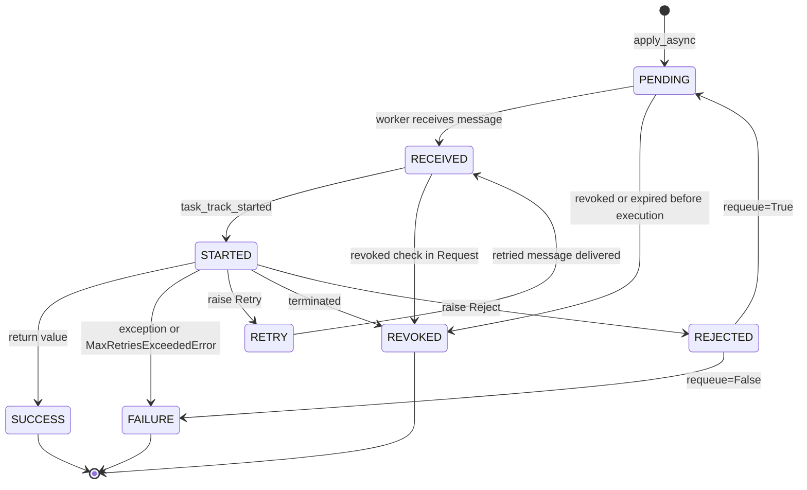
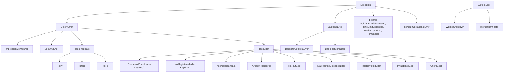

## Overview

Every stored task result has a `status` string, and every abnormal outcome of a task is an exception type. `celery/states.py` defines the built-in state names, the sets used to decide whether a result is final or should re-raise, and a precedence order used to merge out-of-order updates. `celery/exceptions.py` defines the error hierarchy, including the "semi-predicate" exceptions (`Retry`, `Ignore`, `Reject`) that a task raises to steer the worker rather than to report a bug.

Sources: [celery/states.py:55-74](repo://celery/states.py#L55-L74), [celery/exceptions.py:1-52](repo://celery/exceptions.py#L1-L52)

The tracer in [[Task Execution and Tracing]] maps each exception to a state and writes it through the result backend ([[Result Backends]]). Callers then read the state back through [[Task Results]], where `ready()`, `get()` and `maybe_throw()` test it against the sets defined here.

Sources: [celery/app/trace.py:107-114](repo://celery/app/trace.py#L107-L114), [celery/result.py:369-397](repo://celery/result.py#L369-L397)

## State constants

States are plain strings, so any backend can store them and any client can compare them without importing Celery.

Sources: [celery/states.py:126-142](repo://celery/states.py#L126-L142)

| State | Meaning | Where it is produced |
| --- | --- | --- |
| `PENDING` | Unknown, assumed waiting | Default answer for an id the backend has no record of; `sent` events |
| `RECEIVED` | A worker received the message | Only in events (`task-received`) |
| `STARTED` | Execution began | Stored by the tracer only when `task_track_started` (or `Task.track_started`) is on and the result is not ignored |
| `SUCCESS` | Returned normally | `backend.mark_as_done` after callbacks are dispatched |
| `FAILURE` | Raised an exception or exceeded retries | `TraceInfo.handle_failure`, and `Request.on_failure` / `on_timeout` in the worker |
| `RETRY` | Waiting to be retried | `TraceInfo.handle_retry` via `mark_as_retry` |
| `REVOKED` | Revoked or expired before or during execution | `Request._announce_revoked` via `mark_as_revoked` |
| `REJECTED` | Message rejected | Only in events (`task-rejected`); the tracer uses it internally |
| `IGNORED` | Task raised `Ignore` | Internal to the tracer; never stored |

Sources: [celery/states.py:126-142](repo://celery/states.py#L126-L142), [celery/backends/base.py:1148-1153](repo://celery/backends/base.py#L1148-L1153), [celery/app/trace.py:501-501](repo://celery/app/trace.py#L501-L501), [celery/app/trace.py:574-627](repo://celery/app/trace.py#L574-L627), [celery/backends/base.py:306-323](repo://celery/backends/base.py#L306-L323), [celery/events/state.py:67-76](repo://celery/events/state.py#L67-L76)

## State sets

| Set | Members | Used for |
| --- | --- | --- |
| `READY_STATES` | `SUCCESS`, `FAILURE`, `REVOKED` | `AsyncResult.ready()`, caching metadata, polling loops, setting `date_done` |
| `UNREADY_STATES` | `PENDING`, `RECEIVED`, `STARTED`, `REJECTED`, `RETRY` | Backends that must not let an unready update overwrite a ready one |
| `EXCEPTION_STATES` | `RETRY`, `FAILURE`, `REVOKED` | States whose `result` is an exception to be deserialized |
| `PROPAGATE_STATES` | `FAILURE`, `REVOKED` | States that `get()` re-raises when `propagate=True` |
| `ALL_STATES` | `PENDING`, `RECEIVED`, `STARTED`, `SUCCESS`, `FAILURE`, `RETRY`, `REVOKED` | Enumeration of the documented states |

Sources: [celery/states.py:144-151](repo://celery/states.py#L144-L151), [celery/result.py:369-397](repo://celery/result.py#L369-L397), [celery/result.py:461-468](repo://celery/result.py#L461-L468), [celery/backends/base.py:581-589](repo://celery/backends/base.py#L581-L589), [celery/backends/elasticsearch.py:195-195](repo://celery/backends/elasticsearch.py#L195-L195)

`RETRY` is an exception state but not a ready state: the stored result holds the exception that caused the retry, yet `get()` keeps waiting because the task will run again under the same id. `ALL_STATES` omits `REJECTED` and `IGNORED`, which never reach a backend as final states.

Sources: [celery/states.py:144-151](repo://celery/states.py#L144-L151), [celery/backends/base.py:315-323](repo://celery/backends/base.py#L315-L323)

## Lifecycle



Sources: [celery/app/trace.py:574-607](repo://celery/app/trace.py#L574-L607), [celery/worker/request.py:456-506](repo://celery/worker/request.py#L456-L506), [celery/worker/request.py:622-671](repo://celery/worker/request.py#L622-L671), [celery/app/task.py:841-866](repo://celery/app/task.py#L841-L866)

`STARTED` is optional: without `task_track_started` (default `False`) a result goes straight from `PENDING` to a final state, because the tracer only writes `STARTED` when `track_started` is computed true for a non-eager run with stored results. `RECEIVED` and `REJECTED` appear only in the event stream and `celery.events.state` ([[Events and Monitoring]]); no backend write produces them.

Sources: [celery/app/trace.py:501-501](repo://celery/app/trace.py#L501-L501), [celery/app/trace.py:574-578](repo://celery/app/trace.py#L574-L578), [celery/app/defaults.py:322-322](repo://celery/app/defaults.py#L322-L322)

## Precedence and comparison

`PRECEDENCE` lists states from most to least final. `precedence(state)` returns the list index, and any state not in the list (a custom state) gets the index of the `None` slot, between `FAILURE` and `REVOKED`.

Sources: [celery/states.py:61-89](repo://celery/states.py#L61-L89)

```python
PRECEDENCE = [
    'SUCCESS',
    'FAILURE',
    None,
    'REVOKED',
    'STARTED',
    'RECEIVED',
    'REJECTED',
    'RETRY',
    'PENDING',
]
```

Sources: [celery/states.py:64-74](repo://celery/states.py#L64-L74)

The `state` class subclasses `str` and inverts the index in its comparison methods, so "greater" means "more final". `state(PENDING) < state(SUCCESS)` is `True`, and a custom `state('PROGRESS')` is greater than `STARTED` but less than `SUCCESS` and `FAILURE`. Only `__gt__`, `__ge__`, `__lt__` and `__le__` are overridden; equality stays plain string equality.

Sources: [celery/states.py:92-123](repo://celery/states.py#L92-L123)

The main consumer of precedence is `celery.events.state.Task.event`. Events can arrive out of order, so when an incoming state has a higher index (it logically happened before the current one) the task keeps its current state and merges only the fields listed in `merge_rules`. `RETRY` is exempt from this check, because a retried task legitimately moves "backwards".

Sources: [celery/events/state.py:305-332](repo://celery/events/state.py#L305-L332)

Key/value backends protect `SUCCESS` separately: `KeyValueStoreBackend._store_result` reads the current meta and returns without writing if it is already `SUCCESS`. This stops a duplicate delivery (from a lost worker or a network partition) from overwriting a finished result.

Sources: [celery/backends/base.py:1122-1138](repo://celery/backends/base.py#L1122-L1138)

## Custom states

`Task.update_state(task_id=None, state=None, meta=None)` calls `backend.store_result` with any state string, defaulting to the current request's id. This is how tasks report progress states such as `PROGRESS`. Such states fall in the `None` precedence slot and are not in `READY_STATES`, so `ready()` stays `False` and `get()` keeps waiting until a built-in final state is stored.

Sources: [celery/app/task.py:1121-1133](repo://celery/app/task.py#L1121-L1133), [celery/states.py:76-89](repo://celery/states.py#L76-L89)

## Exception hierarchy



Sources: [celery/exceptions.py:137-212](repo://celery/exceptions.py#L137-L212), [celery/exceptions.py:213-305](repo://celery/exceptions.py#L213-L305), [celery/exceptions.py:54-58](repo://celery/exceptions.py#L54-L58)

> [!NOTE]
> The module docstring lists `BackendError` under `CeleryError`, but the class is declared as `class BackendError(Exception)`. An `except CeleryError` clause does not catch backend errors.

Sources: [celery/exceptions.py:24-26](repo://celery/exceptions.py#L24-L26), [celery/exceptions.py:282-283](repo://celery/exceptions.py#L282-L283)

The time-limit and worker-loss exceptions are re-exported from `billiard.exceptions`, and `OperationalError` from `kombu.exceptions`, so code can import every error it may see from `celery.exceptions`. `reraise(tp, value, tb)` re-raises `value` with the given traceback, attaching it only when it differs from the current one.

Sources: [celery/exceptions.py:54-58](repo://celery/exceptions.py#L54-L58), [celery/exceptions.py:106-110](repo://celery/exceptions.py#L106-L110)

## Task predicates

### Retry

`Retry` carries `message`, `exc` (the original error, run through `get_pickleable_exception`), `when` (a countdown number or an ETA datetime), `is_eager`, and `sig` (the signature that will re-run the task). If `exc` is a string it is kept only as text in `excs`. `__str__` renders "Retry in 5s: ..." or "Retry at" followed by the ETA, and `__reduce__` pickles only `message`, `exc` and `when`. `RetryTaskError` remains as a compatibility alias.

Sources: [celery/exceptions.py:145-187](repo://celery/exceptions.py#L145-L187)

`Task.retry()` builds the next attempt and then raises `Retry`, in the steps below.

Sources: [celery/app/task.py:756-760](repo://celery/app/task.py#L756-L760)

1. If the task was called directly (not by a worker or `apply`), it re-raises `exc`, or a plain `Retry`, through `raise_with_context`.
2. It builds the retry signature with `retries + 1` and the countdown (default `default_retry_delay`) or ETA.
3. If `retries` would exceed `max_retries`, it re-raises `exc` when given, otherwise raises `MaxRetriesExceededError` carrying `task_args` and `task_kwargs`.
4. For eager runs it raises (or returns, with `throw=False`) the `Retry` without sending anything.
5. Otherwise it calls `S.apply_async()`. If publishing fails it raises `Reject(exc, requeue=False)`; on success it raises `Retry`.

Sources: [celery/app/task.py:818-866](repo://celery/app/task.py#L818-L866), [celery/exceptions.py:242-248](repo://celery/exceptions.py#L242-L248)

In the tracer, `except Retry` routes to `on_error(..., RETRY, call_errbacks=False)`, and `TraceInfo.handle_retry` stores `reason.exc` with `mark_as_retry`, calls `task.on_retry`, and sends the `task_retry` signal. Errbacks do not run, because the task is not finished. In the worker, `Request.on_failure` hands a `Retry` to `on_retry` instead of marking failure.

Sources: [celery/app/trace.py:599-603](repo://celery/app/trace.py#L599-L603), [celery/app/trace.py:212-240](repo://celery/app/trace.py#L212-L240), [celery/worker/request.py:672-675](repo://celery/worker/request.py#L672-L675)

### Ignore

Raising `Ignore` tells the tracer to record nothing: the state becomes the internal `IGNORED`, `handle_ignore` only logs, and because `IGNORED` is in `IGNORE_STATES`, `after_return` is skipped. The worker then simply acknowledges the message. Tasks use this after storing a state themselves, or when `Task.replace` has handed the work to another signature.

Sources: [celery/exceptions.py:190-191](repo://celery/exceptions.py#L190-L191), [celery/app/trace.py:593-597](repo://celery/app/trace.py#L593-L597), [celery/app/trace.py:650-654](repo://celery/app/trace.py#L650-L654), [celery/worker/request.py:672-673](repo://celery/worker/request.py#L672-L673), [celery/app/task.py:1222-1227](repo://celery/app/task.py#L1222-L1227)

### Reject

`Reject(reason=None, requeue=False)` asks the worker to reject the message at the broker. The tracer records the internal `REJECTED` state and logs it. `Request.on_failure` then calls `self.reject(requeue=exc.requeue)`. With `requeue=False` the message will never run again, so the worker first stores `FAILURE`, sends `task_failure` and emits `task-failed`; otherwise the result would stay `PENDING` forever.

Sources: [celery/exceptions.py:194-203](repo://celery/exceptions.py#L194-L203), [celery/app/trace.py:587-592](repo://celery/app/trace.py#L587-L592), [celery/worker/request.py:649-671](repo://celery/worker/request.py#L649-L671)

> [!WARNING]
> `Reject(requeue=True)` on a task that always fails produces an endless redelivery loop. Pair it with a dead-letter configuration on the broker, or give up after a bounded number of attempts.

Sources: [celery/worker/request.py:649-671](repo://celery/worker/request.py#L649-L671)

## Time limits and lost workers

`SoftTimeLimitExceeded` is raised inside the task by the pool when the soft limit expires, so the task can catch it and clean up. In the parent process, `Request.on_timeout(soft=True)` only logs a warning. On the hard limit the pool kills the child, and `on_timeout(soft=False)` builds a `TimeLimitExceeded(timeout)`. It stores it as `FAILURE`, runs `on_failure`, `after_return` (if overridden), the `task_failure` signal and the `task-failed` event, and with `acks_late` either acknowledges (`acks_on_timeout`) or requeues.

Sources: [celery/worker/request.py:529-594](repo://celery/worker/request.py#L529-L594)

`Request.on_failure` decides between acknowledging, rejecting and storing a failure from the exception type, as the table shows.

Sources: [celery/worker/request.py:622-630](repo://celery/worker/request.py#L622-L630)

| Exception | Outcome |
| --- | --- |
| `Terminated` | Announced as `REVOKED` (`'terminated'`) unless already cancelled or revoked |
| `MemoryError` | Re-raised in the worker |
| `Reject` | Rejected, with `FAILURE` stored when `requeue=False` |
| `Ignore` | Acknowledged |
| `Retry` | `on_retry` |
| `WorkerLostError` with `acks_late` and `reject_on_worker_lost` | Requeued, no failure stored |
| `TimeLimitExceeded` with `acks_late` and not `acks_on_timeout` | Requeued, no failure stored |
| other, with `acks_late` | Acknowledged if `acks_on_failure`, else rejected without requeue |
| any not requeued | `FAILURE` stored and `task_failure` sent when the process died (`WorkerLostError`) or the result was not already written (`return_ok` false) |

Sources: [celery/worker/request.py:622-712](repo://celery/worker/request.py#L622-L712)

## Other task errors

| Exception | Raised when |
| --- | --- |
| `QueueNotFound` | A route names a queue by string and the router cannot find it in `task_queues` |
| `NotRegistered` | Looking up an unknown task name in the registry; its `repr` asks you to import the task module |
| `InvalidTaskError` | A message has an unparsable `eta` or `expires`, or is otherwise malformed |
| `TaskRevokedError` | `Request.execute_using_pool` sees a revoked task; also the stored result of a revoked task |
| `ChordError` | A chord header member failed; the body's errbacks receive it, with the original error as `__cause__` |
| `TimeoutError` | `AsyncResult.get()` / `ResultSet.join()` exceed their `timeout` |
| `IncompleteStream` | `AsyncResult.collect()` reaches an unfinished node |
| `MaxRetriesExceededError` | `Task.retry()` beyond `max_retries` without an `exc` to re-raise |

Sources: [celery/app/routes.py:90-97](repo://celery/app/routes.py#L90-L97), [celery/app/registry.py:15-18](repo://celery/app/registry.py#L15-L18), [celery/exceptions.py:226-230](repo://celery/exceptions.py#L226-L230), [celery/worker/request.py:134-155](repo://celery/worker/request.py#L134-L155), [celery/worker/request.py:340-354](repo://celery/worker/request.py#L340-L354), [celery/backends/base.py:306-313](repo://celery/backends/base.py#L306-L313), [celery/backends/base.py:68-77](repo://celery/backends/base.py#L68-L77), [celery/result.py:337-349](repo://celery/result.py#L337-L349), [celery/backends/base.py:918-944](repo://celery/backends/base.py#L918-L944)

## Backend errors

`BackendGetMetaError` and `BackendStoreError` are the fallback errors that `Backend._ensure_retryable` raises when a read or write keeps failing. They keep `task_id` (and `state` for stores) as attributes and append them to their `repr`. `KeyValueStoreBackend._store_result` re-raises a store failure as `BackendStoreError(str(ex), state=state, task_id=task_id)` so the failing write can be identified.

Sources: [celery/exceptions.py:282-304](repo://celery/exceptions.py#L282-L304), [celery/backends/base.py:746-768](repo://celery/backends/base.py#L746-L768), [celery/backends/base.py:1133-1136](repo://celery/backends/base.py#L1133-L1136)

## Worker shutdown and warnings

`WorkerShutdown` (warm) and `WorkerTerminate` (cold) subclass `SystemExit`, so a broad `except Exception` in task or consumer code does not swallow them. `celery.worker.state.maybe_shutdown()` raises them when the `should_stop` / `should_terminate` flags are set, and the remote `shutdown` command raises `WorkerShutdown`. `WorkController.start` catches `WorkerTerminate` to terminate, and treats any other `SystemExit` as a stop with its exit code. `SystemTerminate` is a compatibility alias.

Sources: [celery/exceptions.py:271-279](repo://celery/exceptions.py#L271-L279), [celery/worker/state.py:88-93](repo://celery/worker/state.py#L88-L93), [celery/worker/control.py:592-596](repo://celery/worker/control.py#L592-L596), [celery/worker/worker.py:201-212](repo://celery/worker/worker.py#L201-L212)

Warnings derive from `CeleryWarning(UserWarning)`: `AlwaysEagerIgnored` (`send_task` ignores `task_always_eager`), `DuplicateNodenameWarning`, `FixupWarning`, `NotConfigured` and `SecurityWarning`. `CPendingDeprecationWarning` and `CDeprecationWarning` subclass the standard deprecation warnings. `CeleryCommandException` is a `click.ClickException` that carries the CLI's `exit_code`.

Sources: [celery/exceptions.py:113-134](repo://celery/exceptions.py#L113-L134), [celery/exceptions.py:263-268](repo://celery/exceptions.py#L263-L268), [celery/exceptions.py:307-312](repo://celery/exceptions.py#L307-L312)
