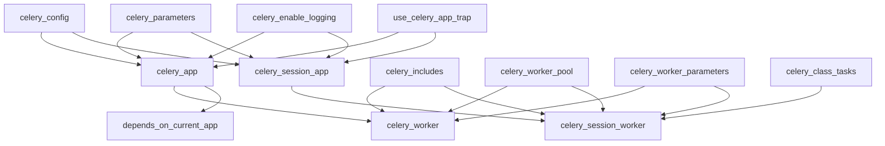
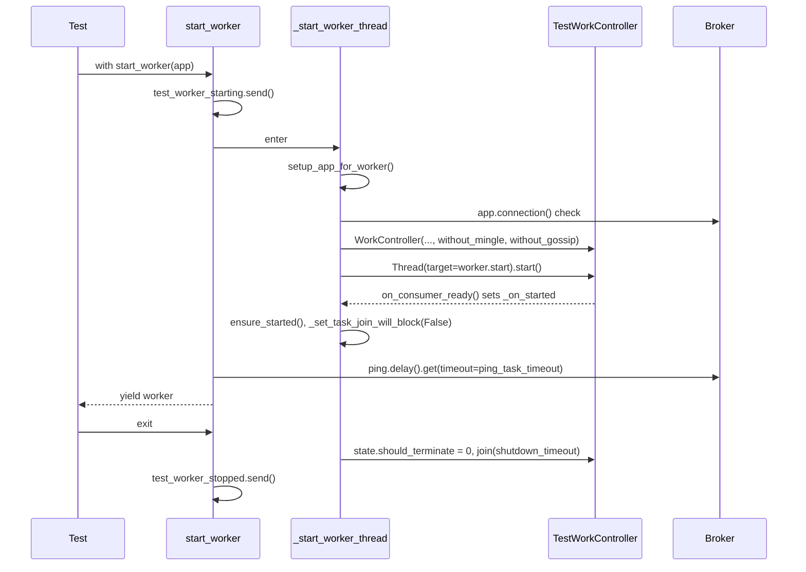

## Overview

Celery ships the building blocks for testing task code without a production broker: a pytest plugin with app and worker fixtures (`celery.contrib.pytest`), an embedded worker that runs in a thread (`celery.contrib.testing.worker`), a test app factory with in-memory transports (`celery.contrib.testing.app`), polling helpers for integration suites (`celery.contrib.testing.manager`), and mocks for building raw task messages (`celery.contrib.testing.mocks`). For the simplest unit tests, the `task_always_eager` setting runs tasks inline instead of sending them.

Sources: [celery/contrib/pytest.py:1-30](repo://celery/contrib/pytest.py#L1-L30), [celery/contrib/testing/worker.py:1-27](repo://celery/contrib/testing/worker.py#L1-L27), [celery/contrib/testing/app.py:1-20](repo://celery/contrib/testing/app.py#L1-L20)

The plugin is not registered automatically. Enable it with `pip install celery[pytest]`, by setting `PYTEST_PLUGINS=celery.contrib.pytest`, or by adding `pytest_plugins = ("celery.contrib.pytest", )` to the root `conftest.py`. Once loaded, `pytest_configure` registers the `celery(**overrides)` marker so pytest does not warn about it.

Sources: [docs/userguide/testing.rst:120-128](repo://docs/userguide/testing.rst#L120-L128), [celery/contrib/pytest.py:22-29](repo://celery/contrib/pytest.py#L22-L29), [requirements/extras/pytest.txt:1-1](repo://requirements/extras/pytest.txt#L1-L1)

## Pytest fixtures

### Fixture graph

The fixtures form two parallel stacks: function-scoped `celery_app`/`celery_worker`, created fresh for each test, and session-scoped `celery_session_app`/`celery_session_worker`, shared by the whole run. Both stacks read the same session-scoped configuration fixtures.

Sources: [celery/contrib/pytest.py:53-169](repo://celery/contrib/pytest.py#L53-L169), [celery/contrib/pytest.py:172-216](repo://celery/contrib/pytest.py#L172-L216)



Sources: [celery/contrib/pytest.py:64-105](repo://celery/contrib/pytest.py#L64-L105), [celery/contrib/pytest.py:172-216](repo://celery/contrib/pytest.py#L172-L216)

### Configuration fixtures

Override these in a `conftest.py` to shape the app and worker. All are session-scoped, so a function-scoped override is not allowed to feed the session fixtures.

Sources: [celery/contrib/pytest.py:53-61](repo://celery/contrib/pytest.py#L53-L61), [celery/contrib/pytest.py:108-169](repo://celery/contrib/pytest.py#L108-L169), [celery/contrib/pytest.py:188-191](repo://celery/contrib/pytest.py#L188-L191)

| Fixture | Default | Used for |
| --- | --- | --- |
| `celery_config` | `{}` | Settings merged over `DEFAULT_TEST_CONFIG` for the test app |
| `celery_parameters` | `{}` | Keyword arguments passed to the `Celery(...)` constructor |
| `celery_enable_logging` | `False` | When true, the app keeps its normal log class instead of `UnitLogging` |
| `use_celery_app_trap` | `False` | Installs the `Trap` so any use of the current/default app raises |
| `celery_includes` | `()` | Module names imported via `app.loader.import_task_module` before the worker starts |
| `celery_worker_pool` | `'solo'` | Pool passed to `start_worker` (for example `'prefork'`) |
| `celery_worker_parameters` | `{}` | Extra keyword arguments for the `WorkController`, such as `queues` |
| `celery_class_tasks` | `[]` | Class-based tasks registered with `app.register_task` (session worker only) |

Sources: [celery/contrib/pytest.py:53-61](repo://celery/contrib/pytest.py#L53-L61), [celery/contrib/pytest.py:108-169](repo://celery/contrib/pytest.py#L108-L169), [celery/contrib/pytest.py:188-191](repo://celery/contrib/pytest.py#L188-L191)

### App fixtures and the celery marker

`celery_app` and `celery_session_app` both look up the closest `celery` marker on the requesting node and merge its keyword arguments over `celery_config`, then enter `_create_app`. That helper builds a `TestApp(set_as_current=False, ...)` and wraps it in `setup_default_app`, which restores global app state on exit. The session app additionally calls `set_default()` and `set_current()` unless the trap is enabled.

Sources: [celery/contrib/pytest.py:32-50](repo://celery/contrib/pytest.py#L32-L50), [celery/contrib/pytest.py:64-81](repo://celery/contrib/pytest.py#L64-L81), [celery/contrib/pytest.py:172-185](repo://celery/contrib/pytest.py#L172-L185)

```python
@pytest.mark.celery(result_backend='redis://')
def test_something():
    ...
```

Sources: [docs/userguide/testing.rst:142-144](repo://docs/userguide/testing.rst#L142-L144), [celery/contrib/pytest.py:172-185](repo://celery/contrib/pytest.py#L172-L185)

> [!NOTE]
> The marker only affects `celery_session_app` when it is on the node that first requests the session fixture; later tests reuse the already-built session app.

Sources: [celery/contrib/pytest.py:64-81](repo://celery/contrib/pytest.py#L64-L81)

`depends_on_current_app` calls `celery_app.set_current()` for tests that rely on `current_app` (for example code using `shared_task`).

Sources: [celery/contrib/pytest.py:213-216](repo://celery/contrib/pytest.py#L213-L216)

### Worker fixtures

`celery_worker` imports every module in `celery_includes` and enters `worker.start_worker(celery_app, pool=celery_worker_pool, **celery_worker_parameters)`, yielding the running worker for the duration of the test. `celery_session_worker` does the same for the session app and also registers `celery_class_tasks`. Setting the `NO_WORKER` environment variable makes both fixtures yield nothing, which lets a suite run against an externally started worker.

Sources: [celery/contrib/pytest.py:16-16](repo://celery/contrib/pytest.py#L16-L16), [celery/contrib/pytest.py:84-105](repo://celery/contrib/pytest.py#L84-L105), [celery/contrib/pytest.py:194-210](repo://celery/contrib/pytest.py#L194-L210)

```python
def test_create_task(celery_app, celery_worker):
    @celery_app.task
    def mul(x, y):
        return x * y

    celery_worker.reload()
    assert mul.delay(4, 4).get(timeout=10) == 16
```

Sources: [docs/userguide/testing.rst:175-181](repo://docs/userguide/testing.rst#L175-L181)

> [!NOTE]
> The embedded worker only runs tasks registered on the fixture app: `@shared_task` functions, tasks defined on `celery_app` inside the test, or tasks registered on it before `celery_worker.reload()`. A task bound to a separately created `Celery()` instance is not found.

Sources: [docs/userguide/testing.rst:217-227](repo://docs/userguide/testing.rst#L217-L227)

## Test application

`TestApp` is a factory function, not a subclass. It imports `celery.contrib.testing.tasks` (registering `celery.ping` as a shared task), merges the caller's `config` over a deep copy of `DEFAULT_TEST_CONFIG`, and creates a plain `Celery` named `celery.tests` by default. When `broker` or `backend` is passed explicitly, the matching default URL is dropped from the config so the argument wins. The config is applied with `add_defaults`, so later `conf` updates still override it.

Sources: [celery/contrib/testing/app.py:47-65](repo://celery/contrib/testing/app.py#L47-L65)

| Setting | Test default |
| --- | --- |
| `broker_url` | `memory://` |
| `result_backend` | `cache+memory://` |
| `accept_content` | `{'json'}` |
| `enable_utc` / `timezone` | `True` / `UTC` |
| `broker_heartbeat` | `0` |
| `worker_hijack_root_logger` | `False` |
| `worker_log_color` | `False` |

Sources: [celery/contrib/testing/app.py:10-20](repo://celery/contrib/testing/app.py#L10-L20)

With `enable_logging=False` the app uses `UnitLogging`, a subclass of the app's log class that marks itself `already_setup`, so creating the app never reconfigures the root logger.

Sources: [celery/contrib/testing/app.py:39-44](repo://celery/contrib/testing/app.py#L39-L44), [celery/contrib/testing/app.py:56-56](repo://celery/contrib/testing/app.py#L56-L56)

`setup_default_app(app, use_trap=False)` snapshots the current app, the default app, the app finalizers and the set of known apps, yields, and restores all four afterwards, closing the test app if it was not the previous current app. With `use_trap=True` it also enters `set_trap`, which installs a `Trap` object as both the default app and the thread-local current app; any attribute access on it raises `RuntimeError('Test depends on current_app')`. This catches code that silently falls back to `current_app` instead of using the app it was given.

Sources: [celery/contrib/testing/app.py:23-36](repo://celery/contrib/testing/app.py#L23-L36), [celery/contrib/testing/app.py:68-112](repo://celery/contrib/testing/app.py#L68-L112)

## Embedded worker

### Start sequence

`start_worker` is a context manager that runs a real `WorkController` in a daemon thread inside the test process, waits until its consumer is ready, and verifies the round trip with a ping task.

Sources: [celery/contrib/testing/worker.py:99-136](repo://celery/contrib/testing/worker.py#L99-L136)



Sources: [celery/contrib/testing/worker.py:117-192](repo://celery/contrib/testing/worker.py#L117-L192)

The steps in detail:

Sources: [celery/contrib/testing/worker.py:139-178](repo://celery/contrib/testing/worker.py#L139-L178), [celery/contrib/testing/worker.py:219-225](repo://celery/contrib/testing/worker.py#L219-L225), [celery/contrib/testing/worker.py:81-96](repo://celery/contrib/testing/worker.py#L81-L96)

1. `setup_app_for_worker` finalizes the app, makes it current and default, resets the log class's `_setup` flag, and calls `app.log.setup(loglevel, logfile)`.
2. When `perform_ping_check` is true it asserts that `celery.ping` is registered, then opens a connection (to `TEST_BROKER` if set) and touches `default_channel` to fail fast when the broker is unreachable.
3. The worker is built with `ready_callback=None` (so `on_consumer_ready` cannot be replaced), `without_heartbeat=True` unless overridden, and mingle and gossip disabled. The hostname defaults to `anon_nodename()`.
4. After the thread starts, `ensure_started()` blocks on a `threading.Event` set by `on_consumer_ready`, which also sends `test_worker_started`.
5. `_set_task_join_will_block(False)` lets the test call `.get()` on results, and the ping is waited for inside `allow_join_result()`.

Sources: [celery/contrib/testing/worker.py:139-178](repo://celery/contrib/testing/worker.py#L139-L178), [celery/contrib/testing/worker.py:219-225](repo://celery/contrib/testing/worker.py#L219-L225), [celery/contrib/testing/worker.py:81-96](repo://celery/contrib/testing/worker.py#L81-L96)

On exit, `worker.state.should_terminate` is set to `0` to request a clean shutdown, and the thread is joined for `shutdown_timeout` seconds. If it is still alive, `RuntimeError` asks you to raise `shutdown_timeout`; otherwise `should_terminate` is reset to `None` so the next worker can start.

Sources: [celery/contrib/testing/worker.py:180-192](repo://celery/contrib/testing/worker.py#L180-L192)

### start_worker parameters

| Parameter | Default | Meaning |
| --- | --- | --- |
| `concurrency` | `1` | Pool size |
| `pool` | `'solo'` | Pool implementation |
| `loglevel` | `WORKER_LOGLEVEL` env var, else `'error'` | Worker log level |
| `logfile` | `None` | Log file path |
| `perform_ping_check` | `True` | Run `celery.ping` before yielding |
| `ping_task_timeout` | `10.0` | Seconds to wait for the ping result |
| `shutdown_timeout` | `10.0` | Seconds to wait for the worker thread to exit |
| `**kwargs` | | Passed to `WorkController` (for example `queues`, `hostname`) |

Sources: [celery/contrib/testing/worker.py:14-14](repo://celery/contrib/testing/worker.py#L14-L14), [celery/contrib/testing/worker.py:99-116](repo://celery/contrib/testing/worker.py#L99-L116)

### TestWorkController and test signals

`TestWorkController` sets `__test__ = False` so pytest does not collect it. With the prefork pool it creates a `billiard.Queue`, installs `tblib` pickling support when available, and starts a `QueueListener` feeding the root logger; `start()` adds a `QueueHandler` that forwards records from child processes, so logs from forked workers reach pytest's capture.

Sources: [celery/contrib/testing/worker.py:30-79](repo://celery/contrib/testing/worker.py#L30-L79)

| Signal | Sender | Arguments |
| --- | --- | --- |
| `test_worker_starting` | app | none |
| `test_worker_started` | app | `worker`, `consumer` |
| `test_worker_stopped` | app | `worker` |

Sources: [celery/contrib/testing/worker.py:16-27](repo://celery/contrib/testing/worker.py#L16-L27)

The ping task used by the health check is a shared task that returns `'pong'`:

Sources: [celery/contrib/testing/tasks.py:1-9](repo://celery/contrib/testing/tasks.py#L1-L9)

```python
@shared_task(name='celery.ping')
def ping():
    # type: () -> str
    """Simple task that just returns 'pong'."""
    return 'pong'
```

Sources: [celery/contrib/testing/tasks.py:1-9](repo://celery/contrib/testing/tasks.py#L1-L9)

## Integration helpers

`Manager(app, **kwargs)` wraps an app with polling helpers from `ManagerMixin`. `_init_manager` sets `block_timeout` (30 minutes), `no_join`, output streams, and records the connection's recoverable errors so `join` can tolerate a dropped broker.

Sources: [celery/contrib/testing/manager.py:27-38](repo://celery/contrib/testing/manager.py#L27-L38), [celery/contrib/testing/manager.py:234-239](repo://celery/contrib/testing/manager.py#L234-L239)

| Method | Behaviour |
| --- | --- |
| `wait_for(fun, catch, ...)` | Retries `fun` via `kombu.utils.functional.retry_over_time` while it raises an exception in `catch`; can warn with `E_STILL_WAITING` |
| `ensure_not_for_a_while(fun, catch, ...)` | Inverse: raises `AssertionError` if `fun` succeeds within the retries |
| `join(r, propagate=False, max_retries=10)` | Calls `ResultSet.get`, remarking which ids are still missing on timeouts; raises `AssertionError('Test failed: Missing task results')` |
| `assert_received(ids)` / `assert_accepted(ids)` | Poll `inspect().query_task` until ids are reserved/active/ready, or active/ready |
| `assert_result_tasks_in_progress_or_completed(results)` | Poll until every result is `STARTED` or `SUCCESS` |
| `query_task_states(ids)` | Map of state to set of task ids across workers |
| `wait_until_idle()` | Purge queues until empty, then poll `inspect().active()` until no task is running |

Sources: [celery/contrib/testing/manager.py:48-132](repo://celery/contrib/testing/manager.py#L48-L132), [celery/contrib/testing/manager.py:134-231](repo://celery/contrib/testing/manager.py#L134-L231)

The `assert_*` helpers share one pattern: `true_or_raise` turns a false predicate into the private `Sentinel` exception, and `wait_for` retries on `Sentinel` until the predicate holds or retries run out.

Sources: [celery/contrib/testing/manager.py:173-209](repo://celery/contrib/testing/manager.py#L173-L209)

## Message mocks

`celery.contrib.testing.mocks` builds `unittest.mock.Mock` objects shaped like Kombu messages, for feeding the consumer or request code directly.

Sources: [celery/contrib/testing/mocks.py:1-8](repo://celery/contrib/testing/mocks.py#L1-L8)

- `TaskMessage(name, id=None, args=(), kwargs=None, callbacks=None, errbacks=None, chain=None, shadow=None, utc=None, **options)` creates a protocol 2 message: headers hold `id`, `task`, `shadow` plus any extra options, and the body is the JSON-serialized `(args, kwargs, embed)` tuple, also exposed as `payload`.
- `TaskMessage1(...)` creates the legacy protocol 1 form with everything in the payload dict and empty headers.
- `task_message_from_sig(app, sig, utc=True)` freezes a signature, pulls `link`, `link_error`, `countdown`, `eta` and `expires` out of its options, converts a countdown or numeric expiry into ISO timestamps relative to `app.now()`, and passes the rest to `TaskMessage`.
- `ContextMock(*args, **kwargs)` returns a mock usable in a `with` statement: `__enter__` returns the mock itself and `__exit__` returns `None`, so exceptions are not swallowed.

Sources: [celery/contrib/testing/mocks.py:11-111](repo://celery/contrib/testing/mocks.py#L11-L111), [celery/contrib/testing/mocks.py:114-137](repo://celery/contrib/testing/mocks.py#L114-L137)

## Eager mode

When `task_always_eager` is true, `Task.apply_async` never contacts the broker. It still serializes and deserializes the arguments with the configured serializer (so non-serializable arguments fail as they would in production), then calls `self.apply()` inside `denied_join_result()` and returns an `EagerResult`.

Sources: [celery/app/task.py:682-701](repo://celery/app/task.py#L682-L701)

`apply()` builds a request with `is_eager: True` and runs the task through the tracer in the calling thread. Exceptions are re-raised only when `throw` is true, which defaults to `task_eager_propagates`.

Sources: [celery/app/task.py:869-945](repo://celery/app/task.py#L869-L945)

| Setting | Default | Effect |
| --- | --- | --- |
| `task_always_eager` | `False` | Run `delay()`/`apply_async()` locally via `apply()` |
| `task_eager_propagates` | `False` | Re-raise task exceptions from eager calls |
| `task_store_eager_result` | `False` | Write eager results to the result backend |

Sources: [celery/app/defaults.py:275-275](repo://celery/app/defaults.py#L275-L275), [celery/app/defaults.py:290-294](repo://celery/app/defaults.py#L290-L294)

> [!WARNING]
> Eager mode skips routing, serialization round trips through the broker, worker signals and acknowledgement. It is a unit-testing shortcut; use the `celery_worker` fixture to exercise the real message path. See [[Calling Tasks and Message Protocol]] and [[Task Execution and Tracing]] for what is bypassed.

Sources: [celery/app/task.py:682-707](repo://celery/app/task.py#L682-L707)
