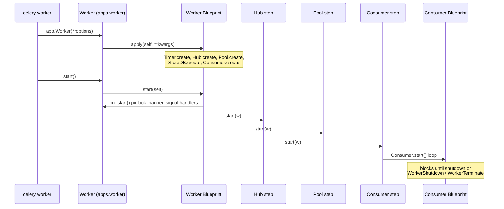
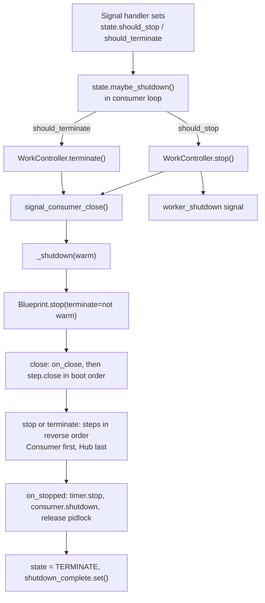

## Overview

A Celery worker is not one monolithic object. `WorkController` holds the configuration, but the actual services (the timer, the event loop hub, the execution pool, an embedded beat, the persistent state file and the message consumer) are separate *bootsteps* that a `Blueprint` creates, orders by dependency, starts and stops. That design lets the worker run with or without an event loop, swap concurrency pools, and lets applications plug in their own services without subclassing the worker.

Sources: [celery/worker/worker.py:1-13](repo://celery/worker/worker.py#L1-L13), [celery/bootsteps.py:1-26](repo://celery/bootsteps.py#L1-L26)

There are two layers. `celery.worker.worker.WorkController` is the bare in-process worker with no global side effects. `celery.apps.worker.Worker` subclasses it to become the program run by `celery worker`: it sets up logging, prints the banner and installs the signal handlers that drive warm and cold shutdown. The consumer started by the last worker step runs a second blueprint of its own, covered in [[Consumer and Message Handling]].

Sources: [celery/apps/worker.py:1-8](repo://celery/apps/worker.py#L1-L8), [celery/apps/worker.py:91-104](repo://celery/apps/worker.py#L91-L104), [celery/app/base.py:1431-1437](repo://celery/app/base.py#L1431-L1437)

## Bootstep model

### Blueprint

`Blueprint` holds a set of step *types*: the classes in `default_steps` plus any extra `steps` passed to the constructor. `apply(parent)` turns those types into instances bound to the parent object. It calls `claim_steps` to resolve each type (strings such as `'celery.worker.components:Pool'` are loaded with `symbol_by_name`), builds a `DependencyGraph` from every step's `requires`, topologically sorts it, instantiates each step with `S(parent, **kwargs)` and finally calls `step.include(parent)` on each in boot order.

Sources: [celery/bootsteps.py:99-107](repo://celery/bootsteps.py#L99-L107), [celery/bootsteps.py:186-212](repo://celery/bootsteps.py#L186-L212), [celery/bootsteps.py:251-256](repo://celery/bootsteps.py#L251-L256)

`_finalize_steps` gives the step marked `last = True` an edge to every other node, so it always sorts after them. `_firstpass` walks `requires` transitively, so a dependency that was never registered is still pulled into the graph. An unresolvable name surfaces as `KeyError('unknown bootstep: ...')`.

Sources: [celery/bootsteps.py:221-249](repo://celery/bootsteps.py#L221-L249)

The blueprint tracks a small state machine in `state` (`RUN`, `CLOSE`, `TERMINATE`) and counts how many steps have started in `started`. `human_state()` maps it to `initializing`, `running`, `closing` or `terminating`, which is what `repr(worker)` shows.

Sources: [celery/bootsteps.py:23-26](repo://celery/bootsteps.py#L23-L26), [celery/bootsteps.py:88-97](repo://celery/bootsteps.py#L88-L97), [celery/bootsteps.py:119-120](repo://celery/bootsteps.py#L119-L120), [celery/worker/worker.py:336-341](repo://celery/worker/worker.py#L336-L341)

### Step classes

`StepType` is the metaclass that gives each step a `name` equal to its qualified name (`module.ClassName`) unless one is set explicitly. That name is the key in `Blueprint.steps` and the identity used for dependency resolution.

Sources: [celery/bootsteps.py:266-285](repo://celery/bootsteps.py#L266-L285)

| Class | Purpose | Lifecycle methods |
| --- | --- | --- |
| `Step` | Initialization-only step: `__init__` can set attributes on the parent and `create` runs when `include_if` is true. It is not added to `parent.steps`, so it is never started or stopped. | `__init__`, `include_if`, `create`, `info` |
| `StartStopStep` | Step whose `create` returns a service object stored in `self.obj`; `include` appends the step to `parent.steps` so the blueprint starts and stops it. | `start`, `stop`, `close`, `terminate` (falls back to `obj.stop`) |
| `ConsumerStep` | Consumer-blueprint step that requires `Connection`, opens a channel and calls `consume()` on every consumer returned by `get_consumers(channel)`. | `get_consumers`, `start`, `stop` (cancels), `shutdown` |

Sources: [celery/bootsteps.py:288-352](repo://celery/bootsteps.py#L288-L352), [celery/bootsteps.py:355-415](repo://celery/bootsteps.py#L355-L415)

The class attributes that control graph placement are `requires` (steps that must start first, in the same blueprint), `conditional` (only affects graph rendering), `last` (reserved for the worker's `Consumer`) and `enabled`, the default answer of `include_if`.

Sources: [celery/bootsteps.py:297-328](repo://celery/bootsteps.py#L297-L328)

## Worker construction

### WorkController initialization

`WorkController.__init__` resolves the node name, calls `app.loader.init_worker()`, then runs three hooks in order: `on_before_init`, `setup_defaults` and `on_after_init`. `setup_defaults` reads each option through `app.either`, which prefers the explicit argument and falls back to the setting, for example `worker_concurrency`, `worker_pool`, `worker_prefetch_multiplier` or `worker_state_db`.

Sources: [celery/worker/worker.py:90-99](repo://celery/worker/worker.py#L90-L99), [celery/worker/worker.py:351-410](repo://celery/worker/worker.py#L351-L410)

`setup_instance` then selects queues (raising `ImproperlyConfigured` when `-Q` or `-X` names a queue missing from `task_queues`), adds the worker-direct queue when `worker_direct` is set, imports `include` modules and defaults `concurrency` to `cpu_count()`. It decides `use_eventloop` with `should_use_eventloop()`: only when no green library is patched in, the transport implements asynchronous I/O and the platform is not Windows. It then sends `worker_init`, resolves the pool class with `concurrency.get_implementation` and builds the blueprint with `self.app.steps['worker']` as extra steps.

Sources: [celery/worker/worker.py:101-139](repo://celery/worker/worker.py#L101-L139), [celery/worker/worker.py:167-193](repo://celery/worker/worker.py#L167-L193), [celery/worker/worker.py:239-242](repo://celery/worker/worker.py#L239-L242)

```python
    class Blueprint(bootsteps.Blueprint):
        """Worker bootstep blueprint."""

        name = 'Worker'
        default_steps = {
            'celery.worker.components:Hub',
            'celery.worker.components:Pool',
            'celery.worker.components:Beat',
            'celery.worker.components:Timer',
            'celery.worker.components:StateDB',
            'celery.worker.components:Consumer',
            'celery.worker.autoscale:WorkerComponent',
        }
```

Sources: [celery/worker/worker.py:76-88](repo://celery/worker/worker.py#L76-L88)

The keyword arguments given to `WorkController` are forwarded to `blueprint.apply(self, **kwargs)`, so every step's `__init__` sees the worker's command-line options. That is how `Pool` receives `autoscale` and `Beat` receives `beat`.

Sources: [celery/worker/worker.py:133-139](repo://celery/worker/worker.py#L133-L139), [celery/worker/components.py:117-128](repo://celery/worker/components.py#L117-L128), [celery/worker/components.py:190-193](repo://celery/worker/components.py#L190-L193)

### Worker components

| Step | Kind | Requires | What `create` does |
| --- | --- | --- | --- |
| `Timer` | `Step` | none | With the event loop, a kombu `Timer(max_interval=10.0)` with no thread. Otherwise instantiates `worker_timer` or the pool's own `Timer` class, with `worker_timer_precision` as `max_interval`. |
| `Hub` | `StartStopStep` | `Timer` | Only when `use_eventloop`. Reuses or creates the kombu event loop (or the transport's `requires_hub`) and swaps `app.clock.mutex` and billiard's `Lock` for `DummyLock`. |
| `Pool` | `StartStopStep` | `Hub` | Parses `autoscale` into `max_concurrency`/`min_concurrency`, creates a `LaxBoundedSemaphore` when running in the event loop, and instantiates the pool class with time limits, `maxtasksperchild`, `max_memory_per_child` and other options. |
| `WorkerComponent` (Autoscaler) | `StartStopStep` | `Pool` | Only when `--autoscale` is given. Builds `worker_autoscaler`; in the event loop it registers `maybe_scale` on the hub instead of running a thread. |
| `Beat` | `StartStopStep` | none | Only with `-B`. Creates `celery.beat.EmbeddedService` and refuses green pools with `ERR_B_GREEN`. |
| `StateDB` | `Step` | none | Only when `worker_state_db` is set. Creates `state.Persistent` and registers its `save` with `atexit`. |
| `Consumer` | `StartStopStep`, `last = True` | everything | Computes `initial_prefetch_count` as concurrency (or `max_concurrency`) times `prefetch_multiplier` and instantiates `worker_consumer` with the pool, timer, hub and `process_task`. |

Sources: [celery/worker/components.py:32-98](repo://celery/worker/components.py#L32-L98), [celery/worker/components.py:101-178](repo://celery/worker/components.py#L101-L178), [celery/worker/components.py:181-246](repo://celery/worker/components.py#L181-L246), [celery/worker/autoscale.py:31-58](repo://celery/worker/autoscale.py#L31-L58)

`Pool.create` also decides how a received task reaches the pool. `w.process_task` is normally `_process_task`, which calls `req.execute_using_pool(self.pool)`. When the worker runs in the event loop with `worker_pool_putlocks` enabled and a pool whose `uses_semaphore` is true, it switches to `_process_task_sem`, which first acquires the semaphore sized to the pool's concurrency. Pool internals are covered in [[Concurrency Pools and Autoscaling]].

Sources: [celery/worker/components.py:138-172](repo://celery/worker/components.py#L138-L172), [celery/worker/worker.py:220-231](repo://celery/worker/worker.py#L220-L231)

> [!WARNING]
> Selecting `eventlet` or `gevent` through the `worker_pool` setting triggers `W_POOL_SETTING`: those pools must be chosen with `-P` so that monkey patching happens as early as possible. Embedding beat with `-B` under either green pool raises `ImproperlyConfigured`.

Sources: [celery/worker/components.py:18-29](repo://celery/worker/components.py#L18-L29), [celery/worker/components.py:138-142](repo://celery/worker/components.py#L138-L142), [celery/worker/components.py:195-201](repo://celery/worker/components.py#L195-L201)

## Startup order

`celery worker` builds `app.Worker(...)`, calls `worker.start()` and exits with `worker.exitcode`. `WorkController.start` calls `blueprint.start(self)`, which sets `state = RUN`, runs `on_start` and then calls `step.start(parent)` for each entry in `parent.steps`. Only `StartStopStep` instances are in that list, in topological order, so `Timer` and `StateDB` run during `apply` and are never started.

Sources: [celery/bin/worker.py:359-368](repo://celery/bin/worker.py#L359-L368), [celery/worker/worker.py:201-212](repo://celery/worker/worker.py#L201-L212), [celery/bootsteps.py:109-117](repo://celery/bootsteps.py#L109-L117)



Sources: [celery/bin/worker.py:359-368](repo://celery/bin/worker.py#L359-L368), [celery/worker/worker.py:129-139](repo://celery/worker/worker.py#L129-L139), [celery/bootsteps.py:109-117](repo://celery/bootsteps.py#L109-L117), [celery/apps/worker.py:128-147](repo://celery/apps/worker.py#L128-L147), [celery/worker/consumer/consumer.py:366-382](repo://celery/worker/consumer/consumer.py#L366-L382)

The `Consumer` step is last because its `start` does not return: `Consumer.start` loops over its own blueprint until the state is `CLOSE` or `TERMINATE`, restarting it after recoverable connection errors. When the event loop is used, `asynloop` calls `controller.register_with_event_loop(hub)`, which broadcasts `register_with_event_loop` to every worker step. That is how `Pool` registers the pool's file descriptors and `WorkerComponent` schedules autoscaling on the hub.

Sources: [celery/worker/consumer/consumer.py:366-382](repo://celery/worker/consumer/consumer.py#L366-L382), [celery/worker/loops.py:60-63](repo://celery/worker/loops.py#L60-L63), [celery/worker/worker.py:214-218](repo://celery/worker/worker.py#L214-L218), [celery/worker/components.py:177-178](repo://celery/worker/components.py#L177-L178)

## The worker program

### Hooks and banner

`Worker` fills in the `WorkController` hooks. `on_before_init` applies the tracer optimizations, sends `celeryd_init` (useful for per-node configuration) and checks privileges against `accept_content`. `on_after_init` reads `worker_redirect_stdouts` and its level and prepares colored output. `on_init_blueprint` sets up logging just before the blueprint is built.

Sources: [celery/apps/worker.py:94-126](repo://celery/apps/worker.py#L94-L126)

`on_start` runs when the blueprint starts, before any step. After creating the pidfile lock, it sends `celeryd_after_setup` (the place to change queues after `-Q` was applied), purges queues for `--purge`, prints the banner unless `--quiet`, sets the process title and calls `install_platform_tweaks`, which installs the signal handlers. `on_consumer_ready` sends `worker_ready` and logs `<hostname> ready.`.

Sources: [celery/apps/worker.py:128-147](repo://celery/apps/worker.py#L128-L147), [celery/apps/worker.py:180-182](repo://celery/apps/worker.py#L180-L182)

`startup_info` fills the `BANNER` template with the app, transport URI, result backend URI, concurrency (shown as `{min=..., max=...}` with autoscale, followed by the pool module name), the task events flag and the queue list. It prefixes each line with `ARTLINES`. `extra_info` adds the `[tasks]` list when the log level is `INFO` or lower, and includes built-in `celery.` tasks only at `DEBUG`.

Sources: [celery/apps/worker.py:52-71](repo://celery/apps/worker.py#L52-L71), [celery/apps/worker.py:204-252](repo://celery/apps/worker.py#L204-L252)

### Signal handlers

`install_platform_tweaks` installs these handlers through `platforms.signals`. Shutdown handlers built by `_shutdown_handler` only act in the `MainProcess`: they run an optional callback, print `worker: Warm shutdown (MainProcess)` or the cold equivalent, send `worker_shutting_down`, and set `state.should_stop` (warm) or `state.should_terminate` (cold) to the exit code.

Sources: [celery/apps/worker.py:254-274](repo://celery/apps/worker.py#L254-L274), [celery/apps/worker.py:288-316](repo://celery/apps/worker.py#L288-L316)

| Signal | Handler | Behaviour |
| --- | --- | --- |
| `SIGTERM` | `install_worker_term_handler` | Warm shutdown. With `REMAP_SIGTERM == "SIGQUIT"` it becomes a cold shutdown with `on_cold_shutdown`. |
| `SIGQUIT` | `install_worker_term_hard_handler` | Cold shutdown via `on_cold_shutdown`, exit code `EX_FAILURE`. |
| `SIGINT` | `install_worker_int_handler` | First Ctrl+C: warm shutdown, and `on_SIGINT` rebinds SIGINT to the cold handler. |
| `SIGHUP` | `install_worker_restart_handler` | Only when not attached to a TTY: sets `should_stop` and registers an `os.execv` re-exec at exit. On macOS it only warns. |
| `SIGUSR1` | `install_cry_handler` | Dumps the stack trace of every thread (not on PyPy). |
| `SIGUSR2` | `install_rdb_handler` | Opens a remote debugger, only when `CELERY_RDBSIG` is set. |

Sources: [celery/apps/worker.py:433-466](repo://celery/apps/worker.py#L433-L466), [celery/apps/worker.py:469-523](repo://celery/apps/worker.py#L469-L523)

`on_cold_shutdown` first rebinds SIGINT and SIGQUIT to `during_soft_shutdown`, then calls `wait_for_soft_shutdown()`. When `worker_soft_shutdown_timeout` is positive and there are active requests (or `worker_enable_soft_shutdown_on_idle` is set), that call sleeps for the timeout so short tasks can finish. Next it cancels the task consumer so requeued messages are not redelivered immediately, calls `cancel_active_requests()`, sets `state.should_terminate` and stops the pool. A further signal during the soft wait goes to `during_soft_shutdown`, which cancels requests and installs `on_hard_shutdown`. That handler raises `WorkerTerminate(EX_FAILURE)` the next time.

Sources: [celery/apps/worker.py:319-366](repo://celery/apps/worker.py#L319-L366), [celery/apps/worker.py:369-430](repo://celery/apps/worker.py#L369-L430), [celery/worker/worker.py:412-435](repo://celery/worker/worker.py#L412-L435)

## Shutdown order

Signal handlers never stop the worker directly: they only set flags. The consumer loop calls `state.maybe_shutdown()`, which raises `WorkerTerminate` or `WorkerShutdown` (both `SystemExit` subclasses). The exception unwinds out of `blueprint.start` into `WorkController.start`, which calls `terminate()` for `WorkerTerminate` and `stop(exitcode=...)` for `SystemExit`. Any other exception is logged as `Unrecoverable error` and stops the worker with `EX_FAILURE`.

Sources: [celery/worker/state.py:88-93](repo://celery/worker/state.py#L88-L93), [celery/worker/loops.py:80-90](repo://celery/worker/loops.py#L80-L90), [celery/worker/worker.py:201-212](repo://celery/worker/worker.py#L201-L212)



Sources: [celery/worker/worker.py:157-165](repo://celery/worker/worker.py#L157-L165), [celery/worker/worker.py:233-267](repo://celery/worker/worker.py#L233-L267), [celery/bootsteps.py:128-176](repo://celery/bootsteps.py#L128-L176)

`Blueprint.stop` returns immediately if a stop is already in progress. If the blueprint never reached `RUN` with every step started, it only marks itself `TERMINATE`, because there is nothing to unwind. Otherwise `close` runs `on_close` (the loader's `shutdown_worker`) and each step's `close` in boot order, so `Pool.close` stops the pool from accepting work. Then `restart` sends `stop`, or `terminate` for a cold shutdown, to each step in *reverse* order, so the consumer stops before the pool and the hub. Errors in individual steps are logged and do not abort shutdown (`propagate=False`).

Sources: [celery/bootsteps.py:128-176](repo://celery/bootsteps.py#L128-L176), [celery/worker/components.py:130-136](repo://celery/worker/components.py#L130-L136)

`_shutdown` wraps the stop in `default_socket_timeout(SHUTDOWN_SOCKET_TIMEOUT)` (5 seconds) so a hung broker socket cannot block shutdown forever, then calls `blueprint.join()` to wait for `shutdown_complete`. When `stop` is called from inside a signal handler, the shutdown only runs right away if the pool is `signal_safe`. `worker_shutdown` is sent after a warm stop.

Sources: [celery/worker/worker.py:46-47](repo://celery/worker/worker.py#L46-L47), [celery/worker/worker.py:244-267](repo://celery/worker/worker.py#L244-L267), [celery/bootsteps.py:178-184](repo://celery/bootsteps.py#L178-L184)

## Adding custom steps

`app.steps` is a `defaultdict(set)`. The worker blueprint reads `app.steps['worker']` and the consumer blueprint reads `app.steps['consumer']`. Add the step *class*, not an instance: the blueprint instantiates it and places it by its `requires`, so the order in which steps are added does not matter.

Sources: [celery/app/base.py:305-307](repo://celery/app/base.py#L305-L307), [celery/app/base.py:370-370](repo://celery/app/base.py#L370-L370), [celery/worker/worker.py:133-139](repo://celery/worker/worker.py#L133-L139), [celery/worker/consumer/consumer.py:250-254](repo://celery/worker/consumer/consumer.py#L250-L254), [docs/userguide/extending.rst:592-610](repo://docs/userguide/extending.rst#L592-L610)

```python
    class InfoStep(bootsteps.Step):

        def __init__(self, parent, **kwargs):
            # here we can prepare the Worker/Consumer object
            # in any way we want, set attribute defaults, and so on.
            print('{0!r} is in init'.format(parent))

        def start(self, parent):
            # our step is started together with all other Worker/Consumer
            # bootsteps.
            print('{0!r} is starting'.format(parent))

        def stop(self, parent):
            # the Consumer calls stop every time the consumer is
            # restarted (i.e., connection is lost) and also at shutdown.
            # The Worker will call stop at shutdown only.
            print('{0!r} is stopping'.format(parent))

        def shutdown(self, parent):
            # shutdown is called by the Consumer at shutdown, it's not
            # called by Worker.
            print('{0!r} is shutting down'.format(parent))

        app = Celery(broker='amqp://')
        app.steps['worker'].add(InfoStep)
        app.steps['consumer'].add(InfoStep)
```

Sources: [docs/userguide/extending.rst:617-646](repo://docs/userguide/extending.rst#L617-L646)

Choose the base class by what the step must do. The hooks below are the ones the built-in components use.

Sources: [celery/bootsteps.py:288-383](repo://celery/bootsteps.py#L288-L383)

- Subclass `StartStopStep` and return a service object from `create` when the step owns something with `start`/`stop`, and set `requires = ('celery.worker.components:Pool',)` if it needs `w.pool`.
- Override `include_if` (or set `enabled` in `__init__`, as `Beat` and `StateDB` do) to turn the step on from a command-line option.
- Implement `register_with_event_loop(self, w, hub)` to schedule work on the hub instead of starting a thread.
- Implement `info(self, w)`: its dict is merged into the output of `WorkController.stats()`, which backs `celery inspect stats` (see [[Remote Control and Inspection]]).

Sources: [celery/bootsteps.py:319-341](repo://celery/bootsteps.py#L319-L341), [celery/worker/components.py:190-217](repo://celery/worker/components.py#L190-L217), [celery/worker/autoscale.py:50-58](repo://celery/worker/autoscale.py#L50-L58), [celery/worker/worker.py:326-334](repo://celery/worker/worker.py#L326-L334)

Custom options for such steps are added to the `celery worker` command through `app.user_options['worker']`. Because the worker forwards its keyword arguments to `Blueprint.apply`, the parsed value arrives in the step's `__init__` kwargs.

Sources: [celery/bin/celery.py:157-160](repo://celery/bin/celery.py#L157-L160), [celery/worker/worker.py:133-139](repo://celery/worker/worker.py#L133-L139)

> [!TIP]
> `celery graph bootsteps` builds a `WorkController`, connects the worker and consumer blueprint graphs with `connect_with` and writes the dependency graph in DOT format. Use it to check where a custom step lands in the boot order.

Sources: [celery/bin/graph.py:18-30](repo://celery/bin/graph.py#L18-L30), [celery/bootsteps.py:214-216](repo://celery/bootsteps.py#L214-L216)
