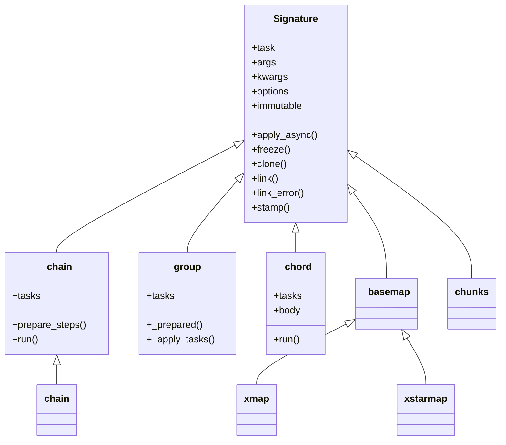
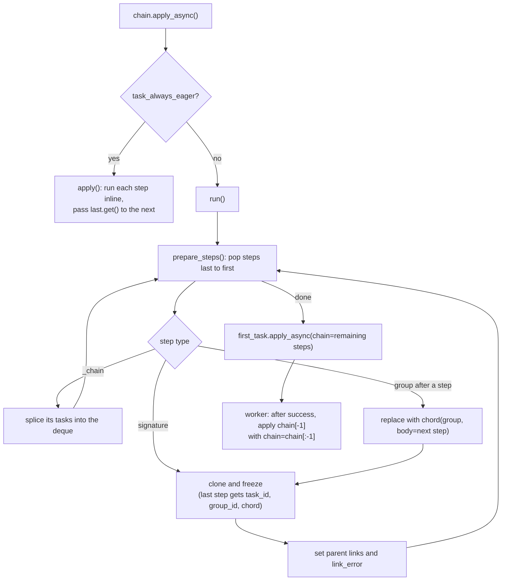
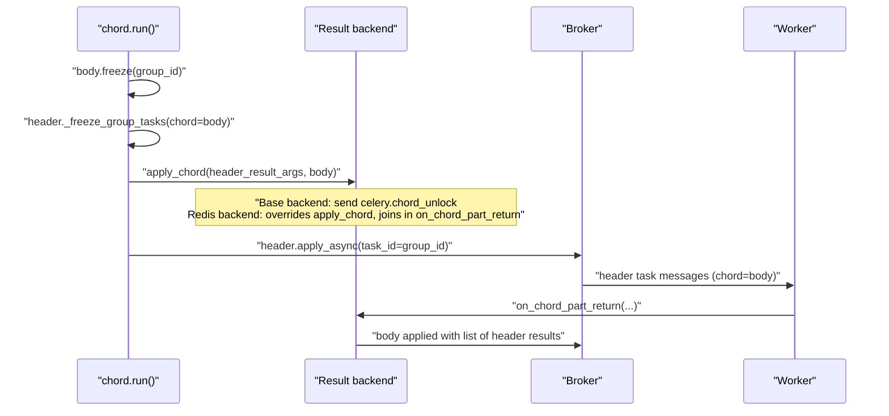
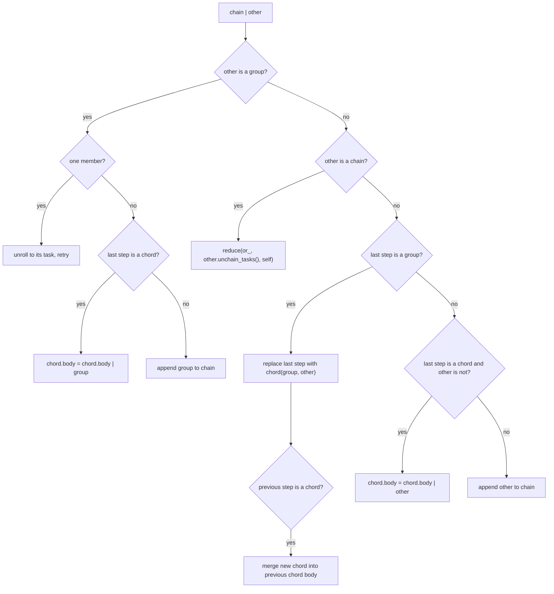

## Overview

The canvas lets you describe work as data before it runs. A `Signature` wraps one task call (task name, args, kwargs, execution options) in a plain `dict`, so it can be serialized into a message, passed as a callback, or combined with others. The primitives built on top of it (`chain`, `group`, `chord`, `xmap`, `xstarmap`, `chunks`) are all `Signature` subclasses defined in `celery/canvas.py`, and are re-exported from the `celery` package.

Sources: [celery/canvas.py:1-40](repo://celery/canvas.py#L1-L40), [celery/canvas.py:232-294](repo://celery/canvas.py#L232-L294)

Calling a workflow on the client side mostly prepares and freezes signatures, then publishes the first message(s). The rest happens in the worker: the tracer dispatches `link` callbacks and the next `chain` step after a task succeeds (see [[Task Execution and Tracing]]), and the result backend joins chord headers (see [[Result Backends]]). The `AsyncResult` and `GroupResult` objects the canvas returns are described in [[Task Results]].

Sources: [celery/app/trace.py:426-473](repo://celery/app/trace.py#L426-L473), [celery/backends/base.py:832-867](repo://celery/backends/base.py#L832-L867)



Sources: [celery/canvas.py:934-955](repo://celery/canvas.py#L934-L955), [celery/canvas.py:1322-1325](repo://celery/canvas.py#L1322-L1325), [celery/canvas.py:1385-1450](repo://celery/canvas.py#L1385-L1450), [celery/canvas.py:1491-1522](repo://celery/canvas.py#L1491-L1522), [celery/canvas.py:1970-1972](repo://celery/canvas.py#L1970-L1972)

## Signatures

### Creating signatures

`Task.signature()` calls `celery.canvas.signature` with the task's app. `Task.s(*args, **kwargs)` is the star-argument shortcut, and `Task.si(...)` creates the same signature with `immutable=True`. The `.s()` form cannot carry execution options, so `Signature.set(**options)` updates `options` in place and returns `self` for chaining.

Sources: [celery/app/task.py:962-986](repo://celery/app/task.py#L962-L986), [celery/canvas.py:539-552](repo://celery/canvas.py#L539-L552)

```python
from celery import signature

sig = add.s(2, 2).set(countdown=10)        # mutable: accepts partial args
fixed = add.si(2, 2)                        # immutable: ignores parent result
by_name = signature('tasks.add', args=(2, 2), options={'queue': 'math'})
result = sig.delay()                        # -> AsyncResult
```

Sources: [celery/app/task.py:962-986](repo://celery/app/task.py#L962-L986), [celery/canvas.py:2395-2409](repo://celery/canvas.py#L2395-L2409)

`Signature.__init__` accepts a task object or a task name. With a task object it stores `task.name` and keeps the object in `_type`; otherwise `type` is resolved lazily from `app.tasks[self['task']]`. Extra keyword arguments are folded into `options`. The dict keys are `task`, `args`, `kwargs`, `options`, `subtask_type` and `immutable`, exposed as attributes through `getitem_property`, along with `id`, `parent_id` and `root_id` read from `options`.

Sources: [celery/canvas.py:323-345](repo://celery/canvas.py#L323-L345), [celery/canvas.py:838-874](repo://celery/canvas.py#L838-L874)

### Calling a signature

| Method | Behaviour |
| --- | --- |
| `sig(*a, **kw)` | Merges partial arguments and calls the task function in the current process. |
| `delay(*a, **kw)` | `apply_async(a, kw)`. |
| `apply_async(args, kwargs, **options)` | Drops options whose value is `None`, merges partial arguments, then calls `self.type.apply_async`, or `app.send_task` when the task is not registered locally. |
| `apply(args, kwargs, **options)` | Runs the task eagerly through `Task.apply`. |
| `~sig` | `apply_async().get()`. |

Sources: [celery/canvas.py:347-401](repo://celery/canvas.py#L347-L401), [celery/canvas.py:820-821](repo://celery/canvas.py#L820-L821), [celery/canvas.py:858-863](repo://celery/canvas.py#L858-L863)

### Merging partial arguments

`_merge` is what makes callbacks work: partial args are **prepended** to the stored args, and partial kwargs are merged over the stored kwargs. If the signature is immutable (and `force` is false) only the options are merged, which is why `si()` signatures ignore the parent's return value. Options listed in `_IMMUTABLE_OPTIONS` (`group_id`, `stamped_headers`), plus every key named in the signature's own `stamped_headers`, are never overwritten when they are already set, because changing them would stall the parent group or drop stamps.

Sources: [celery/canvas.py:290-294](repo://celery/canvas.py#L290-L294), [celery/canvas.py:403-443](repo://celery/canvas.py#L403-L443)

### Freezing and cloning

`clone()` builds a fresh signature through `Signature.from_dict`, deep-copying `options` so links in the original are not mutated; `partial` is an alias. `freeze()` finalizes a signature without sending it: it sets `options['task_id']` (keeping an existing one, otherwise `_id` or a new UUID), fills `root_id`, `parent_id`, `reply_to` (the app's `thread_oid`), `group_id`, `chord` and `group_index`, and returns the `AsyncResult` for that id. A frozen signature must only be sent once, since sending it twice produces two messages with the same id.

Sources: [celery/canvas.py:445-522](repo://celery/canvas.py#L445-L522)

### Callbacks and error callbacks

`link(callback)` and `link_error(errback)` append to the `link` and `link_error` list options (skipping duplicates) and return the argument, not `self`. `on_error(errback)` does the same as `link_error` but returns the original signature so it can be chained. `flatten_links()` returns the signature followed by everything reachable through its `link` options.

Sources: [celery/canvas.py:685-757](repo://celery/canvas.py#L685-L757)

```python
add.s(2, 2).on_error(log_error.s()).delay()   # sends add, not log_error
sig = add.s(2, 2)
sig.link(mul.s(10))                            # mul(4, 10) runs after add succeeds
```

Sources: [celery/canvas.py:717-746](repo://celery/canvas.py#L717-L746)

## Serialization and maybe_signature

A signature is a `dict`, so `__reduce__` and `__json__` serialize it as a plain mapping and the task type is loaded lazily on the other side. To rebuild the right subclass, each primitive registers itself with `Signature.register_type()`, which records it in `Signature.TYPES` under its name. `Signature.from_dict` looks up `d['subtask_type']` in `TYPES` and delegates to that class's own `from_dict`, which rebuilds nested signatures (for example `group.from_dict` converts every entry of `kwargs.tasks`).

Sources: [celery/canvas.py:296-321](repo://celery/canvas.py#L296-L321), [celery/canvas.py:823-829](repo://celery/canvas.py#L823-L829), [celery/canvas.py:1524-1578](repo://celery/canvas.py#L1524-L1578)

`signature(varies, ...)` clones an existing signature, converts a dict with `Signature.from_dict`, or builds a new `Signature`. `maybe_signature(d, app=None, clone=False)` is the defensive form used throughout the worker and the canvas: it returns `None` for `None`, converts dicts, optionally clones real signatures, and binds the result to `app` when one is given. `subtask` and `maybe_subtask` are kept as compatibility aliases.

Sources: [celery/canvas.py:2395-2442](repo://celery/canvas.py#L2395-L2442)

## Chains

### Building chains

`chain(a, b, c)` is implemented in `chain.__new__` as `reduce(operator.or_, tasks, _chain())`, so it behaves exactly like `a | b | c` and goes through the same upgrade rules. A single iterable argument (for example a generator expression) is treated as the list of tasks. The `_chain` signature itself is a `celery.chain` signature whose `kwargs['tasks']` holds the steps.

Sources: [celery/canvas.py:1322-1382](repo://celery/canvas.py#L1322-L1382), [celery/canvas.py:934-955](repo://celery/canvas.py#L934-L955)

```python
from celery import chain

res = chain(add.s(2, 2), add.s(4), add.s(8))()   # ((2 + 2) + 4) + 8
res.get()          # 16
res.parent.get()   # 8, result of the previous step
```

Sources: [celery/canvas.py:1322-1368](repo://celery/canvas.py#L1322-L1368)

`unchain_tasks()` returns clones of the steps with the chain's own `link` callbacks moved to the last step and its `link_error` errbacks copied onto every step, so an error anywhere in the chain reaches the chain's errback.

Sources: [celery/canvas.py:1017-1034](repo://celery/canvas.py#L1017-L1034)

### Applying a chain

`_chain.apply_async` runs the chain eagerly with `apply()` when `task_always_eager` is set; otherwise it calls `run()`. `run()` prepends partial args (unless immutable), calls `prepare_steps`, adds any `link` to the first task, pops the first task from the reversed list and sends it with the remaining steps in the `chain` option. It returns the result of the last step, or the real result of the only task when the chain has one step (important for a `GroupResult`).

Sources: [celery/canvas.py:1036-1092](repo://celery/canvas.py#L1036-L1092)

`prepare_steps` walks the tasks from last to first using a `deque`. For each step it converts dicts to signatures, unrolls single-member groups, skips empty groups, clones the step (only the first step receives the partial args), splices nested chains into the queue, and upgrades a group followed by a step into a `chord`. The last step is frozen with the chain's `task_id`, `group_id`, `chord` body and `group_index`, so a chain inside a group or chord synchronizes on its final task; every other step is frozen with just `root_id`. Each result's `parent` is set to the result of the step before it, and `link_error` errbacks are added to every step (and to a chord's body for `chord_error_from_stack`). When a chord is produced, `app.backend.ensure_chords_allowed()` is called.

Sources: [celery/canvas.py:1157-1255](repo://celery/canvas.py#L1157-L1255), [celery/canvas.py:1257-1292](repo://celery/canvas.py#L1257-L1292)



Sources: [celery/canvas.py:1036-1092](repo://celery/canvas.py#L1036-L1092), [celery/canvas.py:1181-1292](repo://celery/canvas.py#L1181-L1292), [celery/canvas.py:1294-1302](repo://celery/canvas.py#L1294-L1302), [celery/app/trace.py:467-473](repo://celery/app/trace.py#L467-L473)

### The chain message field

With task protocol 2 (the default `task_protocol`), the remaining steps travel in the message body's `chain` field instead of being nested as `link` callbacks; the code notes this avoids pickle recursing through a deep tree of links. The list is stored in reverse so the worker only needs `chain[-1]` and passes `chain[:-1]` on. Protocol 1 (or `use_link=True`) links each step to the next instead. `_prepare_chain_from_options` builds the options in a `ChainMap` and concatenates an existing `chain` option with `+` rather than extending it, because group members share one options dict and mutating it would leak steps between members (issue #5354).

Sources: [celery/canvas.py:877-931](repo://celery/canvas.py#L877-L931), [celery/canvas.py:1157-1180](repo://celery/canvas.py#L1157-L1180), [celery/app/amqp.py:393-406](repo://celery/app/amqp.py#L393-L406), [celery/app/defaults.py:295-295](repo://celery/app/defaults.py#L295-L295)

## Groups

### Running a group

A `group` runs its tasks in parallel and returns a `GroupResult`. Its constructor accepts several signatures or one iterable; non-`regen` iterables are wrapped in `regen` so generators are evaluated lazily. `group.apply_async` refuses `link` and `link_error` options with a `TypeError`, runs eagerly under `task_always_eager`, and returns `freeze()` for an empty group.

Sources: [celery/canvas.py:1580-1596](repo://celery/canvas.py#L1580-L1596), [celery/canvas.py:1616-1650](repo://celery/canvas.py#L1616-L1650)

```python
from celery import group

res = group(add.s(i, i) for i in range(10))()
res.get()   # [0, 2, 4, ..., 18]
```

Sources: [celery/canvas.py:1492-1520](repo://celery/canvas.py#L1492-L1520)

The send path has three steps.

Sources: [celery/canvas.py:1630-1636](repo://celery/canvas.py#L1630-L1636)

1. `_freeze_gid` merges options and turns the group's `task_id` (or a new UUID) into the `group_id` given to every member.
2. `_prepared` recursively flattens nested groups, clones each task, prepends partial args to mutable tasks and freezes each one with `group_id`, `root_id` and its `group_index`.
3. `_apply_tasks` publishes every member with one producer. It looks one task ahead so that, when a member carries a `chord`, it can call `app.backend.set_chord_size(group_id, chord_size)` before the last member is sent without consuming a generator twice. Each result is added to a `vine.barrier` so the `GroupResult` becomes ready when all members do.

Sources: [celery/canvas.py:1714-1775](repo://celery/canvas.py#L1714-L1775), [celery/canvas.py:1776-1837](repo://celery/canvas.py#L1776-L1837)

If the current code runs inside a worker task, the new `GroupResult` is added to that task's trail (`add_trail`) unless `add_to_parent=False`. A group whose only member is a chain ending in a group returns the inner `GroupResult` directly.

Sources: [celery/canvas.py:1638-1650](repo://celery/canvas.py#L1638-L1650)

### Freezing and links

`group.freeze` returns a `GroupResult` built from `_freeze_group_tasks`, which stores the group id in `options['task_id']` and freezes each member. For a generator-backed group it uses `itertools.tee` so freezing does not exhaust the generator; otherwise `_freeze_unroll` flattens nested groups into the member list. `group.link(sig)` links an immutable clone to the first member only, so the callback can fire before the other members finish. `group.link_error(sig)` links a clone to every member, which may call the errback more than once.

Sources: [celery/canvas.py:1691-1712](repo://celery/canvas.py#L1691-L1712), [celery/canvas.py:1839-1947](repo://celery/canvas.py#L1839-L1947)

## Chords

### Header and body

A chord is a group (the header) plus a callback (the body) that receives the list of header results. `_chord.__init__` normalizes the header with `_maybe_group` and the body with `maybe_signature`, storing both in `kwargs`; `chord` is an alias of `_chord`. Calling `chord(header)(body)` passes the body through `apply_async`.

Sources: [celery/canvas.py:1970-1996](repo://celery/canvas.py#L1970-L1996), [celery/canvas.py:2058-2075](repo://celery/canvas.py#L2058-L2075), [celery/canvas.py:2386-2392](repo://celery/canvas.py#L2386-L2392), [celery/canvas.py:1475-1488](repo://celery/canvas.py#L1475-L1488)

```python
from celery import chord

res = chord([add.s(2, 2), add.s(4, 4)])(tsum.s())
res.get()   # 12
```

Sources: [celery/canvas.py:1971-1996](repo://celery/canvas.py#L1971-L1996)

### Running a chord

`_chord.apply_async` clones the body with the call options, turns the header into a group, runs eagerly under `task_always_eager` (header `apply`, then `body.apply` with the joined results), and otherwise calls `run()`. `run()` freezes the body with the header's group id, strips `chain`, `chord` and `task_id` from the options passed to the header (so chains are not sent into header tasks, see #3771), freezes the header tasks with `chord=body`, then calls `app.backend.apply_chord(...)` before `header.apply_async(...)`. An empty header never completes, so `run()` sends `body.delay([])` directly. The body result's `parent` is the header `GroupResult`.

Sources: [celery/canvas.py:2153-2188](repo://celery/canvas.py#L2153-L2188), [celery/canvas.py:2226-2286](repo://celery/canvas.py#L2226-L2286)



Sources: [celery/canvas.py:2226-2286](repo://celery/canvas.py#L2226-L2286), [celery/backends/base.py:832-867](repo://celery/backends/base.py#L832-L867), [celery/backends/redis.py:573-583](repo://celery/backends/redis.py#L573-L583), [celery/backends/redis.py:593-596](repo://celery/backends/redis.py#L593-L596)

`_chord._descend` counts how many completions a header member contributes: each task in a group, the last non-empty element of a chain, or a nested chord's body. `__length_hint__` sums these for the header, and the group send path uses `_descend` to compute the chord size passed to `set_chord_size`. `freeze()` freezes the header with `chord=self.body`, then the body, and attaches the header result as the `parent` of the first result in the body's parent chain.

Sources: [celery/canvas.py:2094-2125](repo://celery/canvas.py#L2094-L2125), [celery/canvas.py:2190-2224](repo://celery/canvas.py#L2190-L2224), [celery/canvas.py:1804-1811](repo://celery/canvas.py#L1804-L1811)

### Links and errors

`chord.link(callback)` links to the body only. `chord.link_error(errback)` always links the body and recurses into nested chords in the header; it links the header tasks too (as immutable clones) only when `task_allow_error_cb_on_chord_header` is `True`. With the default `False` it emits a `CPendingDeprecationWarning`, since this default is planned to change. `set_immutable` affects the header tasks, not the body.

Sources: [celery/canvas.py:2298-2353](repo://celery/canvas.py#L2298-L2353), [celery/app/defaults.py:323-323](repo://celery/app/defaults.py#L323-L323)

> [!WARNING]
> Chords need a result backend. `prepare_steps` calls `app.backend.ensure_chords_allowed()` when it builds a chord, and the `DisabledBackend` raises `NotImplementedError` there.

Sources: [celery/canvas.py:1278-1279](repo://celery/canvas.py#L1278-L1279), [celery/backends/base.py:1263-1272](repo://celery/backends/base.py#L1263-L1272)

## Composition and upgrade rules

The `|` operator is defined separately on each primitive, and several combinations are rewritten into a different shape. The aim is that a group directly followed by a task always becomes a chord, so the next step receives all of the group's results.

Sources: [celery/canvas.py:759-786](repo://celery/canvas.py#L759-L786), [celery/canvas.py:960-1006](repo://celery/canvas.py#L960-L1006), [celery/canvas.py:1598-1607](repo://celery/canvas.py#L1598-L1607), [celery/canvas.py:2077-2092](repo://celery/canvas.py#L2077-L2092)

| Left | Right | Result |
| --- | --- | --- |
| signature | signature | `_chain(left, right)` |
| signature | chain | chain of `left` followed by `right.unchain_tasks()` |
| signature | group | chain; a one-member group is unrolled to its task first |
| chain | chain | each task of the right chain is or-ed onto the left in turn |
| chain | group | chain with the group appended; if the chain ends in a chord, the group is or-ed into that chord's body; an empty chain returns the group |
| chain ending in a group | signature | the last group becomes `chord(group, signature)`; if the step before it is also a chord, the new chord is folded into that chord's body |
| chain ending in a chord | signature (not a chord) | the signature is or-ed into the chord's body |
| group | empty list-based group | the left group, unchanged |
| group | anything else | `chord(group, body=other)` |
| chord | signature (not group or chain) | the signature is or-ed into the chord's body |
| chord | one-member group | the unrolled member is or-ed into the chord's body |
| chord | other | falls back to `Signature.__or__` |

Sources: [celery/canvas.py:759-786](repo://celery/canvas.py#L759-L786), [celery/canvas.py:960-1006](repo://celery/canvas.py#L960-L1006), [celery/canvas.py:1598-1607](repo://celery/canvas.py#L1598-L1607), [celery/canvas.py:2077-2092](repo://celery/canvas.py#L2077-L2092)



Sources: [celery/canvas.py:960-1006](repo://celery/canvas.py#L960-L1006)

`__ior__` is overridden to call `__or__`, because Python 3.9 made `|=` the dict merge operator and `Signature` subclasses `dict`. `prepare_steps` applies the group-to-chord upgrade again at send time for chains built without the operator.

Sources: [celery/canvas.py:782-786](repo://celery/canvas.py#L782-L786), [celery/canvas.py:1216-1241](repo://celery/canvas.py#L1216-L1241)

## Map, starmap and chunks

`xmap` and `xstarmap` (from `_basemap`) are immutable signatures for the built-in `celery.map` and `celery.starmap` tasks with `kwargs` `task` and `it`. They run the whole iterable **sequentially inside one worker task**, not in parallel. `apply_async` evaluates the iterable into a list and routes the message by the wrapped task's name (`route_name`). `Task.map(it)` and `Task.starmap(it)` create them.

Sources: [celery/canvas.py:1385-1433](repo://celery/canvas.py#L1385-L1433), [celery/app/task.py:993-1001](repo://celery/app/task.py#L993-L1001)

`chunks(task, it, n)` splits the iterable into parts of `n` items. `chunks.group()` builds a `group` of `xstarmap(task, part)` signatures, one per chunk, and `apply_async` sends that group (also routed by the wrapped task's name), so chunks run in parallel while items within a chunk run sequentially.

Sources: [celery/canvas.py:1436-1472](repo://celery/canvas.py#L1436-L1472), [celery/app/task.py:988-991](repo://celery/app/task.py#L988-L991)

```python
add.map([(1, 1), (2, 2)])            # celery.map: add((1, 1)) ...
add.starmap([(1, 1), (2, 2)])        # celery.starmap: add(1, 1), add(2, 2)
add.chunks(zip(range(100), range(100)), 10)()   # group of 10 xstarmap tasks
```

Sources: [celery/app/task.py:988-1001](repo://celery/app/task.py#L988-L1001), [celery/canvas.py:1455-1468](repo://celery/canvas.py#L1455-L1468)

## Stamping

### The visitor interface

Stamping (added in 5.3) attaches custom headers to every task in a workflow. You subclass `StampingVisitor` and implement `on_signature`, which is abstract; the optional hooks are `on_group_start`/`on_group_end`, `on_chain_start`/`on_chain_end`, `on_chord_header_start`/`on_chord_header_end` (by default delegating to the group hooks on the header), `on_chord_body`, `on_callback` and `on_errback`. Each `on_*` hook that returns a dict supplies the headers to add.

Sources: [celery/canvas.py:119-229](repo://celery/canvas.py#L119-L229)

```python
from celery.canvas import StampingVisitor

class MonitoringIdVisitor(StampingVisitor):
    def on_signature(self, sig, **headers):
        return {'monitoring_id': 'job-42'}

workflow = chain(add.s(1, 1), group(add.s(2), add.s(3)))
workflow.stamp(visitor=MonitoringIdVisitor())
workflow.apply_async()
```

Sources: [celery/canvas.py:165-174](repo://celery/canvas.py#L165-L174), [celery/canvas.py:614-634](repo://celery/canvas.py#L614-L634)

### How stamps propagate

`Signature.stamp(visitor, append_stamps, **headers)` first stamps its callbacks and errbacks with `stamp_links` (calling `on_callback`/`on_errback`, without copying the parent's own stamps), then calls `visitor.on_signature`, merges the result with `_stamp_headers`, and writes the stamps into `options` with `set()`. `_stamp_headers` keeps a `stamped_headers` list naming every stamp key and merges via `_merge_dictionaries`: with `append_stamps=True` duplicate stamps are collected into a list, otherwise the visitor's value wins.

Sources: [celery/canvas.py:554-620](repo://celery/canvas.py#L554-L620), [celery/canvas.py:621-683](repo://celery/canvas.py#L621-L683), [celery/canvas.py:74-116](repo://celery/canvas.py#L74-L116)

Containers walk their children: `_chain.stamp` calls `on_chain_start`, stamps every step, then `on_chain_end`; `group.stamp` stamps each member (mapping lazily over a `regen` generator via `_stamp_regen_task`); `_chord.stamp` stamps the header between `on_chord_header_start` and `on_chord_header_end`, then stamps the body with headers from `on_chord_body`. When the message is built, `as_task_v2` copies every option named in `stamped_headers` into the `stamps` header, and `_merge` keeps those keys immutable afterwards.

Sources: [celery/canvas.py:1107-1118](repo://celery/canvas.py#L1107-L1118), [celery/canvas.py:1668-1689](repo://celery/canvas.py#L1668-L1689), [celery/canvas.py:2127-2151](repo://celery/canvas.py#L2127-L2151), [celery/app/amqp.py:366-391](repo://celery/app/amqp.py#L366-L391)

## Built-in tasks

Every app registers these tasks on finalize through `connect_on_app_finalize` in `celery/app/builtins.py`. All of them are created with `shared=False, lazy=False`.

Sources: [celery/app/builtins.py:1-33](repo://celery/app/builtins.py#L1-L33)

| Task name | Used by | What it does |
| --- | --- | --- |
| `celery.chord_unlock` | `Backend.fallback_chord_unlock` (backends without native chord support) | Rebuilds the header `GroupResult`, retries itself every `result_chord_retry_interval` until `ready()`, joins with `result_chord_join_timeout`, then calls `callback.delay(ret)`; failures go to `backend.chord_error_from_stack`. |
| `celery.map` | `xmap` | `[task(item) for item in it]` |
| `celery.starmap` | `xstarmap` | `[task(*item) for item in it]` |
| `celery.chunks` | `chunks` (when sent as a task) | `chunks.apply_chunks(task, it, n)` |
| `celery.accumulate` | `Task.replace` with a group | Returns `args`, or `args[index]` when `index` is given. |
| `celery.backend_cleanup` | periodic cleanup | Calls `app.backend.cleanup()`. |
| `celery.group`, `celery.chord` | backwards compatibility | Re-run a serialized group or chord; `celery.chain` only raises `NotImplementedError`. |

Sources: [celery/app/builtins.py:12-130](repo://celery/app/builtins.py#L12-L130), [celery/app/builtins.py:133-186](repo://celery/app/builtins.py#L133-L186), [celery/backends/base.py:838-859](repo://celery/backends/base.py#L838-L859), [celery/app/defaults.py:224-225](repo://celery/app/defaults.py#L224-L225)

The `celery.chord_unlock` loop is the polling fallback for chords: it uses `join_native` when the result set supports it, runs the join inside `allow_join_result()`, and when a dependency fails it reports the first failed task in the error message, and hands a `ChordError` (with the original exception as `__cause__`) to `backend.chord_error_from_stack` instead of running the body.

Sources: [celery/app/builtins.py:36-98](repo://celery/app/builtins.py#L36-L98), [celery/backends/base.py:68-77](repo://celery/backends/base.py#L68-L77)
