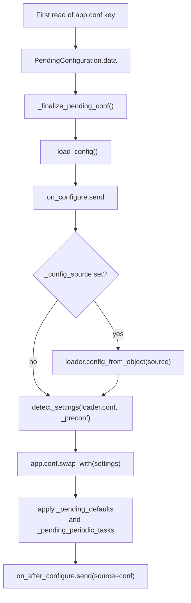
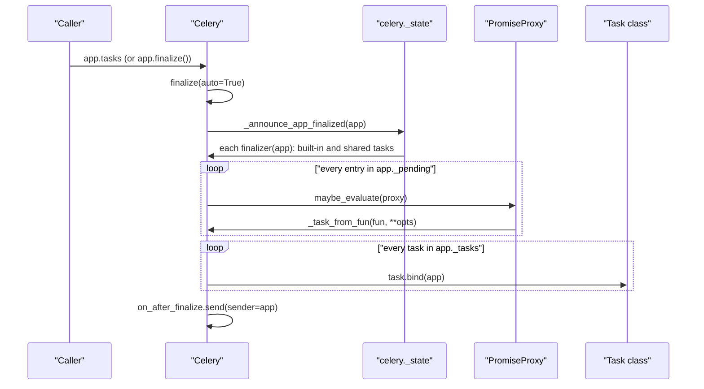

## Overview

Every Celery program starts with an instance of `celery.Celery` (also exported as `celery.app.base.App`). The instance is the entry point for everything else: it owns the configuration, the task registry, and lazily created helpers for messaging (`app.amqp`), results (`app.backend`), remote control (`app.control`), events (`app.events`), configuration loading (`app.loader`) and logging (`app.log`). Clients, workers and beat each create the same app by importing the module that defines it.

Sources: [celery/app/base.py:252-287](repo://celery/app/base.py#L252-L287), [celery/app/base.py:1534-1613](repo://celery/app/base.py#L1534-L1613), [celery/app/base.py:1635-1635](repo://celery/app/base.py#L1635-L1635)

Almost nothing happens when the app is constructed. Configuration is read the first time a setting is accessed, task decorators return proxies that are evaluated when the app is finalized, and helpers are `cached_property` values built on first use. This keeps importing a project cheap and lets settings change after the app object exists but before it is used.

Sources: [celery/app/base.py:208-249](repo://celery/app/base.py#L208-L249), [celery/app/base.py:554-575](repo://celery/app/base.py#L554-L575), [celery/app/base.py:1530-1594](repo://celery/app/base.py#L1530-L1594)

## Constructor arguments

`Celery.__init__` mostly records its arguments. `broker`, `backend` and `include` become the `broker_url`, `result_backend` and `include` settings, and every unknown keyword argument is treated as a setting as well; all of them go into `_preconf`, which later takes priority over the configuration source.

Sources: [celery/app/base.py:343-401](repo://celery/app/base.py#L343-L401), [celery/app/base.py:447-450](repo://celery/app/base.py#L447-L450)

| Argument | Default | Effect |
| --- | --- | --- |
| `main` | `None` | Name of the main module; replaces `__main__` in generated task names. |
| `broker` | `None` | Stored as `broker_url`. |
| `backend` | `None` | Stored as `result_backend` (a URL or a backend class path). |
| `include` | `None` | Stored as `include`: modules every worker imports. |
| `loader` | `CELERY_LOADER` env, then `celery.loaders.app:AppLoader` | Loader class or alias (`app`, `default`). |
| `amqp`, `events`, `log`, `control` | `celery.app.amqp:AMQP`, `celery.app.events:Events`, `celery.app.log:Logging`, `celery.app.control:Control` | Replace the helper classes. |
| `tasks` | `celery.app.registry:TaskRegistry` | A registry instance, or a mapping to build one from. |
| `task_cls` | `celery.app.task:Task` | Base class for tasks created with `@app.task`. |
| `config_source` | `None` | Object or module name to read settings from. |
| `fixups` | `{'celery.fixups.django:fixup'}` | Fix-up plug-ins instantiated with the app. |
| `set_as_current` | `True` | Make this the current app for the thread. |
| `autofinalize` | `True` | When `False`, using the registry before `finalize()` raises `RuntimeError`. |
| `namespace` | `None` | Setting-name prefix, for example `CELERY` to read `CELERY_BROKER_URL`. |
| `strict_typing` | `True` | Default for each task's `typing` attribute: when true, `apply_async` checks the call's arguments against the function signature. |
| `changes` | `None` | Initial dict of setting changes (used when unpickling). |
| `**kwargs` | | Any setting, such as `task_acks_late=True`. |

Sources: [celery/app/base.py:309-318](repo://celery/app/base.py#L309-L318), [celery/app/base.py:343-413](repo://celery/app/base.py#L343-L413), [celery/app/base.py:436-442](repo://celery/app/base.py#L436-L442), [celery/app/base.py:82-84](repo://celery/app/base.py#L82-L84), [celery/loaders/__init__.py:10-18](repo://celery/loaders/__init__.py#L10-L18), [celery/app/task.py:418-430](repo://celery/app/task.py#L418-L430), [celery/app/task.py:662-668](repo://celery/app/task.py#L662-L668)

After storing the arguments the constructor wraps `_preconf` in a `PendingConfiguration`, instantiates each fix-up, calls `set_current()` if requested, creates the four app signals (`on_configure`, `on_after_configure`, `on_after_finalize`, `on_after_fork`), calls the `on_init()` hook and registers the app in the global weak set of live apps.

Sources: [celery/app/base.py:403-434](repo://celery/app/base.py#L403-L434)

```python
from celery import Celery

app = Celery(
    'proj',
    broker='redis://localhost:6379/0',
    backend='redis://localhost:6379/1',
    include=['proj.tasks'],
    task_acks_late=True,
)
```

Sources: [celery/app/base.py:343-401](repo://celery/app/base.py#L343-L401)

## Lazy configuration

### Pending configuration

Until the configuration is loaded, `app.conf` is a `Settings` object over a `PendingConfiguration`. Writes (`app.conf.x = ...`, `update`, `setdefault`, `clear`) go straight into the preconfiguration dict, so they don't trigger loading; reading any key evaluates the `data` cached property, which calls `app._finalize_pending_conf()`.

Sources: [celery/app/base.py:208-249](repo://celery/app/base.py#L208-L249), [celery/app/base.py:403-408](repo://celery/app/base.py#L403-L408)

`_load_config` then does the real work, in this order:
1. Send `on_configure`.
2. If a configuration source was set, call `loader.config_from_object(source)`.
3. Mark the app `configured` and build the final settings with `detect_settings`, merging the loader's configuration with `_preconf` and the namespace prefix. Old-style uppercase names are still accepted; mixing old and new names raises `ImproperlyConfigured` with rename suggestions.
4. Swap the result into the existing `app.conf` object in place, so references taken earlier see the final values.
5. Apply pending `add_defaults()` callables and pending `add_periodic_task()` entries.
6. Send `on_after_configure` with `source=self._conf`.

Sources: [celery/app/base.py:1230-1280](repo://celery/app/base.py#L1230-L1280), [celery/app/utils.py:232-277](repo://celery/app/utils.py#L232-L277)



Sources: [celery/app/base.py:1230-1280](repo://celery/app/base.py#L1230-L1280)

### Loading from an object or module

`config_from_object(obj, silent=False, force=False, namespace=None)` only records the source and namespace when the app is not yet configured. If the app is already configured, or `force=True`, it drops the current settings and asks the loader to import the object right away. The loader imports strings relative to the current directory and accepts both `module.attr` and `module:attr` forms.

Sources: [celery/app/base.py:703-725](repo://celery/app/base.py#L703-L725), [celery/loaders/base.py:119-141](repo://celery/loaders/base.py#L119-L141)

`config_from_envvar(variable_name)` reads a module name from the environment and passes it on to `config_from_object`. If the variable is missing it returns `False` with `silent=True`, otherwise it raises `ImproperlyConfigured` with a message that shows how to set it.

Sources: [celery/app/base.py:727-743](repo://celery/app/base.py#L727-L743), [celery/app/base.py:87-96](repo://celery/app/base.py#L87-L96)

```python
app.config_from_object('proj.celeryconfig')

# Django-style: read CELERY_-prefixed names from settings.py
app.config_from_object('django.conf:settings', namespace='CELERY')

# module name taken from the environment
os.environ['CELERY_CONFIG_MODULE'] = 'proj.celeryconfig'
app.config_from_envvar('CELERY_CONFIG_MODULE')
```

Sources: [celery/app/base.py:703-743](repo://celery/app/base.py#L703-L743)

`add_defaults(d_or_fun)` registers defaults with lower priority than user settings. A callable is kept as a promise and only evaluated when the configuration is loaded, and nothing is copied to child processes, so the call must also happen at import time in the worker.

Sources: [celery/app/base.py:679-701](repo://celery/app/base.py#L679-L701)

See [[Configuration and Settings]] for the settings themselves.

Sources: [celery/app/base.py:1256-1259](repo://celery/app/base.py#L1256-L1259)

## Creating tasks with the task decorator

### How `@app.task` works

`app.task` accepts either a bare function (`@app.task`) or options (`@app.task(bind=True, name='x')`); any other positional use raises `TypeError`. Besides the normal task options it understands three decorator-only options: `shared` (default `True`), `lazy` (default `True`) and `filter`, a function applied to the result before it is returned.

Sources: [celery/app/base.py:515-585](repo://celery/app/base.py#L515-L585)

For each decorated function `_create_task_cls`:
1. If `shared`, registers a constructor with `connect_on_app_finalize`, so every app finalized later gets its own copy of the task.
2. If `lazy` is false or the app is already finalized, creates the task immediately with `_task_from_fun`.
3. Otherwise returns a `PromiseProxy(self._task_from_fun, (fun,), opts)` and appends it to `app._pending`.

Sources: [celery/app/base.py:554-575](repo://celery/app/base.py#L554-L575)

```python
            def _create_task_cls(fun):
                if shared:
                    def cons(app):
                        return app._task_from_fun(fun, **opts)

                    cons.__name__ = fun.__name__
                    connect_on_app_finalize(cons)
                if not lazy or self.finalized:
                    ret = self._task_from_fun(fun, **opts)
                else:
                    # return a proxy object that evaluates on first use
                    ret = PromiseProxy(self._task_from_fun, (fun,), opts,
                                       __doc__=fun.__doc__)
                    self._pending.append(ret)
```

Sources: [celery/app/base.py:557-570](repo://celery/app/base.py#L557-L570)

When the worker is started through `FORKED_BY_MULTIPROCESSING` (execv), a lazy `app.task` call is redirected to `shared_task(..., lazy=False)` so the task in the re-imported module points at the current app.

Sources: [celery/app/base.py:85-85](repo://celery/app/base.py#L85-L85), [celery/app/base.py:545-552](repo://celery/app/base.py#L545-L552)

### Building the task class

`_task_from_fun` raises `RuntimeError('Contract breach: app not finalized')` when `autofinalize=False` and the app isn't finalized. It derives the name with `gen_task_name(fun.__name__, fun.__module__)` unless `name` is given, and uses `base` or `app.Task` as the base class. If the name is already registered the existing task is returned. Otherwise it creates a new subclass with `type()`, setting `app`, `name`, `run` (a `staticmethod` unless `bind=True`), the docstring, module, annotations and a `__header__` signature checker, instantiates it, registers it, calls `task.bind(app)` and applies autoretry options. With `pydantic=True` the function is first wrapped to validate arguments and dump return values.

Sources: [celery/app/base.py:590-633](repo://celery/app/base.py#L590-L633), [celery/utils/imports.py:122-141](repo://celery/utils/imports.py#L122-L141)

```python
@app.task
def add(x, y):
    return x + y

@app.task(bind=True, name='proj.refresh', max_retries=3)
def refresh(self, url):
    ...
```

Sources: [celery/app/base.py:521-534](repo://celery/app/base.py#L521-L534), [celery/app/base.py:590-621](repo://celery/app/base.py#L590-L621)

`register_task(task)` is the compatibility path for class-based tasks: it instantiates a class, generates a name if the task has none, applies autoretry, stores it in `app.tasks` and binds it.

Sources: [celery/app/base.py:635-652](repo://celery/app/base.py#L635-L652)

### Shared tasks

`celery.shared_task` is for reusable libraries that must not import a concrete app. It registers a finalize callback so unfinalized and future apps create the task, immediately creates it on every app that is already finalized, and returns a plain `Proxy` whose target is looked up in `current_app.tasks` on every access.

Sources: [celery/app/__init__.py:24-76](repo://celery/app/__init__.py#L24-L76)

```python
from celery import shared_task

@shared_task
def add(x, y):
    return x + y
```

Sources: [celery/app/__init__.py:34-47](repo://celery/app/__init__.py#L34-L47)

## Finalization

`app.finalize()` turns the pending decorators into registered tasks. It runs under `_finalize_mutex` and only once. With `auto=True` (the call made by `app.tasks`) it raises `RuntimeError` if `autofinalize` is off.

Sources: [celery/app/base.py:657-677](repo://celery/app/base.py#L657-L677)



Sources: [celery/app/base.py:657-677](repo://celery/app/base.py#L657-L677), [celery/app/base.py:1601-1609](repo://celery/app/base.py#L1601-L1609), [celery/_state.py:36-52](repo://celery/_state.py#L36-L52), [celery/local.py:353-358](repo://celery/local.py#L353-L358)

The finalizer set in `celery._state` also holds the built-in tasks: modules such as `celery.app.builtins` decorate functions with `@connect_on_app_finalize`, which is how every app gets `celery.backend_cleanup`, `celery.accumulate`, `celery.chord_unlock` and the canvas helpers `celery.map`, `celery.starmap`, `celery.chunks`, `celery.group`, `celery.chain` and `celery.chord`.

Sources: [celery/app/builtins.py:1-50](repo://celery/app/builtins.py#L1-L50), [celery/app/builtins.py:100-175](repo://celery/app/builtins.py#L100-L175), [celery/_state.py:43-46](repo://celery/_state.py#L43-L46)

`Task.bind(app)` is where configuration reaches the task: it copies each unset attribute listed in `from_config` from `app.conf`, sets `typing` from `strict_typing`, applies `task_annotations` the first time the class is bound, creates the request stack and calls the `on_bound` hook. A task class that has never been bound binds itself to `current_app` the first time its `app` attribute is read.

Sources: [celery/app/task.py:418-475](repo://celery/app/task.py#L418-L475)

> [!WARNING]
> Accessing an attribute on the proxy returned by `@app.task` evaluates it, and accessing `app.tasks` finalizes the app. Code that runs at import time (for example, reading `add.name` in a module that is imported before configuration is complete) forces both earlier than you might expect.

Sources: [celery/app/base.py:536-543](repo://celery/app/base.py#L536-L543), [celery/app/base.py:1601-1609](repo://celery/app/base.py#L1601-L1609)

## Discovering task modules

`autodiscover_tasks(packages=None, related_name='tasks', force=False)` imports `<package>.tasks` for each package. By default it is lazy: it connects a promise to the `import_modules` signal for this app, and the loader sends that signal from `import_default_modules()` when a worker initializes (or a command such as `celery report` needs the tasks). `force=True` imports immediately.

Sources: [celery/app/base.py:782-831](repo://celery/app/base.py#L782-L831), [celery/loaders/base.py:97-111](repo://celery/loaders/base.py#L97-L111), [celery/bin/celery.py:166-172](repo://celery/bin/celery.py#L166-L172)

`packages` may be a callable, evaluated when discovery runs. With no packages the app asks its fix-ups instead: the Django fix-up returns the installed apps. The loader's `find_related_module` imports the package, then its `related_name` submodule, walking up one package level when the package itself is not importable.

Sources: [celery/app/base.py:833-844](repo://celery/app/base.py#L833-L844), [celery/loaders/base.py:218-265](repo://celery/loaders/base.py#L218-L265)

```python
app = Celery('proj')
app.config_from_object('django.conf:settings', namespace='CELERY')
app.autodiscover_tasks()                 # ask fix-ups (Django INSTALLED_APPS)
app.autodiscover_tasks(['proj.billing', 'proj.mail'])
```

Sources: [celery/app/base.py:782-844](repo://celery/app/base.py#L782-L844)

## Sending tasks by name

`app.send_task(name, args, kwargs, **options)` publishes a task without importing its code, which is how a client calls tasks that live only in the worker. It accepts the same options as `Task.apply_async`, and `apply_async` itself ends in `send_task`. `task_always_eager` is ignored here and triggers an `AlwaysEagerIgnored` warning.

Sources: [celery/app/base.py:846-872](repo://celery/app/base.py#L846-L872), [celery/app/task.py:702-708](repo://celery/app/task.py#L702-L708)

The method looks the name up in the raw registry (`self._tasks`, not `self.tasks`) so sending never finalizes the app; if a local task is found, its execution options are merged under the caller's. `time_limit`, `soft_time_limit` and `expires` use a sentinel so an explicit `None` clears a task-level default. A negative `expires` is logged and clamped to `0`. When called from inside a worker task, `root_id`, `parent_id` and (with `task_inherit_parent_priority`) the priority come from the running task, and the new result is added to the parent's trail.

Sources: [celery/app/base.py:885-929](repo://celery/app/base.py#L885-L929), [celery/app/base.py:968-1004](repo://celery/app/base.py#L968-L1004), [celery/app/base.py:1036-1041](repo://celery/app/base.py#L1036-L1041)

```python
result = app.send_task('proj.tasks.add', args=(2, 2), countdown=10)
result.get(timeout=30)
```

Sources: [celery/app/base.py:846-862](repo://celery/app/base.py#L846-L862)

Routing, message creation and publishing are covered in [[Messaging and Routing]].

Sources: [celery/app/base.py:1007-1029](repo://celery/app/base.py#L1007-L1029)

## The current app and current task

### Thread state in celery._state

`celery._state` tracks which app code that doesn't receive one explicitly should use. `set_current()` stores the app in a thread-local, `set_default()` stores a process-wide default, and `get_current_app()` returns the thread's current app or the default. If neither exists it creates a fallback app named `default` with no fix-ups and the `default` loader.

Sources: [celery/app/base.py:452-458](repo://celery/app/base.py#L452-L458), [celery/_state.py:64-118](repo://celery/_state.py#L64-L118)

Executing tasks are pushed onto `_task_stack`, a thread-local stack. `Task.__call__` pushes the task while `run` executes, so `current_task` is the innermost running task. `get_current_worker_task()` (and `app.current_worker_task`) walks the stack from the top and returns the first task whose request was not `called_directly`, skipping tasks that were called as plain functions inside another task.

Sources: [celery/_state.py:73-136](repo://celery/_state.py#L73-L136), [celery/app/task.py:495-502](repo://celery/app/task.py#L495-L502), [celery/app/base.py:1502-1514](repo://celery/app/base.py#L1502-L1514)

Setting `C_STRICT_APP` makes any `get_current_app()` call raise, and `C_WARN_APP` prints a stack trace on each one. `CELERY_TRACE_APP` turns on `app_or_default` tracing, which raises in the main process when code falls back to the default app; these help find code that should have been passed an app.

Sources: [celery/_state.py:107-118](repo://celery/_state.py#L107-L118), [celery/_state.py:157-197](repo://celery/_state.py#L157-L197)

### Proxy and PromiseProxy

`current_app` and `current_task` are `Proxy(get_current_app)` and `Proxy(get_current_task)`. A `Proxy` stores a callable plus arguments and calls it on every attribute access, item access, operator or comparison, so it always reflects the current value. It also forwards `__class__`, `__name__`, `__doc__` and `__module__`, which makes `isinstance` checks work against the target.

Sources: [celery/_state.py:138-142](repo://celery/_state.py#L138-L142), [celery/local.py:52-160](repo://celery/local.py#L52-L160)

`PromiseProxy` evaluates once. The first `_get_current_object()` calls the factory, caches the object in `__thing`, deletes the stored callable and arguments, and runs callbacks queued with `__then__`. `maybe_evaluate(obj)` evaluates a promise and returns any other object unchanged, which is how `finalize` drains `_pending`.

Sources: [celery/local.py:282-358](repo://celery/local.py#L282-L358)

```python
from celery import current_app, current_task

def log_context():
    print(current_app.main)          # resolved on each access
    if current_task:
        print(current_task.request.id)
```

Sources: [celery/_state.py:121-142](repo://celery/_state.py#L121-L142), [celery/local.py:127-131](repo://celery/local.py#L127-L131)

## Custom task base classes

`app.Task` is a cached subclass of `task_cls` created by `create_task_cls()` through `subclass_with_self`, with the app stored in its `_app` attribute and marked `abstract`. Subclassing `app.Task` gives a base class already bound to this app; `subclass_with_self` is the same mechanism used for `app.AsyncResult`, `app.GroupResult`, `app.Worker`, `app.WorkController` and `app.Beat`.

Sources: [celery/app/base.py:1335-1375](repo://celery/app/base.py#L1335-L1375), [celery/app/base.py:1430-1486](repo://celery/app/base.py#L1430-L1486)

There are three ways to change the base class: pass `base=` to a single decorator, pass `task_cls=` (a class or `'module:Class'` string) to the constructor for every task in the app, or set `task_cls` on a `Celery` subclass. The constructor records whether either of the last two was used in `_custom_task_cls_used`; the Django fix-up only switches the default to `celery.contrib.django.task:DjangoTask` when it wasn't.

Sources: [celery/app/base.py:360-366](repo://celery/app/base.py#L360-L366), [celery/app/base.py:604-605](repo://celery/app/base.py#L604-L605), [celery/fixups/django.py:84-85](repo://celery/fixups/django.py#L84-L85)

```python
class LoggedTask(app.Task):
    def on_failure(self, exc, task_id, args, kwargs, einfo):
        print(f'{task_id} failed: {exc!r}')

@app.task(base=LoggedTask)
def risky():
    ...

app2 = Celery('proj', task_cls='proj.base:LoggedTask')
```

Sources: [celery/app/base.py:590-606](repo://celery/app/base.py#L590-L606), [celery/app/base.py:1335-1340](repo://celery/app/base.py#L1335-L1340)

See [[Tasks]] for task options and handlers.

Sources: [celery/app/task.py:418-455](repo://celery/app/task.py#L418-L455)

## App signals and lifecycle

Each app has its own four `Signal` objects, created in the constructor, and connecting to them only affects that app. The global signals in `celery.signals` are covered in [[Signals]].

Sources: [celery/app/base.py:327-341](repo://celery/app/base.py#L327-L341), [celery/app/base.py:418-427](repo://celery/app/base.py#L418-L427)

| Signal | Sent from | Arguments |
| --- | --- | --- |
| `on_configure` | Start of `_load_config`, before the configuration source is read | `sender=app` |
| `on_after_configure` | End of `_load_config`, after defaults and pending periodic tasks are applied | `sender=app`, `source=app.conf` |
| `on_after_finalize` | End of `finalize`, after pending tasks are evaluated and all tasks bound | `sender=app` |
| `on_after_fork` | `_after_fork`, in each child process after its connection pool is reset | `sender=app` |

Sources: [celery/app/base.py:1247-1288](repo://celery/app/base.py#L1247-L1288), [celery/app/base.py:657-677](repo://celery/app/base.py#L657-L677)

`Signal.connect` works as a decorator, so a receiver can be attached in the module that defines the app. A common use is adding beat entries once the configuration exists: `add_periodic_task` called before configuration is queued and applied during `_load_config`, and called afterwards writes straight into `beat_schedule`.

Sources: [celery/utils/dispatch/signal.py:110-185](repo://celery/utils/dispatch/signal.py#L110-L185), [celery/app/base.py:1295-1333](repo://celery/app/base.py#L1295-L1333)

```python
@app.on_after_configure.connect
def setup_periodic_tasks(sender, **kwargs):
    sender.add_periodic_task(10.0, add.s(2, 2), name='add every 10s')

@app.on_after_finalize.connect
def list_tasks(sender, **kwargs):
    print(sorted(sender.tasks))
```

Sources: [celery/app/base.py:1295-1310](repo://celery/app/base.py#L1295-L1310), [celery/app/base.py:1601-1609](repo://celery/app/base.py#L1601-L1609)

The fork hook is registered lazily: the first access to `app.pool` (the broker connection pool, not the worker pool) calls `_ensure_after_fork`, which registers `_after_fork_cleanup_app` with kombu's `register_after_fork`. In the child, `_after_fork` drops the connection and producer pools so connections are never shared across processes.

Sources: [celery/app/base.py:460-464](repo://celery/app/base.py#L460-L464), [celery/app/base.py:118-124](repo://celery/app/base.py#L118-L124), [celery/app/base.py:1282-1288](repo://celery/app/base.py#L1282-L1288), [celery/app/base.py:1488-1500](repo://celery/app/base.py#L1488-L1500)

Apps are pickled by their constructor keywords: `__reduce_keys__` returns `main`, the setting changes, the helper class names, fix-ups, configuration source, `task_cls` and namespace, so child processes rebuild an equivalent app instead of copying it. `close()` (also called by the `with` statement) drops the pool and removes the app from the live-apps set.

Sources: [celery/app/base.py:1391-1421](repo://celery/app/base.py#L1391-L1421), [celery/app/base.py:466-478](repo://celery/app/base.py#L466-L478), [celery/app/base.py:1382-1386](repo://celery/app/base.py#L1382-L1386)
