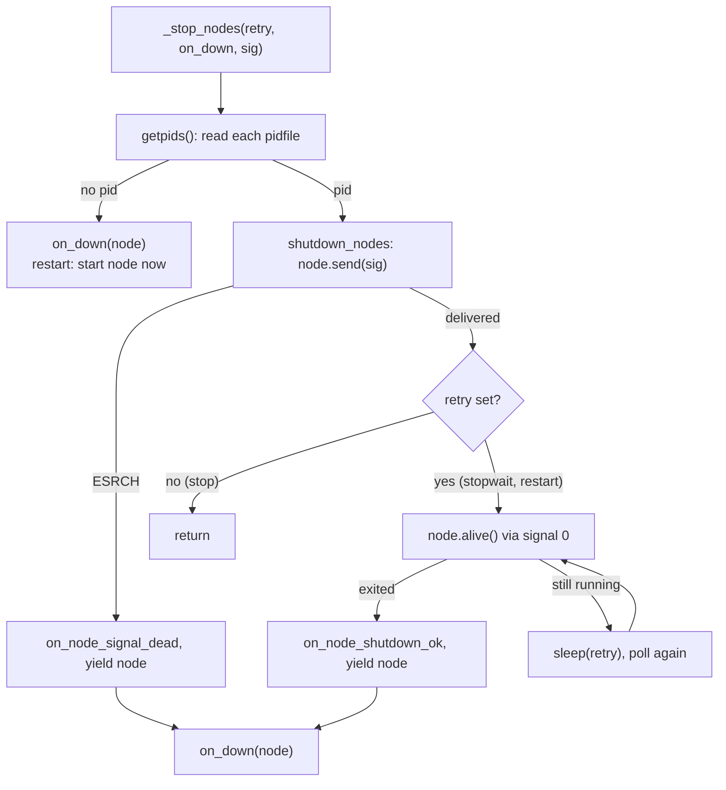

## Overview

`celery multi` starts, stops and restarts a group of detached `celery worker` processes on one host from a single command line. It exists so that init scripts and systemd units can manage several named workers, each with its own options, pidfile and logfile, without a supervisor. It is a thin process manager: it never talks to the broker, it only builds a `celery worker --detach` command per node, runs it, and later finds each worker again through its pidfile to send it signals.

Sources: [celery/bin/multi.py:1-56](repo://celery/bin/multi.py#L1-L56), [celery/apps/multi.py:122-135](repo://celery/apps/multi.py#L122-L135)

The code is split in two layers. `celery/bin/multi.py` holds `MultiTool`, the command dispatcher and terminal reporter, plus the click command that plugs it into the `celery` program (see [[Command Line Interface]]). `celery/apps/multi.py` holds the reusable model: `NamespacedOptionParser` splits the argument list, `MultiParser` turns it into `Node` objects, and `Cluster` starts and signals those nodes. Name and placeholder handling comes from `celery/utils/nodenames.py`. The systemd unit and generic init script shipped in `extra/` drive workers through these same commands (see [[Deployment]]).

Sources: [celery/bin/multi.py:101-116](repo://celery/bin/multi.py#L101-L116), [celery/apps/multi.py:1-19](repo://celery/apps/multi.py#L1-L19), [extra/systemd/celery.service:11-18](repo://extra/systemd/celery.service#L11-L18)

## Commands

### Command reference

`MultiTool.__init__` maps each subcommand name to a method. The first non-option argument picks the command; everything after it is the node list plus worker options.

Sources: [celery/bin/multi.py:240-260](repo://celery/bin/multi.py#L240-L260), [celery/bin/multi.py:118-136](repo://celery/bin/multi.py#L118-L136)

| Command | Method | What it does |
| --- | --- | --- |
| `start` | `MultiTool.start` | Runs `Cluster.start()`, one detached worker per node; exits 1 if any node failed. |
| `stop` | `MultiTool.stop` | Sends a signal (default `SIGTERM`) to every node with a pid and returns without waiting. |
| `stopwait` (alias `stop_verify`) | `MultiTool.stopwait` | Sends the signal, then polls until every node has exited. |
| `restart` | `MultiTool.restart` | Stops each node, waits for it to exit, then starts it again; exits 1 if any restart failed. |
| `kill` | `MultiTool.kill` | Sends `SIGKILL` to every node with a pid. |
| `show` | `MultiTool.show` | Prints the full command line (executable included) for each node; starts nothing. |
| `get <nodename>` | `MultiTool.get` | Prints the argv of one node, or exits with `EX_FAILURE` if no node has that name. |
| `names` | `MultiTool.names` | Prints the expanded node names, one per line. |
| `expand <template>` | `MultiTool.expand` | Prints the template with each node's placeholders filled in. |
| `help` | `MultiTool.help` | Prints the module docstring with its examples. |

Sources: [celery/bin/multi.py:289-342](repo://celery/bin/multi.py#L289-L342), [celery/apps/multi.py:406-447](repo://celery/apps/multi.py#L406-L447)

There is no separate dry-run command: `show`, `get`, `names` and `expand` build the same `Node` objects as `start` but only print them, so they are the way to check what a `start` would run. They still create missing pidfile and logfile directories, because `Node` does that while filling in default options (see Pidfiles and logfiles below).

Sources: [celery/bin/multi.py:311-339](repo://celery/bin/multi.py#L311-L339), [celery/apps/multi.py:137-154](repo://celery/apps/multi.py#L137-L154)

### Usage examples

The module docstring, also printed by `celery multi help`, gives the canonical forms: a count builds numbered nodes, a list of words builds named nodes, and `%h` stands for the current host name.

Sources: [celery/bin/multi.py:29-56](repo://celery/bin/multi.py#L29-L56), [celery/bin/multi.py:341-342](repo://celery/bin/multi.py#L341-L342)

```console
$ # 3 workers, with 3 processes each
$ celery multi start 3 -c 3
celery worker -n celery1@myhost -c 3
celery worker -n celery2@myhost -c 3
celery worker -n celery3@myhost -c 3

$ # override name prefix when using range
$ celery multi start 3 --range-prefix=worker -c 3
celery worker -n worker1@myhost -c 3
celery worker -n worker2@myhost -c 3
celery worker -n worker3@myhost -c 3

$ # start 3 named workers
$ celery multi start image video data -c 3
celery worker -n image@myhost -c 3
celery worker -n video@myhost -c 3
celery worker -n data@myhost -c 3
```

Sources: [celery/bin/multi.py:29-45](repo://celery/bin/multi.py#L29-L45)

The pidfile and logfile options must be repeated on every later command, because `celery multi` keeps no state of its own: `stop` and `restart` can only find a worker by recomputing its pidfile path.

Sources: [celery/apps/multi.py:246-265](repo://celery/apps/multi.py#L246-L265), [celery/apps/multi.py:491-496](repo://celery/apps/multi.py#L491-L496)

```console
$ celery multi start Leslie -E --pidfile=/var/run/celery/%n.pid
                               --logfile=/var/log/celery/%n%I.log
$ celery multi restart Leslie -E --pidfile=/var/run/celery/%n.pid
                                 --logfile=/var/log/celery/%n%I.log
$ celery multi stop Leslie --pidfile=/var/run/celery/%n.pid
```

Sources: [celery/bin/multi.py:13-27](repo://celery/bin/multi.py#L13-L27), [celery/apps/multi.py:246-265](repo://celery/apps/multi.py#L246-L265)

## From the command line to running workers

### Dispatch flow

`multi` is registered as a click command with `allow_extra_args` and `ignore_unknown_options`, so click passes the raw arguments through. Because `-A/--app` and the other options are global in Celery 5, the command re-reads `sys.argv`, moves everything from the word `multi` onward to the front and appends the global options after it. `MultiTool` then sees them as ordinary node options, and `Node` later puts them back before the `worker` subcommand.

Sources: [celery/bin/multi.py:463-480](repo://celery/bin/multi.py#L463-L480), [celery/apps/multi.py:161-179](repo://celery/apps/multi.py#L161-L179)

```python
cmd = MultiTool(quiet=ctx.obj.quiet, no_color=ctx.obj.no_color)
# In 4.x, celery multi ignores the global --app option.
# Since in 5.0 the --app option is global only we
# rearrange the arguments so that the MultiTool will parse them correctly.
args = sys.argv[1:]
args = args[args.index('multi'):] + args[:args.index('multi')]
return cmd.execute_from_commandline(args)
```

Sources: [celery/bin/multi.py:463-480](repo://celery/bin/multi.py#L463-L480)

`execute_from_commandline` first removes the reserved options `--nosplash`, `--quiet`/`-q`, `--verbose` and `--no-color` from anywhere in the list and stores them on the tool. It then pops the program name and rejects an argument list whose first element starts with `-`. Last, `call_command` looks up the command method. The `@using_cluster` and `@using_cluster_and_sig` decorators turn the remaining argv into a `Cluster` before the method body runs, and `@splash` prints the `celery multi v<version>` banner unless `--nosplash` was given.

Sources: [celery/bin/multi.py:143-167](repo://celery/bin/multi.py#L143-L167), [celery/bin/multi.py:226-287](repo://celery/bin/multi.py#L226-L287)

```mermaid
sequenceDiagram
    participant User
    participant Click as "multi() click command"
    participant Tool as "MultiTool"
    participant Opt as "NamespacedOptionParser"
    participant Parser as "MultiParser"
    participant Cl as "Cluster"
    participant N as "Node"
    User->>Click: celery -A proj multi start 3 -c 3
    Click->>Tool: execute_from_commandline(["multi","start","3","-c","3","-A","proj"])
    Tool->>Tool: _handle_reserved_options, call_command("start")
    Tool->>Opt: parse()
    Opt-->>Tool: values, options, namespaces, passthrough
    Tool->>Parser: parse(p)
    Parser-->>Tool: Node per name
    Tool->>Cl: Cluster(nodes, callbacks)
    Tool->>Cl: start()
    Cl->>N: start(env, on_spawn, ...)
    N->>N: Popen(python -m celery -A proj worker --detach ...)
    N-->>Cl: exit code
    Cl-->>Tool: list of exit codes
```

Sources: [celery/bin/multi.py:262-293](repo://celery/bin/multi.py#L262-L293), [celery/bin/multi.py:359-393](repo://celery/bin/multi.py#L359-L393), [celery/apps/multi.py:208-221](repo://celery/apps/multi.py#L208-L221), [celery/apps/multi.py:406-421](repo://celery/apps/multi.py#L406-L421)

### Building each worker's argv

`Node` defaults its command to `-m celery worker --detach`. `_prepare_argv` expands placeholders in the command, then moves the global options (`-A/--app`, `-b/--broker`, `--result-backend`, `--loader`, `--config`, `--workdir`, `-C/--no-color`, `-q/--quiet`) to just after `celery`, so they come before `worker`. The remaining options follow, rendered by `format_opt` as `--name=value` for long options and `-x value` for short ones (a bare flag when the value is empty). After those come the text after a literal `--` (`extra_args`) and the expanded `--append` string.

Sources: [celery/apps/multi.py:54-59](repo://celery/apps/multi.py#L54-L59), [celery/apps/multi.py:125-135](repo://celery/apps/multi.py#L125-L135), [celery/apps/multi.py:161-190](repo://celery/apps/multi.py#L161-L190)

`Node.start` prefixes the argv with the `--executable` option (default `sys.executable`), joins it into a string, splits it again with `shlex.split` (POSIX rules except on Windows), and runs it with `Popen(...).wait()`. Since the child is a `worker --detach`, it forks into the background and its parent process exits, so `wait()` returns as soon as detaching succeeds or fails. `handle_process_exit` reports a negative return code as death by signal (`on_child_signalled`) and a positive one as failure (`on_child_failure`).

Sources: [celery/apps/multi.py:208-233](repo://celery/apps/multi.py#L208-L233), [celery/apps/multi.py:267-273](repo://celery/apps/multi.py#L267-L273), [celery/bin/worker.py:338-356](repo://celery/bin/worker.py#L338-L356)

## Node names and per-node options

### Ranges, names and hostnames

`MultiParser.parse` reads the positional values as node names. When there is exactly one value and it parses as an integer, `_get_ranges` replaces it with `"1"` to `"N"` and the prefix becomes `--range-prefix` (default `celery`). Otherwise each value is a literal name and the prefix is `--prefix` (default empty). The host part comes from `--suffix`, falling back to `--hostname`, then `-n`, then `gethostname()`. A suffix of `""` or `''` yields an empty host part. Because `-n` is consumed here as the hostname, it can't be used to pass a node name to the worker: `Node` always sets `-n` to the computed node name.

Sources: [celery/apps/multi.py:285-332](repo://celery/apps/multi.py#L285-L332), [celery/apps/multi.py:137-138](repo://celery/apps/multi.py#L137-L138)

`build_nodename` handles the two name shapes. A name that already contains `@` (such as `foo@%h` or `foo@worker.example.com`) is expanded with `host_format` and split with `nodesplit`, so the given host wins. Any other name becomes `<prefix><name>@<suffix>` and is expanded the same way.

Sources: [celery/apps/multi.py:28-39](repo://celery/apps/multi.py#L28-L39), [celery/utils/nodenames.py:69-74](repo://celery/utils/nodenames.py#L69-L74)

### Namespaced options

`NamespacedOptionParser.parse` walks the arguments: `--name=value` becomes a long option, `-x value` a short option (the next argument is taken as the value unless it starts with `-`), and the first `--` stops parsing and saves the rest as passthrough text. An option name containing `:` goes into a namespace instead of the global options, so `-c:1 10` stores `-c 10` in namespace `1`.

Sources: [celery/apps/multi.py:70-119](repo://celery/apps/multi.py#L70-L119)

`MultiParser` then resolves namespaces in two passes. `_update_ns_opts` maps purely numeric namespaces to the node at that 1-based position and raises `KeyError` for index 0 or an index past the end. `_update_ns_ranges` splits namespaces holding commas (`-Q:4,5`) and, in range mode only, dashes (`-c:1-3`) into one namespace per member. Last, `_node_from_options` looks up options under the full node name if such a namespace exists, else under the short name. `optmerge` lays the namespace values over the global options, so the per-node value wins.

Sources: [celery/apps/multi.py:323-364](repo://celery/apps/multi.py#L323-L364), [celery/apps/multi.py:108-111](repo://celery/apps/multi.py#L108-L111)

```console
$ # 3 workers: Two with 3 processes, and one with 10 processes.
$ celery multi start 3 -c 3 -c:1 10
celery worker -n celery1@myhost -c 10
celery worker -n celery2@myhost -c 3
celery worker -n celery3@myhost -c 3

$ # can also specify options for named workers
$ celery multi start image video data -c 3 -c:image 10
celery worker -n image@myhost -c 10
celery worker -n video@myhost -c 3
celery worker -n data@myhost -c 3
```

Sources: [celery/bin/multi.py:73-83](repo://celery/bin/multi.py#L73-L83)

> [!WARNING]
> `call_command` catches `KeyError` around the whole command call. A bad namespace index such as `-c:0`, or `-c:4` with three nodes, raises `KeyError` inside `MultiParser`, so it is reported as `Invalid command: start` followed by the usage text, not as an index error.

Sources: [celery/bin/multi.py:276-280](repo://celery/bin/multi.py#L276-L280), [celery/apps/multi.py:334-345](repo://celery/apps/multi.py#L334-L345)

## Placeholders

### Expansion in two stages

Placeholders are expanded twice. While the node name is built, `host_format` fills in the current machine: `%h` is the full host name, `%n` the part before the first dot, `%d` the domain. Every option value, the command and the `--append` string are then passed through the node's `expander`, which `build_expander` makes from `node_format` with keys tied to that node. `%i` and `%I` map to themselves, so they reach the worker unchanged. The worker then expands them per pool process through `_fmt_process_index`.

Sources: [celery/apps/multi.py:42-51](repo://celery/apps/multi.py#L42-L51), [celery/utils/nodenames.py:83-114](repo://celery/utils/nodenames.py#L83-L114)

| Placeholder | Inside `celery multi` options (node expander) | Expanded later by the worker |
| --- | --- | --- |
| `%h` | Full node name, for example `celery1@myhost` | |
| `%n` | Short node name with prefix, for example `celery1` | |
| `%N` | Short node name (same as `%n`) | |
| `%p` | Full node name | |
| `%d` | Host part of the node name | |
| `%i` | Kept literally | Pool process index, or `0` in the main process |
| `%I` | Kept literally | `-<index>` in a pool process, empty in the main process |
| `%%` | A literal `%` | |

Sources: [celery/apps/multi.py:42-51](repo://celery/apps/multi.py#L42-L51), [celery/utils/nodenames.py:89-114](repo://celery/utils/nodenames.py#L89-L114), [celery/utils/text.py:120-138](repo://celery/utils/text.py#L120-L138)

An unknown key makes `simple_format` raise `ValueError`. `celery multi expand <template> <nodes>` prints the template expanded for each node, which is the easy way to check a path before using it.

Sources: [celery/utils/text.py:120-138](repo://celery/utils/text.py#L120-L138), [celery/bin/multi.py:335-339](repo://celery/bin/multi.py#L335-L339)

### Name utilities

`celery/utils/nodenames.py` is shared by the worker, the control API and `celery multi`.

Sources: [celery/utils/nodenames.py:1-35](repo://celery/utils/nodenames.py#L1-L35)

| Function | Behavior |
| --- | --- |
| `gethostname()` | `socket.gethostname` memoized, so it is looked up once per process. |
| `nodename(name, hostname)` | Joins with `NODENAME_SEP` (`@`). |
| `nodesplit(name)` | Splits on the first `@`; returns `(None, name)` when there is no `@`. |
| `default_nodename(hostname)` | Fills a missing name with `celery` and a missing host with `gethostname()`. |
| `anon_nodename(hostname, prefix)` | `gen<pid>@host`, used for non-worker processes such as a task message's origin. |
| `node_format(s, name, **extra)` | Splits `name` and calls `host_format` with the host part, the short name and `p=name`. |
| `host_format(s, host, name, **extra)` | Expands `%h`, `%n`, `%d`, `%i`, `%I` plus any extra keys. |
| `worker_direct(hostname)` | Returns the `<hostname>.dq2` queue on the `C.dq2` exchange used to route to one worker. |

Sources: [celery/utils/nodenames.py:13-114](repo://celery/utils/nodenames.py#L13-L114)

## Pidfiles and logfiles

`Node._annotate_with_default_opts` makes sure every worker gets a node name, a pidfile, a logfile and an executable.

Sources: [celery/apps/multi.py:137-142](repo://celery/apps/multi.py#L137-L142)

```python
def _annotate_with_default_opts(self, options):
    options['-n'] = self.name
    self._setdefaultopt(options, ['--pidfile', '-p'], '/var/run/celery/%n.pid')
    self._setdefaultopt(options, ['--logfile', '-f'], '/var/log/celery/%n%I.log')
    self._setdefaultopt(options, ['--executable'], sys.executable)
    return options
```

Sources: [celery/apps/multi.py:137-142](repo://celery/apps/multi.py#L137-L142)

`_setdefaultopt` first returns any value given under the short alias (`-p`, `-f`). Otherwise it sets the long option to the normalized default and creates the option's parent directory if it is missing. It does that both for the default and for a user-supplied `--pidfile`/`--logfile`. The `%n` in the default pidfile gives each node its own file, and `%I` in the logfile gives each pool process its own log.

Sources: [celery/apps/multi.py:144-154](repo://celery/apps/multi.py#L144-L154)

> [!NOTE]
> The module docstring says pidfiles and logfiles go in the current directory by default, but the code defaults to `/var/run/celery/%n.pid` and `/var/log/celery/%n%I.log`. Running `celery multi` as an unprivileged user without `--pidfile`/`--logfile` therefore fails when those directories can't be created.

Sources: [celery/bin/multi.py:13-18](repo://celery/bin/multi.py#L13-L18), [celery/apps/multi.py:137-154](repo://celery/apps/multi.py#L137-L154)

The pidfile is how later commands find a worker. `Node.pid` reads it with `Pidfile.read_pid()`. A missing file gives `None`, and a partial or invalid file raises `ValueError`, which `Node.pid` swallows into `None`. `Cluster.getpids` yields only nodes with a pid and calls `on_down` for the others, which `MultiTool` reports as `> name: DOWN`.

Sources: [celery/apps/multi.py:246-265](repo://celery/apps/multi.py#L246-L265), [celery/apps/multi.py:491-496](repo://celery/apps/multi.py#L491-L496), [celery/platforms.py:163-176](repo://celery/platforms.py#L163-L176)

## Stopping, restarting and signals

### Choosing the signal

`stop`, `stopwait` and `restart` take an optional signal argument, found by `_find_sig_argument`. It scans the arguments after the node names from the end. A two-character `-N` is read as a signal number (`-9`), and `-NAME` is resolved with `signals.signum`, which accepts uppercase names with or without the `SIG` prefix (`-KILL`, `-SIGINT`). Lowercase options such as `-c` raise `TypeError` and are skipped. The default is `SIGTERM`.

Sources: [celery/bin/multi.py:344-357](repo://celery/bin/multi.py#L344-L357), [celery/platforms.py:647-656](repo://celery/platforms.py#L647-L656)

```console
$ celery multi stop 3 --pidfile=/var/run/celery/%n.pid -KILL
$ celery multi stopwait 3 --pidfile=/var/run/celery/%n.pid -INT
```

Sources: [celery/bin/multi.py:118-123](repo://celery/bin/multi.py#L118-L123), [celery/bin/multi.py:344-357](repo://celery/bin/multi.py#L344-L357)

### Shutdown loop

All three commands go through `Cluster._stop_nodes` and differ only in `retry` and `on_down`. `stop` passes `retry=None`, so it signals and returns. `stopwait` and `restart` pass `retry=2`. `restart` also replaces `on_down` with `restart_on_down`, which starts the node again through `_start_node` as soon as it is down.

Sources: [celery/apps/multi.py:431-454](repo://celery/apps/multi.py#L431-L454)

`shutdown_nodes` sends the signal to every node through `Node.send`, which calls `os.kill`. A node whose process no longer exists (`ESRCH`) is reported with `on_node_signal_dead` and yielded as down right away. Any other `OSError` is raised. With `retry` set, the loop checks each remaining node with `Node.alive()` (signal 0), yields each one that has exited, and sleeps `retry` seconds after each full pass over the remaining set.

Sources: [celery/apps/multi.py:192-206](repo://celery/apps/multi.py#L192-L206), [celery/apps/multi.py:456-483](repo://celery/apps/multi.py#L456-L483)



Sources: [celery/apps/multi.py:431-496](repo://celery/apps/multi.py#L431-L496)

> [!IMPORTANT]
> `celery multi` never escalates on its own. `stopwait` and `restart` keep polling for as long as a worker runs, which with `SIGTERM` (warm shutdown) means until its current tasks finish. To force a node down, run `celery multi kill`, which sends `SIGKILL` through `Cluster.send_all`, or pass `-KILL` to `stop`. Because `restart` sends its on_down callback to `getpids` too, it also starts nodes that had no pid, not just the ones it stopped.

Sources: [celery/apps/multi.py:423-441](repo://celery/apps/multi.py#L423-L441), [celery/apps/multi.py:449-454](repo://celery/apps/multi.py#L449-L454)

## Output and extension points

`MultiTool` sends all progress through the callbacks it passes to `Cluster`, such as `on_node_start`, `on_send_signal`, `on_still_waiting_for`, `on_node_down` and `on_child_failure`. `TermLogger` prints them: `note` is silenced by `--quiet`, `info` is shown only with `--verbose` (this is how `on_child_spawn` prints each spawned command line), and `--no-color` turns off the green `OK`, red `FAILED` and magenta `DOWN` markers.

Sources: [celery/bin/multi.py:170-223](repo://celery/bin/multi.py#L170-L223), [celery/bin/multi.py:373-460](repo://celery/bin/multi.py#L373-L460)

`Cluster` accepts those callbacks as keyword arguments, and every call goes through `maybe_call`, so a program can drive workers with no terminal output or with its own reporting. `MultiTool.MultiParser` and `MultiTool.OptionParser` are class attributes that a subclass can replace. `Node.from_kwargs(name, **kwargs)` builds a node from Python keyword arguments, turning `concurrency=4` into `--concurrency=4` and single letters into short options.

Sources: [celery/apps/multi.py:62-67](repo://celery/apps/multi.py#L62-L67), [celery/apps/multi.py:275-282](repo://celery/apps/multi.py#L275-L282), [celery/apps/multi.py:367-404](repo://celery/apps/multi.py#L367-L404), [celery/bin/multi.py:226-230](repo://celery/bin/multi.py#L226-L230)

```python
from celery.apps.multi import Cluster, Node

nodes = [Node.from_kwargs('w1@localhost', concurrency=2, pidfile='/tmp/%n.pid',
                          logfile='/tmp/%n%I.log')]
cluster = Cluster(nodes)
cluster.start()
cluster.stopwait()
```

Sources: [celery/apps/multi.py:275-277](repo://celery/apps/multi.py#L275-L277), [celery/apps/multi.py:406-447](repo://celery/apps/multi.py#L406-L447)
