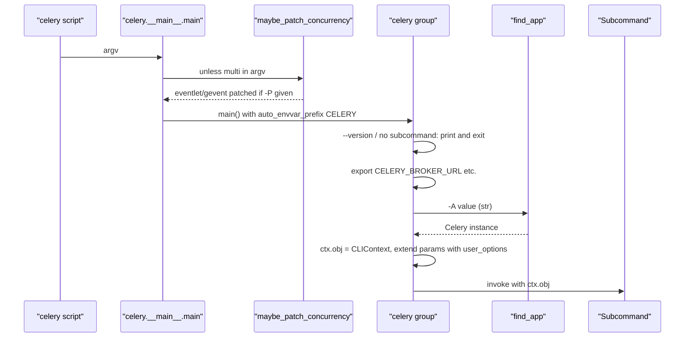

## Overview

The `celery` program is one click group that holds every operational command: starting workers and beat, sending tasks, inspecting and controlling running workers, purging queues and running the debugging utilities. The group function `celery` in `celery/bin/celery.py` parses the global options, loads the application named by `-A/--app`, and stores both in a `CLIContext` object that every subcommand reads as `ctx.obj`. The subcommands live one per module in `celery/bin/`.

Sources: [celery/bin/celery.py:1-31](repo://celery/bin/celery.py#L1-L31), [celery/bin/celery.py:112-164](repo://celery/bin/celery.py#L112-L164)

The shared plumbing sits in `celery/bin/base.py`: the `CLIContext` output helper, the `CeleryOption`, `CeleryCommand` and `CeleryDaemonCommand` classes that group help output and add daemon options, and custom click parameter types for JSON, ISO 8601 dates, comma separated lists and log levels. Worker internals are covered in [[Worker Architecture and Bootsteps]], the remote control protocol behind `inspect` and `control` in [[Remote Control and Inspection]], and `celery multi` in [[Running Multiple Workers with celery multi]].

Sources: [celery/bin/base.py:37-45](repo://celery/bin/base.py#L37-L45), [celery/bin/base.py:163-227](repo://celery/bin/base.py#L163-L227)

## Entry points and start-up

The installed `celery` script is a console-script entry point that calls `celery.__main__:main`. The same function runs with `python -m celery`.

Sources: [setup.py:155-159](repo://setup.py#L155-L159), [celery/__main__.py:1-19](repo://celery/__main__.py#L1-L19)

`celery.__main__.main` calls `maybe_patch_concurrency()` before importing anything else from the CLI, unless `multi` is in `sys.argv`. That function scans `sys.argv` for `-P`/`--pool`, and when the pool is `eventlet` or `gevent` it applies the monkey patches at once, so libraries imported later see the patched modules. It then calls `celery.bin.celery.main`, which runs the click group with `auto_envvar_prefix="CELERY"` and returns its exit code to `sys.exit`.

Sources: [celery/__main__.py:10-15](repo://celery/__main__.py#L10-L15), [celery/__init__.py:123-152](repo://celery/__init__.py#L123-L152), [celery/bin/celery.py:220-227](repo://celery/bin/celery.py#L220-L227)



Sources: [celery/__main__.py:10-15](repo://celery/__main__.py#L10-L15), [celery/bin/celery.py:112-164](repo://celery/bin/celery.py#L112-L164)

The group is built with `DYMGroup` from `click_didyoumean`, so a mistyped subcommand gets a "did you mean" suggestion, and with `invoke_without_command=True`, so `celery` alone prints the help text and exits. `--version` prints `VERSION_BANNER` and exits before any app is loaded.

Sources: [celery/bin/celery.py:55-56](repo://celery/bin/celery.py#L55-L56), [celery/bin/celery.py:116-121](repo://celery/bin/celery.py#L116-L121)

## Global options

Global options belong to the `celery` group, so they go before the subcommand name: `celery -A proj worker`, not `celery worker -A proj`.

Sources: [celery/bin/celery.py:55-66](repo://celery/bin/celery.py#L55-L66), [celery/bin/celery.py:199-203](repo://celery/bin/celery.py#L199-L203)

| Option | Environment variable | Effect |
| --- | --- | --- |
| `-A`, `--app` | `APP` | Application to load; passed to `find_app` when it is a string. Declared `click.UNPROCESSED` so a `Celery` object passed in from Python is not turned into a string. |
| `-b`, `--broker` | `BROKER_URL` | Exported as `CELERY_BROKER_URL`. |
| `--result-backend` | `RESULT_BACKEND` | Exported as `CELERY_RESULT_BACKEND`. |
| `--loader` | `LOADER` | Exported as `CELERY_LOADER`, which the default app reads (Issue #1066). |
| `--config` | `CONFIG_MODULE` | Exported as `CELERY_CONFIG_MODULE`. |
| `--workdir` | none | Eager option: its callback runs `os.chdir()` before the other options are processed. |
| `-C`, `--no-color` | `NO_COLOR` | Disables styling in every `CLIContext` output helper. |
| `-q`, `--quiet` | none | Stored on `CLIContext.quiet`; suppresses banners and `<-` chat lines. |
| `--version` | none | Prints `VERSION_BANNER` and exits. |
| `--skip-checks` | `SKIP_CHECKS` | Exports `CELERY_SKIP_CHECKS=true` to skip Django core checks on startup. |

Sources: [celery/bin/celery.py:57-111](repo://celery/bin/celery.py#L57-L111), [celery/bin/celery.py:123-133](repo://celery/bin/celery.py#L123-L133)

The group does not set configuration on the app directly. It writes the option values to `CELERY_*` environment variables before loading the app, so the loader and the default app pick them up as they would from a shell environment. Options with no explicit `envvar` also read click's automatic variables built from the `CELERY` prefix passed by `main()`.

Sources: [celery/bin/celery.py:123-133](repo://celery/bin/celery.py#L123-L133), [celery/bin/celery.py:220-227](repo://celery/bin/celery.py#L220-L227)

```bash
celery -A proj worker -l INFO
celery -A proj -b redis://localhost:6379/0 --result-backend redis://localhost:6379/1 call proj.tasks.add -a '[2, 2]'
APP=proj celery inspect active
```

Sources: [celery/bin/celery.py:57-75](repo://celery/bin/celery.py#L57-L75), [celery/bin/worker.py:310-323](repo://celery/bin/worker.py#L310-L323)

## Loading the application

When `-A` is a string, the group calls `find_app`. It resolves `module:attribute` or a dotted path with `symbol_by_name`. If the result is a module and the name has no colon, it looks for an `app` attribute, then a `celery` attribute, then for a package it retries with `<name>.celery`, and finally it takes the first `Celery` instance among the module's globals.

Sources: [celery/app/utils.py:378-415](repo://celery/app/utils.py#L378-L415)

A failed load ends the command through `ctx.fail` with one of three messages. A `ModuleNotFoundError` for the named module says the module was not found; a `ModuleNotFoundError` raised for some other module, inside the app's own imports, prints the full traceback instead. An `AttributeError` prints the capitalised attribute message, and any other exception prints its traceback.

Sources: [celery/bin/celery.py:32-43](repo://celery/bin/celery.py#L32-L43), [celery/bin/celery.py:135-152](repo://celery/bin/celery.py#L135-L152)

With no `-A`, `CLIContext.__init__` falls back to `get_current_app()`, so commands such as `celery report` still run against the default app.

Sources: [celery/bin/base.py:40-45](repo://celery/bin/base.py#L40-L45)

Celery 5 removed `-A` as a subcommand option. The module monkey-patches `click.exceptions.NoSuchOption.show` so that `celery worker -A proj` prints a red message showing the correct order before click's own error.

Sources: [celery/bin/celery.py:193-217](repo://celery/bin/celery.py#L193-L217)

## Command classes and parameter types

### CLIContext

`CLIContext` holds `app`, `no_color`, `quiet` and `workdir`, and every output path goes through it. `echo`, `secho` and `error` drop colour when `no_color` is set, and `error` writes to stderr. `pretty` formats remote-control replies: lists become bullet lines, dicts with `ok` or `error` keys are unwrapped into an `OK` or `ERROR` status, and other dicts become indented JSON, highlighted with pygments when it is installed. `say_chat` prints the `->`/`<-` lines of a remote command and hides the `<-` direction in quiet mode.

Sources: [celery/bin/base.py:22-34](repo://celery/bin/base.py#L22-L34), [celery/bin/base.py:37-120](repo://celery/bin/base.py#L37-L120)

### CeleryOption and CeleryCommand

`CeleryOption` adds two keywords to `click.Option`: `help_group`, the help section the option is listed under, and `default_value_from_context`, which reads the default from `ctx.obj` when the help or the value is resolved. `CeleryCommand.format_options` groups help records by `help_group`, which is why `celery worker --help` shows sections such as "Worker Options", "Pool Options" and "Queue Options".

Sources: [celery/bin/base.py:163-194](repo://celery/bin/base.py#L163-L194)

### CeleryDaemonCommand and DaemonOption

`CeleryDaemonCommand` is the base for `worker`, `beat` and `events`. It appends six `DaemonOption`s under "Daemonization Options": `--logfile`/`-f`, `--pidfile`, `--uid`, `--gid`, `--umask` and `--executable`. A `DaemonOption` with no value on the command line falls back to the app setting named `<command>_<option>`, so `worker_pidfile` or `beat_logfile` in the configuration act as defaults.

Sources: [celery/bin/base.py:197-227](repo://celery/bin/base.py#L197-L227)

### Parameter types

| Instance | Class | Converts |
| --- | --- | --- |
| `JSON_ARRAY` | `JsonArray` | JSON text to a `list`; fails if it is not an array. |
| `JSON_OBJECT` | `JsonObject` | JSON text to a `dict`; fails if it is not an object. |
| `ISO8601` | `ISO8601DateTime` | ISO 8601 text to a `datetime` with `maybe_iso8601`. |
| `ISO8601_OR_FLOAT` | `ISO8601DateTimeOrFloat` | A float of seconds, else an ISO 8601 date. |
| `LOG_LEVEL` | `LogLevel` | Case-insensitive `DEBUG`...`FATAL` to the numeric level via `mlevel`. |
| `COMMA_SEPARATED_LIST` | `CommaSeparatedList` | `a,b,c` to a list with `str_to_list`. |

Sources: [celery/bin/base.py:230-329](repo://celery/bin/base.py#L230-L329)

`celery/bin/worker.py` defines four more types for its own options: `CeleryBeat` refuses `-B` on Windows, `WorkersPool` turns a pool name into a pool class and prefers `worker_pool` from the configuration when the CLI only supplied the default `prefork`, `Hostname` expands `%h`-style placeholders through `host_format(default_nodename(value))`, and `Autoscale` parses `max,min` or a single integer into a `(max, min)` tuple.

Sources: [celery/bin/worker.py:22-103](repo://celery/bin/worker.py#L22-L103)

## Subcommands

### Command table

All subcommands are registered with `celery.add_command`, except `report`, which is defined in `celery/bin/celery.py` itself and prints `app.bugreport()` after importing the default modules.

Sources: [celery/bin/celery.py:166-191](repo://celery/bin/celery.py#L166-L191)

| Command | Module | Purpose and key options |
| --- | --- | --- |
| `worker` | `celery/bin/worker.py` | Start a worker. See the worker options below. |
| `beat` | `celery/bin/beat.py` | Start the periodic task scheduler. `--detach`, `-s/--schedule` (default `beat_schedule_filename`), `-S/--scheduler` (default `beat_scheduler`), `--max-interval`, `-l/--loglevel`, plus the daemon options. |
| `events` | `celery/bin/events.py` | Event stream tools: curses monitor by default, `-d/--dump` for the dumper, `-c/--camera` with `-F/--frequency`, `-r/--maxrate` and `--detach` for snapshot cameras. |
| `call` | `celery/bin/call.py` | `call NAME`: send a task by name with `app.send_task` and print its id. `-a/--args` (JSON array), `-k/--kwargs` (JSON object), `--eta`, `--countdown`, `--expires`, `--serializer` (default `json`), `--queue`, `--exchange`, `--routing-key`. |
| `result` | `celery/bin/result.py` | `result TASK_ID`: print the result with `.get()`; `-t/--task` uses that task's `AsyncResult`, `--traceback` prints the traceback instead. |
| `inspect` | `celery/bin/control.py` | `inspect COMMAND [ARGS]`: send an inspect command. `-t/--timeout` (default 1.0), `-d/--destination`, `-j/--json`, `--list`. |
| `control` | `celery/bin/control.py` | `control COMMAND [ARGS]`: broadcast a control command with `reply=True`; same options as `inspect`. |
| `status` | `celery/bin/control.py` | Ping all workers and print the number of nodes online; `-t`, `-d`, `-j`. |
| `purge` | `celery/bin/purge.py` | Delete all messages from the known task queues. `-f/--force` skips the prompt, `-Q/--queues` and `-X/--exclude-queues` narrow the set. |
| `migrate` | `celery/bin/migrate.py` | `migrate SOURCE DESTINATION`: move messages between brokers with `migrate_tasks`. `-n/--limit`, `-t/--timeout`, `-a/--ack-messages`, `-T/--tasks`, `-Q/--queues`, `-F/--forever`. |
| `shell` | `celery/bin/shell.py` | Interactive shell with `app`, `celery`, canvas primitives and all non-`celery.` tasks as locals. `-I/--ipython`, `-B/--bpython`, `--python`, `-T/--without-tasks`, `--eventlet`, `--gevent`. |
| `list` | `celery/bin/list.py` | `list bindings`: print queue, exchange and routing key bindings from `conn.manager.get_bindings()`. |
| `graph` | `celery/bin/graph.py` | `graph bootsteps` and `graph workers`: write a GraphViz dot graph to stdout. |
| `logtool` | `celery/bin/logtool.py` | `stats`, `traces`, `errors`, `incomplete` and `debug` over worker log files. |
| `amqp` | `celery/bin/amqp.py` | AMQP administration REPL with `exchange.declare`, `exchange.delete`, `queue.bind`, `queue.declare`, `queue.delete`, `queue.purge`, `basic.get`, `basic.publish`, `basic.ack`. |
| `upgrade` | `celery/bin/upgrade.py` | `upgrade settings FILENAME`: rewrite Celery 3.x setting names to the new names; `--django`, `--compat`, `--no-backup`. |
| `multi` | `celery/bin/multi.py` | Start and manage several worker nodes; see [[Running Multiple Workers with celery multi]]. |
| `report` | `celery/bin/celery.py` | Print the bug-report information from `app.bugreport()`. |

Sources: [celery/bin/celery.py:166-191](repo://celery/bin/celery.py#L166-L191), [celery/bin/beat.py:10-49](repo://celery/bin/beat.py#L10-L49), [celery/bin/events.py:51-96](repo://celery/bin/events.py#L51-L96), [celery/bin/call.py:8-71](repo://celery/bin/call.py#L8-L71), [celery/bin/result.py:7-30](repo://celery/bin/result.py#L7-L30), [celery/bin/control.py:107-151](repo://celery/bin/control.py#L107-L151), [celery/bin/control.py:153-262](repo://celery/bin/control.py#L153-L262), [celery/bin/purge.py:8-70](repo://celery/bin/purge.py#L8-L70), [celery/bin/migrate.py:9-63](repo://celery/bin/migrate.py#L9-L63), [celery/bin/shell.py:82-173](repo://celery/bin/shell.py#L82-L173), [celery/bin/list.py:7-38](repo://celery/bin/list.py#L7-L38), [celery/bin/graph.py:11-35](repo://celery/bin/graph.py#L11-L35), [celery/bin/logtool.py:113-157](repo://celery/bin/logtool.py#L113-L157), [celery/bin/amqp.py:61-166](repo://celery/bin/amqp.py#L61-L166), [celery/bin/amqp.py:186-258](repo://celery/bin/amqp.py#L186-L258), [celery/bin/amqp.py:258-312](repo://celery/bin/amqp.py#L258-L312), [celery/bin/upgrade.py:12-91](repo://celery/bin/upgrade.py#L12-L91), [celery/bin/multi.py:463-480](repo://celery/bin/multi.py#L463-L480)

### Worker options

| Group | Options |
| --- | --- |
| Worker Options | `-n/--hostname` (expands `%h`, `%n`, `%d`), `-D/--detach`, `-S/--statedb` (default `worker_state_db`), `-l/--loglevel` (default `WARNING`), `-O/--optimization` (`default` or `fair`), `--prefetch-multiplier` (default `worker_prefetch_multiplier`), `--disable-prefetch` (Redis only) |
| Pool Options | `-c/--concurrency` (default `worker_concurrency`), `-P/--pool` (default `prefork`), `-E/--task-events`, `--time-limit`, `--soft-time-limit`, `--max-tasks-per-child`, `--max-memory-per-child` (KiB) |
| Queue Options | `--purge/--discard`, `-Q/--queues`, `-X/--exclude-queues`, `-I/--include` |
| Features | `--without-gossip`, `--without-mingle`, `--without-heartbeat`, `--heartbeat-interval`, `--autoscale` |
| Embedded Beat Options | `-B/--beat`, `-s/--schedule-filename` (default `beat_schedule_filename`), `--scheduler` |
| Daemonization Options | `-f/--logfile`, `--pidfile`, `--uid`, `--gid`, `--umask`, `--executable` |

Sources: [celery/bin/worker.py:136-232](repo://celery/bin/worker.py#L136-L232), [celery/bin/worker.py:233-304](repo://celery/bin/worker.py#L233-L304), [celery/bin/base.py:214-227](repo://celery/bin/base.py#L214-L227)

The `worker` function first applies `--disable-prefetch` to `app.conf.worker_disable_prefetch`, then any extra arguments as configuration. With `--detach` it rebuilds the argument list as `-m celery ...` without `--detach`, `-D`, `--uid` and `--gid`, and re-executes the interpreter inside `detached()`. Otherwise it drops privileges with `maybe_drop_privileges`, builds `app.Worker` with the pidfile and state db passed through `node_format(..., hostname)`, starts it, and exits with `worker.exitcode`. A `SecurityError` prints its message and exits with status 1.

Sources: [celery/bin/worker.py:305-371](repo://celery/bin/worker.py#L305-L371), [celery/bin/worker.py:108-133](repo://celery/bin/worker.py#L108-L133)

```bash
celery -A proj worker -l INFO -Q hipri,lopri
celery -A proj worker --concurrency=1000 -P eventlet
celery -A proj worker --autoscale=10,0 -n w1@%h
```

Sources: [celery/bin/worker.py:310-323](repo://celery/bin/worker.py#L310-L323)

### Remote control commands

`inspect` and `control` take the command name as an argument and check it against `Panel.meta`, the registry of commands registered in `celery.worker.control`; an unknown name is a usage error that lists the valid commands, and `--list` prints them with their signatures. Extra positional arguments are converted by `_compile_arguments` using the argument names and types declared in the command's metadata, with leftover values passed to the variadic argument when the command has one.

Sources: [celery/bin/control.py:26-104](repo://celery/bin/control.py#L26-L104)

`inspect` calls `app.control.inspect(...)._request(command, **arguments)`; `control` calls `app.control.broadcast(command, reply=True, arguments=arguments)`. Without `--json`, each reply is printed as it arrives through `_say_remote_command_reply`; with `--json`, all replies are dumped at the end.

Sources: [celery/bin/control.py:16-23](repo://celery/bin/control.py#L16-L23), [celery/bin/control.py:178-262](repo://celery/bin/control.py#L178-L262)

```bash
celery -A proj inspect --list
celery -A proj inspect active -d w1@example.com --json
celery -A proj control rate_limit proj.tasks.add 10/m
celery -A proj status -t 5
```

Sources: [celery/bin/control.py:153-262](repo://celery/bin/control.py#L153-L262)

## Configuration from extra arguments

`worker` and `beat` accept extra arguments (`allow_extra_args`) and pass them to `app.config_from_cmdline`. For `worker` the namespace is `worker`, so `.concurrency=4` or `_concurrency=4` sets `worker_concurrency`. A key with a namespace prefix, such as `broker_pool_limit=10`, sets that setting. A value of the form `(json)[1,2]` is cast with the named type; otherwise the value is converted with the setting's declared type. A parse failure becomes a `click.UsageError` naming the reason.

Sources: [celery/bin/worker.py:328-335](repo://celery/bin/worker.py#L328-L335), [celery/bin/beat.py:52-59](repo://celery/bin/beat.py#L52-L59), [celery/app/base.py:745-748](repo://celery/app/base.py#L745-L748), [celery/loaders/base.py:161-206](repo://celery/loaders/base.py#L161-L206)

```bash
celery -A proj worker -l INFO .prefetch_multiplier=1 broker_pool_limit=10
```

Sources: [celery/loaders/base.py:175-205](repo://celery/loaders/base.py#L175-L205)

## Extending the CLI

### Custom options on built-in commands

After loading the app, the group extends `worker.params`, `beat.params` and `events.params` with the click options in `app.user_options['worker']`, `['beat']` and `['events']`. Options in `app.user_options['preload']` are added to every subcommand. Worker options reach bootsteps as keyword arguments, because the worker passes its remaining keyword arguments to `app.Worker`.

Sources: [celery/bin/celery.py:157-163](repo://celery/bin/celery.py#L157-L163), [celery/app/base.py:369-369](repo://celery/app/base.py#L369-L369), [celery/bin/worker.py:359-366](repo://celery/bin/worker.py#L359-L366)

```python
from celery import Celery
from click import Option

app = Celery(broker='amqp://')

app.user_options['worker'].add(Option(('--enable-my-option',),
                                      is_flag=True,
                                      help='Enable custom option.'))
```

Sources: [docs/userguide/extending.rst:750-758](repo://docs/userguide/extending.rst#L750-L758)

### Preload options

Subcommands are wrapped with `handle_preload_options`. Before the command body runs, it collects the values of the app's preload options from the command's keyword arguments and sends the `user_preload_options` signal with `app` and `options`, so a handler can act on them, for example to choose a configuration template. See [[Signals]].

Sources: [celery/bin/base.py:143-160](repo://celery/bin/base.py#L143-L160)

```python
from celery import Celery
from celery import signals
from click import Option

app = Celery()

app.user_options['preload'].add(Option(('-Z', '--template'),
                                       default='default',
                                       help='Configuration template to use.'))

@signals.user_preload_options.connect
def on_preload_parsed(options, **kwargs):
    use_template(options['template'])
```

Sources: [docs/userguide/extending.rst:787-802](repo://docs/userguide/extending.rst#L787-L802), [celery/bin/base.py:143-160](repo://celery/bin/base.py#L143-L160)

### Plugin subcommands

The group is decorated with `click_plugins.with_plugins(_PLUGINS)`, where `_PLUGINS` is the `celery.commands` entry-point group read with `importlib.metadata.entry_points`. On Python 3.10 and later it uses `entry_points(group=...)`; the older branches fall back to `.get()` or `.select()`. Each entry point must name a click command, which becomes `celery <name>`; this is how Flower adds `celery flower`.

Sources: [celery/bin/celery.py:46-55](repo://celery/bin/celery.py#L46-L55)

```python
setup(
    name='flower',
    entry_points={
        'celery.commands': [
           'flower = flower.command:flower',
        ],
    }
)
```

Sources: [docs/userguide/extending.rst:828-835](repo://docs/userguide/extending.rst#L828-L835)

## Errors and exit codes

Remote commands (`status`, `inspect`, `control`, `events`) route exceptions through `handle_remote_command_error`. A click exception is re-raised unchanged; a kombu `OperationalError` becomes a `CeleryCommandException` saying the broker could not be reached; any other exception becomes "Unable to run the `<command>` command". Both carry `EX_UNAVAILABLE` (69 when `os` does not define it). `status`, `inspect` and `control` raise the same exception type with "No nodes replied within time constraint" when no worker answers before the timeout.

Sources: [celery/bin/base.py:123-140](repo://celery/bin/base.py#L123-L140), [celery/exceptions.py:307-312](repo://celery/exceptions.py#L307-L312), [celery/platforms.py:49-52](repo://celery/platforms.py#L49-L52), [celery/bin/control.py:136-143](repo://celery/bin/control.py#L136-L143)

| Situation | Behaviour |
| --- | --- |
| App cannot be loaded | `ctx.fail(...)`, click usage error exit |
| `-A` given after the subcommand | Red hint, then click's "no such option" error |
| Unknown inspect/control command | `click.UsageError` listing the valid commands |
| Broker unreachable / no replies | `CeleryCommandException` with `EX_UNAVAILABLE` |
| `SecurityError` while starting a worker | Message on stderr, exit 1 |
| `celery events` without curses | `click.UsageError`: the curses module is required |
| `list bindings` on a transport without bindings support | `click.UsageError`: your transport cannot list bindings |

Sources: [celery/bin/celery.py:135-152](repo://celery/bin/celery.py#L135-L152), [celery/bin/celery.py:206-217](repo://celery/bin/celery.py#L206-L217), [celery/bin/control.py:59-66](repo://celery/bin/control.py#L59-L66), [celery/bin/worker.py:369-371](repo://celery/bin/worker.py#L369-L371), [celery/bin/events.py:40-48](repo://celery/bin/events.py#L40-L48), [celery/bin/list.py:28-31](repo://celery/bin/list.py#L28-L31)
