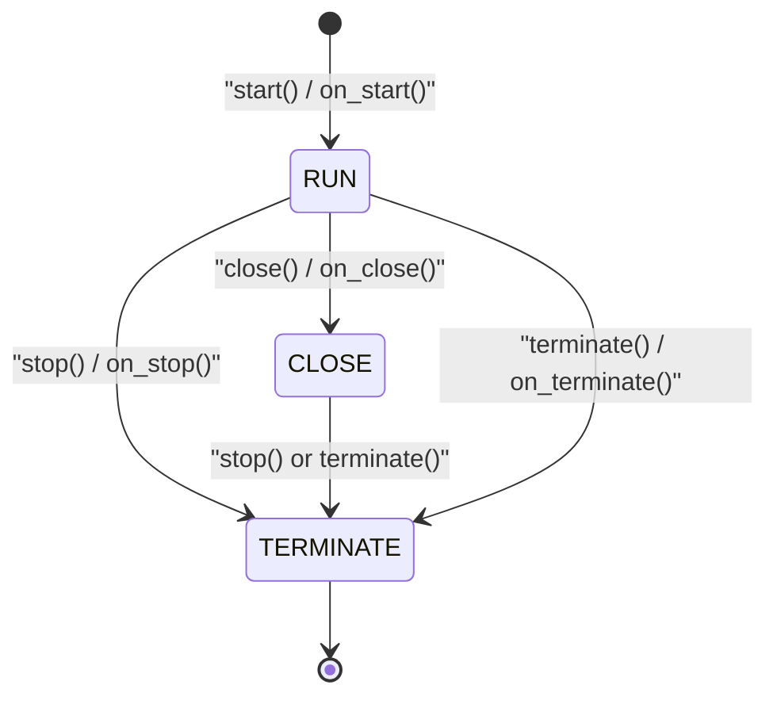
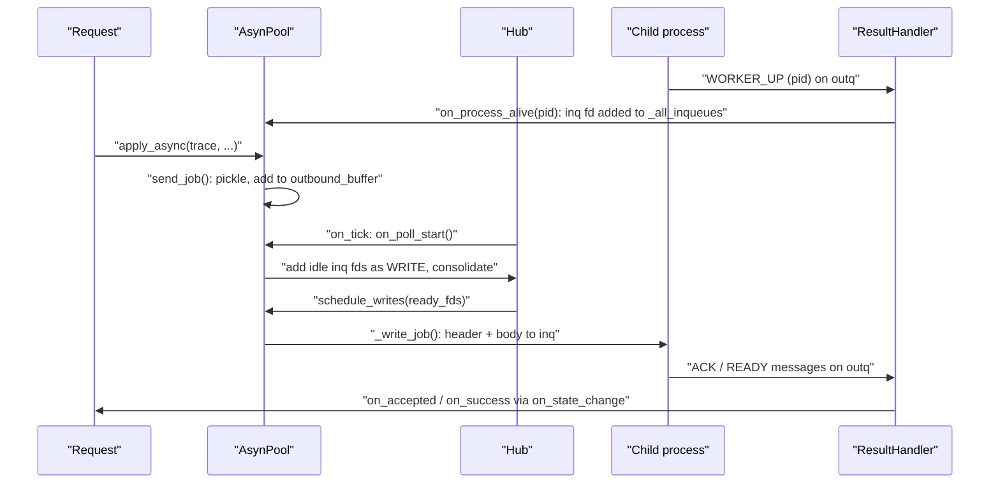

## Overview

A Celery worker receives messages in one place (the consumer) and runs task bodies somewhere else: the execution pool. The `celery.concurrency` package holds the interchangeable pool implementations (prefork processes, threads, eventlet or gevent greenlets, or the inline solo pool), all behind the `BasePool` interface, so the rest of the worker only ever calls `apply_async`, `grow`, `shrink`, `terminate_job` and the start/stop hooks. The pool is created by the worker's `Pool` bootstep (see [[Worker Architecture and Bootsteps]]) and fed by task requests (see [[Task Requests and Strategies]]).

Sources: [celery/concurrency/__init__.py:1-48](repo://celery/concurrency/__init__.py#L1-L48), [celery/concurrency/base.py:47-166](repo://celery/concurrency/base.py#L47-L166)

The default implementation is `prefork`, which runs tasks in child processes managed by billiard (Celery's fork of `multiprocessing`). When the broker transport supports asynchronous I/O, prefork uses `AsynPool`, a variant that does not need helper threads: it plugs the child processes' pipes directly into the worker's kombu event loop (the Hub).

Sources: [celery/app/defaults.py:11-11](repo://celery/app/defaults.py#L11-L11), [celery/concurrency/prefork.py:95-127](repo://celery/concurrency/prefork.py#L95-L127), [celery/concurrency/asynpool.py:1-14](repo://celery/concurrency/asynpool.py#L1-L14)

## Selecting a pool implementation

### Aliases and get_implementation

Pools are named by alias. `ALIASES` maps each short name to a `module:Class` path, and `get_implementation` resolves either an alias or any full path with kombu's `symbol_by_name`, so a class path also works as a pool name.

Sources: [celery/concurrency/__init__.py:11-48](repo://celery/concurrency/__init__.py#L11-L48)

| Alias | Class | Notes |
| --- | --- | --- |
| `prefork` | `celery.concurrency.prefork:TaskPool` | Default (`DEFAULT_POOL`); child processes via billiard |
| `processes` | `celery.concurrency.prefork:TaskPool` | Compatibility alias for `prefork` |
| `threads` | `celery.concurrency.thread:TaskPool` | Added only when `concurrent.futures` imports |
| `eventlet` | `celery.concurrency.eventlet:TaskPool` | Green threads, `is_green = True` |
| `gevent` | `celery.concurrency.gevent:TaskPool` | Green threads, `is_green = True` |
| `solo` | `celery.concurrency.solo:TaskPool` | Runs tasks inline in the consumer, `limit = 1` |
| `custom` | value of `CELERY_CUSTOM_WORKER_POOL` | Out-of-tree `BasePool` subclass, selected with `--pool custom` |

Sources: [celery/concurrency/__init__.py:11-38](repo://celery/concurrency/__init__.py#L11-L38), [celery/app/defaults.py:11-11](repo://celery/app/defaults.py#L11-L11)

### Command line and the worker_pool setting

The `-P/--pool` option of `celery worker` is a `WorkersPool` click type whose choices come from `get_available_pool_names()`. Its default is `prefork`, but if the CLI value is still `prefork` and the app sets `worker_pool`, the configured pool wins. The `WorkController` then calls `get_implementation(self.pool_cls)` again during `__init__`, so a programmatically started worker accepts aliases too.

Sources: [celery/bin/worker.py:35-63](repo://celery/bin/worker.py#L35-L63), [celery/bin/worker.py:194-211](repo://celery/bin/worker.py#L194-L211), [celery/worker/worker.py:125-132](repo://celery/worker/worker.py#L125-L132)

```bash
celery -A proj worker --concurrency=4
celery -A proj worker --concurrency=1000 -P eventlet
celery -A proj worker -P threads -c 8
```

Sources: [celery/bin/worker.py:307-321](repo://celery/bin/worker.py#L307-L321)

### Monkey patching for green pools

eventlet and gevent must monkey-patch the standard library before anything else imports sockets or threads. The `celery` entry point in `celery/__main__.py` calls `maybe_patch_concurrency()` (except for `celery multi`), which scans `sys.argv` for `-P`/`--pool` and runs `eventlet.monkey_patch()` or `gevent.monkey.patch_all()` before the CLI loads. Setting `EVENTLET_NOBLOCK` additionally turns on eventlet's blocking detection.

Sources: [celery/__init__.py:107-153](repo://celery/__init__.py#L107-L153), [celery/__main__.py:10-15](repo://celery/__main__.py#L10-L15)

> [!WARNING]
> Selecting eventlet or gevent through the `worker_pool` setting is too late for patching: the `Pool` bootstep warns with `W_POOL_SETTING` and tells you to use `-P`. The eventlet module also warns at import time when `celery.`, `kombu.` or `billiard.` modules were already loaded with unpatched `thread`/`socket`.

Sources: [celery/worker/components.py:18-30](repo://celery/worker/components.py#L18-L30), [celery/worker/components.py:138-142](repo://celery/worker/components.py#L138-L142), [celery/concurrency/eventlet.py:14-26](repo://celery/concurrency/eventlet.py#L14-L26)

## The BasePool interface

### Lifecycle and state

`BasePool` stores `limit` (the concurrency), `putlocks`, `forking_enable`, `callbacks_propagate`, the `app`, and any extra keyword arguments in `options`. Public methods drive a small state machine (`RUN`, `CLOSE`, `TERMINATE`) and delegate to `on_*` hooks that subclasses override: `start()` calls `on_start()` and sets `RUN`; `close()` sets `CLOSE` and calls `on_close()`; `stop()` calls `on_stop()` then sets `TERMINATE`; `terminate()` sets `TERMINATE` and calls `on_terminate()`. `active` is true only in `RUN`.

Sources: [celery/concurrency/base.py:47-138](repo://celery/concurrency/base.py#L47-L138), [celery/concurrency/base.py:174-176](repo://celery/concurrency/base.py#L174-L176)



Sources: [celery/concurrency/base.py:50-138](repo://celery/concurrency/base.py#L50-L138)

### Class attributes the worker reads

The worker adapts to the pool through class flags rather than type checks.

Sources: [celery/concurrency/base.py:50-71](repo://celery/concurrency/base.py#L50-L71)

| Attribute | Default | Meaning |
| --- | --- | --- |
| `signal_safe` | `True` | Pool can be shut down from inside a signal handler (`False` for threads, eventlet, gevent) |
| `is_green` | `False` | Pool uses greenlets |
| `uses_semaphore` | `False` | Only prefork sets it; enables the worker's semaphore-guarded `_process_task_sem` |
| `task_join_will_block` | `True` | Passed to `_set_task_join_will_block`; green pools set it to `False` |
| `body_can_be_buffer` | `False` | Message body may be passed as a buffer (solo and threads set `True`) |
| `Timer` | `timer2.Timer` | Timer class; eventlet and gevent provide greenlet-based timers |

Sources: [celery/concurrency/base.py:50-71](repo://celery/concurrency/base.py#L50-L71), [celery/worker/components.py:138-172](repo://celery/worker/components.py#L138-L172)

### apply_async and apply_target

`apply_async(target, args, kwargs, **options)` logs the call at debug level and forwards to `on_apply` with `waitforslot=self.putlocks` and `callbacks_propagate`. The worker's `Request.execute_using_pool` is the caller: the target is `fast_trace_task` or `trace_task_ret`, and the options carry `accept_callback`, `callback`, `error_callback`, `timeout_callback`, `soft_timeout`, `timeout` and `correlation_id` (the task id).

Sources: [celery/concurrency/base.py:140-156](repo://celery/concurrency/base.py#L140-L156), [celery/worker/request.py:355-372](repo://celery/worker/request.py#L355-L372)

Pools that run the target in-process use the module-level `apply_target`. It reports acceptance first (`accept_callback(pid, monotonic())`), runs the target, and passes the return value to `callback`. Exceptions listed in `propagate`, ordinary `Exception`s, and `WorkerShutdown`/`WorkerTerminate` are re-raised; any other `BaseException` is converted to a `WorkerLostError` and delivered to `callback` as an `ExceptionInfo`.

Sources: [celery/concurrency/base.py:22-44](repo://celery/concurrency/base.py#L22-L44)

```python
    if accept_callback:
        accept_callback(pid or getpid(), monotonic())
    try:
        ret = target(*args, **kwargs)
    except propagate:
        raise
```

Sources: [celery/concurrency/base.py:27-32](repo://celery/concurrency/base.py#L27-L32)

`info` returns `_get_info()`, a JSON-friendly dict with `implementation` and `max-concurrency` that subclasses extend; it is what `celery inspect stats` reports under `pool`. Optional operations (`terminate_job`, `restart`) raise `NotImplementedError` in the base class.

Sources: [celery/concurrency/base.py:112-118](repo://celery/concurrency/base.py#L112-L118), [celery/concurrency/base.py:158-172](repo://celery/concurrency/base.py#L158-L172), [celery/worker/components.py:174-175](repo://celery/worker/components.py#L174-L175)

## How the worker builds the pool

The `Pool` bootstep (`celery.worker.components.Pool`) requires the `Hub` step and instantiates `w.pool_cls`. It decides whether the pool is threaded: `threaded = not w.use_eventloop or IS_WINDOWS`, where `use_eventloop` is true only when the environment is not green, the transport implements asynchronous I/O, and the platform is not Windows. In the non-threaded (event loop) case it also creates a `LaxBoundedSemaphore` sized to the concurrency and allows up to 100 restarts.

Sources: [celery/worker/components.py:101-172](repo://celery/worker/components.py#L101-L172), [celery/worker/worker.py:239-242](repo://celery/worker/worker.py#L239-L242)

```python
        pool = w.pool = self.instantiate(
            w.pool_cls, w.min_concurrency,
            initargs=(w.app, w.hostname),
            maxtasksperchild=w.max_tasks_per_child,
            max_memory_per_child=w.max_memory_per_child,
            timeout=w.time_limit,
            soft_timeout=w.soft_time_limit,
            putlocks=w.pool_putlocks and threaded,
            lost_worker_timeout=w.worker_lost_wait,
            threads=threaded,
```

Sources: [celery/worker/components.py:154-163](repo://celery/worker/components.py#L154-L163)

The pool is created with `w.min_concurrency`, which equals `--concurrency` unless `--autoscale` set a min/max pair. After creation, `register_with_event_loop` forwards the Hub to `pool.register_with_event_loop`, which only prefork (via `AsynPool`) implements.

Sources: [celery/worker/components.py:117-128](repo://celery/worker/components.py#L117-L128), [celery/worker/components.py:177-178](repo://celery/worker/components.py#L177-L178), [celery/concurrency/prefork.py:135-140](repo://celery/concurrency/prefork.py#L135-L140)

## Prefork pool

### TaskPool.on_start

`prefork.TaskPool` picks billiard's blocking `Pool` when `options['threads']` is true and `AsynPool` otherwise, and creates it with `processes=self.limit`, `initializer=process_initializer`, `on_process_exit=process_destructor`, `enable_timeouts=True`, `synack=False` and `proc_alive_timeout` from `worker_proc_alive_timeout`. It then binds the pool's methods directly onto itself (`on_apply = P.apply_async`, `maintain_pool`, `terminate_job`, `grow`, `shrink`, `flush`) so calls skip a level of indirection.

Sources: [celery/concurrency/prefork.py:95-127](repo://celery/concurrency/prefork.py#L95-L127)

### Child process initialization

Each child runs `process_initializer(app, hostname)`. It asks the OS to SIGKILL the child when the parent dies (`set_pdeathsig`), resets `SIGTERM`, `SIGHUP`, `SIGTTIN`, `SIGTTOU`, `SIGUSR1` to default handlers and ignores `SIGINT` (plus the remapped term signal when billiard uses `REMAP_SIGTERM`), sets the process title, and runs the loader's `init_worker` and `init_worker_process`. Logging is set up again from `CELERY_LOG_*` environment variables; a log file name containing `%i` forces re-setup since each child gets its own file.

Sources: [celery/concurrency/prefork.py:26-66](repo://celery/concurrency/prefork.py#L26-L66)

It then makes the app current and finalized (or calls `trace.setup_worker_optimizations` when the child was started by execv), rebuilds every task's `__trace__` with `build_tracer`, resets worker state, and sends the `worker_process_init` signal. When a child exits, `process_destructor` sends `worker_process_shutdown` with the pid and exit code (see [[Signals]]).

Sources: [celery/concurrency/prefork.py:67-92](repo://celery/concurrency/prefork.py#L67-L92)

### Shutdown and pool info

`on_stop` closes the pool and joins it. If a Hub exists (asynchronous transport), it starts a daemon thread, `prefork-timer-shutdown`, that calls `hub.fire_timers()` every 0.5 seconds while `join()` blocks, so broker heartbeats keep flowing during a long drain. `on_terminate` calls the pool's `terminate()`; `restart()` restarts the children and sends a `noop` job.

Sources: [celery/concurrency/prefork.py:128-198](repo://celery/concurrency/prefork.py#L128-L198)

`_get_info` adds the child pids, `max-tasks-per-child`, whether puts are semaphore guarded, the soft/hard timeouts, and `writes`, the per-process write distribution from `AsynPool.human_write_stats`.

Sources: [celery/concurrency/prefork.py:200-216](repo://celery/concurrency/prefork.py#L200-L216), [celery/concurrency/asynpool.py:1206-1210](repo://celery/concurrency/asynpool.py#L1206-L1210)

## AsynPool and the event loop

### Per-process queues

Billiard's classic pool shares one in-queue among all children; `AsynPool` instead pre-creates a queue triple per process in `create_process_queues`: an `inq` (parent writes, non-blocking), an `outq` (parent reads, non-blocking), and a `synq` only when `synack` is enabled. `_setup_queues` disables the shared queues. Fds are indexed in `_fileno_to_inq`, `_fileno_to_outq` and `_fileno_to_synq` so the Hub callbacks can map a ready fd back to its process.

Sources: [celery/concurrency/asynpool.py:428-488](repo://celery/concurrency/asynpool.py#L428-L488), [celery/concurrency/asynpool.py:1153-1169](repo://celery/concurrency/asynpool.py#L1153-L1169), [celery/concurrency/asynpool.py:1273-1281](repo://celery/concurrency/asynpool.py#L1273-L1281)

### Registering with the Hub

`register_with_event_loop(hub)` wires everything into the event loop: it registers the `ResultHandler`, creates the time-limit, process and write handlers, adds a reader on each child's sentinel fd (a `dup` of it, so it can be unregistered from epoll safely) that calls `maintain_pool` when the child exits, adds a reader on every `outq` fd, schedules `maintain_pool` every 5 seconds through `timers`, and adds `on_poll_start` to `hub.on_tick` once.

Sources: [celery/concurrency/asynpool.py:495-547](repo://celery/concurrency/asynpool.py#L495-L547), [celery/concurrency/asynpool.py:1415-1417](repo://celery/concurrency/asynpool.py#L1415-L1417)



Sources: [celery/concurrency/asynpool.py:243-262](repo://celery/concurrency/asynpool.py#L243-L262), [celery/concurrency/asynpool.py:770-887](repo://celery/concurrency/asynpool.py#L770-L887), [celery/concurrency/asynpool.py:1171-1185](repo://celery/concurrency/asynpool.py#L1171-L1185)

### Process startup handshake

A new child is not writable until it says so. The custom `Worker.on_loop_start` puts `(WORKER_UP, (pid,))` on its out-queue, and the `ResultHandler` maps `WORKER_UP` to `on_process_alive`, which moves the process out of `_waiting_to_start` and adds its in-queue fd to `_fileno_to_inq` and `_all_inqueues`. `on_process_up` meanwhile schedules `verify_process_alive` after `_proc_alive_timeout` (default `PROC_ALIVE_TIMEOUT = 4.0`, setting `worker_proc_alive_timeout`); a child still waiting then is logged as timed out and killed with signal 9.

Sources: [celery/concurrency/asynpool.py:71-75](repo://celery/concurrency/asynpool.py#L71-L75), [celery/concurrency/asynpool.py:625-663](repo://celery/concurrency/asynpool.py#L625-L663), [celery/app/defaults.py:355-355](repo://celery/app/defaults.py#L355-L355)

### Writing jobs to child processes

`send_job` (installed as `_quick_put`) pickles the job tuple, frames it with a 4-byte big-endian length header, stores the memoryviews on the job as `_payload`, and appends it to `outbound_buffer`. Nothing is written yet.

Sources: [celery/concurrency/asynpool.py:877-887](repo://celery/concurrency/asynpool.py#L877-L887)

On every loop tick `on_poll_start` registers the in-queue fds not currently being written as `WRITE | ERR` with `consolidate=True`, but only if there are buffered jobs (and, under the fair strategy, at least one idle worker); otherwise it removes the writers so always-writable pipes do not spin the loop. The Hub then calls `schedule_writes` once with the list of ready fds. It cycles through them using `total_write_count % num_ready`, skips fds already being written or (fair strategy) busy, pops a job, records `job._scheduled_for`, and starts a `_write_job` generator, marking the fd active and the worker busy.

Sources: [celery/concurrency/asynpool.py:759-875](repo://celery/concurrency/asynpool.py#L759-L875)

`_write_job` writes the header then the body with `send_job_offset`, yielding back to the event loop on `EAGAIN`/`EINTR`. After more than 100 consecutive failures it calls `on_not_recovering`, which terminates the child and puts the job back. Its `finally` removes the writer, bumps `write_stats[proc.index]` and frees the fd.

Sources: [celery/concurrency/asynpool.py:889-946](repo://celery/concurrency/asynpool.py#L889-L946)

The scheduling strategy comes from `-O/--optimization`: `SCHED_STRATEGIES` maps `None`, `default` and `fair` to `SCHED_STRATEGY_FAIR`, and `fast`/`fcfs` to `SCHED_STRATEGY_FCFS`. Under the fair strategy a worker is marked available again only when `on_job_ready` fires, so a child never receives a second job while executing one.

Sources: [celery/concurrency/asynpool.py:77-87](repo://celery/concurrency/asynpool.py#L77-L87), [celery/concurrency/asynpool.py:607-608](repo://celery/concurrency/asynpool.py#L607-L608), [celery/bin/worker.py:169-175](repo://celery/bin/worker.py#L169-L175)

### ResultHandler

`ResultHandler._make_process_result` returns `on_result_readable(fileno)`, the reader callback for every `outq` fd. It runs `_recv_message` as a generator: read the 4-byte header, then the body, yielding on `EAGAIN` so a partial message just leaves the generator registered as the fd's reader. A complete message is unpickled and passed to `on_state_change`, which dispatches by message type (including the added `WORKER_UP` handler). EOF or `OSError` removes the reader.

Sources: [celery/concurrency/asynpool.py:253-345](repo://celery/concurrency/asynpool.py#L253-L345)

At shutdown, `on_stop_not_started` keeps flushing the out-queues synchronously with `_flush_outqueue` (and checking timeouts) until the cache is empty or all workers have joined.

Sources: [celery/concurrency/asynpool.py:352-411](repo://celery/concurrency/asynpool.py#L352-L411)

### Time limits

`_create_timelimit_handlers` replaces billiard's timeout thread with Hub timers: `on_timeout_set` schedules `_on_soft_timeout` (or `_on_hard_timeout` if there is no soft limit) with `hub.call_later`. When the soft limit fires and a hard limit exists, the hard timer is scheduled for `hard - soft` seconds later. Both look the job up in `_cache` and do nothing if it already finished.

Sources: [celery/concurrency/asynpool.py:549-605](repo://celery/concurrency/asynpool.py#L549-L605)

## Recycling, lost processes and flushing

### max_tasks_per_child and max_memory_per_child

`--max-tasks-per-child` (`worker_max_tasks_per_child`) and `--max-memory-per-child` (`worker_max_memory_per_child`, in KiB) are passed to billiard as `maxtasksperchild` and `max_memory_per_child`. A child that hits either limit exits after finishing its current task; with `AsynPool` the exit makes the sentinel fd readable, `_event_process_exit` untracks it and calls `maintain_pool()`, which starts a replacement through `_create_worker_process`. That method sends `worker_before_create_process` and runs `gc.collect()` first.

Sources: [celery/bin/worker.py:233-248](repo://celery/bin/worker.py#L233-L248), [celery/worker/components.py:154-158](repo://celery/worker/components.py#L154-L158), [celery/concurrency/asynpool.py:490-498](repo://celery/concurrency/asynpool.py#L490-L498), [celery/app/defaults.py:350-351](repo://celery/app/defaults.py#L350-L351)

### When a child dies

`on_process_down` flushes the dead process's out-queue (`process_flush_queues`) and removes its fds from the indices and the Hub, taking care not to remove an fd that a newer process already reused. For each job assigned to it, `on_job_process_down` decides what to do: if the job was partially written, `on_partial_read` puts unaccepted jobs back and marks the process `dead`, replacing its queues because message boundaries can no longer be trusted; if it was only scheduled, `_put_back` returns it to the front of `outbound_buffer`. `_put_back` instead acknowledges and terminates jobs that were revoked or terminated in the meantime.

Sources: [celery/concurrency/asynpool.py:665-714](repo://celery/concurrency/asynpool.py#L665-L714), [celery/concurrency/asynpool.py:745-757](repo://celery/concurrency/asynpool.py#L745-L757), [celery/concurrency/asynpool.py:1187-1204](repo://celery/concurrency/asynpool.py#L1187-L1204), [celery/concurrency/asynpool.py:1319-1370](repo://celery/concurrency/asynpool.py#L1319-L1370)

### Flushing on connection loss

When the consumer's connection closes, `Consumer.on_close` clears reserved requests and calls the pool's `flush`. `AsynPool.flush` cancels (with `synack`) or discards every job that has not been accepted, since the broker will redeliver it, and clears `outbound_buffer`. Writes already in progress must complete to keep message boundaries, so it drives the active writer generators with `_flush_writer` until they finish, discarding generators that never started. Finally it trims `_busy_workers` to processes still running accepted jobs, so the fair scheduler keeps avoiding them after reconnecting.

Sources: [celery/worker/consumer/consumer.py:532-547](repo://celery/worker/consumer/consumer.py#L532-L547), [celery/concurrency/asynpool.py:999-1114](repo://celery/concurrency/asynpool.py#L999-L1114), [celery/concurrency/asynpool.py:1116-1131](repo://celery/concurrency/asynpool.py#L1116-L1131)

## Threads, solo and green pools

### Thread pool

`thread.TaskPool` wraps a `ThreadPoolExecutor(max_workers=self.limit)`. `on_apply` submits `apply_target` with the callbacks and returns an `ApplyResult` around the future; `on_stop` shuts the executor down with `cancel_futures=True`. It is not signal safe and reports the live thread count in its info.

Sources: [celery/concurrency/thread.py:21-64](repo://celery/concurrency/thread.py#L21-L64)

### Solo pool

`solo.TaskPool` sets `on_apply = apply_target`, so every task runs synchronously in the consumer's thread and blocks message handling until it returns. It forces `limit = 1` and sends `worker_process_init` on construction, since there is no child process to do so.

Sources: [celery/concurrency/solo.py:11-31](repo://celery/concurrency/solo.py#L11-L31)

### Eventlet and gevent

Both green pools keep a greenlet pool (`eventlet.greenpool.GreenPool` or `gevent.pool.Pool`) of size `limit`, spawn one greenlet per task with the module's `apply_target`, and use the greenlet's id as its "pid". Each greenlet is kept in `_pool_map` until it finishes, which is how `terminate_job(pid)` finds and kills it; the target is wrapped by `_make_killable_target` so a `GreenletExit` returns `(False, None, None)` instead of propagating. `grow` and `shrink` resize the pool in place.

Sources: [celery/concurrency/eventlet.py:88-181](repo://celery/concurrency/eventlet.py#L88-L181), [celery/concurrency/gevent.py:85-166](repo://celery/concurrency/gevent.py#L85-L166)

Differences: eventlet sends the `eventlet_pool_started`, `eventlet_pool_apply`, `eventlet_pool_preshutdown` and `eventlet_pool_postshutdown` signals; gevent supports a pool-wide `timeout` and, when a timeout applies, runs `apply_timeout`, which wraps the call in `gevent.Timeout` and invokes `timeout_callback(False, timeout)` on expiry. Both replace the timer with greenlet-scheduled entries (`spawn_after`, `Greenlet.spawn_later`).

Sources: [celery/concurrency/eventlet.py:36-121](repo://celery/concurrency/eventlet.py#L36-L121), [celery/concurrency/gevent.py:21-83](repo://celery/concurrency/gevent.py#L21-L83), [celery/concurrency/gevent.py:116-126](repo://celery/concurrency/gevent.py#L116-L126)

> [!NOTE]
> The embedded beat (`celery worker -B`) refuses to start with eventlet or gevent and raises `ImproperlyConfigured`: run beat as its own process instead (see [[Periodic Tasks with Beat]]).

Sources: [celery/worker/components.py:20-23](repo://celery/worker/components.py#L20-L23), [celery/worker/components.py:195-201](repo://celery/worker/components.py#L195-L201)

## Autoscaling

### Enabling the Autoscaler

`--autoscale=max,min` is parsed by the `Pool` bootstep into `w.max_concurrency` and `w.min_concurrency`; the pool starts at `min`. The conditional `WorkerComponent` bootstep then instantiates `worker_autoscaler` (default `celery.worker.autoscale:Autoscaler`). Without an event loop the autoscaler runs as a `bgThread` whose `body` calls `maybe_scale` under a lock every second. With the Hub it uses a `DummyLock`, hooks `maybe_scale` into `consumer.on_task_message`, and also calls it every `keepalive` seconds.

Sources: [celery/worker/components.py:117-128](repo://celery/worker/components.py#L117-L128), [celery/worker/autoscale.py:31-81](repo://celery/worker/autoscale.py#L31-L81), [celery/app/defaults.py:328-328](repo://celery/app/defaults.py#L328-L328)

```bash
celery -A proj worker --autoscale=10,3
celery -A proj control autoscale 20 5
```

Sources: [celery/bin/worker.py:285-288](repo://celery/bin/worker.py#L285-L288), [celery/worker/control.py:579-589](repo://celery/worker/control.py#L579-L589)

### Scaling decisions

The demand signal is `qty`, the number of reserved requests in worker state. `_maybe_scale` grows the pool to `min(qty, max_concurrency)` when that exceeds the current `num_processes`, and otherwise shrinks it toward `max(qty, min_concurrency)`. Scale-down only happens after `keepalive` seconds (environment variable `AUTOSCALE_KEEPALIVE`, default 30) have passed since the last scale-up, which prevents thrashing. After any change `maybe_scale` calls `pool.maintain_pool()`.

Sources: [celery/worker/autoscale.py:28-28](repo://celery/worker/autoscale.py#L28-L28), [celery/worker/autoscale.py:83-131](repo://celery/worker/autoscale.py#L83-L131), [celery/worker/autoscale.py:148-154](repo://celery/worker/autoscale.py#L148-L154)

`update(max, min)` backs the `autoscale` remote control command: it shrinks immediately if the new max is below the current size, adjusts the consumer's prefetch count by the difference, and grows to a raised min. A `ValueError` from `pool.shrink` (all processes busy) is logged at debug level and ignored. The `pool_grow` and `pool_shrink` control commands refuse to run while an autoscaler is active (see [[Remote Control and Inspection]]).

Sources: [celery/worker/autoscale.py:98-138](repo://celery/worker/autoscale.py#L98-L138), [celery/worker/control.py:541-566](repo://celery/worker/control.py#L541-L566)

## Writing a custom pool

A custom pool subclasses `BasePool`, implements `on_start`, `on_apply` (calling `accept_callback` and `callback` as `apply_target` does), and optionally `on_stop`, `grow`, `shrink`, `terminate_job` and `_get_info`. Point `CELERY_CUSTOM_WORKER_POOL` at it and select `--pool custom`, or pass the class path directly, since `get_implementation` resolves any `module:Class` string.

Sources: [celery/concurrency/__init__.py:26-43](repo://celery/concurrency/__init__.py#L26-L43), [celery/concurrency/base.py:22-44](repo://celery/concurrency/base.py#L22-L44), [celery/concurrency/base.py:82-118](repo://celery/concurrency/base.py#L82-L118)

```python
from celery.concurrency.base import BasePool, apply_target


class InlineLoggingPool(BasePool):
    body_can_be_buffer = True

    def on_apply(self, target, args=None, kwargs=None, callback=None,
                 accept_callback=None, **_):
        return apply_target(target, args, kwargs, callback, accept_callback)
```

Sources: [celery/concurrency/solo.py:11-20](repo://celery/concurrency/solo.py#L11-L20), [celery/concurrency/base.py:22-24](repo://celery/concurrency/base.py#L22-L24)

```bash
CELERY_CUSTOM_WORKER_POOL='myproj.pools:InlineLoggingPool' celery -A proj worker --pool custom
```

Sources: [celery/concurrency/__init__.py:26-38](repo://celery/concurrency/__init__.py#L26-L38)
