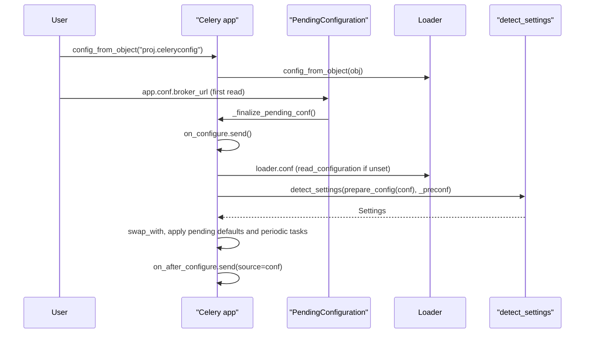
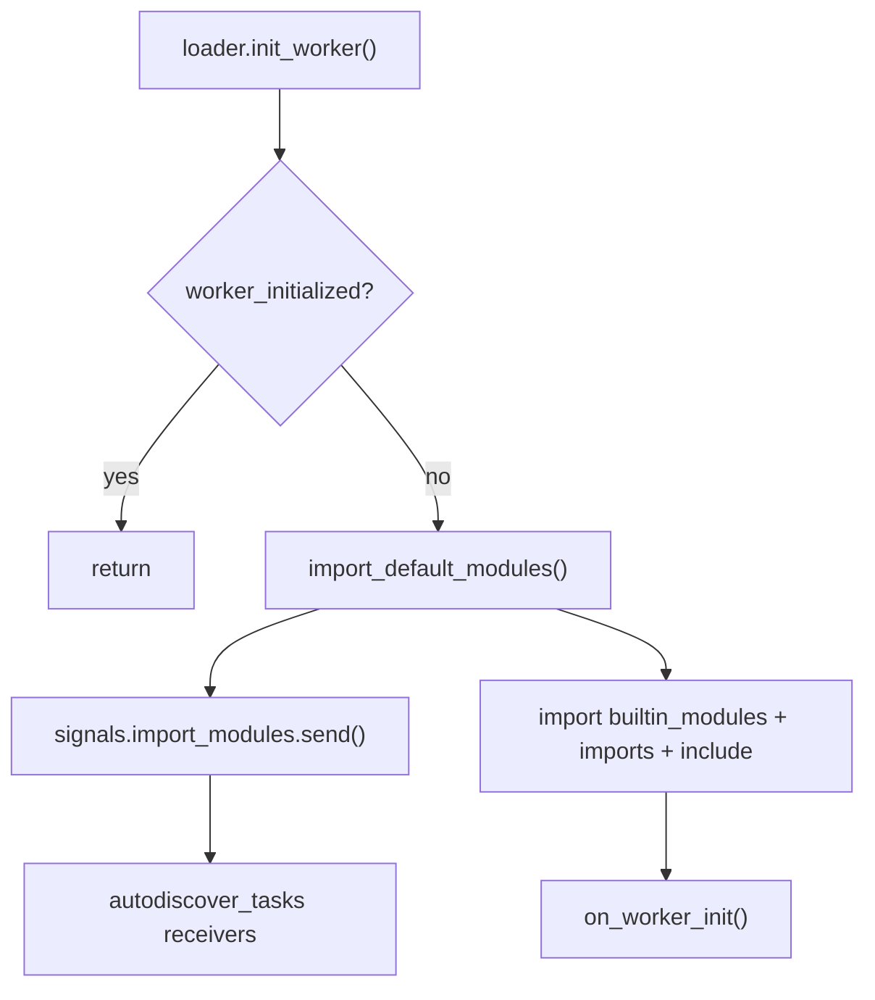

## Overview

Every Celery behaviour that can be tuned without code (broker URL, serializers, queues, worker limits, result expiry) is a named setting. The settings are declared once, with their types and defaults, in `celery/app/defaults.py`; `celery/app/utils.py` turns user configuration plus those defaults into the `Settings` mapping exposed as `app.conf`; and a loader from `celery/loaders/` decides where user configuration comes from and which task modules are imported when a worker starts.

Sources: [celery/app/defaults.py:1-64](repo://celery/app/defaults.py#L1-L64), [celery/app/utils.py:70-82](repo://celery/app/utils.py#L70-L82), [celery/loaders/base.py:33-61](repo://celery/loaders/base.py#L33-L61)

Configuration is lazy: an app created with `Celery(...)` does not read anything until the first key of `app.conf` is accessed. That design lets modules call `config_from_object`, set keys on `app.conf` and register defaults in any order at import time. The app object itself is described in [[The Celery Application]].

Sources: [celery/app/base.py:208-249](repo://celery/app/base.py#L208-L249), [celery/app/base.py:1565-1574](repo://celery/app/base.py#L1565-L1574)

## Declaring settings

### Option and Namespace

Each setting is an `Option` carrying a `default`, a `type` name and optional deprecation metadata (`deprecate_by`, `remove_by`, `alt`) plus `old`, the set of legacy names. `Option.to_python` converts a string through `typemap`, which is how values typed on the command line become real Python types.

Sources: [celery/app/defaults.py:42-63](repo://celery/app/defaults.py#L42-L63)

```python
class Option:
    """Describes a Celery configuration option."""

    alt = None
    deprecate_by = None
    remove_by = None
    old = set()
    typemap = {'string': str, 'int': int, 'float': float, 'any': lambda v: v,
               'bool': strtobool, 'dict': dict, 'tuple': tuple}
```

Sources: [celery/app/defaults.py:42-50](repo://celery/app/defaults.py#L42-L50)

`NAMESPACES` is a nested dict built with `Namespace(...)`: top-level keys such as `accept_content`, `timezone` and `imports`, and sub-namespaces `beat`, `broker`, `cache`, `result`, `task`, `worker`, `event`, `control`, `redis`, `database`, `security` and the backend-specific groups. A setting's full name is the namespace and key joined by `_`, so `NAMESPACES['task']['acks_late']` is the `task_acks_late` setting.

Sources: [celery/app/defaults.py:66-108](repo://celery/app/defaults.py#L66-L108), [celery/app/defaults.py:265-375](repo://celery/app/defaults.py#L265-L375)

### Flattened tables

`flatten` walks `NAMESPACES` breadth-first, prefixing nested keys with their namespace, and the module builds its lookup tables from it at import time: `DEFAULTS` (new name to default), `_OLD_DEFAULTS` (old name to default), `_TO_OLD_KEY` and `_TO_NEW_KEY` (name translation), `SETTING_KEYS` and `_OLD_SETTING_KEYS`.

Sources: [celery/app/defaults.py:378-413](repo://celery/app/defaults.py#L378-L413)

### Old setting names

Before Celery 4 settings were upper-case with prefixes such as `CELERY_`, `CELERYD_` and `CELERYBEAT_`. `Namespace(__old__=...)` fills `opt.old` for every option in the group that did not declare its own: `OLD_NS = {'celery_{0}'}` gives `task_acks_late` the old name `CELERY_ACKS_LATE`, `OLD_NS_WORKER` gives `worker_concurrency` the name `CELERYD_CONCURRENCY`. Options with an irregular history set `old` explicitly, for example `result_expires` maps to `CELERY_TASK_RESULT_EXPIRES`. `_to_compat` formats each pattern with the bare key and upper-cases it; options without `old` simply upper-case their new name (`broker_url` becomes `BROKER_URL`).

Sources: [celery/app/defaults.py:23-39](repo://celery/app/defaults.py#L23-L39), [celery/app/defaults.py:205-219](repo://celery/app/defaults.py#L205-L219), [celery/app/defaults.py:382-388](repo://celery/app/defaults.py#L382-L388)

### Searching for an option

`find(name, namespace='celery')` returns a `searchresult(namespace, key, type)`. It tries the given namespace, then every namespace (also matching a namespace name itself), and finally treats the name as a fully qualified key in `DEFAULTS`. The function is memoized, and `Settings.find_option` and `Settings.find_value_for_key` are thin wrappers around it.

Sources: [celery/app/defaults.py:427-447](repo://celery/app/defaults.py#L427-L447), [celery/app/utils.py:141-170](repo://celery/app/utils.py#L141-L170)

## Loading and resolving configuration

### Lazy finalization

The `Celery` constructor stores keyword arguments such as `broker`, `backend` and `include` in `self._preconf` (remembering them in `_preconf_set_by_auto`) and wraps that dict in a `PendingConfiguration` inside a `Settings` view. Writes go straight into the pending dict; the first read evaluates `PendingConfiguration.data`, which calls `_finalize_pending_conf` and then `_load_config`.

Sources: [celery/app/base.py:392-408](repo://celery/app/base.py#L392-L408), [celery/app/base.py:447-450](repo://celery/app/base.py#L447-L450), [celery/app/base.py:1230-1245](repo://celery/app/base.py#L1230-L1245)



Sources: [celery/app/base.py:703-725](repo://celery/app/base.py#L703-L725), [celery/app/base.py:1247-1280](repo://celery/app/base.py#L1247-L1280), [celery/loaders/base.py:231-236](repo://celery/loaders/base.py#L231-L236)

`_load_config` sends `on_configure`, re-applies `_config_source` to the loader, passes the loader's mapping through `prepare_config` (which runs `find_deprecated_settings` to warn about options with `deprecate_by`/`remove_by`), and calls `detect_settings`. If an old `Settings` object exists it is replaced in place with `swap_with`, so references to `app.conf` taken earlier see the final values. Defaults registered with `add_defaults` and periodic tasks queued before configuration are applied afterwards, and `on_after_configure` fires last.

Sources: [celery/app/base.py:1193-1195](repo://celery/app/base.py#L1193-L1195), [celery/app/base.py:1247-1280](repo://celery/app/base.py#L1247-L1280), [celery/app/defaults.py:416-424](repo://celery/app/defaults.py#L416-L424), [celery/utils/collections.py:428-438](repo://celery/utils/collections.py#L428-L438)

### detect_settings

`detect_settings` decides whether the user writes new-style or old-style names by intersecting the provided keys with `SETTING_KEYS` and `_OLD_SETTING_KEYS`. The majority style wins; with no recognisable keys, or whenever a `prefix` (the app `namespace`) is in use, the new format is chosen. A key in the minority style raises `ImproperlyConfigured` with a rename list, unless the user also supplied its translated twin. The result is a `Settings` whose maps are `preconf`, then the loaded config, then the defaults of the chosen style, with `(_old_key_to_new, _new_key_to_old)` as key translators and the old keys recorded in `deprecated_settings`.

Sources: [celery/app/utils.py:212-286](repo://celery/app/utils.py#L212-L286)

> [!WARNING]
> Mixing styles fails at the first configuration read, for example `task_serializer` together with a majority of `CELERY_*` names. Keys passed to the `Celery` constructor are ignored by this check (`ignore_keys=self._preconf_set_by_auto`).

Sources: [celery/app/utils.py:42-62](repo://celery/app/utils.py#L42-L62), [celery/app/base.py:1256-1259](repo://celery/app/base.py#L1256-L1259)

### Key lookup

`Settings` subclasses `ConfigurationView`, a `ChainMap` with attribute access. `__getitem__` first tries the key adjusted for the prefix, then the key passed through each translator, in every map, so `app.conf.task_serializer` and `app.conf.CELERY_TASK_SERIALIZER` resolve to the same value. With `namespace='CELERY'` the prefix is `CELERY_` and a lookup of `broker_url` tries `CELERY_BROKER_URL` first. Writes always go into the first map (`changes`).

Sources: [celery/utils/collections.py:353-416](repo://celery/utils/collections.py#L353-L416)

A few settings are properties on `Settings` that add environment overrides or fallbacks: `broker_url` reads `CELERY_BROKER_URL` from the environment before `broker_url`/`broker_host`; `broker_read_url` and `broker_write_url` fall back to `broker_url`; `result_backend` honours `CELERY_RESULT_BACKEND`; `task_default_exchange` and `task_default_routing_key` fall back to `task_default_queue`; `timezone` falls back to Django's `TIME_ZONE`.

Sources: [celery/app/utils.py:84-131](repo://celery/app/utils.py#L84-L131)

### Inspecting configuration

`without_defaults()` drops the last map (the defaults), `value_set_for(key)` asks whether the user set a key, and `table()`/`humanize()` render the changed settings. Both censor values through `filter_hidden_settings`: keys matching `HIDDEN_SETTINGS` (API, TOKEN, KEY, SECRET, PASS and similar) are masked, and broker and backend URLs have their passwords masked. `bugreport(app)` includes the humanized settings.

Sources: [celery/app/utils.py:133-195](repo://celery/app/utils.py#L133-L195), [celery/app/utils.py:37-40](repo://celery/app/utils.py#L37-L40), [celery/app/utils.py:327-375](repo://celery/app/utils.py#L327-L375)

## Configuring an app

### From objects and environment variables

`config_from_object` accepts a module object, any object with attributes, or a dotted name; `force=True` (or an already configured app) drops the current settings so they are re-read. `config_from_envvar` reads a module name from an environment variable and raises `ImproperlyConfigured` when it is unset (unless `silent`). `config_from_cmdline` parses `key=value` pairs through the loader. `add_defaults` accepts a dict or a callable evaluated at configuration time.

Sources: [celery/app/base.py:679-748](repo://celery/app/base.py#L679-L748)

```python
from celery import Celery

app = Celery('proj', broker='amqp://localhost//')
app.config_from_object('proj.celeryconfig')
app.conf.update(task_serializer='json', result_expires=3600)

# With a namespace, Django-style CELERY_ prefixed names are read:
app2 = Celery('proj')
app2.config_from_object('django.conf:settings', namespace='CELERY')
```

Sources: [celery/app/base.py:703-725](repo://celery/app/base.py#L703-L725), [celery/utils/collections.py:376-382](repo://celery/utils/collections.py#L376-L382)

### Command-line values

`BaseLoader.cmdline_config_parser` turns arguments such as `task.default_queue=high` or `_acks_late=true` into settings: dots become underscores, a leading `_` selects the default namespace, and the value is converted with the option's `to_python`. A `(type)` prefix forces a conversion, and `list`, `tuple` and `dict` are parsed as JSON.

Sources: [celery/loaders/base.py:161-206](repo://celery/loaders/base.py#L161-L206)

## Loaders

### Choosing a loader

`get_loader_cls` resolves a loader by alias (`app` for `AppLoader`, `default` for `Loader`) or by dotted path. A user-created app uses the `CELERY_LOADER` environment variable, then its `loader_cls`, then `celery.loaders.app:AppLoader`. The fallback app created when no app exists (`_get_current_app`) uses the `default` loader.

Sources: [celery/loaders/__init__.py:10-18](repo://celery/loaders/__init__.py#L10-L18), [celery/app/base.py:436-442](repo://celery/app/base.py#L436-L442), [celery/_state.py:92-100](repo://celery/_state.py#L92-L100)

### BaseLoader and AppLoader

`BaseLoader.conf` reads configuration lazily through `read_configuration`, which imports the module named by `CELERY_CONFIG_MODULE` if that variable is set. `config_from_object` replaces it: a string goes through `_smart_import` (a `module:attr` path, a module, or a module attribute), and the result is coerced with `force_mapping`. `AppLoader` adds nothing to `BaseLoader`.

Sources: [celery/loaders/base.py:119-156](repo://celery/loaders/base.py#L119-L156), [celery/loaders/base.py:208-216](repo://celery/loaders/base.py#L208-L216), [celery/loaders/app.py:1-8](repo://celery/loaders/app.py#L1-L8)

### The default loader and celeryconfig

`celery.loaders.default:Loader` reads the module named by `CELERY_CONFIG_MODULE`, defaulting to `celeryconfig`. A missing module yields empty settings; it only warns with `NotConfigured` when `C_WNOCONF` is set and the process was not forked by multiprocessing. `_import_config_module` rejects names ending in `.py` with a hint to drop the suffix.

Sources: [celery/loaders/default.py:1-44](repo://celery/loaders/default.py#L1-L44), [celery/loaders/base.py:21-28](repo://celery/loaders/base.py#L21-L28), [celery/loaders/base.py:147-156](repo://celery/loaders/base.py#L147-L156)

### Importing task modules

`default_modules` is `builtin_modules` plus the `imports` and `include` settings. `import_default_modules` first sends the `import_modules` signal (used by `app.autodiscover_tasks`) and re-raises any exception a receiver returned, since logging is not set up yet, then imports each module from the current directory, recording it in `task_modules`. `init_worker` runs this once and then `on_worker_init`; the worker, beat and the prefork child initialiser call it, and the `celery` CLI and shell call `import_default_modules` directly.

Sources: [celery/loaders/base.py:83-117](repo://celery/loaders/base.py#L83-L117), [celery/loaders/base.py:223-229](repo://celery/loaders/base.py#L223-L229), [celery/worker/worker.py:90-96](repo://celery/worker/worker.py#L90-L96), [celery/concurrency/prefork.py:50-58](repo://celery/concurrency/prefork.py#L50-L58)



Sources: [celery/loaders/base.py:97-111](repo://celery/loaders/base.py#L97-L111), [celery/app/base.py:782-844](repo://celery/app/base.py#L782-L844)

`autodiscover_tasks(packages, related_name='tasks')` imports `<package>.tasks` for each package. `find_related_module` returns `None` only when that exact module does not exist, so an `ImportError` raised inside an existing `tasks.py` still propagates. A module-level `_RACE_PROTECTION` flag prevents re-entrant discovery.

Sources: [celery/loaders/base.py:218-221](repo://celery/loaders/base.py#L218-L221), [celery/loaders/base.py:239-278](repo://celery/loaders/base.py#L239-L278)

## Important settings

The table lists frequently used settings with their defaults from `NAMESPACES`. The old name column gives the pre-4.0 key and is blank where that key is simply the new name upper-cased.

Sources: [celery/app/defaults.py:378-413](repo://celery/app/defaults.py#L378-L413)

| Setting | Default | Old name | Purpose |
| --- | --- | --- | --- |
| `broker_url` | `None` | | Broker connection URL (also `CELERY_BROKER_URL` env) |
| `broker_connection_retry_on_startup` | `None` | | Retry the first broker connection |
| `broker_connection_max_retries` | `100` | | Reconnect attempts |
| `broker_heartbeat` | `120` | | AMQP heartbeat in seconds |
| `broker_pool_limit` | `10` | | Connection pool size |
| `accept_content` | `('json',)` | `CELERY_ACCEPT_CONTENT` | Serializers accepted by consumers |
| `enable_utc` / `timezone` | `True` / `None` | `CELERY_TIMEZONE` | Time zone handling |
| `imports` / `include` | `()` | `CELERY_IMPORTS` | Modules imported at worker start |
| `result_backend` | `None` | `CELERY_RESULT_BACKEND` | Result store URL |
| `result_expires` | `timedelta(days=1)` | `CELERY_TASK_RESULT_EXPIRES` | Result lifetime |
| `result_serializer` | `'json'` | `CELERY_RESULT_SERIALIZER` | Result encoding |
| `result_extended` | `False` | `CELERY_RESULT_EXTENDED` | Store task name, args and more |
| `task_serializer` | `'json'` | `CELERY_TASK_SERIALIZER` | Message body encoding |
| `task_default_queue` | `'celery'` | `CELERY_DEFAULT_QUEUE` | Queue for unrouted tasks |
| `task_default_queue_type` | `'classic'` | | `classic` or `quorum` |
| `task_routes` / `task_queues` | `None` | `CELERY_ROUTES` / `CELERY_QUEUES` | Routing table and queue declarations |
| `task_create_missing_queues` | `True` | | Auto-declare unknown queues |
| `task_protocol` | `2` | `CELERY_TASK_PROTOCOL` | Message protocol version |
| `task_acks_late` | `False` | `CELERY_ACKS_LATE` | Acknowledge after execution |
| `task_always_eager` | `False` | `CELERY_ALWAYS_EAGER` | Run tasks locally in `apply_async` |
| `task_ignore_result` | `False` | `CELERY_IGNORE_RESULT` | Skip storing results |
| `task_time_limit` / `task_soft_time_limit` | `None` | `CELERYD_TASK_TIME_LIMIT` / `CELERYD_TASK_SOFT_TIME_LIMIT` | Hard and soft limits in seconds |
| `task_track_started` | `False` | `CELERY_TRACK_STARTED` | Report the `STARTED` state |
| `task_publish_retry_policy` | `max_retries` 3, `interval_max` 1 | `CELERY_TASK_PUBLISH_RETRY_POLICY` | Retry when publishing fails |
| `worker_concurrency` | `None` (CPU count) | `CELERYD_CONCURRENCY` | Pool size |
| `worker_pool` | `'prefork'` | `CELERYD_POOL` | Pool implementation |
| `worker_prefetch_multiplier` | `4` | `CELERYD_PREFETCH_MULTIPLIER` | Messages reserved per process |
| `worker_max_tasks_per_child` | `None` | `CELERYD_MAX_TASKS_PER_CHILD` | Recycle child after N tasks |
| `worker_send_task_events` | `False` | `CELERY_SEND_EVENTS` | Emit task events |
| `beat_schedule` | `{}` | `CELERYBEAT_SCHEDULE` | Periodic task table |
| `beat_scheduler` | `'celery.beat:PersistentScheduler'` | `CELERYBEAT_SCHEDULER` | Scheduler class |

Sources: [celery/app/defaults.py:66-108](repo://celery/app/defaults.py#L66-L108), [celery/app/defaults.py:205-230](repo://celery/app/defaults.py#L205-L230), [celery/app/defaults.py:265-324](repo://celery/app/defaults.py#L265-L324), [celery/app/defaults.py:325-375](repo://celery/app/defaults.py#L325-L375), [celery/worker/worker.py:105-112](repo://celery/worker/worker.py#L105-L112)

How these settings are consumed is covered in [[Messaging and Routing]], [[Tasks]], [[Result Backends]] and [[Periodic Tasks with Beat]]; framework-specific loading with a namespace is covered in [[Django Integration]].

Sources: [celery/app/defaults.py:265-324](repo://celery/app/defaults.py#L265-L324)
