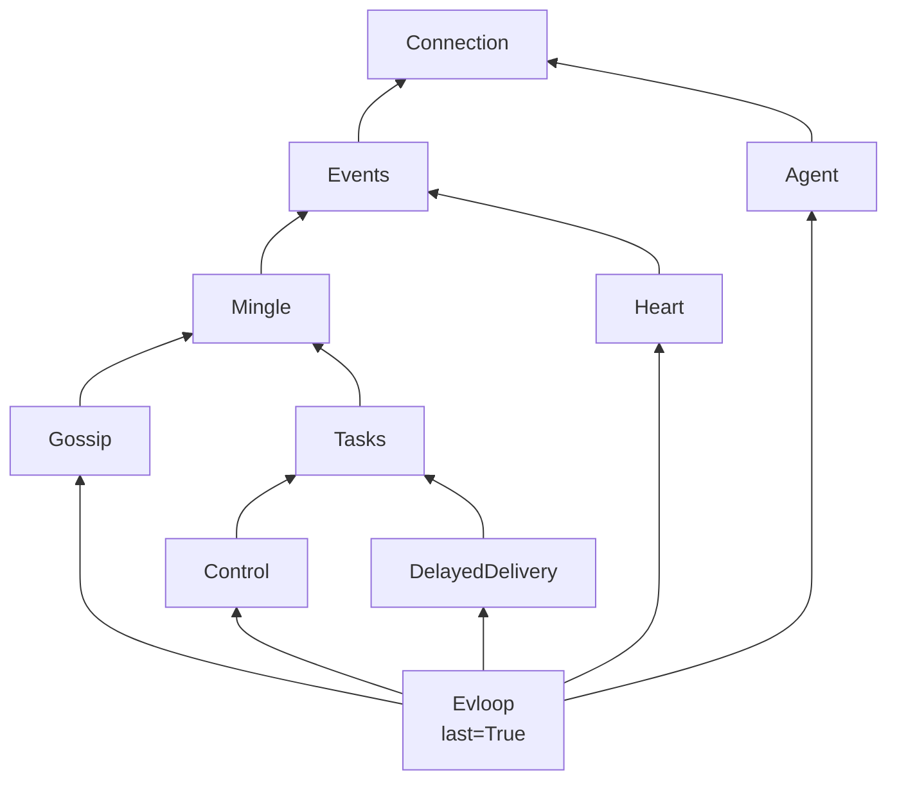
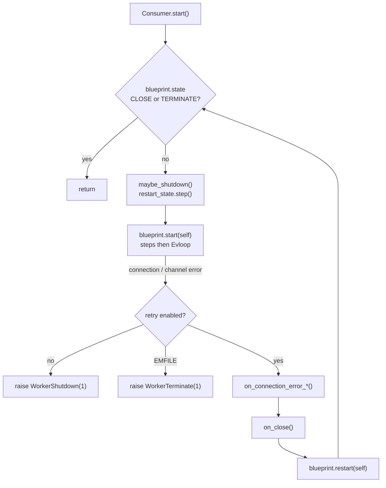

## Overview

The consumer is the part of the worker that talks to the broker. It owns the broker connection, the task consumer and its prefetch window (QoS), the event dispatcher, remote control and the inner event loop, and it hands each decoded task message to a per-task strategy. It is the last step of the worker blueprint described in [[Worker Architecture and Bootsteps]], and is itself built from a second blueprint of bootsteps.

Sources: [celery/worker/consumer/consumer.py:1-6](repo://celery/worker/consumer/consumer.py#L1-L6), [celery/worker/components.py:221-246](repo://celery/worker/components.py#L221-L246)

`celery.worker.consumer.Consumer` is created by the worker's `Consumer` step with `w.process_task` as its `on_task_request` callback, so every request the consumer accepts ends up in the pool. What happens to a request between the message and the pool is covered in [[Task Requests and Strategies]].

Sources: [celery/worker/consumer/consumer.py:191-255](repo://celery/worker/consumer/consumer.py#L191-L255)

## Consumer blueprint

### Default consumer steps

`Consumer.Blueprint` is named `Consumer`. Its default steps are merged with `app.steps['consumer']`, and `apply` receives the worker options as keyword arguments, which is how command-line flags such as `--without-mingle` reach the steps' `__init__`.

Sources: [celery/worker/consumer/consumer.py:171-189](repo://celery/worker/consumer/consumer.py#L171-L189), [celery/worker/consumer/consumer.py:250-255](repo://celery/worker/consumer/consumer.py#L250-L255)

| Step | Requires | Included when | Role |
| --- | --- | --- | --- |
| `Connection` | | always | Opens `c.connection` with `c.connect()` on start, closes it on shutdown. |
| `Events` | `Connection` | task events, gossip or heartbeat is on | Creates `c.event_dispatcher` on its own write connection. |
| `Mingle` | `Events` | not `--without-mingle` and transport is `amqp`, `redis` or `gcpubsub` | Syncs clock and revoked ids with other workers at start. |
| `Gossip` | `Mingle` | not `--without-gossip` and transport is `amqp` or `redis` | Consumes `worker.#` events from other workers. |
| `Heart` | `Events` | not `--without-heartbeat` | Sends `worker-heartbeat` events on the timer. |
| `Tasks` | `Mingle` | always | Builds strategies, sets QoS, creates `c.task_consumer`. |
| `Control` | `Tasks` | `worker_enable_remote_control` and fanout exchanges supported | Starts the pidbox for remote control commands. |
| `DelayedDelivery` | `Tasks` | quorum queues detected | Declares native delayed delivery exchanges and binds queues. |
| `Agent` | `Connection` | `worker_agent` set | Starts a `cell` actor agent. |
| `Evloop` | all others (`last=True`) | always | Runs `c.loop(*c.loop_args())`. |

Sources: [celery/worker/consumer/connection.py:13-45](repo://celery/worker/consumer/connection.py#L13-L45), [celery/worker/consumer/events.py:15-33](repo://celery/worker/consumer/events.py#L15-L33), [celery/worker/consumer/mingle.py:13-34](repo://celery/worker/consumer/mingle.py#L13-L34), [celery/worker/consumer/gossip.py:23-38](repo://celery/worker/consumer/gossip.py#L23-L38), [celery/worker/consumer/heart.py:10-26](repo://celery/worker/consumer/heart.py#L10-L26), [celery/worker/consumer/tasks.py:20-27](repo://celery/worker/consumer/tasks.py#L20-L27), [celery/worker/consumer/control.py:18-33](repo://celery/worker/consumer/control.py#L18-L33), [celery/worker/consumer/delayed_delivery.py:53-64](repo://celery/worker/consumer/delayed_delivery.py#L53-L64), [celery/worker/consumer/agent.py:9-21](repo://celery/worker/consumer/agent.py#L9-L21), [celery/worker/consumer/consumer.py:857-872](repo://celery/worker/consumer/consumer.py#L857-L872)



Sources: [celery/worker/consumer/consumer.py:171-186](repo://celery/worker/consumer/consumer.py#L171-L186), [celery/bootsteps.py:235-249](repo://celery/bootsteps.py#L235-L249)

Because `Evloop` is last and its `start` blocks inside the loop, the blueprint's `start` does not return while the worker consumes. Every other step has finished starting, so the connection is open and the task consumer exists, by the time the loop runs.

Sources: [celery/worker/consumer/consumer.py:857-869](repo://celery/worker/consumer/consumer.py#L857-L869), [celery/bootsteps.py:109-117](repo://celery/bootsteps.py#L109-L117)

## Start loop and connection recovery

### The restart loop

`Consumer.start` wraps `blueprint.start(self)` in a loop that runs until the blueprint is closing or terminating. Before each attempt it calls `maybe_shutdown()` and steps a `restart_state(maxR=5, maxT=1)`; too many restarts in one second logs `Frequent restarts detected` and sleeps one second. Connection errors are recoverable, and channel errors are too when `broker_channel_error_retry` is on. Any other exception propagates to `WorkController.start`.

Sources: [celery/worker/consumer/consumer.py:366-383](repo://celery/worker/consumer/consumer.py#L366-L383), [celery/worker/consumer/consumer.py:208-208](repo://celery/worker/consumer/consumer.py#L208-L208)

On a recoverable error the consumer decides whether to retry. `broker_connection_retry_on_startup` governs the very first connection attempt when it is set, and `broker_connection_retry` governs everything else. If retrying is disabled it raises `WorkerShutdown(1)`. `EMFILE` (too many open files) raises `WorkerTerminate(1)`. Otherwise it runs the error handler, clears local queues with `on_close()`, and calls `blueprint.restart(self)`, which stops every step in reverse before the loop starts them again.

Sources: [celery/worker/consumer/consumer.py:383-413](repo://celery/worker/consumer/consumer.py#L383-L413), [celery/bootsteps.py:133-135](repo://celery/bootsteps.py#L133-L135)



Sources: [celery/worker/consumer/consumer.py:366-407](repo://celery/worker/consumer/consumer.py#L366-L407)

### Establishing the connection

`connect()` calls `connection_for_read(heartbeat=self.amqheartbeat)` and, with an event loop, registers the transport with the hub. `ensure_connected` either calls `conn.connect()` directly when retry is disabled, or uses kombu's `ensure_connection` with `broker_connection_max_retries` and `maybe_shutdown` as the per-retry callback, so a shutdown signal interrupts the retry wait. Each failed attempt logs `Cannot connect to ...` with the retry count, or `Will retry using next failover` when an alternate URL is tried.

Sources: [celery/worker/consumer/consumer.py:549-622](repo://celery/worker/consumer/consumer.py#L549-L622), [celery/worker/consumer/consumer.py:47-63](repo://celery/worker/consumer/consumer.py#L47-L63)

> [!NOTE]
> When `broker_connection_retry_on_startup` is unset, `broker_connection_retry=False` also disables retries at startup and emits a `CPendingDeprecationWarning`: in Celery 6.0 only the startup setting will control this.

Sources: [celery/worker/consumer/consumer.py:585-603](repo://celery/worker/consumer/consumer.py#L585-L603)

### After a lost connection

`on_connection_error_after_connected` logs `Connection to broker lost`, collects the old connection with a 5-second socket timeout so cleanup cannot hang on a dead socket, and closes it. With `worker_cancel_long_running_tasks_on_connection_loss`, every active `acks_late` request that is not yet acknowledged is cancelled, because its delivery tag belongs to the dead channel and the broker will redeliver it. Without the setting a pending-deprecation warning announces that the default will change in 6.0.

Sources: [celery/worker/consumer/consumer.py:65-68](repo://celery/worker/consumer/consumer.py#L65-L68), [celery/worker/consumer/consumer.py:123-134](repo://celery/worker/consumer/consumer.py#L123-L134), [celery/worker/consumer/consumer.py:419-450](repo://celery/worker/consumer/consumer.py#L419-L450)

`on_close` then empties the worker's local buffers: it clears the pool semaphore and the rate-limit buckets, forgets reserved requests that are not active, and flushes the pool. Messages held there cannot be acknowledged on a new channel anyway.

Sources: [celery/worker/consumer/consumer.py:532-547](repo://celery/worker/consumer/consumer.py#L532-L547)

## Prefetch count and QoS

### Initial QoS

The `Tasks` step sets the prefetch window when it starts. It records whether QoS is global: global when the broker's QoS semantics do not match the AMQP spec (RabbitMQ 3.3 and later), but forced off when `worker_detect_quorum_queues` finds a quorum queue, since quorum queues do not support global QoS. It sends `basic_qos(0, c.initial_prefetch_count, qos_global)`, creates `c.task_consumer` with `app.amqp.TaskConsumer`, and wraps the prefetch value in a kombu `QoS` object capped by `worker_eta_task_limit`.

Sources: [celery/worker/consumer/tasks.py:29-57](repo://celery/worker/consumer/tasks.py#L29-L57), [celery/worker/consumer/tasks.py:103-124](repo://celery/worker/consumer/tasks.py#L103-L124)

The initial count comes from the worker: `concurrency * worker_prefetch_multiplier` (default multiplier 4). Strategies raise it with `qos.increment_eventually()` for each ETA task held in memory, and lower it again when the task is released, so scheduled tasks do not consume the slots of ready ones. The loops only call `qos.update()` when `qos.prev != qos.value`.

Sources: [celery/worker/components.py:226-230](repo://celery/worker/components.py#L226-L230), [celery/worker/consumer/consumer.py:659-663](repo://celery/worker/consumer/consumer.py#L659-L663), [celery/worker/loops.py:90-94](repo://celery/worker/loops.py#L90-L94)

With `worker_disable_prefetch` on a Redis broker, the step patches the channel's `can_consume` so no new message is fetched while the number of reserved requests is at the autoscaler's `max_concurrency` or the pool size. On other brokers the setting is ignored with a warning.

Sources: [celery/worker/consumer/tasks.py:59-83](repo://celery/worker/consumer/tasks.py#L59-L83)

### Reduction after reconnect

When `worker_enable_prefetch_count_reduction` is on (the default), a reconnect would otherwise fetch a full window while old tasks are still running. The consumer sets `initial_prefetch_count` to `max(prefetch_multiplier, max_prefetch_count - active * prefetch_multiplier)`, where `max_prefetch_count` is `pool.num_processes * prefetch_multiplier`. Each later ack or reject runs `_restore_prefetch_count_after_connection_restart`, which raises the count by one multiplier step until the maximum is reached and logs `Resuming normal operations`. Under per-consumer QoS (`qos_global is False`) the reduction is skipped, because `basic.qos` updates would not reach the running consumer.

Sources: [celery/worker/consumer/consumer.py:452-491](repo://celery/worker/consumer/consumer.py#L452-L491), [celery/worker/consumer/consumer.py:788-815](repo://celery/worker/consumer/consumer.py#L788-L815)

Pool resizes by the autoscaler go through `_update_prefetch_count(index)`, which recomputes the count from `num_processes` and calls `qos.increment_eventually` or `decrement_eventually` by `abs(index) * prefetch_multiplier`.

Sources: [celery/worker/consumer/consumer.py:305-327](repo://celery/worker/consumer/consumer.py#L305-L327)

## Receiving task messages

### Strategies

`Tasks.start` begins with `c.update_strategies()`. For every registered task it stores `task.start_strategy(app, consumer)` in `consumer.strategies` and builds the task's tracer with `build_tracer`. The strategy is a closure from `Task.Strategy`, by default `celery.worker.strategy:default`.

Sources: [celery/worker/consumer/consumer.py:716-721](repo://celery/worker/consumer/consumer.py#L716-L721), [celery/app/task.py:222-225](repo://celery/app/task.py#L222-L225), [celery/app/task.py:520-521](repo://celery/app/task.py#L520-L521)

### on_task_received

The event loop installs the result of `create_task_handler()` as the task consumer's `on_message`. For each message, `on_task_received` reads the task name from the `task` header (protocol 2), or decodes the body and reads `payload['task']` (protocol 1). It looks up the strategy and calls it with the message, the payload (protocol 1 only), an ack promise, a reject promise and the `on_task_message` callbacks.

Sources: [celery/worker/consumer/consumer.py:723-786](repo://celery/worker/consumer/consumer.py#L723-L786)

| Condition | Handler | Effect |
| --- | --- | --- |
| Headers are not a mapping, or the body has no `task` | `on_unknown_message` | Rejects the message, sends `task_rejected`. |
| Body cannot be decoded | `on_decode_error` | Logs critical and acks the message so it does not loop. |
| No strategy for the task name | `on_unknown_task` | Rejects, stores `NotRegistered` as the task result, sends a `task-failed` event and `task_unknown`. |
| Strategy raises `InvalidTaskError` or `ContentDisallowed` | `on_invalid_task` | Rejects, sends `task_rejected`. |

Sources: [celery/worker/consumer/consumer.py:516-530](repo://celery/worker/consumer/consumer.py#L516-L530), [celery/worker/consumer/consumer.py:672-714](repo://celery/worker/consumer/consumer.py#L672-L714)

```mermaid
sequenceDiagram
  participant Broker
  participant Loop as "asynloop / synloop"
  participant Handler as "on_task_received"
  participant Strategy as "strategy closure"
  participant Worker as "WorkController.process_task"
  participant Pool
  Broker->>Loop: message
  Loop->>Handler: consumer.on_message(message)
  Handler->>Handler: read task header, find strategy
  Handler->>Strategy: strategy(message, payload, ack, reject, callbacks)
  Strategy->>Worker: on_task_request(req)
  Worker->>Pool: req.execute_using_pool(pool)
```

Sources: [celery/worker/loops.py:57-64](repo://celery/worker/loops.py#L57-L64), [celery/worker/consumer/consumer.py:731-780](repo://celery/worker/consumer/consumer.py#L731-L780), [celery/worker/worker.py:223-226](repo://celery/worker/worker.py#L223-L226)

The ack and reject promises call `message.ack_log_error` or `reject_log_error` through `call_soon_ack`. With a hub this is scheduled on the loop. Without one (synloop, gevent or eventlet) it runs immediately rather than waiting in `_pending_operations`, because with `acks_late` and a prefetch of 1 the broker cannot send the next message until the ack is written.

Sources: [celery/worker/consumer/consumer.py:257-294](repo://celery/worker/consumer/consumer.py#L257-L294)

## Event loops

### asynloop

`asynloop` is used when the worker has a hub. It sets up AMQP heartbeat checks on the hub timer, installs `on_task_received`, registers the worker and consumer steps with the hub (the pool registers its file descriptors this way), starts consuming and calls `on_ready()`, which fires the worker's `init_callback` once. On the first start it raises `WorkerLostError` if the pool processes failed to start. It then calls `next()` on `hub.create_loop()` while the blueprint is running and a connection exists, checking `maybe_shutdown()`, heartbeat errors and pending QoS updates on every pass.

Sources: [celery/worker/loops.py:28-99](repo://celery/worker/loops.py#L28-L99), [celery/worker/consumer/consumer.py:493-514](repo://celery/worker/consumer/consumer.py#L493-L514)

On an exception (a lost connection, for example) the hub is reset and its timer cleared, so stale callbacks and repeated timers from the old connection cannot fire during the reconnect; the steps register them again on the next `blueprint.start`. A normal exit does not reset the hub, so heartbeats keep firing while the pool drains. `WorkerShutdown` and `WorkerTerminate` derive from `SystemExit` and skip this cleanup.

Sources: [celery/worker/loops.py:100-130](repo://celery/worker/loops.py#L100-L130)

### synloop

`synloop` is the blocking fallback for transports without asynchronous I/O and for green pools. Each cycle raises any heartbeat error, applies QoS changes, runs `perform_pending_operations()` and calls `connection.drain_events(timeout=2.0)`. Socket timeouts are ignored, and `OSError` is raised only while the blueprint is running. AMQP heartbeats are only checked when the pool is green.

Sources: [celery/worker/loops.py:133-183](repo://celery/worker/loops.py#L133-L183)

The consumer chooses the loop in `__init__`: `asynloop` if a hub was passed, otherwise `synloop`, unless a subclass already defines `loop`. Broker heartbeats (`broker_heartbeat`) are enabled only with a hub or a green pool.

Sources: [celery/worker/consumer/consumer.py:231-240](repo://celery/worker/consumer/consumer.py#L231-L240)

## Supporting steps

### Events and Heart

`Events.start` creates the dispatcher on a separate write connection. Without task events it only enables the `worker` group. With a hub, `task` events are buffered and flushed from the loop. On a restart, events buffered by the previous dispatcher are moved to the new one and flushed, and every reserved request's `eventer` is pointed at it. `Heart` wraps `celery.worker.heartbeat.Heart`, which sends `worker-online` and then `worker-heartbeat` every `--heartbeat-interval` seconds (2 by default) with active and processed counts and the load average. See [[Events and Monitoring]].

Sources: [celery/worker/consumer/events.py:35-71](repo://celery/worker/consumer/events.py#L35-L71), [celery/worker/consumer/heart.py:21-36](repo://celery/worker/consumer/heart.py#L21-L36), [celery/worker/heartbeat.py:25-54](repo://celery/worker/heartbeat.py#L25-L54)

### Mingle and Gossip

At start, `Mingle.sync` sends a `hello` broadcast through `app.control.inspect(timeout=1.0)` carrying this worker's revoked set. It drops its own reply, adjusts the logical clock from each neighbour's clock and merges their revoked ids into `state.revoked`, or logs `mingle: all alone`.

Sources: [celery/worker/consumer/mingle.py:36-76](repo://celery/worker/consumer/mingle.py#L36-L76)

`Gossip` is a `ConsumerStep`: it consumes `worker.#` events into an `events.State`, fires `node_join`, `node_leave` and `node_lost` handlers, prunes dead workers every 5 seconds, and only advances the logical clock for its own events. It also implements a small leader election (`worker-elect` and `worker-elect-ack`): once every alive worker has acked, the entry `clock.sort_heap` picks from the request heap wins, and the winner runs the `task` election handler, which applies the given signature.

Sources: [celery/worker/consumer/gossip.py:81-154](repo://celery/worker/consumer/gossip.py#L81-L154), [celery/worker/consumer/gossip.py:156-206](repo://celery/worker/consumer/gossip.py#L156-L206)

### Control, Agent and DelayedDelivery

`Control` delegates `start`, `stop` and `shutdown` to a `pidbox.Pidbox`, or to `gPidbox` for green pools, which serves the commands in [[Remote Control and Inspection]]. `Agent` instantiates the class named by `worker_agent` with the consumer connection.

Sources: [celery/worker/consumer/control.py:18-33](repo://celery/worker/consumer/control.py#L18-L33), [celery/worker/consumer/agent.py:9-21](repo://celery/worker/consumer/agent.py#L9-L21)

`DelayedDelivery` runs only when a RabbitMQ queue declares `x-queue-type: quorum`. It validates `broker_url` and `broker_native_delayed_delivery_queue_type` (`classic` or `quorum`), then for each broker URL declares the native delayed delivery exchanges and queues and binds every non-broadcast queue to them, retrying `ConnectionRefusedError` and `OSError` up to 3 times. A failure on one URL is logged and the next URL is tried; failing on all of them logs a critical message but does not stop the worker.

Sources: [celery/worker/consumer/delayed_delivery.py:30-110](repo://celery/worker/consumer/delayed_delivery.py#L30-L110), [celery/worker/consumer/delayed_delivery.py:152-199](repo://celery/worker/consumer/delayed_delivery.py#L152-L199), [celery/utils/quorum_queues.py:4-20](repo://celery/utils/quorum_queues.py#L4-L20)

## Shutdown and queue management

`Consumer.shutdown()` runs any pending operations, then sends `shutdown` to every step. That cancels and closes the task consumer, closes the event dispatcher, stops the heart and closes the connection. `stop()` only stops the blueprint, so in-flight acks can still use the connection.

Sources: [celery/worker/consumer/consumer.py:499-504](repo://celery/worker/consumer/consumer.py#L499-L504), [celery/worker/consumer/tasks.py:85-97](repo://celery/worker/consumer/tasks.py#L85-L97), [celery/worker/consumer/connection.py:24-38](repo://celery/worker/consumer/connection.py#L24-L38)

During a cold shutdown `cancel_active_requests()` cancels every active request except `acks_late` requests that were already acknowledged or already succeeded. For requests without `acks_late` that had started, `Request.cancel` records a retry and sends `task_retry`; `acks_late` ones are left for the broker to redeliver.

Sources: [celery/worker/consumer/consumer.py:823-854](repo://celery/worker/consumer/consumer.py#L823-L854), [celery/worker/request.py:428-455](repo://celery/worker/request.py#L428-L455)

`add_task_queue` and `cancel_task_queue` back the `add_consumer` and `cancel_consumer` control commands. Adding selects a queue from `task_queues`, or declares a new one with a direct exchange of the same name, and starts consuming from it if the task consumer is not already doing so.

Sources: [celery/worker/consumer/consumer.py:632-657](repo://celery/worker/consumer/consumer.py#L632-L657), [celery/worker/control.py:610-627](repo://celery/worker/control.py#L610-L627)

## Configuration

These settings change consumer behaviour; see [[Configuration and Settings]] for the full reference.

Sources: [celery/app/defaults.py:89-98](repo://celery/app/defaults.py#L89-L98), [celery/app/defaults.py:325-375](repo://celery/app/defaults.py#L325-L375)

| Setting | Default | Effect |
| --- | --- | --- |
| `broker_connection_retry` | `True` | Retry after a lost connection. |
| `broker_connection_retry_on_startup` | `None` | Retry the first connection; falls back to `broker_connection_retry`. |
| `broker_connection_max_retries` | `100` | Limit passed to `ensure_connection`. |
| `broker_channel_error_retry` | `False` | Treat channel errors as recoverable. |
| `broker_heartbeat`, `broker_heartbeat_checkrate` | `120`, `3.0` | AMQP heartbeat and check rate. |
| `worker_prefetch_multiplier` | `4` | Messages reserved per process. |
| `worker_eta_task_limit` | `None` | Maximum prefetch the `QoS` object will grow to. |
| `worker_enable_prefetch_count_reduction` | `True` | Shrink prefetch after reconnect. |
| `worker_disable_prefetch` | `False` | Redis only: fetch no more than the pool can run. |
| `worker_detect_quorum_queues` | `True` | Disable global QoS when quorum queues are used. |
| `worker_cancel_long_running_tasks_on_connection_loss` | `False` | Cancel unacked `acks_late` tasks on connection loss. |
| `worker_enable_remote_control` | `True` | Include the `Control` step. |
| `worker_agent` | `None` | Class for the `Agent` step. |

Sources: [celery/app/defaults.py:89-98](repo://celery/app/defaults.py#L89-L98), [celery/app/defaults.py:325-375](repo://celery/app/defaults.py#L325-L375)
