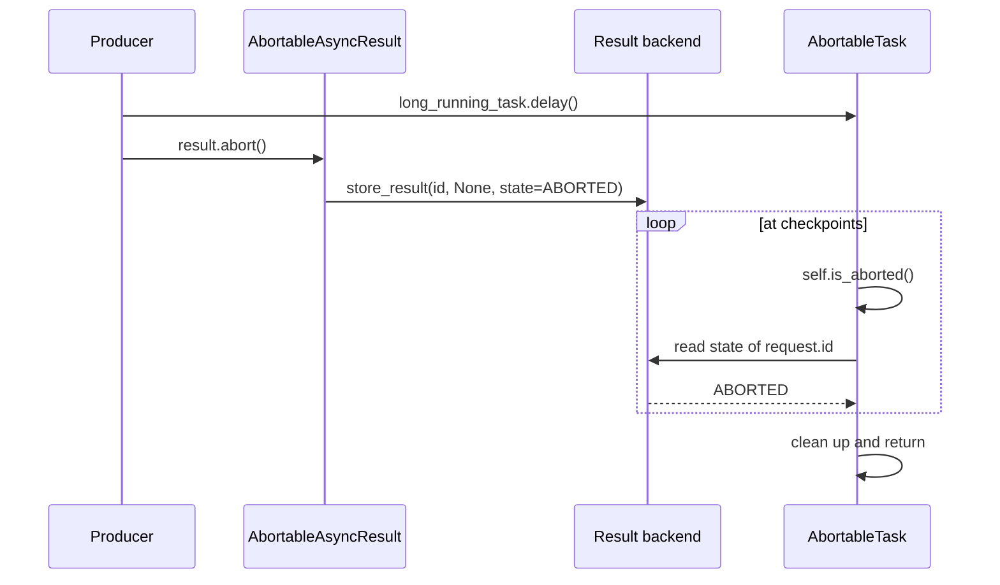
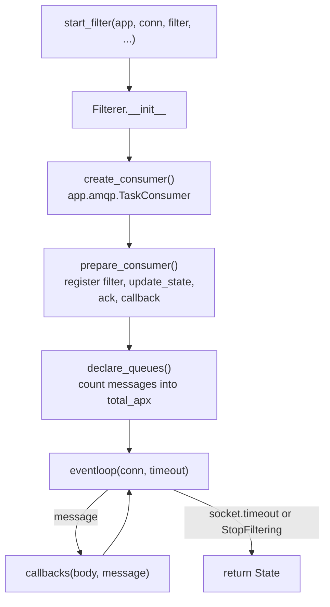

## Overview

`celery.contrib` collects optional helpers that are not needed to run tasks but solve recurring problems around them: cooperative cancellation of long tasks (`abortable`), debugging a task inside a pool process over a socket (`rdb`), moving messages between brokers or queues (`migrate`), and documenting tasks with Sphinx (`sphinx`). Each module is imported explicitly; none is loaded by the app or worker unless asked for, except `rdb`, which the worker can hook to a signal.

Sources: [celery/contrib/abortable.py:1-21](repo://celery/contrib/abortable.py#L1-L21), [celery/contrib/rdb.py:1-42](repo://celery/contrib/rdb.py#L1-L42), [celery/contrib/migrate.py:1-19](repo://celery/contrib/migrate.py#L1-L19), [celery/contrib/sphinx.py:1-47](repo://celery/contrib/sphinx.py#L1-L47)

The pytest fixtures and Django task class also live under `celery.contrib`; they are covered in [[Testing Celery Applications]] and [[Django Integration]].

Sources: [celery/contrib/pytest.py:1-16](repo://celery/contrib/pytest.py#L1-L16), [celery/contrib/django/task.py:1-21](repo://celery/contrib/django/task.py#L1-L21)

## Abortable tasks

### How aborting works

`AbortableTask` supports cooperative cancellation: the producer marks the task as `ABORTED` in the result backend, and the task body polls that state and decides how to stop. The communication goes entirely through the backend; no message is sent to the worker.

Sources: [celery/contrib/abortable.py:1-21](repo://celery/contrib/abortable.py#L1-L21), [celery/contrib/abortable.py:100-165](repo://celery/contrib/abortable.py#L100-L165)



Sources: [celery/contrib/abortable.py:103-165](repo://celery/contrib/abortable.py#L103-L165)

### API

| Name | Description |
| --- | --- |
| `ABORTED` | The state string `'ABORTED'` |
| `AbortableAsyncResult.abort()` | Calls `backend.store_result(self.id, result=None, state=ABORTED, traceback=None)` |
| `AbortableAsyncResult.is_aborted()` | `self.state == ABORTED` |
| `AbortableTask.AsyncResult(task_id)` | Returns an `AbortableAsyncResult` bound to the task's backend, so `delay()` results have `abort()` |
| `AbortableTask.is_aborted(task_id=...)` | Checks the current request's id (or `task_id`) against the backend; returns `False` if the result is not abortable |

Sources: [celery/contrib/abortable.py:100-165](repo://celery/contrib/abortable.py#L100-L165)

```python
from celery.contrib.abortable import AbortableTask

@app.task(bind=True, base=AbortableTask)
def long_running_task(self):
    for i in range(100):
        if not i % 5 and self.is_aborted():
            return  # stop at a safe point
        do_something_expensive(i)

result = long_running_task.delay()
result.abort()
```

Sources: [celery/contrib/abortable.py:23-67](repo://celery/contrib/abortable.py#L23-L67), [celery/contrib/abortable.py:130-165](repo://celery/contrib/abortable.py#L130-L165)

### Limitations

`abort()` gives no guarantee that the task stops, or when: it only writes a state that the task may never read. Each `is_aborted()` call is a backend query, so check at a reasonable interval. The module docstring states that this works only with the database backends; the code itself simply needs a backend whose `store_result` is visible to the worker's subsequent state reads. When the task returns after noticing the abort, its normal result handling records the final state, replacing `ABORTED`.

Sources: [celery/contrib/abortable.py:69-79](repo://celery/contrib/abortable.py#L69-L79), [celery/contrib/abortable.py:114-127](repo://celery/contrib/abortable.py#L114-L127), [celery/contrib/abortable.py:147-165](repo://celery/contrib/abortable.py#L147-L165)

## Remote debugger (rdb)

### Using set_trace

Pool child processes have no usable terminal, so a regular `pdb.set_trace()` cannot be driven. `celery.contrib.rdb.Rdb` is a `Pdb` subclass that opens a TCP socket, waits for one client, and redirects `sys.stdin` and `sys.stdout` to that connection. Call `rdb.set_trace()` in a task and connect with telnet to the address the worker logs.

Sources: [celery/contrib/rdb.py:1-21](repo://celery/contrib/rdb.py#L1-L21), [celery/contrib/rdb.py:84-114](repo://celery/contrib/rdb.py#L84-L114)

```python
from celery.contrib import rdb

@app.task
def add(x, y):
    result = x + y
    rdb.set_trace()
    return result
```

Sources: [celery/contrib/rdb.py:12-21](repo://celery/contrib/rdb.py#L12-L21), [celery/contrib/rdb.py:183-187](repo://celery/contrib/rdb.py#L183-L187)

```text
Remote Debugger:6900: Ready to connect: telnet 127.0.0.1 6900

Type `exit` in session to continue.

Remote Debugger:6900: Waiting for client...
```

Sources: [celery/contrib/rdb.py:72-78](repo://celery/contrib/rdb.py#L72-L78)

### Session lifecycle

`set_trace(frame=None)` uses the caller's frame by default and calls `debugger()`, which reuses the active `Rdb` in `_current[0]` or creates a new one. `Rdb.__init__` blocks in `accept()` until a client connects, then prints `SESSION_STARTED` and starts `Pdb` on the socket file. `continue` (`c`, `cont`) and `quit` (`q`, `exit`) both close the session: they restore the previous stdin and stdout, close the file, client and listening socket, and print `SESSION_ENDED`. `quit` also clears the trace function with `sys.settrace(None)` instead of raising `BdbQuit`, so leaving the debugger lets the task continue rather than fail.

Sources: [celery/contrib/rdb.py:91-114](repo://celery/contrib/rdb.py#L91-L114), [celery/contrib/rdb.py:140-187](repo://celery/contrib/rdb.py#L140-L187)

### Port selection and environment variables

| Variable | Default | Meaning |
| --- | --- | --- |
| `CELERY_RDB_HOST` | `127.0.0.1` | Address to bind; the default is reachable only from localhost |
| `CELERY_RDB_PORT` | `6899` (`DEFAULT_PORT`) | Base port for the search |
| `CELERY_RDBSIG` | unset | When set, the worker installs a `SIGUSR2` handler that opens `rdb` at the current frame |

Sources: [celery/contrib/rdb.py:23-59](repo://celery/contrib/rdb.py#L23-L59), [celery/apps/worker.py:502-514](repo://celery/apps/worker.py#L502-L514)

`get_avail_port` tries up to `port_search_limit` (100) ports starting at `port + skew`. The skew is taken from the billiard process name: a process whose name ends in `-3` starts at base port + 3, so several children can debug at once without colliding. Ports that fail with `EADDRINUSE` or `EINVAL` are skipped; if none is free it raises an `Exception` with `NO_AVAILABLE_PORT`, asking you to set `CELERY_RDB_PORT`.

Sources: [celery/contrib/rdb.py:66-70](repo://celery/contrib/rdb.py#L66-L70), [celery/contrib/rdb.py:116-135](repo://celery/contrib/rdb.py#L116-L135)

> [!WARNING]
> The debugger session is unauthenticated and gives full Python access to the worker process. Keep `CELERY_RDB_HOST` on a loopback address unless the network is trusted.

Sources: [celery/contrib/rdb.py:26-32](repo://celery/contrib/rdb.py#L26-L32), [celery/contrib/rdb.py:58-58](repo://celery/contrib/rdb.py#L58-L58)

The `CELERY_RDBSIG` handler is installed by `install_rdb_handler()` during the worker's signal setup. It uses the interrupted frame passed to the signal handler (or the caller's frame under gevent, which passes no arguments) as the breakpoint location.

Sources: [celery/apps/worker.py:268-274](repo://celery/apps/worker.py#L268-L274), [celery/apps/worker.py:502-514](repo://celery/apps/worker.py#L502-L514)

## Message migration

### Filtering engine

All functions in `celery.contrib.migrate` are built on `start_filter`, which constructs a `Filterer` and runs it. `Filterer` creates a task consumer on the given connection, registers callbacks, declares the queues (passively counting their messages into `State.total_apx`), and drains the connection with kombu's `eventloop` until a socket timeout (default `timeout=1.0` seconds) or a `StopFiltering` exception ends it. With `forever=True` timeouts are ignored and it keeps running.

Sources: [celery/contrib/migrate.py:247-355](repo://celery/contrib/migrate.py#L247-L355)



Sources: [celery/contrib/migrate.py:272-335](repo://celery/contrib/migrate.py#L272-L335)

`State` tracks progress: `count` (messages seen), `filtered` (messages moved by `move`), and `total_apx` (approximate total from queue declarations, shown as `?` when unknown). `limit` stops the filter once `count` reaches it.

Sources: [celery/contrib/migrate.py:31-47](repo://celery/contrib/migrate.py#L31-L47), [celery/contrib/migrate.py:286-289](repo://celery/contrib/migrate.py#L286-L289)

| `start_filter` option | Default | Effect |
| --- | --- | --- |
| `limit` | `None` | Stop after this many messages |
| `timeout` | `1.0` | Seconds of inactivity before stopping |
| `ack_messages` | `False` | Ack each consumed message on the source |
| `tasks` | `None` | Only pass messages whose `body['task']` is in this list (comma-separated string allowed) |
| `queues` | `None` | Source queues, also used as a rename map (see below) |
| `consume_from` | keys of `queues` | Explicit list of queues or queue names to consume |
| `callback` | `None` | Called as `callback(state, body, message)` per message |
| `forever` | `False` | Ignore timeouts and run until interrupted |
| `accept` | app's `accept_content` | Content types the consumer accepts |

Sources: [celery/contrib/migrate.py:247-271](repo://celery/contrib/migrate.py#L247-L271), [celery/contrib/migrate.py:337-355](repo://celery/contrib/migrate.py#L337-L355), [celery/app/amqp.py:317-324](repo://celery/app/amqp.py#L317-L324)

> [!CAUTION]
> In `prepare_consumer`, the task-name filter is applied to the `ack_message` callback, but the registration uses the unfiltered `self.ack_message`. With both `tasks` and `ack_messages=True`, every consumed message is acknowledged, including those whose task name was filtered out and therefore never migrated.

Sources: [celery/contrib/migrate.py:301-312](repo://celery/contrib/migrate.py#L301-L312)

### migrate_tasks

`migrate_tasks(source, dest, migrate=migrate_task, app=None, queues=None, **kwargs)` copies task messages from the `source` connection to the `dest` connection. `prepare_queues` turns `queues` into a mapping: a string is split on commas, and each `"src:dst"` item maps `src` to `dst` while a plain `"name"` maps to itself. Before consuming, `on_declare_queue` re-declares each source queue on the destination under its mapped name (also renaming the routing key and exchange when they equal the queue name). Each message is then republished by `migrate_task`, which looks up the original exchange and routing key in the same mapping.

Sources: [celery/contrib/migrate.py:80-118](repo://celery/contrib/migrate.py#L80-L118), [celery/contrib/migrate.py:236-244](repo://celery/contrib/migrate.py#L236-L244)

`republish` sends the raw body bytes so the message is not re-serialized, keeps content type and encoding, carries over headers and properties, re-applies the `compression` header through the producer, and converts `expiration` to a float.

Sources: [celery/contrib/migrate.py:50-77](repo://celery/contrib/migrate.py#L50-L77)

```python
from kombu import Connection
from celery.contrib.migrate import migrate_tasks

migrate_tasks(
    Connection("amqp://old-broker//"),
    Connection("redis://new-broker:6379/0"),
    queues="celery,images:images_v2",
    ack_messages=True,
)
```

Sources: [celery/contrib/migrate.py:99-118](repo://celery/contrib/migrate.py#L99-L118), [celery/contrib/migrate.py:236-244](repo://celery/contrib/migrate.py#L236-L244)

The `celery migrate SOURCE DESTINATION` command is a wrapper around `migrate_tasks` that exposes `--limit`, `--timeout`, `--ack-messages`, `--tasks`, `--queues` and `--forever`, and prints each migrated task. Its docstring marks it experimental and advises backing up messages first. See [[Command Line Interface]].

Sources: [celery/bin/migrate.py:1-63](repo://celery/bin/migrate.py#L1-L63)

### move and its variants

`move(predicate, connection=None, exchange=None, routing_key=None, source=None, app=None, callback=None, limit=None, transform=None, **kwargs)` moves selected messages to another queue on the same broker. For each message it calls `predicate(body, message)`; a false result leaves the message alone. A true result is optionally passed through `transform`, then interpreted as a destination: a `kombu.Queue` is declared and its exchange and routing key are used, a two-item `(exchange, routing_key)` is used directly, and any other true value falls back to the `exchange` and `routing_key` arguments. The message is republished, acked on the source, counted in `state.filtered`, and reported to `callback(state, body, message)`; reaching `limit` moved messages raises `StopFiltering`.

Sources: [celery/contrib/migrate.py:127-223](repo://celery/contrib/migrate.py#L127-L223)

| Function | Selects by | Notes |
| --- | --- | --- |
| `move_task_by_id(task_id, dest, **kwargs)` | One task id | Wrapper for `move_by_idmap({task_id: dest})` |
| `move_by_idmap(map, **kwargs)` | `message.properties['correlation_id']` in `map` | Sets `limit=len(map)` so it stops once all are found |
| `move_by_taskmap(map, **kwargs)` | `body['task']` in `map` | No implicit limit |
| `move_direct`, `move_direct_by_id`, `move_direct_by_idmap`, `move_direct_by_taskmap` | Same as above | `transform=worker_direct`: destinations are worker node names, moved to that worker's direct queue |
| `task_id_eq(task_id, body, message)`, `task_id_in(ids, body, message)` | Task id | Predicate helpers to combine with `functools.partial` |

Sources: [celery/contrib/migrate.py:226-233](repo://celery/contrib/migrate.py#L226-L233), [celery/contrib/migrate.py:358-416](repo://celery/contrib/migrate.py#L358-L416), [celery/utils/nodenames.py:38-50](repo://celery/utils/nodenames.py#L38-L50)

```python
from kombu import Exchange, Queue
from celery.contrib.migrate import move_task_by_id, move_by_taskmap

move_task_by_id(task_id, Queue("hipri", Exchange("hipri"), "hipri"), app=app)
move_by_taskmap({"tasks.add": Queue("math")}, source=["celery"], app=app)
```

Sources: [celery/contrib/migrate.py:358-406](repo://celery/contrib/migrate.py#L358-L406)

`move` consumes from `source` (names resolved through `app.amqp.queues`) or, when `source` is empty, from the app's default consume queues. `filter_status` is a ready-made `callback` that prints `Moving task n/total: name[id]`.

Sources: [celery/contrib/migrate.py:121-124](repo://celery/contrib/migrate.py#L121-L124), [celery/contrib/migrate.py:189-215](repo://celery/contrib/migrate.py#L189-L215), [celery/contrib/migrate.py:409-410](repo://celery/contrib/migrate.py#L409-L410), [celery/app/amqp.py:317-324](repo://celery/app/amqp.py#L317-L324)

## Sphinx extension

### Setup

Tasks are objects created by a decorator, not plain functions, so Sphinx autodoc does not document them correctly out of the box. Adding `celery.contrib.sphinx` to `extensions` in `conf.py` runs its `setup(app)`, which loads `sphinx.ext.autodoc` and registers the hooks listed below.

Sources: [celery/contrib/sphinx.py:1-31](repo://celery/contrib/sphinx.py#L1-L31), [celery/contrib/sphinx.py:111-139](repo://celery/contrib/sphinx.py#L111-L139)

- the `TaskDocumenter` autodocumenter, which provides the `autotask` directive and lets `automodule` pick up tasks;
- a `py:task` directive (`TaskDirective`) whose signature prefix is the `celery_task_prefix` config value, default `'(task)'`;
- a `py:task` cross-reference role, so `:task:` references link to tasks;
- an `autodoc-skip-member` handler that stops autodoc from skipping tasks.

Sources: [celery/contrib/sphinx.py:91-108](repo://celery/contrib/sphinx.py#L91-L108), [celery/contrib/sphinx.py:131-139](repo://celery/contrib/sphinx.py#L131-L139)

```python
# docs/conf.py
extensions = [
    "sphinx.ext.autodoc",
    "celery.contrib.sphinx",
]
celery_task_prefix = "(task)"
autodoc_use_legacy_class_based = True  # Sphinx 9.0+
```

Sources: [celery/contrib/sphinx.py:11-46](repo://celery/contrib/sphinx.py#L11-L46), [celery/contrib/sphinx.py:131-134](repo://celery/contrib/sphinx.py#L131-L134)

```rst
.. autotask:: proj.tasks.add
```

Sources: [celery/contrib/sphinx.py:31-31](repo://celery/contrib/sphinx.py#L31-L31), [celery/contrib/sphinx.py:58-62](repo://celery/contrib/sphinx.py#L58-L62)

### TaskDocumenter

`TaskDocumenter` extends autodoc's `FunctionDocumenter` with `objtype = 'task'`. `can_document_member` accepts objects that are `BaseTask` instances with a `__wrapped__` function, which the task decorator sets. `format_args` renders the wrapped function's signature and drops a leading `self` or `cls` parameter, so bound tasks (`bind=True`) are shown without it. `check_module` compares the wrapped function's `__module__` with the module being documented, because the task object itself lives in `celery.local` and would otherwise be treated as imported. `document_members` does nothing, so task attributes are not listed.

Sources: [celery/contrib/sphinx.py:58-88](repo://celery/contrib/sphinx.py#L58-L88)

`autodoc_skip_member_handler` exists because a decorated task's `__doc__` equals its class's `__doc__`, which autodoc's duplicate-suppression logic would otherwise use to skip it. For such tasks it returns `False` when autodoc wanted to skip, and `None` (no opinion) for everything else.

Sources: [celery/contrib/sphinx.py:98-108](repo://celery/contrib/sphinx.py#L98-L108)

### Sphinx 9 compatibility

Sphinx 9.0 rewrote autodoc, and `TaskDocumenter` relies on the legacy class-based implementation. On Sphinx 9.0 or later, if `autodoc_use_legacy_class_based` is not already true, `setup` emits a `UserWarning` and sets it to `True` itself. Setting it explicitly in `conf.py` avoids the warning.

Sources: [celery/contrib/sphinx.py:33-46](repo://celery/contrib/sphinx.py#L33-L46), [celery/contrib/sphinx.py:117-129](repo://celery/contrib/sphinx.py#L117-L129)
