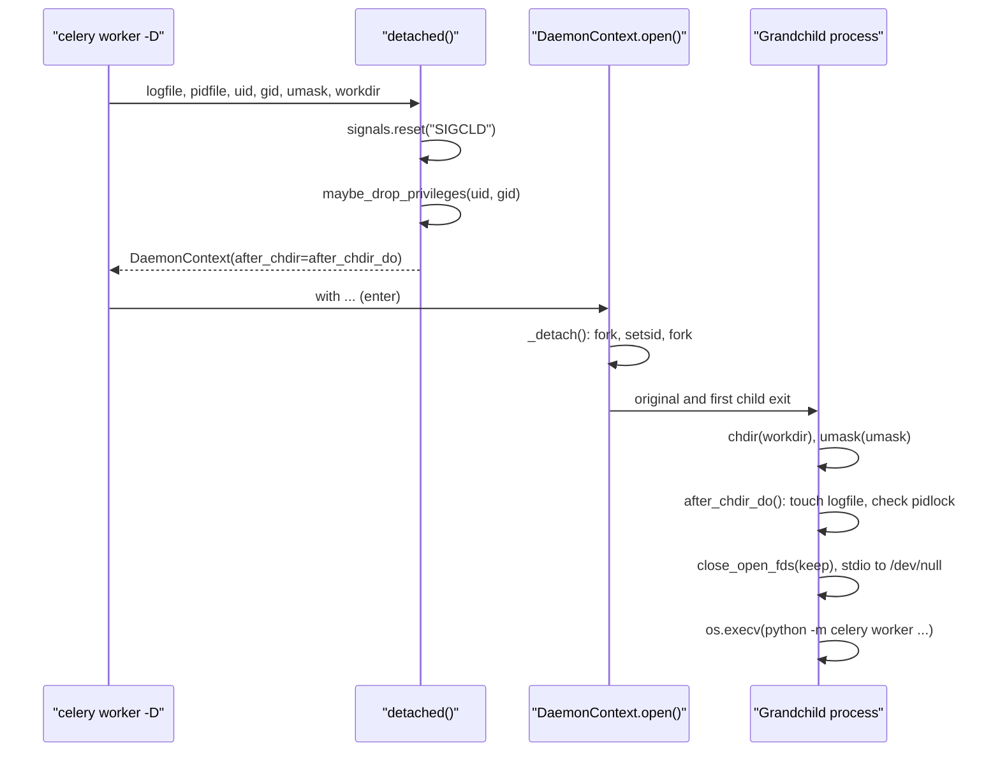
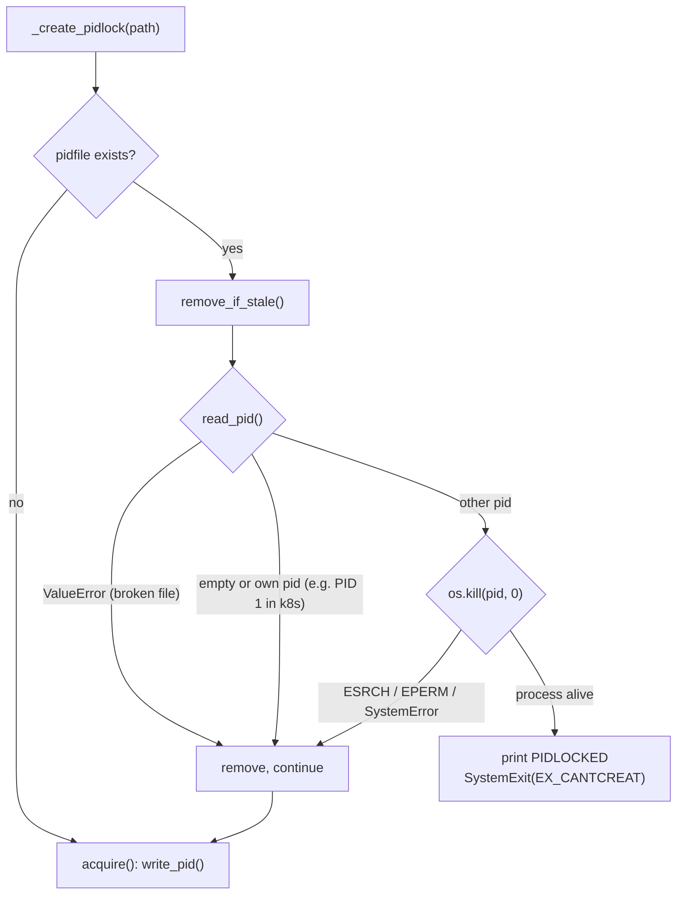

## Overview

Running Celery in production means keeping workers and the beat scheduler alive in the background, under an unprivileged user, with pidfiles and log files that a service manager can watch. Celery covers this at two levels. Inside the package, `celery.platforms` holds the POSIX plumbing: detaching from the terminal (`detached`, `DaemonContext`), pid locking (`Pidfile`, `create_pidlock`), changing user and group (`maybe_drop_privileges`), the root check (`check_privileges`) and a portable `signals` wrapper. Outside the package, the repository ships ready-made service definitions: systemd units and generic init.d scripts in `extra/`, supervisord, launchd and Azure WebJob examples, a Docker development environment in `docker/`, and a Helm chart in `helm-chart/`.

Sources: [celery/platforms.py:1-47](repo://celery/platforms.py#L1-L47)

The `--detach`, `--pidfile`, `--logfile`, `--uid`, `--gid` and `--umask` options that drive this code are added to every daemon command by `CeleryDaemonCommand` (see [[Command Line Interface]]). The systemd unit and the worker init.d script do not start workers themselves: they call `celery multi`, described in [[Running Multiple Workers with celery multi]].

Sources: [celery/bin/base.py:214-227](repo://celery/bin/base.py#L214-L227), [extra/systemd/celery.service:11-18](repo://extra/systemd/celery.service#L11-L18)

## Daemonizing a Process

### Who calls detached

Three commands can put themselves in the background. `celery worker -D/--detach` builds a new argv (`-m celery` plus the original arguments, minus the `--detach`, `-D`, `--uid` and `--gid` tokens) and hands it to `detach()`, which calls `detached()` and then `os.execv`s a fresh Python interpreter inside the daemon context. `celery beat --detach` and `celery events --camera ... --detach` instead run their service directly inside `with detached(...)`. When a command does not detach, it calls `maybe_drop_privileges` itself before starting.

Sources: [celery/bin/worker.py:108-135](repo://celery/bin/worker.py#L108-L135), [celery/bin/worker.py:336-358](repo://celery/bin/worker.py#L336-L358), [celery/bin/beat.py:61-72](repo://celery/bin/beat.py#L61-L72), [celery/bin/events.py:25-37](repo://celery/bin/events.py#L25-L37)

For the worker, `detach()` formats the logfile with `node_format` before detaching. `detached()` touches the logfile to check it is writable before stdout and stderr are closed, so the `%n`-style placeholders must already be expanded at that point. If `os.execv` fails, the error is logged to that file at `CRITICAL` level and `EX_FAILURE` is returned. Setting the `C_FAKEFORK` environment variable forces `fake=1`, which keeps the process in the foreground for debugging. The init.d script's `dryrun` action relies on this.

Sources: [celery/bin/worker.py:105-135](repo://celery/bin/worker.py#L105-L135), [extra/generic-init.d/celeryd:266-268](repo://extra/generic-init.d/celeryd#L266-L268)

### The detach sequence

`detached()` prepares the context before any fork happens. It refuses to run where the `resource` module is missing (Windows), defaults `workdir` to the current directory (which the global `--workdir` option has already changed with `os.chdir`), resets `SIGCLD` to its default handler and drops privileges. Only then does it return a `DaemonContext` whose `after_chdir` hook checks that the logfile can be opened and that the pidfile is not held by a live process.

Sources: [celery/platforms.py:376-429](repo://celery/platforms.py#L376-L429), [celery/bin/celery.py:84-89](repo://celery/bin/celery.py#L84-L89)



Sources: [celery/platforms.py:310-373](repo://celery/platforms.py#L310-L373), [celery/platforms.py:416-429](repo://celery/platforms.py#L416-L429), [celery/bin/worker.py:118-123](repo://celery/bin/worker.py#L118-L123)

### DaemonContext

`DaemonContext.open()` is idempotent (guarded by `_is_open`). With `fake=False` it does a classic double fork: the parent exits, the first child calls `os.setsid()` to get a new session, forks again and exits, so the grandchild can never reacquire a controlling terminal. It then changes to `workdir` (default `DAEMON_WORKDIR = '/'`) and applies `umask`. A string umask is parsed as octal when it starts with `0` and as decimal otherwise. Before redirecting stdin, stdout and stderr to `os.devnull`, it closes every other file descriptor except `/dev/urandom`, which the beat scheduler needs through `shelve`. Finally it runs multiprocessing's after-fork hooks, unless `after_forkers=False`, which the worker's `detach()` passes because it is about to `exec` anyway.

Sources: [celery/platforms.py:310-373](repo://celery/platforms.py#L310-L373), [celery/platforms.py:275-307](repo://celery/platforms.py#L275-L307), [celery/platforms.py:59](repo://celery/platforms.py#L59-L59)

```python
if not self.fake:
    # We need to keep /dev/urandom from closing because
    # shelve needs it, and Beat needs shelve to start.
    keep = list(self.stdfds) + fd_by_path(['/dev/urandom'])
    close_open_fds(keep)
    for fd in self.stdfds:
        self.redirect_to_null(maybe_fileno(fd))
```

Sources: [celery/platforms.py:344-351](repo://celery/platforms.py#L344-L351)

## Pidfiles and Locking

`Pidfile` is a lock file that contains the owner's pid. `write_pid` opens the path with `O_CREAT | O_EXCL | O_WRONLY` and mode 0644, so two processes cannot both create it. It then writes `"<pid>\n"`, flushes, `fsync`s and reads the file back, raising `LockFailed` if the content differs. `read_pid` requires the trailing newline and raises `ValueError` for partial or non-integer content.

Sources: [celery/platforms.py:61-65](repo://celery/platforms.py#L61-L65), [celery/platforms.py:125-238](repo://celery/platforms.py#L125-L238)

`create_pidlock(path)` is the entry point the services use: the worker's `on_start`, beat's `start_scheduler` and the event camera call it whenever a pidfile is configured. It goes through `_create_pidlock`, which handles an existing file with `remove_if_stale`, and registers `release` with `atexit` so the file is removed on a clean exit.

Sources: [celery/platforms.py:244-272](repo://celery/platforms.py#L244-L272), [celery/worker/worker.py:150-152](repo://celery/worker/worker.py#L150-L152), [celery/apps/beat.py:93-95](repo://celery/apps/beat.py#L93-L95), [celery/events/snapshot.py:93](repo://celery/events/snapshot.py#L93-L93)



Sources: [celery/platforms.py:183-213](repo://celery/platforms.py#L183-L213), [celery/platforms.py:266-272](repo://celery/platforms.py#L266-L272)

> [!NOTE]
> A pidfile that names the current process is treated as stale and removed. This covers containers, where the worker is often PID 1 on every restart and a leftover pidfile from the previous run would otherwise block startup.

Sources: [celery/platforms.py:197-200](repo://celery/platforms.py#L197-L200)

## Dropping Privileges and the Root Check

### maybe_drop_privileges

`maybe_drop_privileges(uid, gid)` accepts numeric ids or names (resolved by `parse_uid` and `parse_gid` through `pwd`/`grp`, raising `KeyError` for unknown names). It does nothing on Windows. A process whose real uid is root but whose effective uid is not raises `SecurityError('contact support')`. With a uid, `_setuid` sets the gid first (defaulting to the user's primary group), calls `initgroups` to load supplementary groups, calls `setuid` and then tries `setuid(0)`. That last call must fail with `EPERM`. If it succeeds, privileges could be restored, and `SecurityError` is raised. A final check also raises if the real or effective uid or gid is still 0.

Sources: [celery/platforms.py:432-463](repo://celery/platforms.py#L432-L463), [celery/platforms.py:502-582](repo://celery/platforms.py#L502-L582)

`setgroups` truncates the group list to `SC_NGROUPS_MAX` and then, as in glibc, drops trailing groups one at a time until the kernel accepts the call. An `EPERM` is ignored only when the process already has all the requested groups.

Sources: [celery/platforms.py:466-499](repo://celery/platforms.py#L466-L499)

### check_privileges and C_FORCE_ROOT

Every worker runs `check_privileges(app.conf.accept_content)` at the end of `on_before_init`. The check flags the process when its uid or euid is 0, or when its group or effective group is `sudo` or `wheel`. If a gid cannot be found in the group database, it emits `ASSUMING_ROOT` and treats the process as privileged. What happens next depends on the content types the worker accepts, as the table below shows.

Sources: [celery/apps/worker.py:95-104](repo://celery/apps/worker.py#L95-L104), [celery/platforms.py:788-830](repo://celery/platforms.py#L788-L830)

| Accepts `pickle` or `application/group-python-serialize` | `C_FORCE_ROOT` set | Result |
| --- | --- | --- |
| yes | no | `SecurityError(ROOT_DISALLOWED)`: the worker command prints it and exits with code 1 |
| yes | yes | `SecurityWarning(ROOT_DISCOURAGED)` |
| no | either | `SecurityWarning(ROOT_DISCOURAGED)` |

Sources: [celery/platforms.py:67-85](repo://celery/platforms.py#L67-L85), [celery/platforms.py:833-845](repo://celery/platforms.py#L833-L845), [celery/bin/worker.py:369-371](repo://celery/bin/worker.py#L369-L371)

> [!WARNING]
> `C_FORCE_ROOT` is read with `os.environ.get`, so any non-empty value (even `0` or `false`) turns the error into a warning. Prefer running as a dedicated user via `--uid`/`--gid` or the service manager's `User=` setting.

Sources: [celery/platforms.py:833-838](repo://celery/platforms.py#L833-L838)

## Signals and Process Titles

`celery.platforms.signals` is a `Signals` instance that makes signal handling portable. It accepts names with or without the `SIG` prefix (they must be uppercase). Assigning a handler to a signal the platform lacks is silently ignored, and `reset`, `ignore` and `update` set many handlers at once. `arm_alarm` uses `setitimer` when available, so it supports sub-second timeouts.

Sources: [celery/platforms.py:586-698](repo://celery/platforms.py#L586-L698)

```python
from celery.platforms import signals

signals['INT'] = my_handler
signals.supported('INT')      # True
signals.ignore('USR1')
signals.update(INT=exit_handler, TERM=exit_handler, HUP=hup_handler)
```

Sources: [celery/platforms.py:600-626](repo://celery/platforms.py#L600-L626)

Service managers depend on what the worker does with these signals. When the worker is not attached to a TTY (that is, when it runs as a daemon), it installs a `SIGHUP` handler that schedules `_reload_current_worker` with `atexit`. That function closes all non-stdio descriptors and `os.execv`s the same command line, so `kill -HUP` restarts the worker in place. The init.d script's `graceful` action uses this. On macOS, `SIGHUP` only prints a warning. Pool child processes call `set_pdeathsig('SIGKILL')` so the kernel kills them if the main process dies.

Sources: [celery/apps/worker.py:254-274](repo://celery/apps/worker.py#L254-L274), [celery/apps/worker.py:469-487](repo://celery/apps/worker.py#L469-L487), [celery/apps/worker.py:517-523](repo://celery/apps/worker.py#L517-L523), [celery/concurrency/prefork.py:40-52](repo://celery/concurrency/prefork.py#L40-L52), [extra/generic-init.d/celeryd:291-310](repo://extra/generic-init.d/celeryd#L291-L310)

`set_process_title` and `set_mp_process_title` rename the process in `ps` as `[celeryd: <hostname>:<process name>] <info>` when `setproctitle` is installed. Setting `NOSETPS` turns `set_mp_process_title` into a no-op.

Sources: [celery/platforms.py:723-749](repo://celery/platforms.py#L723-L749), [celery/apps/worker.py:280-285](repo://celery/apps/worker.py#L280-L285)

## systemd Units

`extra/systemd` has a worker unit, a beat unit, an environment file and a tmpfiles rule. `celery.service` is `Type=forking` because `celery multi start` detaches its nodes and exits. Stopping uses `multi stopwait`, which waits for running tasks to finish, and `ExecReload` maps to `multi restart`. Both units run as `User=celery`/`Group=celery` from `/opt/celery` and restart automatically.

Sources: [extra/systemd/celery.service:1-22](repo://extra/systemd/celery.service#L1-L22)

```ini
ExecStart=/bin/sh -c '${CELERY_BIN} -A $CELERY_APP multi start $CELERYD_NODES \
	--pidfile=${CELERYD_PID_FILE} --logfile=${CELERYD_LOG_FILE} \
	--loglevel="${CELERYD_LOG_LEVEL}" $CELERYD_OPTS'
ExecStop=/bin/sh -c '${CELERY_BIN} multi stopwait $CELERYD_NODES \
	--pidfile=${CELERYD_PID_FILE} --logfile=${CELERYD_LOG_FILE}'
```

Sources: [extra/systemd/celery.service:11-15](repo://extra/systemd/celery.service#L11-L15)

`celerybeat.service` is `Type=simple`: beat runs in the foreground with no `--detach`, and systemd supervises it directly. Both units read `/etc/conf.d/celery`, whose template `celery.conf` sets the variables below. The beat variables are commented out by default.

Sources: [extra/systemd/celerybeat.service:1-17](repo://extra/systemd/celerybeat.service#L1-L17), [extra/systemd/celery.conf:1-16](repo://extra/systemd/celery.conf#L1-L16)

| Variable | Default in `celery.conf` | Used for |
| --- | --- | --- |
| `CELERY_APP` | `proj` | `-A` app argument |
| `CELERYD_NODES` | `worker` | node names passed to `celery multi` |
| `CELERYD_OPTS` | empty | extra worker options |
| `CELERY_BIN` | `/usr/bin/celery` | path to the `celery` program |
| `CELERYD_PID_FILE` | `/var/run/celery/%n.pid` | one pidfile per node (`%n` = node name) |
| `CELERYD_LOG_FILE` | `/var/log/celery/%n%I.log` | per node and per pool process (`%I`) |
| `CELERYD_LOG_LEVEL` | `INFO` | `--loglevel` |
| `CELERYBEAT_PID_FILE` / `CELERYBEAT_LOG_FILE` | `/var/run/celery/beat.pid` / `/var/log/celery/beat.log` (commented) | beat unit only |

Sources: [extra/systemd/celery.conf:4-16](repo://extra/systemd/celery.conf#L4-L16)

The pid and log directories must exist and belong to the service user before the units start. `celery.tmpfiles` creates `/var/run/celery` and `/var/log/celery` with mode 0755, owned by `celery:celery`.

Sources: [extra/systemd/celery.tmpfiles:1-2](repo://extra/systemd/celery.tmpfiles#L1-L2)

## Generic init.d Scripts

### celeryd

`extra/generic-init.d/celeryd` is a POSIX `sh` script for SysV-style systems. It refuses to run unless invoked as root, because it changes to `CELERYD_USER` with `su`. Unprivileged users are told to use `celery multi` or `celery worker --detach` instead. Configuration is sourced from `/etc/default/<script name>` (or `/usr/local/etc` on BSD), so copying the script under a new name gives a separate configuration. Before sourcing, `_config_sanity` refuses a config file that is not owned by root or that is writable by group or others, since root runs its contents.

Sources: [extra/generic-init.d/celeryd:22-115](repo://extra/generic-init.d/celeryd#L22-L115)

The defaults are `CELERYD_USER=celery`, `CELERYD_NODES=celery`, pidfile `/var/run/celery/%n.pid`, logfile `/var/log/celery/%n%I.log` and level `INFO`. When the pid or log file falls back to its default, the script also creates the parent directory (mode 02755, chowned to `CELERYD_USER` and optionally `CELERYD_GROUP`). `CELERY_CREATE_DIRS=1` forces that creation. `CELERYD_CHDIR` becomes `--workdir`, and `CELERYD_ULIMIT` is applied before start.

Sources: [extra/generic-init.d/celeryd:53-161](repo://extra/generic-init.d/celeryd#L53-L161), [extra/generic-init.d/celeryd:179-213](repo://extra/generic-init.d/celeryd#L179-L213), [extra/generic-init.d/celeryd:253-263](repo://extra/generic-init.d/celeryd#L253-L263)

Every action goes through `_chuid`, which runs `su $CELERYD_USER -c "$CELERYD_MULTI ..."`. For status, the script expands the pidfile template per node with `celery multi expand`.

Sources: [extra/generic-init.d/celeryd:218-250](repo://extra/generic-init.d/celeryd#L218-L250)

| Action | What it runs |
| --- | --- |
| `start` | `multi start $CELERYD_NODES --pidfile --logfile --loglevel $CELERY_APP_ARG $CELERYD_OPTS` |
| `stop` | `multi stopwait $CELERYD_NODES --pidfile` |
| `restart`, `try-restart` | `multi restart ...` with the start options |
| `graceful` | `kill -HUP` to every pid read from the pidfiles |
| `kill` | `multi kill $CELERYD_NODES --pidfile` |
| `dryrun` | `start_workers --verbose` with `C_FAKEFORK=1` |
| `status` | `kill -0` each pid; exit 1 if any node is down or a pidfile is bad |
| `create-paths`, `check-paths` | create the log and pid directories |

Sources: [extra/generic-init.d/celeryd:253-310](repo://extra/generic-init.d/celeryd#L253-L310), [extra/generic-init.d/celeryd:313-409](repo://extra/generic-init.d/celeryd#L313-L409)

### celerybeat

`extra/generic-init.d/celerybeat` follows the same pattern for the scheduler. It sources `/etc/default/celeryd` first and then `/etc/default/celerybeat`, so beat can share the worker's `CELERY_APP` and `CELERYD_USER`/`CELERYD_CHDIR` while overriding them with `CELERYBEAT_*` variables. It starts beat with `beat --detach`, writing `/var/run/celery/beat.pid` and `/var/log/celery/beat.log` by default.

Sources: [extra/generic-init.d/celerybeat:91-156](repo://extra/generic-init.d/celerybeat#L91-L156), [extra/generic-init.d/celerybeat:248-260](repo://extra/generic-init.d/celerybeat#L248-L260)

Beat has no `multi`, so `stop` handles the process directly. `wait_pid` sends `SIGTERM` every 0.5 seconds until `ps` no longer finds the pid, and gives up after 60 attempts. `restart` runs `stop_beat` and then `start_beat`.

Sources: [extra/generic-init.d/celerybeat:211-246](repo://extra/generic-init.d/celerybeat#L211-L246), [extra/generic-init.d/celerybeat:294-327](repo://extra/generic-init.d/celerybeat#L294-L327)

## Other Process Supervisors

Supervisors that keep a foreground process alive need neither `--detach` nor a pidfile: every example below runs `celery worker` or `celery beat` without them and lets the supervisor restart it.

Sources: [extra/supervisord/celeryd.conf:13-18](repo://extra/supervisord/celeryd.conf#L13-L18), [extra/macOS/org.celeryq.worker.plist:9-19](repo://extra/macOS/org.celeryq.worker.plist#L9-L19)

- **supervisord** (`extra/supervisord`): `celeryd.conf` runs `celery -A proj worker --loglevel=INFO` as `nobody`. It sets `stopwaitsecs = 600` so long tasks can finish during a warm shutdown, `stopasgroup=true` so `SIGTERM` reaches the whole process group, and `priority=1000` so a supervised broker starts first. `celerybeat.conf` runs beat with `--schedule /var/lib/celery/beat.db`. `celery.sh` is a templated wrapper script with `{{ }}` placeholders to fill in.
- **launchd** (`extra/macOS`): `org.celeryq.worker.plist` and `org.celeryq.beat.plist` run `celery worker` (or beat) with `KeepAlive`, `RunAtLoad`, `UserName` `nobody` and `Umask` 7.
- **Azure WebJob** (`extra/WindowsCMD-AzureWebJob`): `run.cmd` deletes the old pid and log files, then runs `celery -A %CELERY_APP% worker -P eventlet` in the foreground. A beat variant is under `CeleryBeat/`.

Sources: [extra/supervisord/celeryd.conf:5-34](repo://extra/supervisord/celeryd.conf#L5-L34), [extra/supervisord/celerybeat.conf:5-25](repo://extra/supervisord/celerybeat.conf#L5-L25), [extra/supervisord/celery.sh:1-3](repo://extra/supervisord/celery.sh#L1-L3), [extra/macOS/org.celeryq.worker.plist:4-28](repo://extra/macOS/org.celeryq.worker.plist#L4-L28), [extra/WindowsCMD-AzureWebJob/Celery/run.cmd:1-31](repo://extra/WindowsCMD-AzureWebJob/Celery/run.cmd#L1-L31)

## Docker Images

The `docker/` directory builds a development and test image, not a slim production image. `docker/Dockerfile` starts from `debian:bookworm-slim` and creates a non-root user from the mandatory `CELERY_USER` build argument (default `developer`). It installs Python 3.10 to 3.13 and PyPy 3.11 with pyenv, installs every requirements file for each interpreter, and installs the copied source tree in editable mode. The `/entrypoint` script cleans `.pyc` files, initializes pyenv and `exec`s the container command.

Sources: [docker/Dockerfile:1-87](repo://docker/Dockerfile#L1-L87), [docker/Dockerfile:153-170](repo://docker/Dockerfile#L153-L170), [docker/entrypoint:1-7](repo://docker/entrypoint#L1-L7)

`docker/docker-compose.yml` wires the `celery/celery:dev` image to the services that integration tests expect. The source tree is mounted at `/home/developer/celery`, so code changes need no rebuild.

Sources: [docker/docker-compose.yml:1-48](repo://docker/docker-compose.yml#L1-L48)

| Service | Image | Role |
| --- | --- | --- |
| `celery` | `celery/celery:dev` (built from `docker/Dockerfile`) | test runner; `TEST_BROKER=pyamqp://rabbit:5672`, `TEST_BACKEND=redis://redis` |
| `rabbit` | `rabbitmq:management` | AMQP broker |
| `redis` | `redis:latest` | result backend and broker |
| `dynamodb` | `amazon/dynamodb-local:latest` | DynamoDB backend tests |
| `azurite` | `mcr.microsoft.com/azure-storage/azurite:latest` | Azure Block Blob backend tests |
| `docs` | `celery/docs` (built from `docker/docs/Dockerfile`) | Sphinx `make livehtml` on host port 7001 |

Sources: [docker/docker-compose.yml:2-48](repo://docker/docker-compose.yml#L2-L48), [docker/docs/Dockerfile:1-33](repo://docker/docs/Dockerfile#L1-L33), [docker/docs/start:1-7](repo://docker/docs/start#L1-L7)

```bash
docker compose -f docker/docker-compose.yml build celery
docker compose -f docker/docker-compose.yml run --rm celery pytest t/unit
```

Sources: [docker/docker-compose.yml:2-25](repo://docker/docker-compose.yml#L2-L25), [docker/entrypoint:1-7](repo://docker/entrypoint#L1-L7)

## Kubernetes with the Helm Chart

`helm-chart/` is a minimal chart named `celery` (chart version 0.1.0). It renders one `Deployment`, a `ConfigMap`, an optional `Secret` and a `ServiceAccount`. You install it from the repository root with `helm install celery helm-chart/`, or add `--values` to point at an environment-specific values file.

Sources: [helm-chart/Chart.yaml:1-6](repo://helm-chart/Chart.yaml#L1-L6), [helm-chart/README.rst:21-57](repo://helm-chart/README.rst#L21-L57)

The Deployment runs `replicaCount` pods (default 4) from `image.repository:image.tag` (default `celery/celery:dev`). It sets no `command`, so the image's own entrypoint and command decide what runs. Configuration reaches Celery as environment variables: `envFrom` loads the ConfigMap (seeded with an empty `CELERY_BROKER_URL`) and, when `secrets.enabled` is true, the Secret. A `checksum/config` annotation hashes the rendered ConfigMap.

Sources: [helm-chart/templates/deployment.yaml:1-69](repo://helm-chart/templates/deployment.yaml#L1-L69), [helm-chart/templates/configmap.yaml:1-8](repo://helm-chart/templates/configmap.yaml#L1-L8), [helm-chart/templates/secret.yaml:1-13](repo://helm-chart/templates/secret.yaml#L1-L13), [helm-chart/values.yaml:1-30](repo://helm-chart/values.yaml#L1-L30), [helm-chart/values.yaml:69-73](repo://helm-chart/values.yaml#L69-L73)

| Value | Default | Effect |
| --- | --- | --- |
| `replicaCount` | `4` | number of worker pods |
| `image.repository` / `image.tag` | `celery/celery` / `dev` | container image (tag falls back to `appVersion`) |
| `configmap.data` | `CELERY_BROKER_URL: ""` | environment variables for the container |
| `secrets.enabled` / `secrets.data` | `false` / `{}` | optional Secret mounted with `envFrom` |
| `serviceAccount.create` / `name` | `true` / `celery` | ServiceAccount used by the pods |
| `securityContext`, `podSecurityContext` | `{}` | e.g. `runAsNonRoot`, `runAsUser: 1000` (commented examples) |
| `livenessProbe`, `readinessProbe` | exec probe | checks that `$HOSTNAME` appears among `inspect().stats()` keys |
| `volumes`, `volumeMounts`, `nodeSelector`, `tolerations`, `affinity` | empty | passed through to the pod spec |

Sources: [helm-chart/values.yaml:1-93](repo://helm-chart/values.yaml#L1-L93)

> [!WARNING]
> The default probes contain a literal `<APP>` placeholder and import `celery.task.control`, a module this source tree no longer has (there is no `celery/task` package). Replace them before deploying, for example with a probe that calls `app.control.inspect().ping()` against the worker's node name.

Sources: [helm-chart/values.yaml:52-67](repo://helm-chart/values.yaml#L52-L67)

Names come from `_helpers.tpl`. `fullnameOverride` and `nameOverride` both default to `celery`, and generated names are truncated to 63 characters to fit DNS label limits. The Deployment's `envFrom` references the ConfigMap by the chart's full name, while the ConfigMap itself is named from `configmap.name`, so the two must agree when you override either one.

Sources: [helm-chart/templates/_helpers.tpl:1-62](repo://helm-chart/templates/_helpers.tpl#L1-L62), [helm-chart/templates/deployment.yaml:37-43](repo://helm-chart/templates/deployment.yaml#L37-L43), [helm-chart/templates/configmap.yaml:1-6](repo://helm-chart/templates/configmap.yaml#L1-L6)
