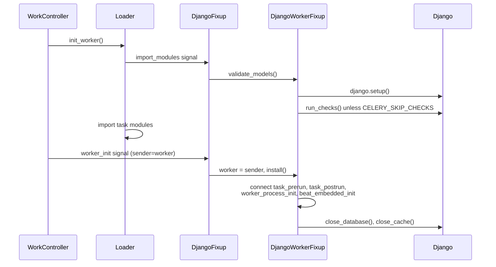

## Overview

Celery works with Django without a separate extension package. Every `Celery` app applies the built-in fix-up `celery.fixups.django:fixup` when it is created, and that fix-up turns itself on only when the process looks like a Django project. Once active, it makes Django's settings, app registry and timezone available to Celery, switches the default task class to `DjangoTask`, and, inside a worker, manages database and cache connections around every task so that long-running workers do not keep stale connections.

Sources: [celery/app/base.py:82-84](repo://celery/app/base.py#L82-L84), [celery/app/base.py:410-413](repo://celery/app/base.py#L410-L413), [celery/fixups/django.py:52-89](repo://celery/fixups/django.py#L52-L89)

The integration is split in two: `DjangoFixup` runs in every process that creates the app (web servers, shells, workers), while `DjangoWorkerFixup` is only installed when a worker starts and holds the connection-management logic. App configuration itself is covered in [[The Celery Application]] and [[Configuration and Settings]]; the signals it hooks into are described in [[Signals]].

Sources: [celery/fixups/django.py:66-163](repo://celery/fixups/django.py#L66-L163)

## When the fix-up installs

`Celery.__init__` instantiates every entry of `fixups` (by default `BUILTIN_FIXUPS`) by calling it with the app. Passing `fixups=[]` to the constructor disables the Django fix-up entirely.

Sources: [celery/app/base.py:82-84](repo://celery/app/base.py#L82-L84), [celery/app/base.py:410-413](repo://celery/app/base.py#L410-L413)

The `fixup()` function decides whether to activate.

Sources: [celery/fixups/django.py:52-63](repo://celery/fixups/django.py#L52-L63)

| Condition | Result |
| --- | --- |
| `DJANGO_SETTINGS_MODULE` is unset or empty | Returns `None`, nothing is installed |
| The app's `loader_cls` name contains `django` (an old django-celery style loader) | Returns `None` |
| Settings module is set but `import django` fails | Emits `FixupWarning` with `ERR_NOT_INSTALLED`, returns `None` |
| Django is older than 1.11 | Raises `ImproperlyConfigured('Celery 5.x requires Django 1.11 or later.')` |
| Otherwise | Returns `DjangoFixup(app).install()` |

Sources: [celery/fixups/django.py:33-63](repo://celery/fixups/django.py#L33-L63)

> [!IMPORTANT]
> Because activation depends on the environment variable, `DJANGO_SETTINGS_MODULE` must be set before the `Celery` instance is created. The example project does this with `os.environ.setdefault` on the line above `Celery('proj')`.

Sources: [examples/django/proj/celery.py:5-8](repo://examples/django/proj/celery.py#L5-L8), [celery/fixups/django.py:52-55](repo://celery/fixups/django.py#L52-L55)

## DjangoFixup

`DjangoFixup.__init__` makes the app the default app if no default exists yet, so `shared_task` proxies in Django apps resolve to it. `install()` then performs the process-wide setup, in this order.

Sources: [celery/fixups/django.py:69-75](repo://celery/fixups/django.py#L69-L75)

1. Prepends `os.getcwd()` to `sys.path`, so the project directory wins over installed modules of the same name.
2. Resolves `django.conf:settings` lazily via `symbol_by_name`.
3. Replaces `app.loader.now` with `DjangoFixup.now`, which returns `datetime.now(timezone.utc)` for UTC and otherwise Django's `django.utils.timezone.now`.
4. Sets `app.task_cls` to `celery.contrib.django.task:DjangoTask`, unless the user chose a custom task class.
5. Connects `on_import_modules` to the `import_modules` signal and `on_worker_init` to `worker_init`.

Sources: [celery/fixups/django.py:66-127](repo://celery/fixups/django.py#L66-L127)

The custom-task check uses `app._custom_task_cls_used`, which is true when `task_cls` was passed to the constructor or when a `Celery` subclass defines a `task_cls` attribute. In both cases the user's class is kept and `DjangoTask`'s on-commit helpers are not available unless that class inherits from it.

Sources: [celery/app/base.py:360-366](repo://celery/app/base.py#L360-L366), [celery/fixups/django.py:84-85](repo://celery/fixups/django.py#L84-L85)

`DjangoFixup.autodiscover_tasks()` returns the name of every installed Django app config. `Celery.autodiscover_tasks()` called without packages defers to this list through `_autodiscover_tasks_from_fixups`, which is why `app.autodiscover_tasks()` with no arguments finds `tasks.py` in every entry of `INSTALLED_APPS`.

Sources: [celery/fixups/django.py:121-123](repo://celery/fixups/django.py#L121-L123), [celery/app/base.py:822-844](repo://celery/app/base.py#L822-L844)

## Worker startup sequence

The worker part is created lazily through the `worker_fixup` property the first time a signal handler needs it. `WorkController.__init__` calls `app.loader.init_worker()`, which sends `import_modules` before importing task modules; `DjangoFixup.on_import_modules` responds by calling `validate_models()`, so `django.setup()` has run before any task module touches models. Later, `setup_instance` sends `worker_init` with the worker as sender, and `on_worker_init` stores that worker on the `DjangoWorkerFixup` and calls its `install()`.

Sources: [celery/worker/worker.py:90-127](repo://celery/worker/worker.py#L90-L127), [celery/loaders/base.py:97-111](repo://celery/loaders/base.py#L97-L111), [celery/fixups/django.py:91-116](repo://celery/fixups/django.py#L91-L116)



Sources: [celery/worker/worker.py:90-127](repo://celery/worker/worker.py#L90-L127), [celery/loaders/base.py:97-111](repo://celery/loaders/base.py#L97-L111), [celery/fixups/django.py:101-163](repo://celery/fixups/django.py#L101-L163)

`validate_models()` always calls `django.setup()` and then runs Django's system checks (`django.core.checks.run_checks`) unless the `CELERY_SKIP_CHECKS` environment variable is set. Skipping the checks shortens worker start-up in large projects.

Sources: [celery/fixups/django.py:146-154](repo://celery/fixups/django.py#L146-L154)

If `worker_init` arrives without a sender, `on_worker_init` emits a `FixupWarning` instead of failing and still installs the worker fix-up.

Sources: [celery/fixups/django.py:105-116](repo://celery/fixups/django.py#L105-L116)

## Database and cache handling around tasks

### Signal handlers

`DjangoWorkerFixup.install()` connects four signal handlers and immediately closes the database connections and caches the parent process holds.

Sources: [celery/fixups/django.py:156-163](repo://celery/fixups/django.py#L156-L163)

| Signal | Handler | Effect |
| --- | --- | --- |
| `beat_embedded_init` | `close_database` | Embedded beat (`worker -B`) does not share the worker's connections |
| `task_prerun` | `on_task_prerun` | `close_database()` before each non-eager task |
| `task_postrun` | `on_task_postrun` | `close_database()` and `close_cache()` after each non-eager task |
| `worker_process_init` | `on_worker_process_init` | Child process drops inherited connections |

Sources: [celery/fixups/django.py:156-203](repo://celery/fixups/django.py#L156-L203)

Both task handlers check `sender.request.is_eager`, so tasks run eagerly inside a request (for example with `task_always_eager` in tests) never close the caller's connections in the middle of a transaction.

Sources: [celery/fixups/django.py:194-203](repo://celery/fixups/django.py#L194-L203)

### Connection reuse with CELERY_DB_REUSE_MAX

`close_database()` closes all connections every time unless `db_reuse_max` is set; it is read from the app configuration key `CELERY_DB_REUSE_MAX`. With a value set, the fix-up counts calls in `_db_recycles` and only really closes connections once the counter reaches `db_reuse_max * 2`, then resets it. The factor two exists because each task triggers two calls (prerun and postrun), so the value means "number of tasks between closes".

Sources: [celery/fixups/django.py:130-139](repo://celery/fixups/django.py#L130-L139), [celery/fixups/django.py:205-211](repo://celery/fixups/django.py#L205-L211)

```python
    def close_database(self, **kwargs: Any) -> None:
        if not self.db_reuse_max:
            return self._close_database()
        if self._db_recycles >= self.db_reuse_max * 2:
            self._db_recycles = 0
            self._close_database()
        self._db_recycles += 1
```

Sources: [celery/fixups/django.py:205-211](repo://celery/fixups/django.py#L205-L211)

### Closing connections

`_close_database()` iterates `connections.all(initialized_only=True)`, falling back to `connections.all()` on Django older than 4.1 where the keyword raises `TypeError`. For each connection it calls `conn.close()`. When the alias has `OPTIONS["pool"]` enabled in `DATABASES` and the worker uses the prefork pool, it also calls `close_pool()` (ignoring `KeyError`), so connection pools are not shared across forked children. `InterfaceError` is ignored, and a `DatabaseError` is ignored only when its message contains `closed` or `not connected`; any other database error propagates.

Sources: [celery/fixups/django.py:219-240](repo://celery/fixups/django.py#L219-L240)

The prefork check `_is_prefork()` accepts `worker.pool_cls` either as a string or as a class (it inspects the class's module). A string is possible because `worker_init` is sent before `WorkController` resolves `pool_cls` to its implementation.

Sources: [celery/fixups/django.py:213-217](repo://celery/fixups/django.py#L213-L217), [celery/worker/worker.py:127-130](repo://celery/worker/worker.py#L127-L130)

`close_cache()` calls `django.core.cache.close_caches()` and swallows `TypeError` and `AttributeError`.

Sources: [celery/fixups/django.py:242-246](repo://celery/fixups/django.py#L242-L246)

### Pool child processes

`on_worker_process_init` runs in each new pool process. If `FORKED_BY_MULTIPROCESSING` is set (Windows, or children started with execv) it first runs `validate_models()` again, because such children do not inherit the parent's initialised Django. It then closes the raw file descriptor of every connection inherited from the parent with `os.close(fh.fileno())` instead of calling `close()`: a normal close may perform network I/O that also breaks the parent's connection. Finally it calls `_close_database()` directly, bypassing the reuse counter, and `close_cache()`.

Sources: [celery/fixups/django.py:39-44](repo://celery/fixups/django.py#L39-L44), [celery/fixups/django.py:165-192](repo://celery/fixups/django.py#L165-L192)

## DjangoTask and on-commit dispatch

`DjangoTask` is the default task class while the fix-up is active. It adds two methods that defer sending until the current database transaction commits, using `django.db.transaction.on_commit`. Without them, a worker can pick up a task before the row it should read has been committed.

Sources: [celery/contrib/django/task.py:1-21](repo://celery/contrib/django/task.py#L1-L21)

| Method | Wraps | Return value |
| --- | --- | --- |
| `delay_on_commit(*args, **kwargs)` | `Task.delay` | `None` |
| `apply_async_on_commit(*args, **kwargs)` | `Task.apply_async` | `None` |

Sources: [celery/contrib/django/task.py:15-21](repo://celery/contrib/django/task.py#L15-L21)

```python
from django.db import transaction
from demoapp.tasks import rename_widget

with transaction.atomic():
    widget.save()
    rename_widget.delay_on_commit(widget.id, "new name")
    rename_widget.apply_async_on_commit((widget.id, "other"), countdown=10)
```

Sources: [celery/contrib/django/task.py:15-21](repo://celery/contrib/django/task.py#L15-L21), [examples/django/demoapp/tasks.py:28-32](repo://examples/django/demoapp/tasks.py#L28-L32)

> [!WARNING]
> Both methods return `None`, not an `AsyncResult`: the message is only sent after commit, so no task id exists yet when the call returns. Use `delay` or `apply_async` when you need the result handle immediately.

Sources: [celery/contrib/django/task.py:15-21](repo://celery/contrib/django/task.py#L15-L21)

## Example project

The repository ships a minimal project under `examples/django/`.

Sources: [examples/django/README.rst:1-28](repo://examples/django/README.rst#L1-L28)

| Path | Role |
| --- | --- |
| `proj/celery.py` | Creates the app, reads settings with the `CELERY` namespace, calls `autodiscover_tasks()` |
| `proj/__init__.py` | Imports the app as `celery_app` so it is loaded whenever Django starts |
| `proj/settings.py` | `CELERY_BROKER_URL`, `CELERY_ACCEPT_CONTENT`, `CELERY_RESULT_BACKEND`, `CELERY_TASK_SERIALIZER` |
| `demoapp/models.py` | A `Widget` model |
| `demoapp/tasks.py` | `shared_task` examples, including ORM access and `autoretry_for` retries |
| `requirements.txt` | `django`, `sqlalchemy`, `celery` |

Sources: [examples/django/proj/celery.py:1-22](repo://examples/django/proj/celery.py#L1-L22), [examples/django/proj/__init__.py:1-5](repo://examples/django/proj/__init__.py#L1-L5), [examples/django/proj/settings.py:8-16](repo://examples/django/proj/settings.py#L8-L16), [examples/django/demoapp/models.py:1-5](repo://examples/django/demoapp/models.py#L1-L5), [examples/django/demoapp/tasks.py:1-52](repo://examples/django/demoapp/tasks.py#L1-L52), [examples/django/requirements.txt:1-3](repo://examples/django/requirements.txt#L1-L3)

The app module follows the standard layout. `config_from_object('django.conf:settings', namespace='CELERY')` means every Celery setting is written in Django settings as upper case with a `CELERY_` prefix (for example `CELERY_BROKER_URL` for `broker_url`), and passing the settings as a string lets the worker avoid pickling the settings object for child processes.

Sources: [examples/django/proj/celery.py:1-22](repo://examples/django/proj/celery.py#L1-L22)

```python
import os

from celery import Celery

# Set the default Django settings module for the 'celery' program.
os.environ.setdefault('DJANGO_SETTINGS_MODULE', 'proj.settings')

app = Celery('proj')

# Using a string here means the worker doesn't have to serialize
# the configuration object to child processes.
# - namespace='CELERY' means all celery-related configuration keys
#   should have a `CELERY_` prefix.
app.config_from_object('django.conf:settings', namespace='CELERY')

# Load task modules from all registered Django apps.
app.autodiscover_tasks()
```

Sources: [examples/django/proj/celery.py:1-17](repo://examples/django/proj/celery.py#L1-L17)

Tasks in `demoapp` use `@shared_task` rather than `@app.task`, so the app stays decoupled from the project and binds to whichever app is current. The README runs the worker with `celery -A proj worker -l INFO` and calls `add.delay_on_commit(2, 3)` from `manage.py shell`.

Sources: [examples/django/demoapp/tasks.py:1-25](repo://examples/django/demoapp/tasks.py#L1-L25), [examples/django/README.rst:23-66](repo://examples/django/README.rst#L23-L66)

> [!NOTE]
> The README's snippet calls `res.get()` on the value of `delay_on_commit`, but that method returns `None`. Use `add.delay(2, 3)` when you want to wait for the result.

Sources: [examples/django/README.rst:54-60](repo://examples/django/README.rst#L54-L60), [celery/contrib/django/task.py:15-17](repo://celery/contrib/django/task.py#L15-L17)

## Environment variables and settings

| Name | Kind | Effect |
| --- | --- | --- |
| `DJANGO_SETTINGS_MODULE` | env var | Enables the fix-up; must be set before the app is created |
| `CELERY_SKIP_CHECKS` | env var | Skips `run_checks()` in `validate_models()` |
| `FORKED_BY_MULTIPROCESSING` | env var | Makes pool children re-run `validate_models()` |
| `CELERY_DB_REUSE_MAX` | app setting | Number of tasks between database closes; unset closes after every task |
| `DATABASES[alias]["OPTIONS"]["pool"]` | Django setting | With prefork, triggers `close_pool()` on close |

Sources: [celery/fixups/django.py:52-55](repo://celery/fixups/django.py#L52-L55), [celery/fixups/django.py:136-136](repo://celery/fixups/django.py#L136-L136), [celery/fixups/django.py:150-169](repo://celery/fixups/django.py#L150-L169), [celery/fixups/django.py:228-234](repo://celery/fixups/django.py#L228-L234)
