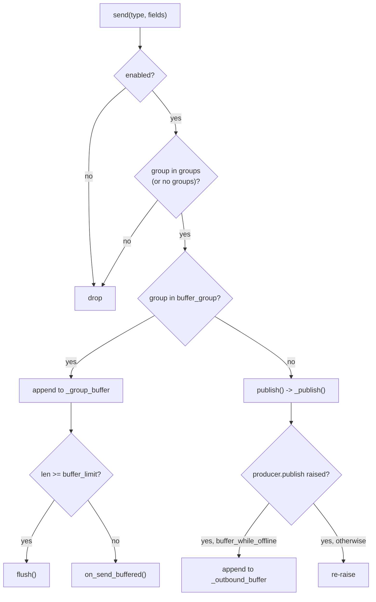
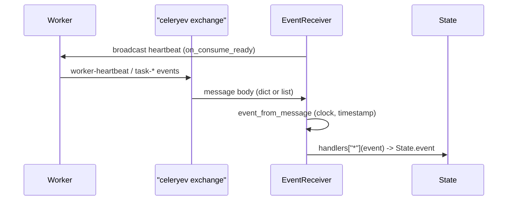

## Overview

Celery workers, and optionally clients, publish small JSON messages called events that describe what is happening in the cluster: a task was received, started or failed, a worker came online or sent a heartbeat. Monitors such as `celery events`, Flower or a custom script consume this stream to show live state without polling result backends. The `celery.events` package holds both ends: `EventDispatcher` publishes, `EventReceiver` consumes, and `State` folds the stream into an in-memory picture of workers and tasks.

Sources: [celery/events/state.py:1-14](repo://celery/events/state.py#L1-L14), [celery/events/dispatcher.py:19-46](repo://celery/events/dispatcher.py#L19-L46), [celery/events/receiver.py:23-32](repo://celery/events/receiver.py#L23-L32)

Every application exposes these classes through `app.events`, an `Events` object built lazily from `app.events_cls`. Its `Receiver`, `Dispatcher` and `State` properties return subclasses bound to the app with `subclass_with_self`, so code never has to pass `app=` explicitly. Events travel over the broker like task messages (see [[Messaging and Routing]]), and the worker side is wired in by a consumer bootstep described in [[Worker Architecture and Bootsteps]].

Sources: [celery/app/events.py:7-40](repo://celery/app/events.py#L7-L40), [celery/app/base.py:1581-1584](repo://celery/app/base.py#L1581-L1584)

## Event messages and the exchange

An event is a plain dictionary. `Event(type, **fields)` adds `type` and, if missing, a `timestamp` from `time.time()`. The part of the type before the first dash is its group, returned by `group_from`: `task-sent` belongs to `task`, `worker-heartbeat` to `worker`, and a custom `custom-my-event` to `custom`. Groups drive both filtering on the sending side and handler dispatch in `State`.

Sources: [celery/events/event.py:18-43](repo://celery/events/event.py#L18-L43)

Events are published to the `celeryev` exchange (name set by `event_exchange`), a topic exchange whose routing key is the event type with dashes replaced by dots, for example `task.succeeded`. `get_exchange` switches the type to `fanout` when the transport is Redis or Google Pub/Sub, because those transports do not route topic keys the same way.

Sources: [celery/events/event.py:11-15](repo://celery/events/event.py#L11-L15), [celery/events/event.py:46-63](repo://celery/events/event.py#L46-L63), [celery/events/dispatcher.py:135-140](repo://celery/events/dispatcher.py#L135-L140)

`EventDispatcher.publish` stamps each event with `hostname`, `utcoffset`, `pid` and a Lamport `clock` value taken from `app.clock.forward()` (omitted when `blind=True`), and sends the dispatcher's hostname in the message headers.

Sources: [celery/events/dispatcher.py:116-162](repo://celery/events/dispatcher.py#L116-L162)

## Event types

The table lists the built-in events and where they are emitted. Every task event carries `uuid`; every event carries the fields stamped by the dispatcher.

Sources: [celery/events/dispatcher.py:135-137](repo://celery/events/dispatcher.py#L135-L137), [celery/worker/request.py:511-513](repo://celery/worker/request.py#L511-L513)

| Event | Emitted by | Extra fields |
| --- | --- | --- |
| `task-sent` | Client in `send_task_message`, only when `task_send_sent_event` is on | `name`, `args`, `kwargs`, `root_id`, `parent_id`, `retries`, `eta`, `expires`, `queue`, `exchange`, `routing_key` |
| `task-received` | Worker strategy when a message is accepted | `name`, `args`, `kwargs`, `root_id`, `parent_id`, `retries`, `eta`, `expires` |
| `task-started` | `Request.on_accepted` when the pool starts the task | none |
| `task-succeeded` | `Request.on_success` | `result`, `runtime` |
| `task-failed` | `Request.on_failure`, `Request.on_timeout`, or the consumer for an unregistered task | `exception`, `traceback` |
| `task-retried` | `Request.on_retry` | `exception`, `traceback` |
| `task-rejected` | `Request.reject` | `requeue` |
| `task-revoked` | `Request._announce_revoked` | `terminated`, `signum`, `expired` |
| `task-cancelled` | `Request._announce_cancelled` | none |
| `worker-online` | `Heart.start` | `freq`, `active`, `processed`, `loadavg`, `sw_ident`, `sw_ver`, `sw_sys` |
| `worker-heartbeat` | `Heart` timer every interval, or the `heartbeat` control command | same as `worker-online` |
| `worker-offline` | `Heart.stop` | same as `worker-online` |

Sources: [celery/app/amqp.py:407-417](repo://celery/app/amqp.py#L407-L417), [celery/app/amqp.py:593-604](repo://celery/app/amqp.py#L593-L604), [celery/worker/strategy.py:165-177](repo://celery/worker/strategy.py#L165-L177), [celery/worker/request.py:439-468](repo://celery/worker/request.py#L439-L468), [celery/worker/request.py:511-523](repo://celery/worker/request.py#L511-L523), [celery/worker/request.py:574-621](repo://celery/worker/request.py#L574-L621), [celery/worker/request.py:736-740](repo://celery/worker/request.py#L736-L740), [celery/worker/consumer/consumer.py:701-705](repo://celery/worker/consumer/consumer.py#L701-L705), [celery/worker/heartbeat.py:39-61](repo://celery/worker/heartbeat.py#L39-L61), [celery/worker/control.py:370-376](repo://celery/worker/control.py#L370-L376)

Worker task events go through `Request.send_event`, which does nothing unless the dispatcher is enabled and the task class has `send_events = True` (the default). A task can publish its own event type with `Task.send_event`, which opens `app.events.default_dispatcher` with the request's hostname and adds the task id as `uuid`.

Sources: [celery/worker/request.py:511-513](repo://celery/worker/request.py#L511-L513), [celery/app/task.py:268-268](repo://celery/app/task.py#L268-L268), [celery/app/task.py:1003-1027](repo://celery/app/task.py#L1003-L1027)

```python
@app.task(bind=True)
def import_rows(self, path):
    for done, total in load(path):
        self.send_event('task-progress', done=done, total=total)
```

Sources: [celery/app/task.py:1003-1027](repo://celery/app/task.py#L1003-L1027)

## Sending events with EventDispatcher

### Construction and enabling

`EventDispatcher` takes a connection or a channel, a `hostname` (default `anon_nodename()`), the serializer from `event_serializer`, and an optional `groups` list. At construction it resolves the exchange and, unless the transport is in `DISABLED_TRANSPORTS` (`sql`), calls `enable()`, which creates a kombu `Producer` with `auto_declare=False` and runs the `on_enabled` callbacks. `disable()` drops the producer and runs `on_disabled`. Callers must `close()` the dispatcher, or use it as a context manager.

Sources: [celery/events/dispatcher.py:48-114](repo://celery/events/dispatcher.py#L48-L114), [celery/events/dispatcher.py:219-222](repo://celery/events/dispatcher.py#L219-L222)

### The send path

`send(type, **fields)` returns immediately when the dispatcher is disabled or when `groups` is set and the event's group is not in it. Groups listed in `buffer_group` are collected instead of published; everything else goes straight to `publish`, which serialises access to the producer with a mutex.

Sources: [celery/events/dispatcher.py:164-199](repo://celery/events/dispatcher.py#L164-L199)



Sources: [celery/events/dispatcher.py:142-213](repo://celery/events/dispatcher.py#L142-L213)

### Buffering

There are two buffers. The outbound buffer holds events whose publish raised while `buffer_while_offline` was true, so a broker outage does not lose them; `flush(errors=True)` replays them. The group buffer batches events of a group: when it reaches `buffer_limit` (24 by default) or when `flush(groups=True)` runs, the whole list is published as one message with routing key `<group>.multi`. `extend_buffer` copies another dispatcher's outbound buffer, which the worker uses after reconnecting.

Sources: [celery/events/dispatcher.py:40-42](repo://celery/events/dispatcher.py#L40-L42), [celery/events/dispatcher.py:159-162](repo://celery/events/dispatcher.py#L159-L162), [celery/events/dispatcher.py:201-217](repo://celery/events/dispatcher.py#L201-L217)

## Events in the worker

### The Events bootstep

The consumer's `Events` bootstep creates the worker's dispatcher on each connection start. Task events are enabled by `worker_send_task_events` or the `-E` option; without them, `groups` is `['worker']` so only heartbeats and gossip events are sent. When the event loop (hub) is running, the `task` group is buffered and `on_send_event_buffered` schedules `_flush_events` on the hub's ready queue, so batches go out on the next loop iteration instead of one message per event.

Sources: [celery/worker/consumer/events.py:15-52](repo://celery/worker/consumer/events.py#L15-L52), [celery/worker/worker.py:377-377](repo://celery/worker/worker.py#L377-L377), [celery/worker/consumer/consumer.py:624-630](repo://celery/worker/consumer/consumer.py#L624-L630)

On reconnect, `_close` keeps the old dispatcher's `groups` (so changes made by remote control survive), then the new dispatcher absorbs its outbound buffer, flushes it, and is assigned to every reserved request.

Sources: [celery/worker/consumer/events.py:35-71](repo://celery/worker/consumer/events.py#L35-L71)

### Heartbeats

`Heart` registers `start` and `stop` as the dispatcher's `on_enabled` and `on_disabled` callbacks. `start` sends `worker-online` and schedules `worker-heartbeat` every `interval` seconds (2.0 by default); `stop` cancels the timer and sends `worker-offline` without retry. Each heartbeat reports the active request count, total processed count, load average and software info, and fires the `heartbeat_sent` signal when it has receivers.

Sources: [celery/worker/heartbeat.py:14-61](repo://celery/worker/heartbeat.py#L14-L61), [celery/worker/consumer/heart.py:22-30](repo://celery/worker/consumer/heart.py#L22-L30)

### Remote toggles

The `enable_events` and `disable_events` control commands add or remove `task` from the running dispatcher's `groups`, and `heartbeat` makes the worker send one `worker-heartbeat` immediately. [[Remote Control and Inspection]] covers how these commands are broadcast.

Sources: [celery/worker/control.py:344-376](repo://celery/worker/control.py#L344-L376)

## Receiving events with EventReceiver

### Queue declaration

`EventReceiver` is a kombu `ConsumerMixin`. It declares a queue named `<event_queue_prefix>.<node_id>` (a fresh uuid by default) bound to the event exchange with `routing_key='#'`, so it receives everything unless you pass a narrower key. Queue options come from the `event_queue_*` settings; asking for a queue that is both exclusive and durable raises `ImproperlyConfigured`. The consumer runs with `no_ack=True` and accepts the event serializer plus `json`.

Sources: [celery/events/receiver.py:36-88](repo://celery/events/receiver.py#L36-L88)

### Capture and dispatch

`capture()` (or the generator `itercapture()`) runs `consume()` until interrupted or `limit` messages arrive. When the consumer is ready it broadcasts the `heartbeat` control command so workers announce themselves immediately instead of after their next interval. `_receive` accepts either one event or a list (a `*.multi` batch) and passes each through `event_from_message` and then `process`, which calls `handlers[type]` or falls back to the `"*"` handler.

Sources: [celery/events/receiver.py:80-111](repo://celery/events/receiver.py#L80-L111), [celery/events/receiver.py:140-145](repo://celery/events/receiver.py#L140-L145)



Sources: [celery/events/receiver.py:90-145](repo://celery/events/receiver.py#L90-L145), [celery/events/snapshot.py:102-106](repo://celery/events/snapshot.py#L102-L106)

### Clock and timestamp handling

`event_from_message` keeps the receiver's logical clock in step: it calls `clock.adjust` with the event's `clock`, or assigns `forward()` if none was sent. `task-sent` events come from clients that never sync clocks, so their clock is replaced by the receiver's current value minus one (`CLIENT_CLOCK_SKEW`). With `localize=True` the timestamp is shifted by the sender's `utcoffset`, and `local_received` records the arrival time.

Sources: [celery/events/receiver.py:18-20](repo://celery/events/receiver.py#L18-L20), [celery/events/receiver.py:113-138](repo://celery/events/receiver.py#L113-L138)

```python
def my_monitor(app):
    state = app.events.State()

    def announce_failed_tasks(event):
        state.event(event)
        task = state.tasks.get(event['uuid'])
        print(f'TASK FAILED: {task.name}[{task.uuid}] {task.info()}')

    with app.connection() as connection:
        recv = app.events.Receiver(connection, handlers={
            'task-failed': announce_failed_tasks,
            '*': state.event,
        })
        recv.capture(limit=None, timeout=None, wakeup=True)
```

Sources: [celery/events/receiver.py:36-45](repo://celery/events/receiver.py#L36-L45), [celery/events/receiver.py:80-106](repo://celery/events/receiver.py#L80-L106), [celery/events/state.py:334-345](repo://celery/events/state.py#L334-L345), [celery/events/state.py:501-503](repo://celery/events/state.py#L501-L503)

## Cluster state

### State storage

`State` keeps `workers` and `tasks` in `LRUCache` instances bounded by `max_workers_in_memory` (5000) and `max_tasks_in_memory` (10000), plus a time-ordered heap of `(clock, timestamp, origin, weakref(task))` tuples capped at four entries per stored task. `State.event(event)` takes a mutex and calls the dispatcher built once by `_create_dispatcher`, a closure that caches attribute lookups for speed. `tasks_by_type` and `tasks_by_worker` are `WeakSet` indexes that can also be called like the older methods to get time-ordered results.

Sources: [celery/events/state.py:398-440](repo://celery/events/state.py#L398-L440), [celery/events/state.py:79-103](repo://celery/events/state.py#L79-L103), [celery/events/state.py:501-503](repo://celery/events/state.py#L501-L503)

### Event handling

The closure counts the event, calls the optional `callback(state, event)`, then splits the type into group and subject. A handler registered in `state.handlers[group]` takes over entirely. Otherwise `worker` events update or create a `Worker` and fire `on_node_join` (new or `online`) or `on_node_leave` (`offline`, which also removes the worker). `task` events create the `Task`, link it to the client hostname for `task-sent` or to the worker otherwise (counting as that worker's heartbeat), insert into the heap, update the indexes, and wire up parent and child links, parking children whose parent has not been seen yet in `_tasks_to_resolve`.

Sources: [celery/events/state.py:540-641](repo://celery/events/state.py#L540-L641)

### Worker liveness

`Worker.event` keeps at most `heartbeat_max` (4) arrival times in a sorted list; `offline` clears it. A worker is `alive` while the current time is before `heartbeat_expires`, which is the last heartbeat plus `freq * HEARTBEAT_EXPIRE_WINDOW / 100`, that is twice the advertised interval. If an event's timestamp and its arrival differ by more than `HEARTBEAT_DRIFT_MAX` (16 s), a clock-drift warning is logged once per hostname.

Sources: [celery/events/state.py:45-57](repo://celery/events/state.py#L45-L57), [celery/events/state.py:106-123](repo://celery/events/state.py#L106-L123), [celery/events/state.py:148-239](repo://celery/events/state.py#L148-L239)

### Out-of-order task events

Events can arrive out of order, for example `task-succeeded` before `task-received`. `Task.event` maps the event to a state through `TASK_EVENT_TO_STATE` and records its timestamp in the matching attribute (`received`, `succeeded`, ...). If the new state has lower precedence than the current one it only merges the fields listed in `merge_rules` (name, args, kwargs and similar from `RECEIVED`) and keeps the current state; otherwise it moves to the new state. `RETRY` always wins so a retried task can go back to running. Unknown event subjects become upper-cased custom states.

Sources: [celery/events/state.py:66-76](repo://celery/events/state.py#L66-L76), [celery/events/state.py:264-332](repo://celery/events/state.py#L264-L332)

### Querying

| Method | Returns |
| --- | --- |
| `tasks_by_time(limit, reverse)` | `(uuid, Task)` pairs ordered by the heap, newest first by default |
| `tasks_by_type[name]` / `tasks_by_type(name, limit)` | `WeakSet` index, or time-ordered pairs when called |
| `tasks_by_worker[hostname]` | same, keyed by worker hostname |
| `task_types()` | sorted names of every task type seen |
| `alive_workers()` | generator of workers whose heartbeat has not expired |
| `clear(ready=True)` | drops workers and finished tasks, keeping in-progress ones |
| `freeze_while(fun, clear_after=False)` | runs `fun` while holding the state mutex |

Sources: [celery/events/state.py:442-475](repo://celery/events/state.py#L442-L475), [celery/events/state.py:650-708](repo://celery/events/state.py#L650-L708)

## Snapshots and built-in monitors

### Snapshot cameras

`Polaroid` takes periodic pictures of a `State`. `install()` schedules `capture` every `freq` seconds and `cleanup` every `cleanup_freq` (one hour). `capture` calls `state.freeze_while(self.shutter, clear_after=self.clear_after)`; `shutter` honours an optional `maxrate` token bucket, sends `shutter_signal` and calls `on_shutter(state)`, the method a camera subclass overrides to store the snapshot. `cancel()` takes a last snapshot before stopping the timers.

Sources: [celery/events/snapshot.py:24-83](repo://celery/events/snapshot.py#L24-L83)

```python
from celery.events.snapshot import Polaroid

class DumpCam(Polaroid):
    clear_after = True  # clear state after each snapshot

    def on_shutter(self, state):
        print(f'Workers: {list(state.workers)}')
        print(f'Tasks: {state.task_count}')
```

Sources: [celery/events/snapshot.py:24-69](repo://celery/events/snapshot.py#L24-L69)

`evcam` is the runner behind `celery events --camera`: it sets up logging, instantiates the camera by dotted name with a new `app.events.State()`, and captures every event into `state.event` until interrupted.

Sources: [celery/events/snapshot.py:86-111](repo://celery/events/snapshot.py#L86-L111)

### Command line tools

`celery events` picks one of three runners: `--dump` runs `evdump`, `--camera` runs `evcam` (optionally detached, with `--frequency` and `--maxrate`), and no option runs `evtop`. See [[Command Line Interface]] for the full option list.

Sources: [celery/bin/events.py:18-40](repo://celery/bin/events.py#L18-L40), [celery/bin/events.py:83-97](repo://celery/bin/events.py#L83-L97)

| Tool | Module | Behaviour |
| --- | --- | --- |
| `evtop` | `celery/events/cursesmon.py` | `CursesMonitor` draws tasks from `State` in a curses screen refreshed by `DisplayThread`; keys `j`/`k` move, `i`/`t`/`r` show info, traceback and result, `c` revokes and `l` sets a rate limit through `app.control` |
| `evdump` | `celery/events/dumper.py` | `Dumper.on_event` prints one line per event, remembering task names by uuid in an `LRUCache` so later events show the task signature |

Sources: [celery/events/cursesmon.py:34-65](repo://celery/events/cursesmon.py#L34-L65), [celery/events/cursesmon.py:173-189](repo://celery/events/cursesmon.py#L173-L189), [celery/events/cursesmon.py:239-243](repo://celery/events/cursesmon.py#L239-L243), [celery/events/dumper.py:15-76](repo://celery/events/dumper.py#L15-L76)

Both tools reconnect on their own: `capture_events` and `evdump` loop forever, calling `ensure_connection` and creating a fresh receiver after each connection or channel error.

Sources: [celery/events/cursesmon.py:492-509](repo://celery/events/cursesmon.py#L492-L509), [celery/events/dumper.py:79-99](repo://celery/events/dumper.py#L79-L99)

## Configuration

| Setting | Default | Effect |
| --- | --- | --- |
| `worker_send_task_events` | `False` | Worker sends `task-*` events (same as `-E`) |
| `task_send_sent_event` | `False` | Clients publish `task-sent` |
| `event_serializer` | `json` | Serializer for dispatchers; receivers also accept `json` |
| `event_exchange` | `celeryev` | Exchange name |
| `event_queue_prefix` | `celeryev` | Prefix of receiver queue names |
| `event_queue_ttl` | `5.0` | Message TTL on receiver queues |
| `event_queue_expires` | `60.0` | Expiry of idle receiver queues |
| `event_queue_exclusive` | `True` | Receiver queue is exclusive |
| `event_queue_durable` | `False` | Receiver queue is durable (not with exclusive) |

Sources: [celery/app/defaults.py:179-189](repo://celery/app/defaults.py#L179-L189), [celery/app/defaults.py:311-313](repo://celery/app/defaults.py#L311-L313), [celery/app/defaults.py:366-368](repo://celery/app/defaults.py#L366-L368), [celery/app/base.py:1009-1013](repo://celery/app/base.py#L1009-L1013)

> [!NOTE]
> Events are disabled automatically on the `sql` transport, and `app.events.default_dispatcher` turns off `buffer_while_offline`, so a custom event sent from client code raises on connection errors instead of being queued.

Sources: [celery/events/dispatcher.py:48-48](repo://celery/events/dispatcher.py#L48-L48), [celery/events/dispatcher.py:84-90](repo://celery/events/dispatcher.py#L84-L90), [celery/app/events.py:32-40](repo://celery/app/events.py#L32-L40)
