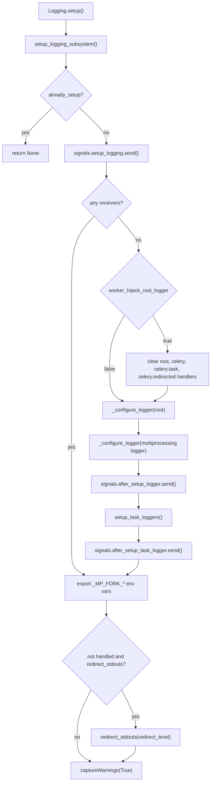

## Overview

Celery configures Python's standard `logging` module for the worker, beat and the event camera so that every process writes in one format, task log lines carry the task name and id, and output printed with `print()` still ends up in the log. The work is split in two modules: `celery.app.log` holds the `Logging` class that each app exposes as `app.log`, and `celery.utils.log` holds the reusable pieces (the logger hierarchy, `get_logger`, `get_task_logger`, `ColorFormatter` and `LoggingProxy`).

Sources: [celery/app/log.py:1-27](repo://celery/app/log.py#L1-L27), [celery/utils/log.py:1-36](repo://celery/utils/log.py#L1-L36)

`app.log` is a cached property that instantiates `log_cls`, which defaults to `'celery.app.log:Logging'` and can be swapped with the `log` argument of the `Celery` constructor. The defaults for format, task format and colour come from the `worker_*` settings described in [[Configuration and Settings]], and the setup is announced through three [[Signals]] that let an application take over logging entirely.

Sources: [celery/app/base.py:315-315](repo://celery/app/base.py#L315-L315), [celery/app/base.py:358-358](repo://celery/app/base.py#L358-L358), [celery/app/base.py:1592-1594](repo://celery/app/base.py#L1592-L1594), [celery/app/log.py:54-59](repo://celery/app/log.py#L54-L59)

## Logger hierarchy

### The celery and celery.task loggers

All Celery loggers hang under one of two roots. `base_logger` is the `celery` logger; `get_logger(name)` fetches a logger through kombu and, unless the logger is the root logger, a direct child of it, or `base_logger` itself, re-parents it under `celery`. The module-level `task_logger` (`celery.task`) and `worker_logger` (`celery.worker`) are created this way at import time.

Sources: [celery/utils/log.py:29-36](repo://celery/utils/log.py#L29-L36), [celery/utils/log.py:91-106](repo://celery/utils/log.py#L91-L106)

`get_task_logger(name)` is the function task modules should use. It refuses the reserved names `celery` and `celery.task` with a `RuntimeError`, then forces the logger's parent to be `celery.task`, so task log records flow through the handler that uses `TaskFormatter`. `_using_logger_parent` only rewrites `parent` when `logger_isa` finds the logger is not already a descendant; `logger_isa` walks up `parent` links and raises `RuntimeError` on a cycle or a hierarchy deeper than 1000.

Sources: [celery/utils/log.py:72-113](repo://celery/utils/log.py#L72-L113)

```python
from celery.utils.log import get_task_logger

logger = get_task_logger(__name__)

@app.task
def add(x, y):
    logger.info('Adding %s + %s', x, y)
    return x + y
```

Sources: [celery/utils/log.py:109-113](repo://celery/utils/log.py#L109-L113)

### Level names

`mlevel(level)` converts a level name such as `'info'` to its integer using kombu's `LOG_LEVELS` (upper-casing first) and passes integers and falsy values through unchanged. Every entry point in `Logging` runs its `loglevel` through `mlevel`, so the CLI's `--loglevel` string (default `WARNING`) and integers read back from environment variables are both accepted.

Sources: [celery/utils/log.py:116-120](repo://celery/utils/log.py#L116-L120), [celery/bin/worker.py:162-168](repo://celery/bin/worker.py#L162-L168)

## Setup flow

### Logging.setup

`Logging.setup(loglevel, logfile, redirect_stdouts, redirect_level, colorize, hostname)` is the entry point the worker and beat call. It configures handlers through `setup_logging_subsystem`, redirects stdout/stderr only when no `setup_logging` receiver took over, exports `CELERY_LOG_LEVEL` and `CELERY_LOG_FILE` to the environment, turns `CDeprecationWarning` and `CPendingDeprecationWarning` into always-shown warnings and calls `logging.captureWarnings(True)` so `warnings` output goes through logging too.

Sources: [celery/app/log.py:61-76](repo://celery/app/log.py#L61-L76)



Sources: [celery/app/log.py:61-146](repo://celery/app/log.py#L61-L146), [celery/app/log.py:156-181](repo://celery/app/log.py#L156-L181)

### setup_logging_subsystem

The class attribute `Logging._setup` makes setup happen once per process: `already_setup` is a `class_property` over it, and `setup_logging_subsystem` returns `None` immediately when it is set. On the first call it formats the log file name with `node_format(logfile, hostname)` (so `%n`, `%h` and similar expand per node), sets the flag, resolves level, format and colour, and resets billiard's multiprocessing logger.

Sources: [celery/app/log.py:46-52](repo://celery/app/log.py#L46-L52), [celery/app/log.py:87-97](repo://celery/app/log.py#L87-L97), [celery/app/log.py:242-248](repo://celery/app/log.py#L242-L248)

It then sends `setup_logging`. If no receiver is connected, Celery configures the root logger itself: when `worker_hijack_root_logger` is true it first empties the handlers of the root, `celery`, `celery.task` and `celery.redirected` loggers, then attaches its own handler to the root logger and to the multiprocessing logger. The multiprocessing logger is held at `ERROR` unless the `MP_LOG` environment variable is set. After `after_setup_logger` fires, `setup_task_loggers` configures `celery.task`.

Sources: [celery/app/log.py:98-131](repo://celery/app/log.py#L98-L131), [celery/app/log.py:29-29](repo://celery/app/log.py#L29-L29)

Whether or not receivers handled it, the method sets the default encoding file to the first root handler's stream, and exports `_MP_FORK_LOGLEVEL_`, `_MP_FORK_LOGFILE_` and `_MP_FORK_LOGFORMAT_` so a pool child started by fork+exec can log before `Process.run`. The return value is the list of signal receivers, which `setup` treats as "handled".

Sources: [celery/app/log.py:133-146](repo://celery/app/log.py#L133-L146)

### Handlers and task loggers

`setup_handlers` leaves a logger alone when `_is_configured` finds it already has a non-`NullHandler` handler (and is not flagged `_rudimentary_setup`). Otherwise `_detect_handler` picks the handler: `None` means `sys.__stderr__`, any object with `write` gets a `StreamHandler`, and a path gets a `WatchedFileHandler` with UTF-8 encoding, which reopens the file when external log rotation moves it.

Sources: [celery/app/log.py:213-237](repo://celery/app/log.py#L213-L237)

`setup_task_loggers` uses `worker_task_log_format` and the `TaskFormatter` class for the `celery.task` logger, sets its level, and sets `propagate` to `int(propagate)` (false by default) so task records are not printed a second time by the root handler. It sends `after_setup_task_logger` and returns the logger.

Sources: [celery/app/log.py:156-181](repo://celery/app/log.py#L156-L181)

## Where setup is called

The worker, beat and pool children each call `app.log` at a different moment.

Sources: [celery/apps/worker.py:122-123](repo://celery/apps/worker.py#L122-L123), [celery/apps/beat.py:86-91](repo://celery/apps/beat.py#L86-L91), [celery/concurrency/prefork.py:58-66](repo://celery/concurrency/prefork.py#L58-L66)

| Caller | Call | Notes |
| --- | --- | --- |
| `celery.apps.worker.Worker.setup_logging` | `app.log.setup(..., redirect_stdouts=False, hostname=...)` | Runs in `on_init_blueprint`; the result is stored as `_custom_logging`. |
| `celery.apps.worker.Worker.on_start` | `app.log.redirect_stdouts(self.redirect_stdouts_level)` | Only when `_custom_logging` is falsy and `worker_redirect_stdouts` is on, after the banner is printed. |
| `celery.apps.beat.Beat.setup_logging` | `app.log.setup(loglevel, logfile, redirect_stdouts, redirect_stdouts_level, colorize=...)` | Beat redirects inside `setup`. |
| `celery.concurrency.prefork.process_initializer` | `app.log.setup(...)` from `CELERY_LOG_*` env vars | Resets `already_setup` when the log file contains `%i`, because each child writes a different file. |
| `celery.bin.worker.detach` | `app.log.setup_logging_subsystem('ERROR', logfile, ...)` | Logs a critical error if `execv` fails after detaching. |
| `celery.events.snapshot.evcam` | `app.log.setup_logging_subsystem(loglevel, logfile)` | Event camera process. |

Sources: [celery/apps/worker.py:122-147](repo://celery/apps/worker.py#L122-L147), [celery/apps/worker.py:184-190](repo://celery/apps/worker.py#L184-L190), [celery/apps/beat.py:86-91](repo://celery/apps/beat.py#L86-L91), [celery/concurrency/prefork.py:58-66](repo://celery/concurrency/prefork.py#L58-L66), [celery/bin/worker.py:124-133](repo://celery/bin/worker.py#L124-L133), [celery/events/snapshot.py:95-95](repo://celery/events/snapshot.py#L95-L95)

The worker postpones redirection until `on_start` so the startup banner, written to `sys.__stdout__`, is not swallowed by the logger. Pool children rebuild the same setup from the environment variables that `setup` and `redirect_stdouts` exported in the parent (`CELERY_LOG_LEVEL`, `CELERY_LOG_FILE`, `CELERY_LOG_REDIRECT`, `CELERY_LOG_REDIRECT_LEVEL`).

Sources: [celery/apps/worker.py:168-178](repo://celery/apps/worker.py#L168-L178), [celery/app/log.py:69-85](repo://celery/app/log.py#L69-L85), [celery/concurrency/prefork.py:58-66](repo://celery/concurrency/prefork.py#L58-L66)

## Formatters and colour

### ColorFormatter

`ColorFormatter` is a `logging.Formatter` that colours the whole formatted message by level: blue for `DEBUG`, yellow for `WARNING`, red for `ERROR`, magenta for `CRITICAL`; `INFO` stays uncoloured. With `use_color` off it returns `safe_str(msg)`. If colouring raises, it reformats the record with the message replaced by `<Unrepresentable ...>` and exception info enabled, then restores the original `msg` and `exc_info` for other handlers.

Sources: [celery/utils/log.py:123-175](repo://celery/utils/log.py#L123-L175)

### TaskFormatter

`TaskFormatter` extends `ColorFormatter`. Before formatting, it looks up the current task with `get_current_task()`; inside a task it injects `task_id` and `task_name` into the record, and outside one it defaults both to `'???'`, so `worker_task_log_format` never fails on a missing key.

Sources: [celery/app/log.py:32-43](repo://celery/app/log.py#L32-L43)

```python
DEFAULT_PROCESS_LOG_FMT = """
    [%(asctime)s: %(levelname)s/%(processName)s] %(message)s
""".strip()
DEFAULT_TASK_LOG_FMT = """[%(asctime)s: %(levelname)s/%(processName)s] \
%(task_name)s[%(task_id)s]: %(message)s"""
```

Sources: [celery/app/defaults.py:14-18](repo://celery/app/defaults.py#L14-L18)

### supports_color and colored

`supports_color(colorize, logfile)` decides whether colour is used. It falls back to `worker_log_color` when `colorize` is `None`, always returns `False` on Windows, and when colour is requested or unset it enables it only if there is no log file and `sys.stderr` is a TTY. `Logging.colored(logfile, enabled)` wraps `celery.utils.term.colored` with that decision; the worker and beat use it for their banners.

Sources: [celery/app/log.py:199-211](repo://celery/app/log.py#L199-L211), [celery/apps/worker.py:117-120](repo://celery/apps/worker.py#L117-L120), [celery/utils/term.py:36-50](repo://celery/utils/term.py#L36-L50)

## Redirecting stdout and stderr

### LoggingProxy

`redirect_stdouts(loglevel, name='celery.redirected')` calls `redirect_stdouts_to_logger` with the `celery.redirected` logger and records `CELERY_LOG_REDIRECT=1` plus the level in the environment. `redirect_stdouts_to_logger` builds a `LoggingProxy` and assigns it to `sys.stdout` and `sys.stderr` (either can be skipped with `stdout=False`/`stderr=False`).

Sources: [celery/app/log.py:78-85](repo://celery/app/log.py#L78-L85), [celery/app/log.py:183-197](repo://celery/app/log.py#L183-L197)

`LoggingProxy` is a file-like object. Its level defaults to the given `loglevel`, else the logger's level, else `ERROR`. On construction it replaces each handler's `handleError` with one that prints the traceback to `sys.__stderr__`, so a failing handler cannot write into the proxy and loop. `write` strips trailing newlines, logs non-empty data at the proxy's level, and uses a thread-local `recurse_protection` flag to drop writes made while a log call is already in progress on that thread. `flush` does nothing, `close` stops forwarding, and `isatty` returns `False`.

Sources: [celery/utils/log.py:178-260](repo://celery/utils/log.py#L178-L260)

### in_sighandler

Logging from a signal handler can deadlock on the handler locks. `in_sighandler()` is a context manager that sets a module-level flag through `set_in_sighandler` and clears it on exit; while it is set, `LoggingProxy.write` bypasses logging and prints straight to `sys.__stderr__`. The worker wraps its shutdown, cry (`SIGUSR1`), rdb and unsupported-HUP handlers in it, and the restart handler sets the flag directly.

Sources: [celery/utils/log.py:39-69](repo://celery/utils/log.py#L39-L69), [celery/utils/log.py:217-223](repo://celery/utils/log.py#L217-L223), [celery/apps/worker.py:301-303](repo://celery/apps/worker.py#L301-L303), [celery/apps/worker.py:477-523](repo://celery/apps/worker.py#L477-L523)

## Settings

| Setting | Default | Effect |
| --- | --- | --- |
| `worker_hijack_root_logger` | `True` | Clear existing handlers on the root and Celery loggers before adding Celery's own. |
| `worker_log_color` | unset (`None`) | Force colour on or off; unset means colour only on a TTY without a log file. |
| `worker_log_format` | `DEFAULT_PROCESS_LOG_FMT` | Format for the root and multiprocessing loggers. |
| `worker_task_log_format` | `DEFAULT_TASK_LOG_FMT` | Format for `celery.task`, rendered by `TaskFormatter`. |
| `worker_redirect_stdouts` | `True` | Replace `sys.stdout`/`sys.stderr` with a `LoggingProxy` (worker and beat). |
| `worker_redirect_stdouts_level` | `'WARNING'` | Level used for redirected output. |

Sources: [celery/app/defaults.py:346-370](repo://celery/app/defaults.py#L346-L370), [celery/app/log.py:54-59](repo://celery/app/log.py#L54-L59), [celery/apps/worker.py:106-112](repo://celery/apps/worker.py#L106-L112)

Beat reads the same `worker_redirect_stdouts` and `worker_redirect_stdouts_level` settings through `app.either`, so command-line arguments override them for both programs.

Sources: [celery/apps/beat.py:51-64](repo://celery/apps/beat.py#L51-L64)

## Customising with signals

### Logging signals

Three signals are defined for logging, all sent with `sender=None`.

Sources: [celery/signals.py:117-135](repo://celery/signals.py#L117-L135)

| Signal | Arguments | Sent from |
| --- | --- | --- |
| `setup_logging` | `loglevel`, `logfile`, `format`, `colorize` | `setup_logging_subsystem`, before any handler is added |
| `after_setup_logger` | `logger`, `loglevel`, `logfile`, `format`, `colorize` | after the root logger is configured (only when no `setup_logging` receiver exists) |
| `after_setup_task_logger` | `logger`, `loglevel`, `logfile`, `format`, `colorize` | end of `setup_task_loggers` |

Sources: [celery/signals.py:117-135](repo://celery/signals.py#L117-L135), [celery/app/log.py:98-131](repo://celery/app/log.py#L98-L131), [celery/app/log.py:176-180](repo://celery/app/log.py#L176-L180)

### Taking over configuration

Connecting any receiver to `setup_logging` makes Celery skip its own handler setup. Both `after_setup_*` signals are skipped too, and the worker also skips stdout redirection because `setup` returned a truthy "handled" value.

Sources: [celery/app/log.py:98-131](repo://celery/app/log.py#L98-L131), [celery/apps/worker.py:122-123](repo://celery/apps/worker.py#L122-L123), [celery/apps/worker.py:146-147](repo://celery/apps/worker.py#L146-L147)

```python
import logging.config
from celery.signals import setup_logging

@setup_logging.connect
def configure_logging(loglevel=None, logfile=None, format=None, colorize=None, **kwargs):
    logging.config.dictConfig(MY_LOGGING_CONFIG)
```

Sources: [celery/signals.py:118-123](repo://celery/signals.py#L118-L123), [celery/app/log.py:98-103](repo://celery/app/log.py#L98-L103)

To keep Celery's handlers and add your own, connect to `after_setup_logger` or `after_setup_task_logger` instead and attach handlers to the `logger` argument.

Sources: [celery/app/log.py:124-128](repo://celery/app/log.py#L124-L128), [celery/app/log.py:176-181](repo://celery/app/log.py#L176-L181)

```python
import logging
from celery.signals import after_setup_task_logger

@after_setup_task_logger.connect
def add_file_handler(logger, loglevel, logfile, format, colorize, **kwargs):
    handler = logging.FileHandler('tasks.log')
    handler.setFormatter(logging.Formatter(format))
    logger.addHandler(handler)
```

Sources: [celery/signals.py:130-135](repo://celery/signals.py#L130-L135), [celery/app/log.py:156-181](repo://celery/app/log.py#L156-L181)

> [!NOTE]
> With `worker_hijack_root_logger` set to `False`, Celery keeps handlers you configured before the worker started, and `setup_handlers` does not add another handler to any logger that already has a real one.

Sources: [celery/app/log.py:106-110](repo://celery/app/log.py#L106-L110), [celery/app/log.py:213-237](repo://celery/app/log.py#L213-L237)
