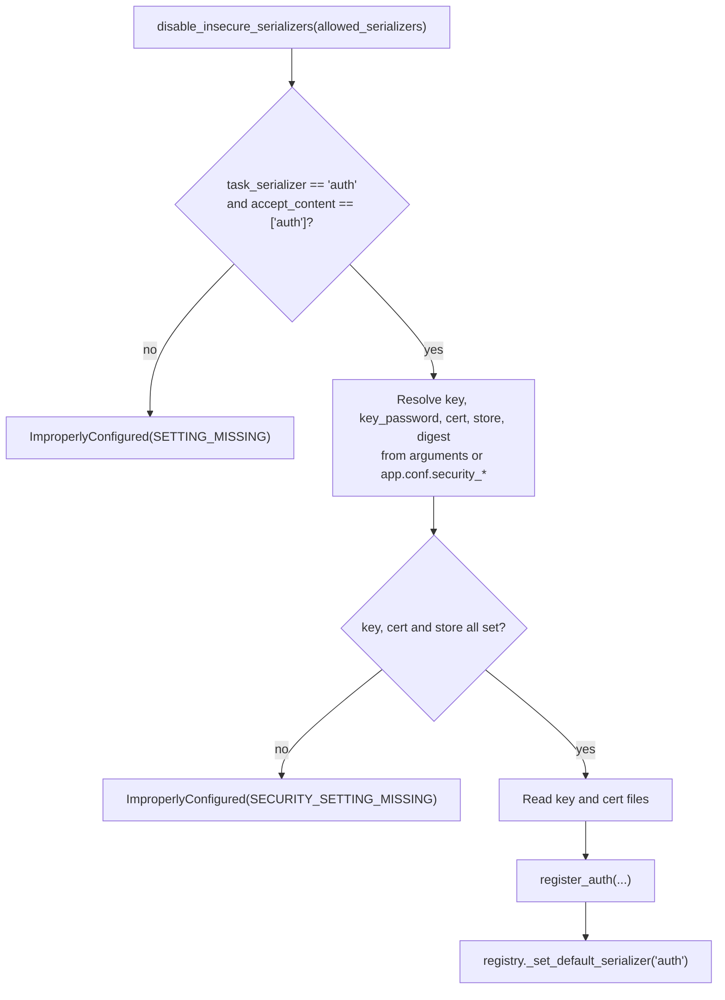
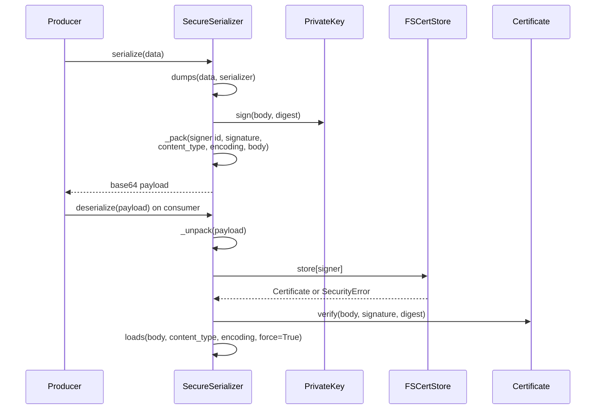

## Overview

Anyone who can publish to the broker can make a worker run any registered task with any arguments. `celery.security` closes that gap by registering an `auth` serializer with kombu: the producer signs every serialized message with its RSA private key, and the consumer verifies the signature against a store of trusted X.509 certificates before it decodes the body. Messages that are unsigned, signed by an unknown certificate, or tampered with are rejected as a `SecurityError`.

Sources: [celery/security/__init__.py:1-70](repo://celery/security/__init__.py#L1-L70), [celery/security/serialization.py:20-58](repo://celery/security/serialization.py#L20-L58)

The package is a thin layer over the `cryptography` library and kombu's serializer registry. Serializers in general are covered in [[Messaging and Routing]] and the configuration namespace in [[Configuration and Settings]].

Sources: [celery/security/__init__.py:1-41](repo://celery/security/__init__.py#L1-L41), [celery/security/utils.py:1-28](repo://celery/security/utils.py#L1-L28)

## Enabling signing

Signing is switched on by configuring the `auth` serializer and calling `app.setup_security()` in every process that sends or consumes tasks. The bundled example does this at import time of the app module.

Sources: [celery/app/base.py:750-780](repo://celery/app/base.py#L750-L780)

```python
app.conf.update(
    security_key='ssl/worker.key',
    security_certificate='ssl/worker.pem',
    security_cert_store='ssl/*.pem',
    task_serializer='auth',
    event_serializer='auth',
    accept_content=['auth'],
    result_accept_content=['json']
)
app.setup_security()
```

Sources: [examples/security/mysecureapp.py:35-44](repo://examples/security/mysecureapp.py#L35-L44)

Its docstring shows how to produce a test key pair with `openssl req -x509 -newkey rsa:4096 ...` and strip the passphrase with `openssl rsa`. Results are not signed in this setup: the example keeps the JSON result serializer and sets `result_accept_content=['json']` so clients can still read results while task messages must be signed.

Sources: [examples/security/mysecureapp.py:1-53](repo://examples/security/mysecureapp.py#L1-L53)

## setup_security

### Validation steps

`Celery.setup_security()` forwards its arguments to `celery.security.setup_security(..., app=self)`. That function works on the given app (or `current_app` when none is passed) and runs the steps shown below in order.

Sources: [celery/app/base.py:750-780](repo://celery/app/base.py#L750-L780), [celery/security/__init__.py:44-49](repo://celery/security/__init__.py#L44-L49)



Sources: [celery/security/__init__.py:44-70](repo://celery/security/__init__.py#L44-L70)

1. `_disable_insecure_serializers(allowed_serializers)` (kombu's `disable_insecure_serializers`) disables untrusted serializers such as pickle, except those named in `allowed_serializers`.
2. The configuration must say `task_serializer = 'auth'` and `accept_content = ['auth']` exactly; otherwise it raises `ImproperlyConfigured(SETTING_MISSING)`, whose text explains that there is no point signing messages that are not verified.
3. Each of `key`, `key_password`, `cert`, `store` and `digest` falls back to `security_key`, `security_key_password`, `security_certificate`, `security_cert_store` and `security_digest`.
4. If key, certificate or store is still missing it raises `ImproperlyConfigured(SECURITY_SETTING_MISSING)`.
5. It opens the key and certificate files, passes their contents to `register_auth`, and makes `auth` kombu's default serializer.

Sources: [celery/security/__init__.py:16-34](repo://celery/security/__init__.py#L16-L34), [celery/security/__init__.py:51-70](repo://celery/security/__init__.py#L51-L70)

Importing `celery.security` itself raises `ImproperlyConfigured(CRYPTOGRAPHY_NOT_INSTALLED)` when `cryptography` is not installed. `disable_untrusted_serializers(whitelist)` is also exported for disabling insecure serializers without enabling signing.

Sources: [celery/security/__init__.py:9-14](repo://celery/security/__init__.py#L9-L14), [celery/security/__init__.py:38-41](repo://celery/security/__init__.py#L38-L41), [celery/security/__init__.py:73-74](repo://celery/security/__init__.py#L73-L74)

> [!WARNING]
> `Celery.setup_security` declares `digest=DEFAULT_SECURITY_DIGEST` (`'sha256'`) and always passes it on, so the `digest or conf.security_digest` fallback never reaches the setting when you call `app.setup_security()` without arguments. To sign with another digest, pass it explicitly, for example `app.setup_security(digest='sha512')`.

Sources: [celery/app/base.py:750-752](repo://celery/app/base.py#L750-L752), [celery/app/base.py:778-780](repo://celery/app/base.py#L778-L780), [celery/security/__init__.py:62-62](repo://celery/security/__init__.py#L62-L62), [celery/app/defaults.py:20-20](repo://celery/app/defaults.py#L20-L20)

### Settings

| Setting | Type | Default | Meaning |
| --- | --- | --- | --- |
| `security_key` | string | none | Path to the PEM private key used to sign |
| `security_key_password` | bytes | none | Password for an encrypted private key |
| `security_certificate` | string | none | Path to the PEM certificate matching the key; its id is sent as the signer |
| `security_cert_store` | string | none | Directory or glob of trusted PEM certificates used to verify |
| `security_digest` | string | `'sha256'` | Hash algorithm name from `cryptography.hazmat.primitives.hashes` |

Sources: [celery/app/defaults.py:239-247](repo://celery/app/defaults.py#L239-L247), [celery/app/defaults.py:20-20](repo://celery/app/defaults.py#L20-L20)

The namespace also accepts the old `CELERY_SECURITY_*` names through `old_ns('celery_security')`.

Sources: [celery/app/defaults.py:239-240](repo://celery/app/defaults.py#L239-L240)

## SecureSerializer and register_auth

### Registration

`register_auth(key, key_password, cert, store, digest, serializer)` wraps the raw PEM strings in `PrivateKey`, `Certificate` and `FSCertStore` and builds a `SecureSerializer`. It registers the serializer's `serialize` and `deserialize` methods under the name `auth` with content type `application/data` and encoding `utf-8`. Any of the three objects may be omitted, which yields a serializer that can only sign or only verify; `serialize` asserts that key and certificate are present and `deserialize` asserts the store is.

Sources: [celery/security/serialization.py:20-34](repo://celery/security/serialization.py#L20-L34), [celery/security/serialization.py:48-50](repo://celery/security/serialization.py#L48-L50), [celery/security/serialization.py:80-90](repo://celery/security/serialization.py#L80-L90)

### Signing and verifying

`serialize(data)` first encodes the data with the inner serializer (`json` by default, the `serializer` argument), then signs the encoded bytes. Signing the encoded body rather than the Python object means the receiver verifies before decoding, so a malicious payload never reaches the decoder. `deserialize` reverses this: unpack, look up the signer's certificate in the store, verify, and only then call kombu's `loads` with `force=True` on the original content type.

Sources: [celery/security/serialization.py:31-58](repo://celery/security/serialization.py#L31-L58)



Sources: [celery/security/serialization.py:31-77](repo://celery/security/serialization.py#L31-L77), [celery/security/certificate.py:65-91](repo://celery/security/certificate.py#L65-L91), [celery/security/key.py:27-35](repo://celery/security/key.py#L27-L35)

### Wire format

`_pack` base64-encodes the signer id and the signature, joins five fields with `DEFAULT_SEPARATOR` (`b"\x00\x01"`), and base64-encodes the result. `_unpack` decodes and splits with `maxsplit=4`, so the body, which is the last field, may itself contain the separator bytes.

Sources: [celery/security/serialization.py:14-17](repo://celery/security/serialization.py#L14-L17), [celery/security/serialization.py:60-77](repo://celery/security/serialization.py#L60-L77)

```text
base64( b64(signer) \x00\x01 b64(signature) \x00\x01 content_type \x00\x01 content_encoding \x00\x01 body )
```

Sources: [celery/security/serialization.py:60-66](repo://celery/security/serialization.py#L60-L66)

## Keys and certificates

### PrivateKey

`PrivateKey(key, password=None)` loads a PEM private key with `serialization.load_pem_private_key` and rejects anything that is not an RSA key with `ValueError("Non-RSA keys are not supported.")`, converted to `SecurityError('Invalid private key: ...')`. `sign(data, digest)` produces an RSA-PSS signature using MGF1 with the same digest and the maximum salt length.

Sources: [celery/security/key.py:12-35](repo://celery/security/key.py#L12-L35)

### Certificate

`Certificate(cert)` loads a PEM X.509 certificate and also requires an RSA public key. Its identity, `get_id()`, is the issuer's attribute values joined by spaces followed by the serial number; that string is what the producer sends as `signer`. `verify(data, signature, digest)` checks an RSA-PSS signature with the same padding as `PrivateKey.sign`, and `has_expired()` compares `not_valid_after_utc` with the current UTC time.

Sources: [celery/security/certificate.py:31-73](repo://celery/security/certificate.py#L31-L73)

### CertStore and FSCertStore

`CertStore` is a dictionary of certificates keyed by `get_id()`. Lookup with `store[signer]` raises `SecurityError('Unknown certificate: ...')` for an id it does not hold, and `add_cert` raises `SecurityError` on a duplicate id. `FSCertStore(path)` fills the store from disk: a directory is expanded to `path/*`, anything else is treated as a glob, and each matching file is loaded as a `Certificate`. An expired certificate aborts loading with `SecurityError('Expired certificate: ...')`.

Sources: [celery/security/certificate.py:76-113](repo://celery/security/certificate.py#L76-L113)

> [!NOTE]
> Every file matched by `security_cert_store` must be a valid, unexpired RSA certificate, and two certificates with the same issuer and serial number cannot coexist. Point the store at a dedicated directory or a pattern such as `ssl/*.pem` so key files are not picked up.

Sources: [celery/security/certificate.py:93-113](repo://celery/security/certificate.py#L93-L113), [examples/security/mysecureapp.py:35-38](repo://examples/security/mysecureapp.py#L35-L38)

## Errors

All cryptographic failures surface as `celery.exceptions.SecurityError`, a `CeleryError` subclass. `reraise_errors(msg, errors)` is the context manager that converts them: it catches the listed exception types (by default the `cryptography.exceptions` module's exceptions), formats `msg` with the exception, and re-raises `SecurityError` with the original traceback.

Sources: [celery/security/utils.py:19-28](repo://celery/security/utils.py#L19-L28), [celery/exceptions.py:210-211](repo://celery/exceptions.py#L210-L211)

| Where | Message | Cause |
| --- | --- | --- |
| `SecureSerializer.serialize` | `Unable to serialize: ...` | Any exception while encoding or signing |
| `SecureSerializer.deserialize` | `Unable to deserialize: ...` | Bad payload, unknown signer or bad signature |
| `PrivateKey.__init__` | `Invalid private key: ...` | Unparseable PEM, wrong password or non-RSA key |
| `PrivateKey.sign` | `Unable to sign data: ...` | Signing failure |
| `Certificate.__init__` | `Invalid certificate: ...` | Unparseable PEM or non-RSA key |
| `Certificate.verify` | `Bad signature: ...` | Signature does not match |
| `CertStore.__getitem__` | `Unknown certificate: ...` | Signer not in the store |
| `FSCertStore.__init__` | `Expired certificate: ...` | A store file has expired |

Sources: [celery/security/serialization.py:31-58](repo://celery/security/serialization.py#L31-L58), [celery/security/key.py:15-35](repo://celery/security/key.py#L15-L35), [celery/security/certificate.py:34-113](repo://celery/security/certificate.py#L34-L113)

Because `deserialize` wraps everything in `reraise_errors(..., (Exception,))`, an unknown signer or a bad signature reaches the consumer as `SecurityError('Unable to deserialize: ...')` with the inner error in the message.

Sources: [celery/security/serialization.py:48-58](repo://celery/security/serialization.py#L48-L58)

## Digest selection

`get_digest_algorithm(digest)` turns a name into a hash instance by upper-casing it and looking it up on `cryptography.hazmat.primitives.hashes`, so `'sha256'`, `'sha384'` and `'sha512'` map to `hashes.SHA256()` and so on. An unknown name fails with `AttributeError` when the `SecureSerializer` is constructed. Producer and consumers must use the same digest, since it is not carried in the message.

Sources: [celery/security/utils.py:13-16](repo://celery/security/utils.py#L13-L16), [celery/security/serialization.py:23-29](repo://celery/security/serialization.py#L23-L29), [celery/security/serialization.py:60-66](repo://celery/security/serialization.py#L60-L66)
