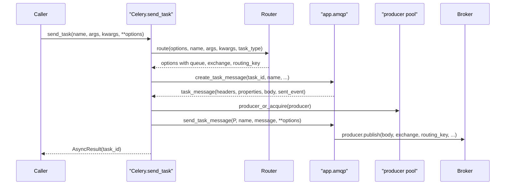
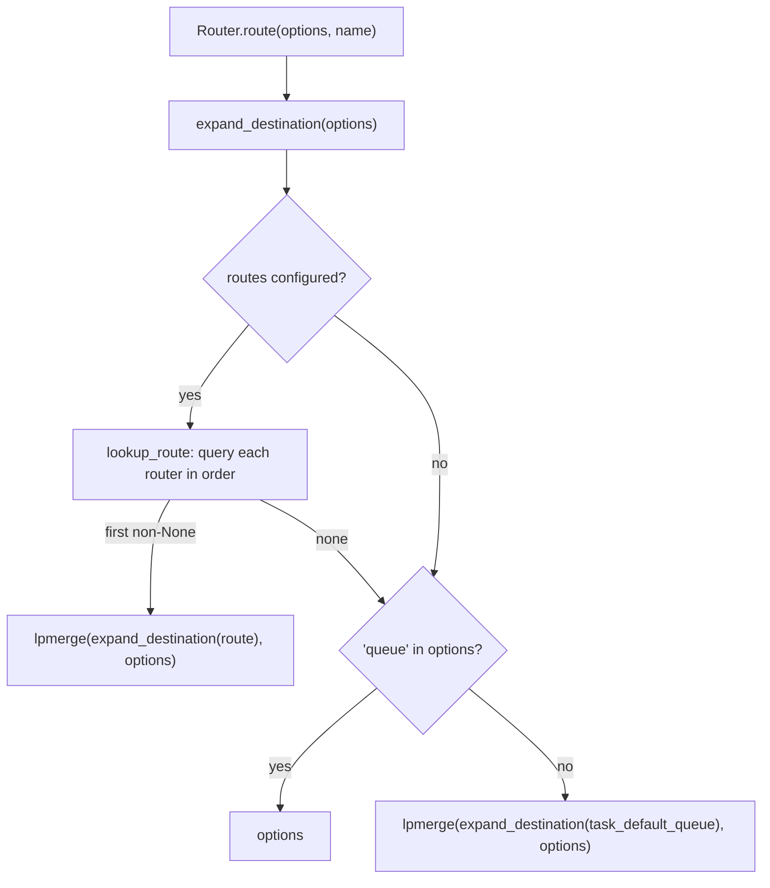

## Overview

Sending a task means turning a call into a broker message and deciding where it goes. `app.amqp`, an instance of `celery.app.amqp.AMQP`, owns that work on the client side: it holds the queue declarations (`Queues`), the router built from `task_routes`, the function that builds a message for the configured protocol version, and the function that publishes it through a Kombu producer from a pool. `app.send_task` connects these pieces, and `Task.apply_async` calls it (see [[Tasks]]).

Sources: [celery/app/amqp.py:225-271](repo://celery/app/amqp.py#L225-L271), [celery/app/base.py:1534-1537](repo://celery/app/base.py#L1534-L1537)

Routing settings (`task_queues`, `task_routes`, `task_default_queue` and related keys) are described in [[Configuration and Settings]]; the worker side, which consumes these queues, is covered in [[Consumer and Message Handling]].

Sources: [celery/app/defaults.py:278-310](repo://celery/app/defaults.py#L278-L310)

## Sending a task

### send_task step by step

`Celery.send_task(name, args, kwargs, ...)` accepts the same options as `apply_async` and works with task names that are not registered locally. It proceeds in seven steps.

Sources: [celery/app/base.py:846-862](repo://celery/app/base.py#L846-L862)

1. Generate a `task_id` if none was given and pick the router (`amqp.router` by default). `task_always_eager` only produces an `AlwaysEagerIgnored` warning here.
2. When called by name, look the task up in `app._tasks` without finalizing the app and merge its non-`None` execution options under the caller's options.
3. Pop `time_limit`, `soft_time_limit`, `expires` and `ignore_result` from the options, then call `router.route(options, route_name or name, args, kwargs, task_type)`.
4. With an ETA or countdown on a RabbitMQ broker that has quorum queues, rewrite the route for native delayed delivery (see below). A numeric or datetime `expires` becomes the AMQP `expiration` in seconds, clamped to 0 when in the past.
5. Inherit `root_id` and `parent_id` (and optionally the priority) from the task currently executing in the worker.
6. Build the message with `amqp.create_task_message` and publish it with `amqp.send_task_message` on a producer from `producer_or_acquire`, after letting the backend prepare for the reply (`backend.on_task_call`) unless results are ignored.
7. Return an `AsyncResult` and, with `add_to_parent`, add it to the parent task's children.

Sources: [celery/app/base.py:846-932](repo://celery/app/base.py#L846-L932), [celery/app/base.py:968-1041](repo://celery/app/base.py#L968-L1041)



Sources: [celery/app/base.py:846-932](repo://celery/app/base.py#L846-L932), [celery/app/base.py:994-1041](repo://celery/app/base.py#L994-L1041), [celery/app/amqp.py:506-606](repo://celery/app/amqp.py#L506-L606)

### Native delayed delivery

Quorum queues cannot hold ETA messages the classic way, so `send_task` checks `detect_quorum_queues` when an ETA or countdown is present. If the target exchange is not `direct`, it converts the ETA to a countdown, computes a routing key with `calculate_routing_key(countdown, routing_key)` and sends to the `celery_delayed_27` topic exchange; for a direct exchange it only logs a warning that the task may block the worker until the ETA.

Sources: [celery/app/base.py:934-966](repo://celery/app/base.py#L934-L966)

`detect_quorum_queues(app, driver_type)` returns `(True, name)` for the first queue in `app.amqp.queues` whose `x-queue-type` argument is `quorum`, and only when the driver is `amqp`. The worker uses the same helper: with `worker_detect_quorum_queues` enabled it turns off global QoS, so the prefetch count becomes static.

Sources: [celery/utils/quorum_queues.py:1-20](repo://celery/utils/quorum_queues.py#L1-L20), [celery/worker/consumer/tasks.py:110-124](repo://celery/worker/consumer/tasks.py#L110-L124)

## The task message protocol

### Choosing a version

`AMQP.task_protocols` maps `1` to `as_task_v1` and `2` to `as_task_v2`; the `create_task_message` cached property selects one with the `task_protocol` setting (default `2`). Both return a `task_message` named tuple of `headers`, `properties`, `body` and `sent_event`, and both reject non-sequence `args` or non-mapping `kwargs` with `TypeError`.

Sources: [celery/app/amqp.py:32-33](repo://celery/app/amqp.py#L32-L33), [celery/app/amqp.py:257-267](repo://celery/app/amqp.py#L257-L267), [celery/app/defaults.py:295-295](repo://celery/app/defaults.py#L295-L295)

### Protocol 2

`as_task_v2` converts a `countdown` into an absolute ETA and a numeric `expires` into a datetime, both made timezone-aware with the app's timezone and serialized as ISO 8601 strings. `argsrepr` and `kwargsrepr` are `saferepr` strings capped at 1024 characters, and `root_id` defaults to the task's own id. Task metadata lives in the message headers, so a worker can route, reject or log a message without deserializing the body.

Sources: [celery/app/amqp.py:326-369](repo://celery/app/amqp.py#L326-L369), [celery/app/amqp.py:250-255](repo://celery/app/amqp.py#L250-L255)

| Part | Field | Content |
| --- | --- | --- |
| headers | `lang`, `task`, `id`, `shadow` | `'py'`, task name, task id, display name override |
| headers | `eta`, `expires` | ISO 8601 strings or `None` |
| headers | `group`, `group_index`, `retries` | Group membership and retry count |
| headers | `timelimit` | `[time_limit, soft_time_limit]` |
| headers | `root_id`, `parent_id` | Workflow lineage |
| headers | `argsrepr`, `kwargsrepr`, `origin` | Log-safe argument reprs and sender node name |
| headers | `ignore_result`, `replaced_task_nesting` | Result storing flag and replace depth |
| headers | `stamped_headers`, `stamps` | Canvas stamping data |
| properties | `correlation_id`, `reply_to` | Task id and the reply queue (default the app's `thread_oid`) |
| body | tuple | `(args, kwargs, embed)` with `embed` holding `callbacks`, `errbacks`, `chain`, `chord` |

Sources: [celery/app/amqp.py:370-406](repo://celery/app/amqp.py#L370-L406), [celery/app/base.py:1007-1016](repo://celery/app/base.py#L1007-L1016)

```python
headers = {
    'lang': 'py',
    'task': name,
    'id': task_id,
    'shadow': shadow,
    'eta': eta,
    'expires': expires,
    'group': group_id,
    'group_index': group_index,
    'retries': retries,
    'timelimit': [time_limit, soft_time_limit],
    'root_id': root_id,
    'parent_id': parent_id,
    'argsrepr': argsrepr,
    'kwargsrepr': kwargsrepr,
    'origin': origin or anon_nodename(),
    'ignore_result': ignore_result,
    'replaced_task_nesting': replaced_task_nesting,
    'stamped_headers': stamped_headers,
    'stamps': stamps,
}
```

Sources: [celery/app/amqp.py:371-391](repo://celery/app/amqp.py#L371-L391)

When `task_send_sent_event` is on, `sent_event` carries the fields of the `task-sent` event (`uuid`, `root_id`, `parent_id`, `name`, reprs, `retries`, `eta`, `expires`).

Sources: [celery/app/amqp.py:407-418](repo://celery/app/amqp.py#L407-L418), [celery/app/base.py:1011-1013](repo://celery/app/base.py#L1011-L1013)

### Protocol 1

`as_task_v1` sends empty headers and puts everything in a dict body: `task`, `id`, `args`, `kwargs`, `group`, `group_index`, `retries`, `eta`, `expires`, `utc` (from `enable_utc`), `callbacks`, `errbacks`, `timelimit`, `taskset` (a copy of `group`) and `chord`. It does not carry the lineage or repr fields of protocol 2.

Sources: [celery/app/amqp.py:420-478](repo://celery/app/amqp.py#L420-L478)

## Publishing

### send_task_message

`_create_task_sender` reads the publishing defaults once (`task_publish_retry`, `task_publish_retry_policy`, `task_default_delivery_mode`, `task_default_routing_key`, `task_serializer`, `task_compression`, the default exchange and the signal receivers) and returns the closure `send_task_message(producer, name, message, ...)`, cached on `AMQP.send_task_message`.

Sources: [celery/app/amqp.py:485-506](repo://celery/app/amqp.py#L485-L506), [celery/app/amqp.py:269-271](repo://celery/app/amqp.py#L269-L271)

The closure merges extra headers and properties into the message, resolves a queue name through `Queues` (the default queue when neither queue nor exchange is given), and takes `delivery_mode` and the exchange type from the queue's exchange. For a `direct` exchange without an explicit exchange and routing key it publishes to the default exchange `''` with the queue name as routing key; otherwise it uses the queue's exchange and routing key. The queue is added to `declare` unless it is a `Broadcast`, and the custom retry policy is merged over the default.

Sources: [celery/app/amqp.py:514-556](repo://celery/app/amqp.py#L514-L556)

It sends `before_task_publish`, calls `producer.publish`, then sends `after_task_publish` and the deprecated `task_sent` signal (only when receivers are connected), and finally publishes the `task-sent` event with the queue, exchange and routing key through a disabled event dispatcher that reuses the same producer. These hooks are listed in [[Signals]].

Sources: [celery/app/amqp.py:558-606](repo://celery/app/amqp.py#L558-L606), [celery/app/amqp.py:653-657](repo://celery/app/amqp.py#L653-L657)

### Producer and connection pools

`AMQP.producer_pool` is a Kombu producer pool for `app.connection_for_write()` (the `broker_write_url`), limited to the app connection pool's limit (`broker_pool_limit`, default 10). `app.producer_or_acquire(producer)` uses the given producer or acquires one, waiting up to `broker_pool_acquire_timeout`; exhausting the pool raises `OperationalError`. Passing `connection=` to `send_task` creates a non-declaring producer on that connection instead.

Sources: [celery/app/amqp.py:635-642](repo://celery/app/amqp.py#L635-L642), [celery/app/base.py:1162-1189](repo://celery/app/base.py#L1162-L1189), [celery/app/base.py:1489-1500](repo://celery/app/base.py#L1489-L1500), [celery/app/base.py:1022-1029](repo://celery/app/base.py#L1022-L1029)

## Queues and default exchange

### The Queues mapping

`AMQP.queues` is built from `task_queues` by `AMQP.Queues`. When `task_queues` is empty it creates a single queue named `task_default_queue` (`celery`) on the default exchange, with `x-queue-type: quorum` if `task_default_queue_type` is `quorum`. The default exchange is `Exchange(task_default_exchange, task_default_exchange_type)`; because `task_default_exchange` and `task_default_routing_key` fall back to the queue name, the default setup is a direct exchange `celery` with routing key `celery`.

Sources: [celery/app/amqp.py:273-306](repo://celery/app/amqp.py#L273-L306), [celery/app/amqp.py:608-615](repo://celery/app/amqp.py#L608-L615), [celery/app/amqp.py:644-647](repo://celery/app/amqp.py#L644-L647), [celery/app/utils.py:114-126](repo://celery/app/utils.py#L114-L126)

`Queues` is a dict from name to `kombu.Queue`. Entries may be `Queue` objects or dicts (via `add_compat`, which accepts the legacy `binding_key`). `_add` fills in the default exchange and routing key and, with `task_queue_max_priority`, sets `x-max-priority`. Queue aliases are tracked in a `WeakValueDictionary` and checked first on lookup.

Sources: [celery/app/amqp.py:41-146](repo://celery/app/amqp.py#L41-L146)

### Missing queues

Looking up an unknown name calls `__missing__`: with `task_create_missing_queues` (default `True`) `new_missing` creates a queue bound to an exchange of the same name, using `task_create_missing_queue_exchange_type` when set and `x-queue-type` from `task_create_missing_queue_type` when it is `quorum`; any other value than `classic` or `quorum` raises `ValueError`. With creation disabled the lookup raises `KeyError`.

Sources: [celery/app/amqp.py:99-102](repo://celery/app/amqp.py#L99-L102), [celery/app/amqp.py:201-216](repo://celery/app/amqp.py#L201-L216)

### Selecting queues to consume

Workers consume from `consume_from`: all queues by default, or the subset chosen with `select` (the `-Q` option) minus those removed by `deselect` (`-X`). `select_add` adds a queue that stays active even when a subset is selected. `TaskConsumer` builds a Kombu consumer for those queues accepting `accept_content`.

Sources: [celery/app/amqp.py:159-222](repo://celery/app/amqp.py#L159-L222), [celery/app/amqp.py:317-324](repo://celery/app/amqp.py#L317-L324)

```python
from kombu import Exchange, Queue

app.conf.task_queues = [
    Queue('default', Exchange('default'), routing_key='default'),
    Queue('video', Exchange('media', type='topic'), routing_key='media.video'),
    Queue('jobs', queue_arguments={'x-queue-type': 'quorum'}),
]
app.conf.task_default_queue = 'default'
```

Sources: [celery/app/amqp.py:63-84](repo://celery/app/amqp.py#L63-L84), [celery/app/amqp.py:132-142](repo://celery/app/amqp.py#L132-L142)

## Routing

### Router.route

`AMQP.router` is a `Router` built from the prepared routes, the `Queues` mapping and `task_create_missing_queues`. `Router.route(options, name, args, kwargs, task_type)` first expands a `queue` given in the call options into a `Queue` object. If any route returns a match, that route is expanded too and merged with the call options by `lpmerge`, so explicit call options win over route values. Without a match and without a queue, the result is merged with `task_default_queue`. A queue name missing from the `Queues` mapping raises `QueueNotFound`; that only happens when `Queues` does not create missing queues.

Sources: [celery/app/amqp.py:308-312](repo://celery/app/amqp.py#L308-L312), [celery/app/amqp.py:627-633](repo://celery/app/amqp.py#L627-L633), [celery/app/routes.py:56-96](repo://celery/app/routes.py#L56-L96)



Sources: [celery/app/routes.py:66-111](repo://celery/app/routes.py#L66-L111)

### Route types and task_routes

`prepare(task_routes)` normalises the setting into a list: a dict, list or tuple of pairs becomes a `MapRoute`; a string becomes a lazy `expand_router_string`, which imports the object and instantiates pre-4.0 classes that define `route_for_task`; anything else (a function or object) is used as is. A single value is wrapped in a tuple. `AMQP.routes` caches the result, and changing `task_routes` through configuration calls `flush_routes` and rebuilds the router.

Sources: [celery/app/routes.py:114-136](repo://celery/app/routes.py#L114-L136), [celery/app/amqp.py:314-315](repo://celery/app/amqp.py#L314-L315), [celery/app/amqp.py:621-625](repo://celery/app/amqp.py#L621-L625), [celery/app/amqp.py:659-663](repo://celery/app/amqp.py#L659-L663)

`MapRoute` splits its keys into exact names and patterns: compiled regular expressions are used as given and keys containing `*` are translated with `fnmatch`. Exact names are tried first, then patterns in insertion order. A value may be a dict of options or a plain queue name, which becomes `{'queue': name}`.

Sources: [celery/app/routes.py:26-53](repo://celery/app/routes.py#L26-L53)

A router function is called as `router(name, args, kwargs, options, task=task_type)` and returns a route or `None` to pass; routers are queried in order and the first non-`None` answer wins. Legacy objects with `route_for_task(task, args, kwargs)` are still supported.

Sources: [celery/app/routes.py:98-111](repo://celery/app/routes.py#L98-L111)

```python
import re

def route_by_priority(name, args, kwargs, options, task=None, **kw):
    if name.endswith('.urgent'):
        return {'queue': 'urgent', 'priority': 9}

app.conf.task_routes = (
    route_by_priority,
    {
        'proj.tasks.add': 'math',
        'proj.video.*': {'queue': 'video', 'routing_key': 'media.video'},
        re.compile(r'(image|audio)\.tasks\..*'): {'queue': 'media'},
    },
    'proj.routers.MyRouter',
)
```

Sources: [celery/app/routes.py:26-53](repo://celery/app/routes.py#L26-L53), [celery/app/routes.py:106-136](repo://celery/app/routes.py#L106-L136)
