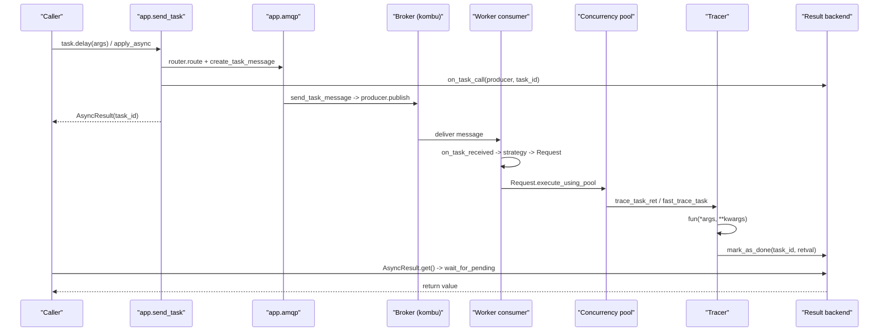

## Overview

Celery is a distributed task queue for Python. A client puts a message describing a unit of work (a task) on a queue, a message broker delivers it, and dedicated worker processes pick it up and run it. Because everything goes through messages, one system can run many workers and brokers, which gives high availability and horizontal scaling, and the protocol can be spoken by clients in other languages.

Sources: [README.rst:91-118](repo://README.rst#L91-L118)

The package is published as `celery` (version `5.6.2`, series `recovery`) and installs a single `celery` console script that maps to `celery.__main__:main`. Its runtime dependencies are small: `kombu` for messaging, `billiard` for the prefork process pool, `vine` for promises, `click` and its plugins for the command line, `python-dateutil` and `tzlocal` for time handling.

Sources: [celery/__init__.py:25-32](repo://celery/__init__.py#L25-L32), [setup.py:137-159](repo://setup.py#L137-L159), [requirements/default.txt:1-10](repo://requirements/default.txt#L1-L10)

Start with [[Quickstart]] to run a worker, then read [[The Celery Application]] for the object every other part hangs off.

Sources: [celery/app/base.py:252-287](repo://celery/app/base.py#L252-L287)

## Main components

A Celery deployment is built from a few cooperating pieces. The application object is shared by every process (clients, workers, beat), and each piece reaches the others through it.

Sources: [celery/app/base.py:1534-1613](repo://celery/app/base.py#L1534-L1613)

| Component | Where it lives | Role |
| --- | --- | --- |
| Application | `celery.app.base.Celery` | Holds configuration (`app.conf`), the task registry (`app.tasks`) and lazily created helpers: `app.amqp`, `app.backend`, `app.control`, `app.events`, `app.loader`, `app.log`. |
| Broker (via kombu) | `celery.app.amqp.AMQP` | Builds task messages and publishes them with a kombu `Producer`; connections come from `app.connection_for_write()` and a kombu connection pool. |
| Worker | `celery.worker.WorkController`, `celery.apps.worker.Worker` | Consumes task messages, turns them into requests and runs them in a concurrency pool (prefork, eventlet, gevent, solo, threads). |
| Beat | `celery.beat.Scheduler`, `celery.apps.beat.Beat` | Sends tasks on a schedule by calling `task.apply_async` or `app.send_task` for each due entry. |
| Result backends | `celery.backends.*` | Store task state and return values; selected by URL scheme from `result_backend`. |
| Events | `celery.events.EventDispatcher`, `EventReceiver` | Stream of monitoring messages sent by workers (and clients when `task_send_sent_event` is enabled). |

Sources: [celery/app/base.py:1430-1460](repo://celery/app/base.py#L1430-L1460), [celery/app/base.py:1534-1594](repo://celery/app/base.py#L1534-L1594), [celery/concurrency/__init__.py:11-24](repo://celery/concurrency/__init__.py#L11-L24), [celery/beat.py:393-421](repo://celery/beat.py#L393-L421), [celery/events/__init__.py:1-15](repo://celery/events/__init__.py#L1-L15)

The broker connection is always a kombu object. `_connection` fills in every option the caller left out from the `broker_*` settings (`broker_user`, `broker_transport`, `broker_use_ssl`, `broker_transport_options`, `broker_connection_timeout`) and hands them to `self.amqp.Connection`. Reading and writing can use different URLs: `connection_for_read` uses `broker_read_url` and `connection_for_write` uses `broker_write_url`.

Sources: [celery/app/base.py:1043-1057](repo://celery/app/base.py#L1043-L1057), [celery/app/base.py:1102-1127](repo://celery/app/base.py#L1102-L1127)

Result backends are resolved by `celery.app.backends.by_url`: the scheme of the `result_backend` URL (or the part before `+`, as in `db+postgresql://`) is looked up in `BACKEND_ALIASES`, so `redis://` maps to `celery.backends.redis:RedisBackend`, `rpc://` to `RPCBackend` and `db`/`database` to `DatabaseBackend`. With no backend configured the alias `disabled` is used. See [[Result Backends]].

Sources: [celery/app/backends.py:15-69](repo://celery/app/backends.py#L15-L69), [celery/app/base.py:1224-1228](repo://celery/app/base.py#L1224-L1228)

## How a task travels

Calling `add.delay(2, 2)` is shorthand for `apply_async((2, 2), {})`. Unless `task_always_eager` is set, `apply_async` delegates to `app.send_task` with the task's name, arguments and its own `AsyncResult` class.

Sources: [celery/app/task.py:523-534](repo://celery/app/task.py#L523-L534), [celery/app/task.py:682-708](repo://celery/app/task.py#L682-L708)

`send_task` generates a task id, merges the task's execution options, routes the message with `amqp.router.route`, and fills `root_id`/`parent_id` from the task currently executing in the worker (so nested calls are linked). It then builds the message with `amqp.create_task_message`, tells the backend about the call with `backend.on_task_call` (unless the result is ignored), publishes with `amqp.send_task_message`, and returns an `AsyncResult` for the id.

Sources: [celery/app/base.py:863-872](repo://celery/app/base.py#L863-L872), [celery/app/base.py:930-932](repo://celery/app/base.py#L930-L932), [celery/app/base.py:994-1041](repo://celery/app/base.py#L994-L1041)

On the worker, the consumer's `on_task_received` reads the task name from the message headers (protocol v2) and looks up the strategy registered for that name; the default strategy builds a `Request` and hands it on. The request is executed in the pool via `pool.apply_async(trace_task_ret, ...)`, and the tracer built by `build_tracer` calls the task function, dispatches callbacks, and stores the outcome with `backend.mark_as_done` (or the failure path through `on_error`).

Sources: [celery/worker/consumer/consumer.py:716-786](repo://celery/worker/consumer/consumer.py#L716-L786), [celery/worker/strategy.py:198-209](repo://celery/worker/strategy.py#L198-L209), [celery/worker/request.py:341-369](repo://celery/worker/request.py#L341-L369), [celery/app/trace.py:565-627](repo://celery/app/trace.py#L565-L627)



Sources: [celery/app/task.py:682-708](repo://celery/app/task.py#L682-L708), [celery/app/base.py:1007-1041](repo://celery/app/base.py#L1007-L1041), [celery/app/amqp.py:506-606](repo://celery/app/amqp.py#L506-L606), [celery/worker/consumer/consumer.py:731-786](repo://celery/worker/consumer/consumer.py#L731-L786), [celery/worker/request.py:341-369](repo://celery/worker/request.py#L341-L369), [celery/app/trace.py:580-627](repo://celery/app/trace.py#L580-L627), [celery/result.py:243-265](repo://celery/result.py#L243-L265)

Publishing fires the `before_task_publish` and `after_task_publish` signals around `producer.publish`, and when the message carries a sent event it also publishes a `task-sent` event through the app's event dispatcher. On the caller side, `AsyncResult.get` returns immediately for ignored results, otherwise it registers itself with `backend.add_pending_result` and blocks in `backend.wait_for_pending`.

Sources: [celery/app/amqp.py:558-606](repo://celery/app/amqp.py#L558-L606), [celery/result.py:243-265](repo://celery/result.py#L243-L265)

## Package layout

The `celery` package keeps the client-side API under `celery.app` and the long-running programs under `celery.worker`, `celery.beat` and `celery.apps`.

Sources: [celery/apps/worker.py:1-4](repo://celery/apps/worker.py#L1-L4), [celery/apps/beat.py:1-4](repo://celery/apps/beat.py#L1-L4)

| Subpackage / module | Contents |
| --- | --- |
| `celery/app/` | The `Celery` class (`base.py`), the `Task` base class (`task.py`), tracing (`trace.py`), kombu integration (`amqp.py`), routing (`routes.py`), default settings (`defaults.py`), task registry, remote-control client (`control.py`), logging setup. |
| `celery/worker/` | `WorkController`, the consumer blueprint (`consumer/`), task requests (`request.py`), execution strategies (`strategy.py`), worker-side remote control, autoscaling and heartbeats. |
| `celery/apps/` | Command-line program versions of the worker and beat, plus `multi.py` for starting and stopping many workers. |
| `celery/bin/` | The click-based `celery` umbrella command and its sub-commands (`worker`, `beat`, `call`, `control`, `events`, `multi`, `purge`, `result`, `shell`, ...). |
| `celery/backends/` | Result backend implementations: `base.py` plus Redis, RPC, database (SQLAlchemy), cache, MongoDB, Cassandra, Elasticsearch, S3, GCS, DynamoDB, filesystem and others. |
| `celery/concurrency/` | Execution pools: `prefork`, `eventlet`, `gevent`, `solo`, `thread`, and the async prefork pool (`asynpool.py`). |
| `celery/events/` | Event dispatcher and receiver, the in-memory cluster `State`, snapshots and the curses monitor. |
| `celery/loaders/` | Loaders that read configuration and import task modules (`AppLoader`, default `Loader`). |
| `celery/security/` | The message-signing `auth` serializer, keys and certificates. |
| `celery/fixups/` | Framework fix-ups; `django.py` is applied by default. |
| `celery/contrib/` | Extras: pytest plugin and testing helpers, abortable tasks, `rdb` remote debugger, Sphinx extension, migration tools, Django helpers. |
| `celery/utils/` | Shared utilities, including the signal dispatcher (`utils/dispatch`), time and serialization helpers. |
| `celery/canvas.py`, `celery/result.py` | Signatures and workflows (`chain`, `group`, `chord`), and `AsyncResult`/`GroupResult`. |
| `celery/beat.py`, `celery/schedules.py` | The periodic task scheduler and its `crontab`, `solar` and interval schedules. |
| `celery/signals.py`, `celery/states.py`, `celery/exceptions.py`, `celery/bootsteps.py` | Signal definitions, task states, error types, and the bootstep dependency graph used to build the worker. |
| `celery/_state.py`, `celery/local.py` | Current app/current task tracking and the `Proxy`/`PromiseProxy` objects used for laziness. |

Sources: [celery/concurrency/__init__.py:1-24](repo://celery/concurrency/__init__.py#L1-L24), [celery/events/__init__.py:1-15](repo://celery/events/__init__.py#L1-L15), [celery/loaders/__init__.py:1-18](repo://celery/loaders/__init__.py#L1-L18), [celery/app/backends.py:15-38](repo://celery/app/backends.py#L15-L38), [celery/app/base.py:82-84](repo://celery/app/base.py#L82-L84), [celery/worker/consumer/consumer.py:1-5](repo://celery/worker/consumer/consumer.py#L1-L5), [celery/bootsteps.py:1-3](repo://celery/bootsteps.py#L1-L3)

## Lazy top-level imports

Importing `celery` is cheap because the package replaces its own module with a `LazyModule` built by `local.recreate_module`. Names such as `Celery`, `shared_task`, `Task`, `current_app`, `chain` and `group` are mapped to the submodule that defines them and imported on first attribute access.

Sources: [celery/__init__.py:155-180](repo://celery/__init__.py#L155-L180), [celery/local.py:454-471](repo://celery/local.py#L454-L471)

```python
old_module, new_module = local.recreate_module(  # pragma: no cover
    __name__,
    by_module={
        'celery.app': ['Celery', 'bugreport', 'shared_task'],
        'celery.app.task': ['Task'],
        'celery._state': ['current_app', 'current_task'],
        'celery.canvas': [
            'Signature', 'chain', 'chord', 'chunks', 'group',
            'signature', 'maybe_signature', 'subtask',
            'xmap', 'xstarmap',
        ],
        'celery.utils': ['uuid'],
    },
```

Sources: [celery/__init__.py:157-169](repo://celery/__init__.py#L157-L169)

The same module exposes `maybe_patch_concurrency`, which scans `argv` for `-P`/`--pool` and applies the eventlet or gevent monkey patches before anything else is imported. That is why those pools must be selected on the command line rather than configured later; see [[Concurrency Pools]].

Sources: [celery/__init__.py:107-152](repo://celery/__init__.py#L107-L152)

## Supported platforms and integrations

`setup.py` requires Python `>=3.10` and lists CPython 3.10 to 3.14 and PyPy in its classifiers. The README still describes the 5.6.x series as supporting Python 3.9 to 3.13 and says it is the last series to support 3.9; the packaging metadata is the one pip enforces.

Sources: [setup.py:150-182](repo://setup.py#L150-L182), [README.rst:120-141](repo://README.rst#L120-L141)

RabbitMQ and Redis are the feature-complete transports, with Amazon SQS and Google Pub/Sub also supported through kombu. Web frameworks such as Django, Flask and FastAPI need no integration package; Django support is a built-in fix-up, described in [[Django Integration]].

Sources: [README.rst:147-153](repo://README.rst#L147-L153), [README.rst:218-274](repo://README.rst#L218-L274), [celery/app/base.py:82-84](repo://celery/app/base.py#L82-L84)

## Where to go next

- [[Quickstart]]: install, define a task, run a worker, fetch a result.
- [[The Celery Application]]: the `Celery` class, lazy finalization and the current app.
- [[Tasks]] and [[Task Execution and Tracing]]: the task base class and what happens when it runs.
- [[Worker Architecture and Bootsteps]]: how the worker is assembled.
- [[Periodic Tasks with Beat]], [[Result Backends]], [[Events and Monitoring]]: the remaining moving parts.

Sources: [celery/app/base.py:1430-1460](repo://celery/app/base.py#L1430-L1460)
