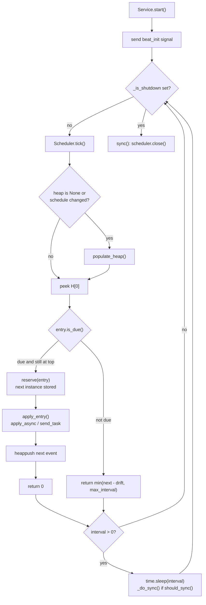

## Overview

Celery beat is the clock of a Celery deployment: a single long-running process that reads a table of periodic task entries, decides which are due, and publishes them to the broker like any other task call. Workers never know that a message came from beat. The engine lives in `celery/beat.py` (`ScheduleEntry`, `Scheduler`, `PersistentScheduler`, `Service`, `EmbeddedService`), the program wrapper that installs logging, pidfiles and signal handlers is `celery.apps.beat.Beat`, and the `celery beat` click command in `celery/bin/beat.py` builds that wrapper from command-line options.

Sources: [celery/beat.py:1-43](repo://celery/beat.py#L1-L43), [celery/apps/beat.py:1-53](repo://celery/apps/beat.py#L1-L53), [celery/bin/beat.py:1-72](repo://celery/bin/beat.py#L1-L72)

When an entry is due depends on its schedule object (an interval, a `crontab` or a `solar` event); those classes are described in [[Schedules: crontab, solar and intervals]]. Beat only asks each schedule `is_due(last_run_at)` and acts on the answer. Only one beat process should run per schedule, otherwise every due task is sent once per beat instance.

Sources: [celery/beat.py:161-163](repo://celery/beat.py#L161-L163), [celery/beat.py:297-298](repo://celery/beat.py#L297-L298)

## Declaring the schedule

### The beat_schedule setting

Entries come from the `beat_schedule` setting, a dict mapping an entry name to a dict of `ScheduleEntry` keyword arguments: `task`, `schedule`, `args`, `kwargs`, `options` and optionally `relative`. The `schedule` value may be a number of seconds, a `timedelta`, or any schedule object; `ScheduleEntry.__init__` normalises it through `maybe_schedule`.

Sources: [celery/beat.py:117-128](repo://celery/beat.py#L117-L128), [celery/app/defaults.py:73-82](repo://celery/app/defaults.py#L73-L82)

```python
from datetime import timedelta
from celery import Celery
from celery.schedules import crontab

app = Celery('proj', broker='redis://localhost')

app.conf.beat_schedule = {
    'add-every-30-seconds': {
        'task': 'proj.tasks.add',
        'schedule': 30.0,
        'args': (16, 16),
    },
    'nightly-report': {
        'task': 'proj.tasks.report',
        'schedule': crontab(hour=3, minute=0),
        'options': {'queue': 'reports', 'expires': 3600},
    },
    'hourly-cleanup': {
        'task': 'proj.tasks.cleanup',
        'schedule': timedelta(hours=1),
    },
}
```

Sources: [celery/beat.py:117-128](repo://celery/beat.py#L117-L128), [celery/schedules.py:703-714](repo://celery/schedules.py#L703-L714)

### add_periodic_task

`app.add_periodic_task(schedule, sig, args=(), kwargs=(), name=None, **opts)` turns a signature into an entry dict and writes it into `beat_schedule`. The key is `name` or, when no name is given, `repr(sig)`, so adding the same unnamed signature twice replaces the first entry and logs a "shadowed a previous unnamed periodic task" warning. Calls made before the app is configured are queued in `_pending_periodic_tasks` and applied when the configuration is loaded, which is why the usual pattern hooks `on_after_configure`.

Sources: [celery/app/base.py:1295-1333](repo://celery/app/base.py#L1295-L1333), [celery/app/base.py:1273-1279](repo://celery/app/base.py#L1273-L1279)

```python
@app.on_after_configure.connect
def setup_periodic_tasks(sender, **kwargs):
    sender.add_periodic_task(10.0, ping.s(), name='ping every 10s')
    sender.add_periodic_task(crontab(minute=0, hour='*/2'), report.s('daily'))
```

Sources: [celery/app/base.py:1295-1310](repo://celery/app/base.py#L1295-L1310)

### Lazy arguments with BeatLazyFunc

Arguments in an entry are normally fixed when the schedule is loaded. Wrapping a callable in `BeatLazyFunc(func, *args, **kwargs)` defers it: just before each send, `_evaluate_entry_args` and `_evaluate_entry_kwargs` call every `BeatLazyFunc` found in the entry's `args` and `kwargs` and pass the result to the task instead.

Sources: [celery/beat.py:50-78](repo://celery/beat.py#L50-L78), [celery/beat.py:201-216](repo://celery/beat.py#L201-L216), [celery/beat.py:400-402](repo://celery/beat.py#L400-L402)

## ScheduleEntry

A `ScheduleEntry` holds one row of the schedule: `name`, `task`, `schedule`, `args`, `kwargs`, `options`, `last_run_at` and `total_run_count`. A fresh entry gets `last_run_at` from `default_now()`, which is the schedule's own `now()` (honouring its `nowfun` and the app timezone).

Sources: [celery/beat.py:81-132](repo://celery/beat.py#L81-L132)

Entries are treated as immutable snapshots. `next(entry)` (`_next_instance`) returns a new instance with `last_run_at` set to now and `total_run_count` incremented, and the scheduler stores that new instance under the same name. `update(other)` copies only the "editable" fields (`task`, `schedule`, `args`, `kwargs`, `options`), and `__eq__` compares only those same fields, so two entries with different run counts are still equal. `__lt__` orders by `id()` because the heap orders by the preceding tuple members and only needs entries to be comparable.

Sources: [celery/beat.py:134-198](repo://celery/beat.py#L134-L198)

## The tick loop

### Service.start

`Service.start()` sends the `beat_init` signal (plus `beat_embedded_init` when running embedded), then loops until `_is_shutdown` is set: call `scheduler.tick()`, sleep for the interval it returns, and run `_do_sync()` when `should_sync()` says so. `KeyboardInterrupt` and `SystemExit` set the shutdown flag, and the `finally` clause calls `sync()`, which closes the scheduler and sets `_is_stopped`.

Sources: [celery/beat.py:633-664](repo://celery/beat.py#L633-L664)



Sources: [celery/beat.py:310-364](repo://celery/beat.py#L310-L364), [celery/beat.py:633-659](repo://celery/beat.py#L633-L659)

### populate_heap and tick

`populate_heap()` builds a min-heap of `event_t(time, priority, entry)` tuples, one per entry. For each entry it calls `is_due()`; the time is `_when(entry, 0 if is_due else next_call_delay)`, an absolute UTC timestamp computed from the entry's `default_now()` plus the delay adjusted by a 10 ms negative drift (`adjust`).

Sources: [celery/beat.py:292-323](repo://celery/beat.py#L292-L323)

`tick()` executes at most one due task per call. It rebuilds the heap when there is none yet or when `schedules_equal(old_schedulers, schedule)` reports a change, which is how edits to the schedule (from a database scheduler, for example) are picked up. It then looks at the heap head and asks the scheduler's `is_due(entry)`.

Sources: [celery/beat.py:325-347](repo://celery/beat.py#L325-L347)

- If due and the popped event is still the same object, it calls `reserve(entry)` to store the advanced entry, sends the task with `apply_entry`, pushes the next event computed from `next_time_to_run`, and returns `0` so the loop ticks again immediately.
- If the head changed between peek and pop, it pushes it back and returns `min(verify[0], max_interval)`.
- If not due, it returns the adjusted `next_time_to_run`, capped at `max_interval` (and falling back to `max_interval` when the value is not numeric).

Sources: [celery/beat.py:348-379](repo://celery/beat.py#L348-L379)

```python
        event = H[0]
        entry = event[2]
        is_due, next_time_to_run = self.is_due(entry)
        if is_due:
            verify = heappop(H)
            if verify is event:
                next_entry = self.reserve(entry)
                self.apply_entry(entry, producer=self.producer)
                heappush(H, event_t(self._when(next_entry, next_time_to_run),
                                    event[1], next_entry))
                return 0
```

Sources: [celery/beat.py:348-358](repo://celery/beat.py#L348-L358)

### Sending a due entry

`apply_entry` logs "Scheduler: Sending due task" and calls `apply_async(entry, producer=..., advance=False)`; any exception is logged as a "Message Error" rather than raised, so one broken entry does not stop beat. `apply_async` looks the task up in `app.tasks`: a registered task is sent with `task.apply_async(args, kwargs, producer=producer, **entry.options)`, an unknown name falls back to `app.send_task`, so beat can schedule tasks whose code it does not import. Failures are re-raised as `SchedulingError`. In the `finally` block the scheduler counts the send and syncs when `should_sync()` is true.

Sources: [celery/beat.py:279-290](repo://celery/beat.py#L279-L290), [celery/beat.py:393-421](repo://celery/beat.py#L393-L421)

The producer is a cached property built on `app.connection_for_write()`; `_ensure_connected` retries the connection up to `broker_connection_max_retries`, logging each "beat: Connection error".

Sources: [celery/beat.py:474-498](repo://celery/beat.py#L474-L498)

## Schedulers

### Scheduler base class

`Scheduler(app, schedule=None, max_interval=None, Producer=None, lazy=False, sync_every_tasks=None)` keeps its entries in an in-memory dict exposed by the `schedule` property. Unless `lazy` is set it calls `setup_schedule()`, which installs default entries and merges `beat_schedule` in place. `lazy=True` is used for introspection, such as printing the startup banner, so subclasses must keep construction idempotent.

Sources: [celery/beat.py:219-266](repo://celery/beat.py#L219-L266), [celery/beat.py:423-425](repo://celery/beat.py#L423-L425)

`merge_inplace(b)` removes every key present in only one of the stored schedule and the configuration, then for each configured key either updates the stored entry's editable fields (keeping its `last_run_at` and `total_run_count`) or adds a new entry. `install_default_entries` adds `celery.backend_cleanup` at `crontab('0', '4', '*')` (04:00 daily, expiring after 12 hours) when `result_expires` is set and the result backend does not support auto-expiry.

Sources: [celery/beat.py:268-277](repo://celery/beat.py#L268-L277), [celery/beat.py:441-472](repo://celery/beat.py#L441-L472)

`should_sync()` is true when no sync has happened yet, when more than `sync_every` seconds (3 minutes) have passed, or when `sync_every_tasks` (from `beat_sync_every`) sends have accumulated. The base `sync()` does nothing; persistent subclasses override it.

Sources: [celery/beat.py:241-248](repo://celery/beat.py#L241-L248), [celery/beat.py:381-387](repo://celery/beat.py#L381-L387), [celery/beat.py:427-439](repo://celery/beat.py#L427-L439)

### PersistentScheduler

`PersistentScheduler` is the default (`beat_scheduler = 'celery.beat:PersistentScheduler'`). It stores entries in a `shelve` file named by `schedule_filename`, opened with `writeback=True`, so `last_run_at` survives restarts and a task is not re-run just because beat restarted. The store holds `entries`, `__version__`, `tz` and `utc_enabled`.

Sources: [celery/beat.py:505-523](repo://celery/beat.py#L505-L523), [celery/app/defaults.py:78-79](repo://celery/app/defaults.py#L78-L79)

`setup_schedule()` opens the shelve and reads its keys to detect corruption; on any error it deletes the file and every known suffix (`''`, `.db`, `.dat`, `.bak`, `.dir`) and opens a fresh one. `_create_schedule` initialises `entries` and clears stores written by older versions that lack `__version__`, `tz` or `utc_enabled`. If the stored `timezone` or `enable_utc` differs from the current configuration the store is cleared with a "Reset: Timezone changed" or "Reset: UTC changed" warning, because stored `last_run_at` values would be wrong. It then merges `beat_schedule`, installs defaults, writes the metadata and syncs.

Sources: [celery/beat.py:525-590](repo://celery/beat.py#L525-L590)

`sync()` calls `shelve.sync()` and `close()` syncs then closes the file. The `info` property shows the database path in the startup banner.

Sources: [celery/beat.py:592-609](repo://celery/beat.py#L592-L609)

### Custom schedulers

`Service.get_scheduler()` resolves `scheduler_cls` with `symbol_by_name`, using aliases loaded from the `celery.beat_schedulers` entry-point namespace, and instantiates it with `app`, `schedule_filename`, `max_interval` and `lazy`. A custom scheduler (such as a database-backed one) subclasses `Scheduler` and overrides `setup_schedule`, the `schedule` property, `sync` and `close`; `tick` will notice changes through `schedules_equal`.

Sources: [celery/beat.py:666-679](repo://celery/beat.py#L666-L679), [celery/beat.py:366-379](repo://celery/beat.py#L366-L379)

## Running beat

### The celery beat command

`celery beat` is a `CeleryDaemonCommand`, so it also accepts the common daemon options (`--logfile`, `--pidfile`, `--uid`, `--gid`, `--umask`, `--workdir`). Extra `key=value` arguments are applied with `app.config_from_cmdline`. Without `--detach` it drops privileges and runs `app.Beat(...).run()` in the foreground; with `--detach` it runs inside `platforms.detached`.

Sources: [celery/bin/beat.py:10-72](repo://celery/bin/beat.py#L10-L72)

| Option | Default | Effect |
| --- | --- | --- |
| `--detach` | off | Run in the background as a daemon. |
| `-s`, `--schedule` | `beat_schedule_filename` (`celerybeat-schedule`) | Path of the schedule database; `.db` may be appended by the dbm backend. |
| `-S`, `--scheduler` | `beat_scheduler` | Scheduler class to use. |
| `--max-interval` | `beat_max_loop_interval` | Max seconds to sleep between iterations. |
| `-l`, `--loglevel` | `WARNING` | Logging level. |

Sources: [celery/bin/beat.py:13-44](repo://celery/bin/beat.py#L13-L44)

```bash
celery -A proj beat -l info
celery -A proj beat -S celery.beat:PersistentScheduler -s /var/run/celery/beat-schedule --max-interval 60
```

Sources: [celery/bin/beat.py:19-44](repo://celery/bin/beat.py#L19-L44)

### The Beat program class

`celery.apps.beat.Beat` resolves `schedule` and `scheduler_cls` against `beat_schedule_filename` and `beat_scheduler` with `app.either`. `run()` prints the version line, calls `init_loader()` (the loader's `init_worker()` and `app.finalize()`, which import task modules), sets the process title and calls `start_scheduler()`.

Sources: [celery/apps/beat.py:40-84](repo://celery/apps/beat.py#L40-L84), [celery/apps/beat.py:129-153](repo://celery/apps/beat.py#L129-L153)

`start_scheduler()` creates the pidlock when a pidfile is given, builds a `beat.Service`, prints the banner (which instantiates the scheduler with `lazy=True` to show its class, `info` and max interval), sets up logging, applies `socket.setdefaulttimeout(socket_timeout)` (30 s by default), installs SIGTERM and SIGINT handlers that call `service.sync()` and raise `SystemExit`, and finally runs `service.start()`. Any exception escaping the service is logged as critical and re-raised.

Sources: [celery/apps/beat.py:93-160](repo://celery/apps/beat.py#L93-L160)

### Embedded beat in a worker

`celery worker -B` enables the worker's `Beat` bootstep, which builds `EmbeddedService(app, schedule_filename=..., scheduler_cls=...)`. The step refuses to run under the eventlet or gevent pools and raises `ImproperlyConfigured`, telling you to run a standalone beat instead.

Sources: [celery/bin/worker.py:289-304](repo://celery/bin/worker.py#L289-L304), [celery/worker/components.py:18-23](repo://celery/worker/components.py#L18-L23), [celery/worker/components.py:181-205](repo://celery/worker/components.py#L181-L205)

`EmbeddedService` returns a `_Process` (a billiard `Process`) by default. Its `run()` resets signals, closes inherited file descriptors except stdio and logger files, makes the app default and current, and starts the service with `embedded_process=True`. With `thread=True`, or when multiprocessing is unavailable, it returns a daemon `_Threaded` thread and forces `max_interval=1` so the thread can be stopped quickly.

Sources: [celery/beat.py:682-738](repo://celery/beat.py#L682-L738)

> [!WARNING]
> Embedded beat runs one scheduler per worker started with `-B`. Start only one worker with `-B`, or run `celery beat` as its own service, or every due task is sent more than once.

Sources: [celery/worker/components.py:181-205](repo://celery/worker/components.py#L181-L205)

## Configuration

| Setting | Default | Used by |
| --- | --- | --- |
| `beat_schedule` | `{}` | Entries merged by `setup_schedule` / `merge_inplace`. |
| `beat_scheduler` | `celery.beat:PersistentScheduler` | Scheduler class for `Beat` and `-S`. |
| `beat_schedule_filename` | `celerybeat-schedule` | Shelve path for `PersistentScheduler`. |
| `beat_max_loop_interval` | `0` (falls back to `DEFAULT_MAX_INTERVAL`, 300 s) | Maximum sleep between ticks. |
| `beat_sync_every` | `0` | Sync after this many sends (0 disables the count trigger; the 3-minute timer still applies). |
| `beat_cron_starting_deadline` | `None` | Lets `crontab.is_due` skip runs missed by more than this many seconds. |

Sources: [celery/app/defaults.py:73-82](repo://celery/app/defaults.py#L73-L82), [celery/beat.py:43-43](repo://celery/beat.py#L43-L43), [celery/beat.py:252-264](repo://celery/beat.py#L252-L264), [celery/schedules.py:661-683](repo://celery/schedules.py#L661-L683)

## Signals and errors

Two signals fire at startup: `beat_init` in every `Service.start()`, and `beat_embedded_init` only for an embedded process; see [[Signals]]. `SchedulingError` wraps any exception raised while sending a scheduled task, and `apply_entry` logs it instead of crashing the loop.

Sources: [celery/signals.py:138-139](repo://celery/signals.py#L138-L139), [celery/beat.py:46-47](repo://celery/beat.py#L46-L47), [celery/beat.py:633-641](repo://celery/beat.py#L633-L641), [celery/beat.py:411-414](repo://celery/beat.py#L411-L414)
