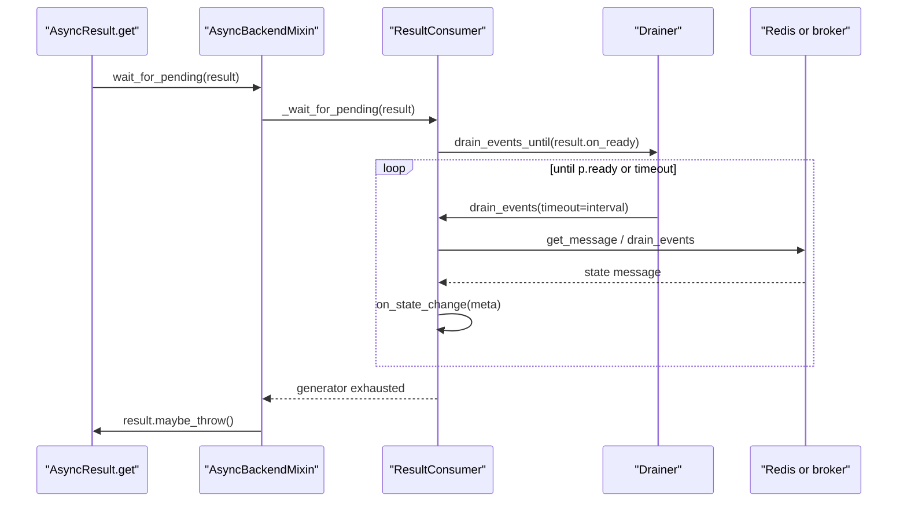
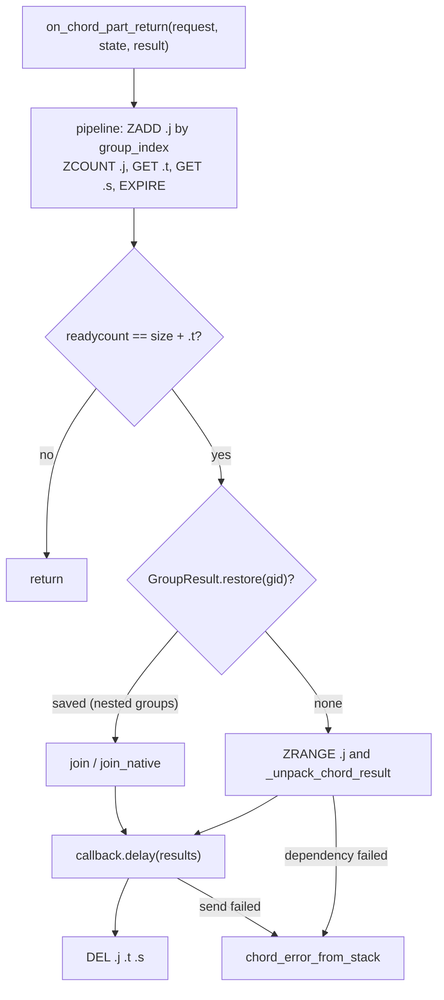

## Overview

Most backends make a client poll for results. The Redis and RPC backends push them instead: the worker publishes each state change and the client consumes it, so `AsyncResult.get` wakes up as soon as the result arrives. Both combine a storage class with `AsyncBackendMixin` and keep a `ResultConsumer` that subscribes per task, so the shared waiting machinery lives in `celery/backends/asynchronous.py` and each backend supplies only its transport.

Sources: [celery/backends/redis.py:204-221](repo://celery/backends/redis.py#L204-L221), [celery/backends/rpc.py:147-159](repo://celery/backends/rpc.py#L147-L159), [celery/backends/asynchronous.py:225-233](repo://celery/backends/asynchronous.py#L225-L233)

`RedisBackend` stores results as keys (it is a `BaseKeyValueStoreBackend`) and also publishes every write on a pub/sub channel named after the key, so results survive the client and can be fetched by any process. `RPCBackend` stores nothing: results are AMQP messages sent to the caller's reply queue, so only the process that sent the task can read them. The common contract, key layout and chord fallback are described in [[Result Backends]].

Sources: [celery/backends/redis.py:532-539](repo://celery/backends/redis.py#L532-L539), [celery/backends/rpc.py:1-4](repo://celery/backends/rpc.py#L1-L4), [celery/backends/rpc.py:254-271](repo://celery/backends/rpc.py#L254-L271)

## Asynchronous result machinery

### AsyncBackendMixin

When a task is sent, `send_task` calls `backend.on_task_call(producer, task_id)` unless the result is ignored; both backends use this hook to start listening before the task can finish. When the caller later waits, `add_pending_result` starts the drainer, tries to resolve the result from the `_pending_messages` buffer, and otherwise records it in `_pending_results` (a concrete dict plus a `WeakValueDictionary`) and calls `result_consumer.consume_from(task_id)`. `remove_pending_result` drops it and calls `on_result_fulfilled`, which by default cancels the subscription.

Sources: [celery/app/base.py:1024-1029](repo://celery/app/base.py#L1024-L1029), [celery/backends/asynchronous.py:260-293](repo://celery/backends/asynchronous.py#L260-L293)

`wait_for_pending` iterates the consumer's `_wait_for_pending` generator until the result is ready and then calls `result.maybe_throw`. `iter_native` serves `ResultSet.join_native`: it registers a bucket (a `deque`) for each result not already cached, and yields `(id, meta)` pairs as the consumer appends fulfilled results to it.

Sources: [celery/backends/asynchronous.py:228-258](repo://celery/backends/asynchronous.py#L228-L258), [celery/backends/asynchronous.py:295-313](repo://celery/backends/asynchronous.py#L295-L313)

### BaseResultConsumer

The consumer owns the drainer, the buckets, and the dispatch of incoming states. `on_state_change` calls the optional `on_message` callback, and for a ready state looks the task up in the pending results: if found, it fills the result's cache and moves it into its bucket; if not, it buffers the meta in `_pending_messages` because the message may arrive before the client registered the result. Subclasses implement `start`, `drain_events`, `consume_from`, `cancel_for` and `_reconnect`.

Sources: [celery/backends/asynchronous.py:316-391](repo://celery/backends/asynchronous.py#L316-L391), [celery/backends/asynchronous.py:419-449](repo://celery/backends/asynchronous.py#L419-L449)

`reconnect_on_error` wraps every transport call. A `socket.timeout` is re-raised untouched because it is the normal end of a polling interval. Any of `_connection_errors` triggers `_reconnect`; if reconnecting fails with another connection error, the consumer logs `E_RETRY_LIMIT_EXCEEDED` and raises `RuntimeError`, since the application must be restarted.

Sources: [celery/backends/asynchronous.py:20-25](repo://celery/backends/asynchronous.py#L20-L25), [celery/backends/asynchronous.py:338-370](repo://celery/backends/asynchronous.py#L338-L370)



Sources: [celery/backends/asynchronous.py:79-109](repo://celery/backends/asynchronous.py#L79-L109), [celery/backends/asynchronous.py:295-309](repo://celery/backends/asynchronous.py#L295-L309), [celery/backends/asynchronous.py:393-411](repo://celery/backends/asynchronous.py#L393-L411)

`_wait_for_pending` installs the caller's `on_message` for the duration of the wait, restores the previous one afterwards, and converts the drainer's `socket.timeout` into `celery.exceptions.TimeoutError`.

Sources: [celery/backends/asynchronous.py:397-411](repo://celery/backends/asynchronous.py#L397-L411)

### Drainers for threads, eventlet and gevent

`BaseResultConsumer` picks its drainer from the `drainers` registry with `detect_environment()`, which reports `default`, `eventlet` or `gevent`. New drainer types are added with the `register_drainer(name)` decorator.

Sources: [celery/backends/asynchronous.py:55-66](repo://celery/backends/asynchronous.py#L55-L66), [celery/backends/asynchronous.py:333-333](repo://celery/backends/asynchronous.py#L333-L333)

| Drainer | Registered as | How it waits |
| --- | --- | --- |
| `Drainer` | `default` | The waiting thread calls `drain_events(timeout=interval)` itself in a loop; `OSError` is logged and followed by a sleep of one interval |
| `eventletDrainer` | `eventlet` | Spawns `run` in a greenthread that drains with `timeout=1`; waiters block on an `EventletAdaptedEvent` |
| `geventDrainer` | `gevent` | Same as eventlet with `gevent.spawn` and `gevent.event.Event` |

Sources: [celery/backends/asynchronous.py:67-113](repo://celery/backends/asynchronous.py#L67-L113), [celery/backends/asynchronous.py:198-222](repo://celery/backends/asynchronous.py#L198-L222)

In the green drainers a single background greenlet does the draining, and after every `drain_events` call it sets and replaces `_drain_complete_event`. A waiter in `wait_for` starts the greenlet if needed, waits on that event, and then calls `_ensure_not_shut_down`: if the greenlet exited, it re-raises the exception that stopped it, or `E_CELERY_RESTART_REQUIRED` when it was stopped normally.

Sources: [celery/backends/asynchronous.py:115-195](repo://celery/backends/asynchronous.py#L115-L195)

`EventletAdaptedEvent` exists because `eventlet.Event` uses `ready()`/`send()`; the adapter exposes `is_set`, `set` and `wait` like `threading.Event` and `gevent.event.Event`.

Sources: [celery/backends/asynchronous.py:35-52](repo://celery/backends/asynchronous.py#L35-L52)

## Redis backend

### Connection settings and URLs

`RedisBackend.__init__` builds `connparams` from settings, then lets the URL override them. It raises `ImproperlyConfigured` when the `redis` library is missing.

Sources: [celery/backends/redis.py:227-262](repo://celery/backends/redis.py#L227-L262)

| Setting | Effect |
| --- | --- |
| `redis_host`, `redis_port`, `redis_db`, `redis_password`, `redis_username` | Defaults `localhost`, `6379`, `0`; username only passed when set |
| `redis_max_connections` | Pool size (`max_connections`) |
| `redis_socket_timeout`, `redis_socket_connect_timeout` | Converted to `float` |
| `redis_retry_on_timeout`, `redis_socket_keepalive` | Passed to the connection |
| `redis_backend_health_check_interval` | `health_check_interval` on the connection |
| `redis_backend_credential_provider` | A `redis.CredentialProvider` instance or dotted path; drops username and password |
| `redis_client_name` | `client_name` |
| `redis_backend_use_ssl` | Dict of `ssl_cert_reqs`, `ssl_ca_certs`, `ssl_certfile`, `ssl_keyfile`; switches to `SSLConnection` |

Sources: [celery/backends/redis.py:238-305](repo://celery/backends/redis.py#L238-L305), [celery/app/defaults.py:190-204](repo://celery/app/defaults.py#L190-L204)

`_params_from_url` parses `redis://`, `rediss://` and `socket://` URLs. The path is the database number (for `socket://` it is the socket path and host, port and connect timeout are removed). A `rediss://` URL selects `SSLConnection` and URL-decodes the `ssl_*` query parameters; SSL query parameters on a plain `redis://` URL raise `E_REDIS_SSL_PARAMS_AND_SCHEME_MISMATCH`, while SSL settings from `redis_backend_use_ssl` are honoured with either scheme. A `credential_provider` query parameter is accepted too, and the remaining query arguments are parsed by redis-py's `URL_QUERY_ARGUMENT_PARSERS` and override everything else.

Sources: [celery/backends/redis.py:388-460](repo://celery/backends/redis.py#L388-L460)

Whenever the connection class is an `SSLConnection`, `ssl_cert_reqs` must be present and one of `CERT_REQUIRED`, `CERT_OPTIONAL`, `CERT_NONE` (or `required`/`optional`/`none`); otherwise `ValueError` is raised. `CERT_OPTIONAL` and `CERT_NONE` log a man-in-the-middle warning.

Sources: [celery/backends/redis.py:310-331](repo://celery/backends/redis.py#L310-L331)

```python
app.conf.result_backend = 'rediss://:secret@redis.example.com:6380/1?ssl_cert_reqs=required'
app.conf.result_backend_transport_options = {
    'retry_policy': {'max_retries': 5},
    'global_keyprefix': 'myapp',
}
```

Sources: [celery/backends/redis.py:421-428](repo://celery/backends/redis.py#L421-L428), [celery/backends/redis.py:492-499](repo://celery/backends/redis.py#L492-L499), [celery/backends/base.py:980-993](repo://celery/backends/base.py#L980-L993)

### Writes, expiry and pub/sub

`set` rejects strings over 512 MB with `BackendStoreError`, then runs `_set` through `ensure`. `_set` uses a pipeline that does `SETEX` with `self.expires` (or `SET` when expiry is disabled) and `PUBLISH`es the same value on a channel named after the key. Because Redis expires keys itself, `supports_autoexpire` is true; `expires_type=int` makes the TTL an integer.

Sources: [celery/backends/redis.py:220-230](repo://celery/backends/redis.py#L220-L230), [celery/backends/redis.py:505-552](repo://celery/backends/redis.py#L505-L552)

```python
def _set(self, key, value):
    with self.client.pipeline() as pipe:
        if self.expires:
            pipe.setex(key, self.expires, value)
        else:
            pipe.set(key, value)
        pipe.publish(key, value)
        pipe.execute()
```

Sources: [celery/backends/redis.py:532-539](repo://celery/backends/redis.py#L532-L539)

### Retry and connection errors

There are two retry layers. `ensure` wraps writes and pub/sub reconnects in kombu's `retry_over_time` using `retry_policy`, which is the base policy updated with `result_backend_transport_options['retry_policy']`; each failed attempt logs `E_LOST`. Separately, `exception_safe_to_retry` returns true for `connection_errors`, which enables the base class's `result_backend_always_retry` loop. `connection_errors` come from kombu's `get_redis_error_classes()`, extended with `additional_connection_errors` from the transport options (classes or dotted paths; unresolvable or non-exception entries are logged and ignored).

Sources: [celery/backends/redis.py:338-382](repo://celery/backends/redis.py#L338-L382), [celery/backends/redis.py:487-524](repo://celery/backends/redis.py#L487-L524)

### Pub/sub ResultConsumer

The Redis `ResultConsumer` subscribes to one channel per task key. `on_task_call` calls `consume_from` unless joining would block (inside a worker), and the first subscription creates the `pubsub` object. `drain_events` reads one message with `get_message(timeout=...)` and decodes it into `on_state_change`; once a task reaches a ready state the consumer unsubscribes from its channel.

Sources: [celery/backends/redis.py:134-201](repo://celery/backends/redis.py#L134-L201), [celery/backends/redis.py:501-503](repo://celery/backends/redis.py#L501-L503)

On a connection error `_reconnect` runs `_reconnect_pubsub` under `ensure`: it resets the pool, `MGET`s every subscribed key so that states published while disconnected are not lost, then creates a fresh `pubsub` and resubscribes. With nothing left to subscribe to it still opens a connection and registers the `on_connect` callback. After a fork the pool is reset and the old pubsub closed.

Sources: [celery/backends/redis.py:88-132](repo://celery/backends/redis.py#L88-L132)

Because results are also stored as keys, `on_wait_for_pending` first reads the current meta with `result._iter_meta` and feeds it through `on_state_change`, so a task that finished before the subscription is resolved immediately. For `SUCCESS` and `FAILURE` it then removes the leftover entry from `_pending_messages` to avoid a leak.

Sources: [celery/backends/redis.py:149-169](repo://celery/backends/redis.py#L149-L169)

### Chord counter

Redis does not use the base `chord_unlock` task or the generic `incr` path; it overrides `apply_chord`, `set_chord_size` and `on_chord_part_return`. Three keys per group are used: `.j` holds the encoded results, `.t` a correction counter bumped by `add_to_chord`, and `.s` the chord size written by `set_chord_size`. `apply_chord` saves the header `GroupResult` only when one of its results is itself a group.

Sources: [celery/backends/redis.py:554-591](repo://celery/backends/redis.py#L554-L591)



Sources: [celery/backends/redis.py:593-686](repo://celery/backends/redis.py#L593-L686)

By default results go into a sorted set scored by `group_index`, so the body receives them in header order; setting `result_chord_ordered` to false in `result_backend_transport_options` uses a list (`RPUSH`/`LRANGE`) instead. `_unpack_chord_result` raises a `ChordError` whose cause is the original exception when any part is in a propagating state. Errors while joining or sending the callback go to `chord_error_from_stack`.

Sources: [celery/backends/redis.py:557-568](repo://celery/backends/redis.py#L557-L568), [celery/backends/redis.py:585-587](repo://celery/backends/redis.py#L585-L587), [celery/backends/redis.py:606-620](repo://celery/backends/redis.py#L606-L620)

### SentinelBackend

`SentinelBackend` accepts several `sentinel://` URLs separated by `;`. `_params_from_url` parses each one into `hosts` and keeps `db`, `password` and `username` from the first. `_get_pool` builds a `redis.sentinel.Sentinel` with `min_other_sentinels` and `sentinel_kwargs` from the transport options and returns the connection pool of `master_for(master_name)`. With SSL it uses `SentinelManagedSSLConnection`, and `as_uri` sanitizes every URL in the list.

Sources: [celery/backends/redis.py:715-806](repo://celery/backends/redis.py#L715-L806)

```python
app.conf.result_backend = 'sentinel://10.0.0.1:26379/0;sentinel://10.0.0.2:26379/0'
app.conf.result_backend_transport_options = {'master_name': 'mymaster'}
```

Sources: [celery/backends/redis.py:730-731](repo://celery/backends/redis.py#L730-L731), [celery/backends/redis.py:793-806](repo://celery/backends/redis.py#L793-L806)

## RPC backend

### Results as AMQP messages

`RPCBackend` (alias `rpc`) sends each state as a message through the broker the app already uses. `send_task` sets the message's `reply_to` to `app.thread_oid`, and the backend's `binding` is a queue named by that same oid, declared with `auto_delete` and the result `expires`. `store_result` reads `reply_to` and `correlation_id` from the request via `destination_for`, skips the write when there is no `reply_to`, and publishes `{'task_id', 'status', 'result', 'traceback', 'children'}` on the default (nameless) exchange with `retry_policy`. The `delivery_mode` is 2 only when `result_persistent` is set, as the backend is not persistent by default.

Sources: [celery/backends/rpc.py:157-212](repo://celery/backends/rpc.py#L157-L212), [celery/backends/rpc.py:225-280](repo://celery/backends/rpc.py#L225-L280), [celery/backends/rpc.py:389-401](repo://celery/backends/rpc.py#L389-L401), [celery/app/base.py:1006-1012](repo://celery/app/base.py#L1006-L1012)

`on_task_call` declares the reply queue before the task is published (skipped inside prefork workers, where it already exists), so a fast result is never published to a missing queue.

Sources: [celery/backends/rpc.py:217-223](repo://celery/backends/rpc.py#L217-L223)

### ResultConsumer and polling

The RPC `ResultConsumer` opens an app connection on first use and runs a `kombu.Consumer` on the reply queue with `on_state_change` as its callback. Since every task shares one queue, `consume_from` only adds the queue if not consumed yet, and `on_result_fulfilled` does nothing. `_reconnect` cancels the old consumer, closes the stale connection and rebuilds a consumer on the same queues.

Sources: [celery/backends/rpc.py:41-145](repo://celery/backends/rpc.py#L41-L145), [celery/backends/rpc.py:246-249](repo://celery/backends/rpc.py#L246-L249)

`get_task_meta` (used by `AsyncResult.state`) cannot read a key, so it slurps up to `backlog_limit` messages from the queue with `basic_get`. It keeps only the latest message per task id (acking older ones), requeues the latest for this task, and stores other tasks' messages as out-of-band results for later. More than 1000 messages raises `BacklogLimitExceeded`. Task ids come from the `correlation_id` property, or from the payload for messages sent by old versions.

Sources: [celery/backends/rpc.py:282-350](repo://celery/backends/rpc.py#L282-L350)

### Limitations

The RPC backend refuses chords with `E_NO_CHORD_SUPPORT`, and `save_group`, `restore_group`, `delete_group`, `reload_task_result` and `reload_group_result` all raise `NotImplementedError`. After a fork, `_after_fork` clears pending results and the consumer's state through `register_after_fork`.

Sources: [celery/backends/rpc.py:23-30](repo://celery/backends/rpc.py#L23-L30), [celery/backends/rpc.py:197-215](repo://celery/backends/rpc.py#L197-L215), [celery/backends/rpc.py:355-374](repo://celery/backends/rpc.py#L355-L374)

> [!WARNING]
> RPC results go to the queue of the client that sent the task, so another process cannot retrieve them, and a group chained with a task (upgraded to a chord) fails on this backend.

Sources: [celery/backends/rpc.py:1-4](repo://celery/backends/rpc.py#L1-L4), [celery/backends/rpc.py:23-30](repo://celery/backends/rpc.py#L23-L30), [celery/backends/rpc.py:398-401](repo://celery/backends/rpc.py#L398-L401)
