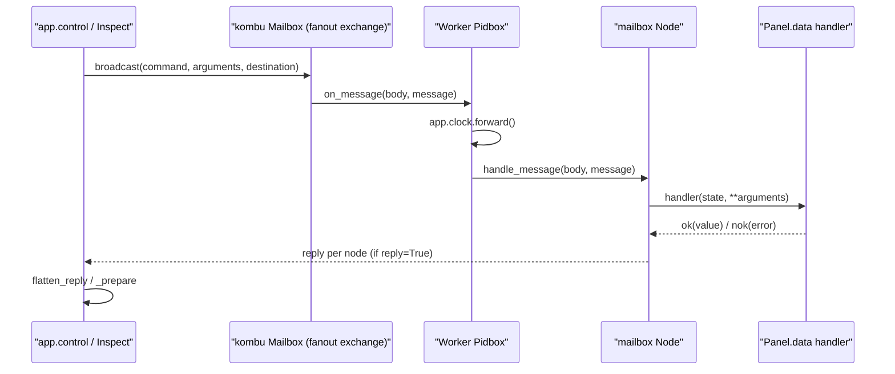
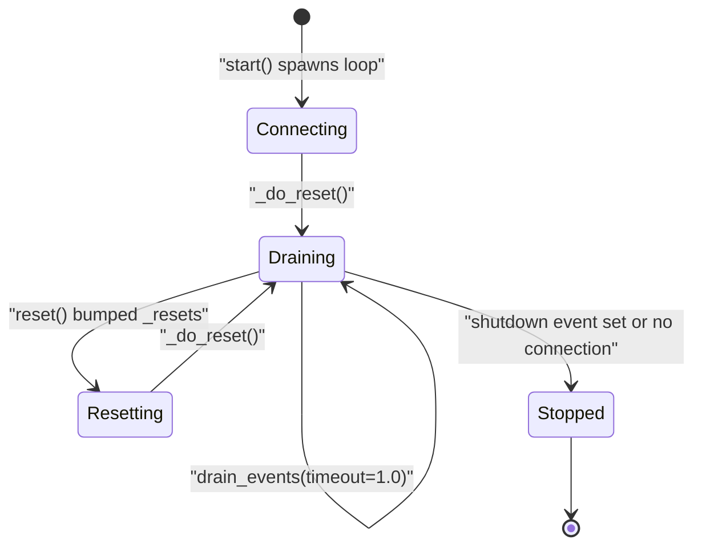

## Overview

Remote control lets a client talk to running workers over the broker without touching task queues. A client (your code, or the `celery inspect` and `celery control` commands) publishes a command message to a fanout exchange; every worker listening on that exchange runs the matching handler and can send a reply back. Celery splits the commands into two kinds: inspect commands read worker state and have no side effects, while control commands change something, such as revoking a task or adding a queue.

Sources: [celery/app/control.py:1-13](repo://celery/app/control.py#L1-L13)

The client half lives in `celery/app/control.py` (`Control` and `Inspect`, reached through `app.control`). The worker half has two parts: `celery/worker/control.py` holds the `Panel` registry with every command handler, and `celery/worker/pidbox.py` holds the mailbox consumer that receives the messages. Both halves sit on top of `kombu.pidbox.Mailbox`. Worker state that commands read, such as active requests, is described in [[Worker Architecture and Bootsteps]], and the event-related commands tie into [[Events and Monitoring]].

Sources: [celery/app/control.py:426-452](repo://celery/app/control.py#L426-L452), [celery/worker/pidbox.py:20-37](repo://celery/worker/pidbox.py#L20-L37), [celery/app/base.py:1577-1579](repo://celery/app/base.py#L1577-L1579)

## Message flow

A command goes from `Control.broadcast` through the kombu mailbox to every worker's `Pidbox`, which dispatches it to a function in `Panel.data`. Replies go back to a reply queue that the client drains until the timeout runs out or `limit` replies have arrived.

Sources: [celery/app/control.py:755-790](repo://celery/app/control.py#L755-L790), [celery/worker/pidbox.py:38-48](repo://celery/worker/pidbox.py#L38-L48)



Sources: [celery/app/control.py:94-117](repo://celery/app/control.py#L94-L117), [celery/app/control.py:755-790](repo://celery/app/control.py#L755-L790), [celery/worker/pidbox.py:23-48](repo://celery/worker/pidbox.py#L23-L48), [celery/worker/control.py:31-36](repo://celery/worker/control.py#L31-L36)

## The Control client

### Constructing the mailbox

`app.control` is a cached `Control` instance built from `app.control_cls` (default `celery.app.control:Control`). Its constructor builds a `Mailbox` of type `fanout` on the `control_exchange`, using the app's `accept_content` and `task_serializer` and a lazy reference to the app's producer pool. It refuses a configuration where `control_queue_durable` and `control_queue_exclusive` are both true, because exclusive queues are deleted automatically and can't be durable. After a fork it drops the mailbox's producer pool so the child process doesn't reuse the parent's connections.

Sources: [celery/app/control.py:426-456](repo://celery/app/control.py#L426-L456), [celery/app/base.py:316-316](repo://celery/app/base.py#L316-L316)

### broadcast

Every `Control` method calls `broadcast`. It acquires a connection (or uses the one passed in), merges any extra keyword arguments into `arguments`, and calls `Mailbox._broadcast`. `pattern` and `matcher` are passed on only when both are given.

Sources: [celery/app/control.py:755-790](repo://celery/app/control.py#L755-L790)

| Argument | Default | Meaning |
| --- | --- | --- |
| `command` | required | Name of a command registered in `Panel` |
| `arguments` | `None` | Keyword arguments for the handler |
| `destination` | `None` | List of node names; `None` means all workers |
| `connection` | `None` | Broker connection; acquired from the pool if unset |
| `reply` | `False` | Wait for replies and return them |
| `timeout` | `1.0` | Seconds to wait for replies |
| `limit` | `None` | Stop after this many replies |
| `callback` | `None` | Called as each reply arrives |
| `pattern` / `matcher` | `None` | Select nodes by name pattern instead of an explicit list |

Sources: [celery/app/control.py:755-773](repo://celery/app/control.py#L755-L773)

> [!NOTE]
> `broadcast` defaults to `reply=False`, so most `Control` methods (`revoke`, `rate_limit`, `shutdown`, ...) are fire-and-forget and return `None` unless you pass `reply=True`. `ping` is the exception: it always sets `reply=True`.

Sources: [celery/app/control.py:560-576](repo://celery/app/control.py#L560-L576), [celery/app/control.py:755-757](repo://celery/app/control.py#L755-L757)

### Control methods

Each method is a thin wrapper that names a command and packs its arguments. Any extra keyword argument (`reply`, `timeout`, `connection`, ...) is forwarded to `broadcast`.

Sources: [celery/app/control.py:488-600](repo://celery/app/control.py#L488-L600), [celery/app/control.py:600-700](repo://celery/app/control.py#L600-L700), [celery/app/control.py:700-753](repo://celery/app/control.py#L700-L753)

| Method | Command | Arguments sent |
| --- | --- | --- |
| `revoke(task_id, terminate=False, signal='SIGTERM')` | `revoke` | `task_id` (one id or a list), `terminate`, `signal` |
| `revoke_by_stamped_headers(headers, terminate=False, signal=...)` | `revoke_by_stamped_headers` | `headers`, `terminate`, `signal` |
| `terminate(task_id, signal=...)` | `revoke` | same as `revoke` with `terminate=True` |
| `ping(timeout=1.0)` | `ping` | none; always `reply=True` |
| `rate_limit(task_name, rate_limit)` | `rate_limit` | `task_name`, `rate_limit` |
| `time_limit(task_name, soft=None, hard=None)` | `time_limit` | `task_name`, `soft`, `hard` |
| `add_consumer(queue, exchange=None, exchange_type='direct', routing_key=None, options=None)` | `add_consumer` | queue fields plus `options` merged in |
| `cancel_consumer(queue)` | `cancel_consumer` | `queue` |
| `enable_events()` / `disable_events()` | same name | none |
| `pool_grow(n=1)` / `pool_shrink(n=1)` | same name | `n` |
| `autoscale(max, min)` | `autoscale` | `max`, `min` |
| `pool_restart(modules=None, reload=False, reloader=None)` | `pool_restart` | `modules`, `reload`, `reloader` |
| `heartbeat()` | `heartbeat` | none |
| `shutdown()` | `shutdown` | none |
| `election(id, topic, action=None)` | `election` | `id`, `topic`, `action` |

Sources: [celery/app/control.py:481-600](repo://celery/app/control.py#L481-L600), [celery/app/control.py:600-700](repo://celery/app/control.py#L600-L700), [celery/app/control.py:700-753](repo://celery/app/control.py#L700-L753)

`revoke_by_stamped_headers` does two rounds. It broadcasts the header-based revoke first, then collects any task ids that workers returned as a `set` in their `ok` value. If it found some, it sends a normal `revoke` for those ids, so they also land in each worker's revoked-id set. `purge` (alias `discard_all`) isn't a broadcast at all: it purges the default task queues through `app.amqp.TaskConsumer` and returns the number of messages discarded.

Sources: [celery/app/control.py:462-478](repo://celery/app/control.py#L462-L478), [celery/app/control.py:512-546](repo://celery/app/control.py#L512-L546)

```python
app.control.revoke(task_id, terminate=True, signal='SIGKILL')
app.control.rate_limit('tasks.add', '10/m', destination=['celery@node1'])
app.control.add_consumer('images', reply=True)
app.control.ping(timeout=0.5)
```

Sources: [celery/app/control.py:488-510](repo://celery/app/control.py#L488-L510), [celery/app/control.py:560-635](repo://celery/app/control.py#L560-L635)

## The Inspect client

### Requests and reply shaping

`app.control.inspect` is an `Inspect` subclass bound to the app, so calling it creates an instance that remembers `destination`, `timeout`, `callback`, `connection`, `limit`, `pattern` and `matcher`. Each inspect method calls `_request`, which always broadcasts with `reply=True` and passes the reply list to `_prepare`.

Sources: [celery/app/control.py:73-117](repo://celery/app/control.py#L73-L117), [celery/app/control.py:457-460](repo://celery/app/control.py#L457-L460)

`_prepare` turns the reply list into one dict keyed by node name using `flatten_reply`. `flatten_reply` emits a `DuplicateNodenameWarning` when two replies share a node name, which happens when workers were started without unique `-n` names. If `destination` is a single string rather than a list, `_prepare` returns just that node's value. If `pattern` is set, it keeps only matching nodes. An empty reply gives `None`.

Sources: [celery/app/control.py:31-63](repo://celery/app/control.py#L31-L63), [celery/app/control.py:94-105](repo://celery/app/control.py#L94-L105)

### Inspect methods

| Method | Worker command | Returns per node |
| --- | --- | --- |
| `active(safe=None)` | `active` | list of `request.info()` for executing tasks |
| `reserved()` | `reserved` | reserved requests that are not active |
| `scheduled()` | `scheduled` | ETA/countdown entries: `eta`, `priority`, `request` |
| `revoked()` | `revoked` | list of revoked task ids |
| `registered(*taskinfoitems)` | `registered` | task names, optionally with attributes |
| `query_task(*ids)` | `query_task` | `{id: [state, info]}` with state `active`, `reserved` or `ready` |
| `stats()` | `stats` | `consumer.controller.stats()` |
| `active_queues()` | `active_queues` | queue dicts the task consumer reads from |
| `conf(with_defaults=False)` | `conf` | worker configuration as JSON-safe values |
| `ping()` | `ping` | `{'ok': 'pong'}` |
| `clock()` | `clock` | `{'clock': value}` |
| `report()` | `report` | `app.bugreport()` text |
| `memsample()` / `memdump(samples=10)` / `objgraph(...)` | same name | memory debugging output |

Sources: [celery/app/control.py:119-180](repo://celery/app/control.py#L119-L180), [celery/app/control.py:181-245](repo://celery/app/control.py#L181-L245), [celery/app/control.py:247-342](repo://celery/app/control.py#L247-L342), [celery/app/control.py:342-424](repo://celery/app/control.py#L342-L424)

`query_task` still accepts the old single-list form `query_task([id1, id2])` and unwraps it. `registered_tasks` is an alias of `registered`.

Sources: [celery/app/control.py:258-275](repo://celery/app/control.py#L258-L275), [celery/app/control.py:342-372](repo://celery/app/control.py#L342-L372)

```python
i = app.control.inspect(timeout=2.0)
i.active()                   # {'celery@node1': [...], 'celery@node2': [...]}
i.registered('rate_limit')   # task names with their rate_limit
app.control.inspect(destination='celery@node1').stats()  # that node's dict only
```

Sources: [celery/app/control.py:82-105](repo://celery/app/control.py#L82-L105), [celery/app/control.py:181-245](repo://celery/app/control.py#L181-L245)

## The Panel command registry

### Registration

`Panel` keeps two class-level dicts shared across the process. `Panel.data` maps a command name to its handler, and `Panel.meta` maps it to a `controller_info_t` holding `alias`, `type`, `visible`, `default_timeout`, `help`, `signature`, `args` and `variadic`. `Panel._register` stores the function under its name, or under `name` if given, and also under `alias`. When no `help` is given it uses the first line of the docstring.

Sources: [celery/worker/control.py:25-65](repo://celery/worker/control.py#L25-L65)

`control_command` and `inspect_command` are the public decorators. They call `Panel.register` with `type='control'` or `type='inspect'`. Every handler receives the mailbox `state` first, followed by the arguments from the message, and returns `ok(value)` (`{'ok': value}`), `nok(value)` (`{'error': value}`) or plain data.

Sources: [celery/worker/control.py:31-74](repo://celery/worker/control.py#L31-L74)

```python
def control_command(**kwargs):
    return Panel.register(type='control', **kwargs)


def inspect_command(**kwargs):
    return Panel.register(type='inspect', **kwargs)
```

Sources: [celery/worker/control.py:68-73](repo://celery/worker/control.py#L68-L73)

### Metadata used by the CLI

The CLI reads `Panel.meta` to turn command-line words into keyword arguments. `_compile_arguments` uses `meta.args`, a list of `(name, type)` pairs, to convert positional words in order. Whatever is left over goes into the argument named by `meta.variadic`, such as `task_id` for `revoke` or `ids` for `query_task`. `signature` appears in usage errors, and `visible=False` hides a command such as `hello`.

Sources: [celery/bin/control.py:26-56](repo://celery/bin/control.py#L26-L56), [celery/worker/control.py:404-420](repo://celery/worker/control.py#L404-L420)

### Writing a custom command

Any module the worker imports can register commands. The handler can reach the app, the hostname and the consumer through `state`.

Sources: [celery/worker/control.py:46-73](repo://celery/worker/control.py#L46-L73), [celery/worker/pidbox.py:26-35](repo://celery/worker/pidbox.py#L26-L35)

```python
from celery.worker.control import control_command, inspect_command


@inspect_command()
def current_prefetch_count(state):
    return {'prefetch_count': state.consumer.qos.value}


@control_command(args=[('n', int)], signature='[N=1]')
def increase_prefetch_count(state, n=1):
    state.consumer.qos.increment_eventually(n)
    return {'ok': 'prefetch count incremented'}
```

Sources: [celery/worker/control.py:46-73](repo://celery/worker/control.py#L46-L73), [celery/worker/control.py:525-551](repo://celery/worker/control.py#L525-L551)

Call a custom command from a client with `app.control.broadcast('increase_prefetch_count', arguments={'n': 2}, reply=True)`, or run `celery control increase_prefetch_count 2`.

Sources: [celery/app/control.py:755-790](repo://celery/app/control.py#L755-L790), [celery/bin/control.py:236-255](repo://celery/bin/control.py#L236-L255)

## Worker command handlers

### Revocation

`revoke` normalizes `task_id` to a set and calls `_revoke`. `_revoke` adds the ids to `worker_state.revoked` and calls `backend.mark_as_revoked` for each id (failures are only logged). If `terminate` is set, it resolves `signal` (default `SIGTERM`) to a number and calls `request.terminate(pool, signal=signum)` for each matching request in `worker_state.requests`. A request checks `revoked()` before it goes to the pool and raises `TaskRevokedError` if it was revoked, so revoking a task that hasn't started yet still keeps it from running.

Sources: [celery/worker/control.py:126-148](repo://celery/worker/control.py#L126-L148), [celery/worker/control.py:209-235](repo://celery/worker/control.py#L209-L235), [celery/worker/request.py:349-356](repo://celery/worker/request.py#L349-L356)

`revoked` is a `LimitedSet` capped by `CELERY_WORKER_REVOKES_MAX` (default 50000) with entries expiring after `CELERY_WORKER_REVOKE_EXPIRES` seconds (default 10800). The `hello` inspect command, used by the Mingle bootstep at startup, merges revoked sets between workers so a new worker learns about earlier revokes.

Sources: [celery/worker/state.py:35-71](repo://celery/worker/state.py#L35-L71), [celery/worker/control.py:376-392](repo://celery/worker/control.py#L376-L392), [celery/worker/consumer/mingle.py:41-56](repo://celery/worker/consumer/mingle.py#L41-L56)

`revoke_by_stamped_headers` appends the stamps to `worker_state.revoked_stamps[header]`. Without `terminate` it returns right after that. With `terminate`, it checks each active request's `stamps` against the headers and terminates any request that matches. Headers can come in as a dict, or as a list of `key=value` strings from the CLI. Stamping is covered in [[Canvas: Signatures and Workflows]].

Sources: [celery/worker/control.py:151-206](repo://celery/worker/control.py#L151-L206)

### Limits, queues and events

| Command | Behavior on the worker |
| --- | --- |
| `rate_limit` | Validates the string with `rate()`, sets `app.tasks[name].rate_limit`, then calls `consumer.reset_rate_limits()`; `nok` for an invalid string or unknown task |
| `time_limit` | Sets `soft_time_limit` and `time_limit` on the task class; `nok('unknown task')` if missing |
| `add_consumer` | Schedules `consumer.add_task_queue(queue, exchange, exchange_type or 'direct', routing_key, **options)` with `call_soon` |
| `cancel_consumer` | Schedules `consumer.cancel_task_queue(queue)` with `call_soon` |
| `enable_events` / `disable_events` | Adds or removes the `task` group on `consumer.event_dispatcher.groups` |
| `heartbeat` | Sends a `worker-heartbeat` event right away |
| `election` | Forwards to `consumer.gossip.election` when Gossip is enabled |

Sources: [celery/worker/control.py:247-321](repo://celery/worker/control.py#L247-L321), [celery/worker/control.py:330-373](repo://celery/worker/control.py#L330-L373), [celery/worker/control.py:589-628](repo://celery/worker/control.py#L589-L628)

### Pool and lifecycle

`pool_grow` and `pool_shrink` resize the pool and adjust the prefetch count by `n`, but they refuse with `nok` when an autoscaler is running. `autoscale` calls `autoscaler.update(max, min)` and raises `ValueError('Autoscale not enabled')` when there's no autoscaler. `pool_restart` needs `worker_pool_restarts` to be enabled and raises `ValueError` if it isn't. `shutdown` logs a warning and raises `WorkerShutdown(EX_OK)`, which stops the worker. Pools are covered in [[Concurrency Pools]].

Sources: [celery/worker/control.py:528-586](repo://celery/worker/control.py#L528-L586)

### Inspection handlers

`active` and `reserved` use `state.tset` to copy the request sets: `pass1` under the event loop, otherwise `set`. `reserved` subtracts the active requests from the reserved ones. `scheduled` walks `consumer.timer.schedule.queue` and yields only entries whose first argument is a `Request`. `registered` skips names starting with `celery.` unless `builtins=True`, and defaults to the attributes `exchange`, `routing_key` and `rate_limit`. `ping` registers a short `default_timeout` of 0.2 seconds, and `objgraph` registers 60 seconds.

Sources: [celery/worker/control.py:395-477](repo://celery/worker/control.py#L395-L477), [celery/worker/control.py:482-487](repo://celery/worker/control.py#L482-L487), [celery/worker/pidbox.py:26-35](repo://celery/worker/pidbox.py#L26-L35)

## The worker mailbox

### The Control bootstep

The consumer's `Control` bootstep, which requires the `Tasks` step, creates the mailbox. It is included only when `worker_enable_remote_control` is true and the transport supports `fanout` exchanges. It picks `gPidbox` when the pool is green (eventlet/gevent) and `Pidbox` otherwise, and forwards `start`, `stop` and `shutdown` to the box.

Sources: [celery/worker/consumer/control.py:18-33](repo://celery/worker/consumer/control.py#L18-L33)

### Pidbox

`Pidbox` creates a mailbox `Node` named after the worker's hostname, with `handlers=Panel.data` and a `state` `AttributeDict` holding `app`, `hostname`, `consumer` and `tset`. `start` opens a channel on the consumer's connection and listens with `on_message` as the callback. `on_message` moves the logical clock forward first, since clients rarely have a valid clock. An unknown command (a `KeyError`) is logged as `No such control command`. Any other exception is logged, and the box resets, closing its channel and opening a new one.

Sources: [celery/worker/pidbox.py:20-72](repo://celery/worker/pidbox.py#L20-L72)

### gPidbox

On green pools the mailbox runs in its own greenlet. `start` calls `c.pool.spawn_n(self.loop, c)`. `loop` opens a separate read connection, calls `_do_reset`, then drains events with a one-second timeout until the shutdown event is set or the consumer loses its connection. `reset` only bumps a counter, and the loop rebuilds the channel and consumer when it notices the change. `on_stop` sets the shutdown event and waits for the loop to signal that it has stopped.

Sources: [celery/worker/pidbox.py:84-126](repo://celery/worker/pidbox.py#L84-L126)



Sources: [celery/worker/pidbox.py:98-126](repo://celery/worker/pidbox.py#L98-L126)

## Configuration

| Setting | Default | Effect |
| --- | --- | --- |
| `worker_enable_remote_control` | `True` | Includes the Control bootstep in the worker |
| `control_exchange` | `'celery'` | Name of the fanout exchange used by the mailbox |
| `control_queue_ttl` | `300.0` | Message TTL for the control and reply queues |
| `control_queue_expires` | `10.0` | Expiry for unused control and reply queues |
| `control_queue_exclusive` | `True` | Make the worker's control queue exclusive |
| `control_queue_durable` | `False` | Make the control queue durable (not allowed together with exclusive) |
| `worker_pool_restarts` | `False` | Allows the `pool_restart` command |

Sources: [celery/app/defaults.py:151-157](repo://celery/app/defaults.py#L151-L157), [celery/app/defaults.py:343-354](repo://celery/app/defaults.py#L343-L354), [celery/app/control.py:431-451](repo://celery/app/control.py#L431-L451)

The `celery inspect` and `celery control` commands accept `--timeout` (default 1.0), `--destination` (a comma-separated list) and `--json`. They exit with `EX_UNAVAILABLE` and the message "No nodes replied within time constraint" when no worker replies. See [[Command Line Interface]].

Sources: [celery/bin/control.py:178-255](repo://celery/bin/control.py#L178-L255)
