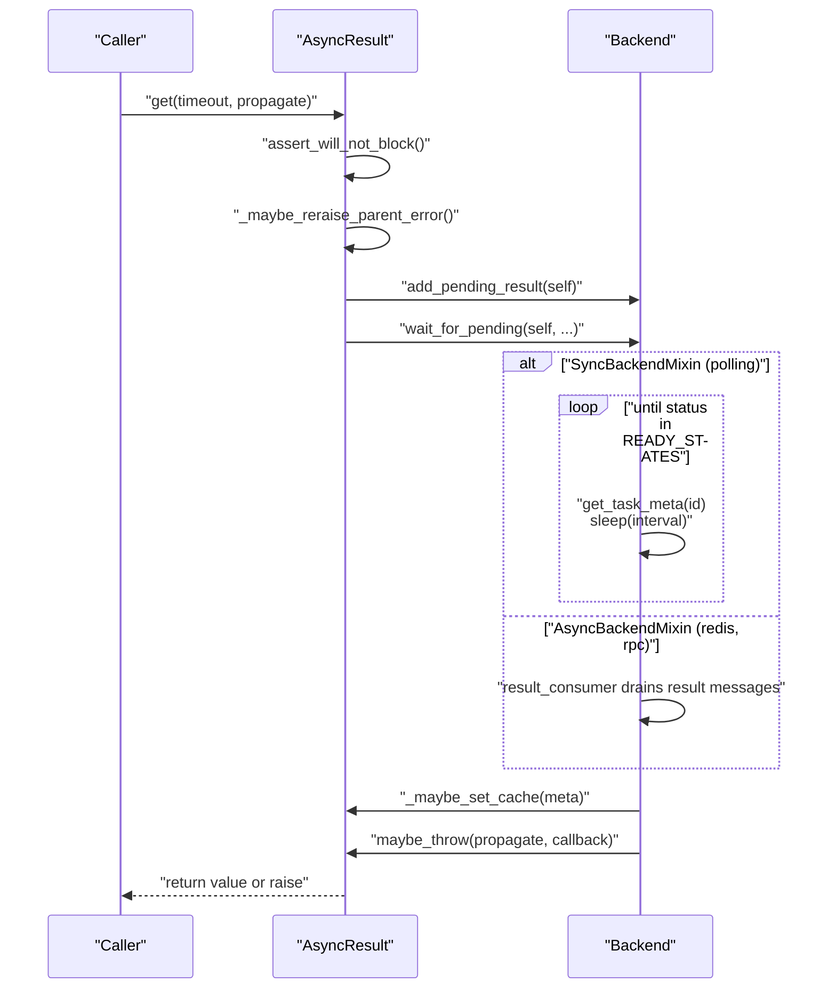

## Overview

Calling a task returns a result object rather than the return value. `celery/result.py` defines that client-side handle: `AsyncResult` for one task, `ResultSet` and `GroupResult` for collections, and `EagerResult` for tasks executed locally. These objects store no state of their own. They ask the app's result backend for the task's metadata (`status`, `result`, `traceback`, `children`, ...) and cache it once the task is finished.

Sources: [celery/result.py:1-28](repo://celery/result.py#L1-L28), [celery/result.py:89-101](repo://celery/result.py#L89-L101)

The worker writes that metadata while tracing the task (see [[Task Execution and Tracing]]), and the backend classes that store and fetch it are described in [[Result Backends]]. `app.AsyncResult` and `app.GroupResult` are subclasses bound to the app, created with `subclass_with_self`, so `app.AsyncResult(task_id)` is the usual way to rebuild a handle from a stored id.

Sources: [celery/app/base.py:1466-1486](repo://celery/app/base.py#L1466-L1486)

## Task states

### The state constants

`celery/states.py` defines the state strings and the sets the result classes test against:

Sources: [celery/states.py:144-147](repo://celery/states.py#L144-L147)

| Set | Members | Used for |
| --- | --- | --- |
| `READY_STATES` | `SUCCESS`, `FAILURE`, `REVOKED` | `ready()`, caching, polling stop condition |
| `UNREADY_STATES` | `PENDING`, `RECEIVED`, `STARTED`, `REJECTED`, `RETRY` | not finished |
| `EXCEPTION_STATES` | `RETRY`, `FAILURE`, `REVOKED` | the result holds an exception |
| `PROPAGATE_STATES` | `FAILURE`, `REVOKED` | `get()` re-raises |
| `ALL_STATES` | the seven core states | |

Sources: [celery/states.py:126-151](repo://celery/states.py#L126-L151)

`PENDING` also means "unknown": a backend returns it for an id it has never seen, which is why `AsyncResult.exists()` (added in 5.7.0) asks `backend.task_result_exists`, which returns true when the stored status is anything other than `PENDING`. `RECEIVED` and `REJECTED` are only emitted in events, and `IGNORED` is defined but is not part of `ALL_STATES`.

Sources: [celery/result.py:351-367](repo://celery/result.py#L351-L367), [celery/backends/base.py:774-783](repo://celery/backends/base.py#L774-L783)

### Precedence

`precedence(state)` returns the index of a state in `PRECEDENCE`, where a lower index means higher precedence. Unknown states map to the `None` slot. The `state` class is a `str` subclass whose comparison operators use that ordering, so a custom state such as `PROGRESS` sorts above `STARTED` but below `SUCCESS` and `FAILURE`.

Sources: [celery/states.py:61-123](repo://celery/states.py#L61-L123)

```python
from celery.states import state, PENDING, SUCCESS, STARTED

assert state(PENDING) < state(SUCCESS)
assert state('PROGRESS') > state(STARTED)
```

Sources: [celery/states.py:92-123](repo://celery/states.py#L92-L123)

## AsyncResult

### Inspecting state and metadata

An `AsyncResult` needs an `id` (passing `None` raises `ValueError`). It takes the backend from the argument or `app.backend`, and an optional `parent`, the previous result in a chain. Every property reads from `_get_task_meta()`:

Sources: [celery/result.py:89-98](repo://celery/result.py#L89-L98)

| Attribute | Meta key |
| --- | --- |
| `state` / `status` | `status` |
| `result` / `info` | `result` (the return value, or the exception instance) |
| `traceback` | `traceback` |
| `children` | `children` (child results, rebuilt with `result_from_tuple`) |
| `name`, `args`, `kwargs`, `worker`, `retries`, `queue` | extended metadata, needs `result_extended` |
| `date_done` | `date_done`, parsed with `isoparse` if it is a string |

Sources: [celery/result.py:89-101](repo://celery/result.py#L89-L101), [celery/result.py:457-575](repo://celery/result.py#L457-L575)

`ready()` is `state in backend.READY_STATES`; `successful()` and `failed()` compare against `SUCCESS` and `FAILURE`. Each of these is a backend round trip until the result is cached.

Sources: [celery/result.py:369-383](repo://celery/result.py#L369-L383)

### Caching

`_get_task_meta` fetches from `backend.get_task_meta(id)` only while `self._cache` is `None`. `_maybe_set_cache` stores the meta only when its status is in `READY_STATES`, converts the `children` entries back into result objects, and resolves the `on_ready` promise. A finished result is therefore read from the backend once, while a pending one is re-fetched on every access. The backend keeps its own cache too: `get_task_meta` caches only `SUCCESS` metas.

Sources: [celery/result.py:461-485](repo://celery/result.py#L461-L485), [celery/backends/base.py:746-768](repo://celery/backends/base.py#L746-L768)

### Other operations

- `forget()` clears the cache, recurses into the parent, removes the pending registration and calls `backend.forget(id)`. Backends that do not implement `_forget` raise `NotImplementedError`.
- `revoke(terminate=False, signal=None, wait=False, timeout=None)` sends `app.control.revoke` to all workers; `revoke_by_stamped_headers(headers, ...)` revokes by stamp values instead. See [[Remote Control and Inspection]].
- `then(callback, on_error=None)` registers the result with the backend and chains onto the `on_ready` promise. `AsyncResult` is registered as a vine `Thenable`.
- `build_graph()` / `graph` returns a `DependencyGraph` of the result tree.

Sources: [celery/result.py:115-189](repo://celery/result.py#L115-L189), [celery/result.py:403-451](repo://celery/result.py#L403-L451), [celery/backends/base.py:695-700](repo://celery/backends/base.py#L695-L700)

## Waiting for a result

### get() and wait()

`get(timeout=None, propagate=True, interval=0.5, no_ack=True, follow_parents=True, callback=None, on_message=None, on_interval=None, disable_sync_subtasks=True)` blocks until the task is ready. `wait` is a deprecated alias. The steps are:

Sources: [celery/result.py:191-195](repo://celery/result.py#L191-L195)

1. Return `None` immediately if `self.ignored` is set.
2. Call `assert_will_not_block()` unless `disable_sync_subtasks=False`.
3. With `follow_parents` and `propagate`, re-raise any failure from parent results, oldest first, now and on every polling interval.
4. If the result is already cached, re-raise its exception if needed and return `self.result`.
5. Otherwise call `backend.add_pending_result(self)` and return `backend.wait_for_pending(...)`.

Sources: [celery/result.py:191-280](repo://celery/result.py#L191-L280)



Sources: [celery/result.py:243-269](repo://celery/result.py#L243-L269), [celery/backends/base.py:900-944](repo://celery/backends/base.py#L900-L944), [celery/backends/asynchronous.py:295-309](repo://celery/backends/asynchronous.py#L295-L309)

### How the backend fetches the result

Synchronous backends use `SyncBackendMixin.wait_for`, which calls `get_task_meta` in a loop, runs `on_interval`, sleeps `interval` seconds, and raises `celery.exceptions.TimeoutError` once the elapsed time reaches `timeout`. `on_message` is not supported there and raises `ImproperlyConfigured`. Asynchronous backends (`AsyncBackendMixin`, used by the Redis and RPC backends) start a drainer and subscribe to the task id. `add_pending_result` first tries to resolve the result from messages already buffered, and `wait_for_pending` iterates the result consumer until the result is fulfilled, so `interval` has no effect. See [[Redis and RPC Backends]].

Sources: [celery/backends/base.py:918-954](repo://celery/backends/base.py#L918-L954), [celery/backends/asynchronous.py:260-313](repo://celery/backends/asynchronous.py#L260-L313)

### Raising remote errors

`maybe_throw` reads the cached meta and, when the state is in `PROPAGATE_STATES` and `propagate` is true, throws the stored exception through the `on_ready` promise. With `task_remote_tracebacks` enabled and `tblib` installed, the stored traceback string is turned back into a traceback object. With `propagate=False`, the exception instance is returned instead.

Sources: [celery/result.py:385-401](repo://celery/result.py#L385-L401)

```python
res = add.delay(2, 2)
try:
    value = res.get(timeout=10)
except TimeoutError:
    res.revoke()
print(res.state, res.successful(), res.traceback)
```

Sources: [celery/result.py:191-195](repo://celery/result.py#L191-L195), [celery/result.py:145-165](repo://celery/result.py#L145-L165)

### Blocking inside tasks

`assert_will_not_block()` raises `RuntimeError` with "Never call result.get() within a task!" when the global `task_join_will_block()` flag is set. Waiting on a subtask from inside a worker can use every pool slot and deadlock. The flag is set by the worker from the pool's `task_join_will_block` attribute (true for the base pool and in prefork children, false for gevent and eventlet). `allow_join_result()` and `denied_join_result()` are context managers that switch the flag temporarily. Passing `disable_sync_subtasks=False` to `get` skips the check for one call.

Sources: [celery/result.py:30-59](repo://celery/result.py#L30-L59), [celery/worker/components.py:171](repo://celery/worker/components.py#L171), [celery/concurrency/prefork.py:41-49](repo://celery/concurrency/prefork.py#L41-L49)

> [!WARNING]
> Every `AsyncResult` keeps backend resources (pending subscriptions, stored results) until you call `get()` or `forget()` on it, as the `get` docstring warns.

Sources: [celery/result.py:202-207](repo://celery/result.py#L202-L207)

## Following result trees

### parent and children

`parent` links a result to the previous step of a chain, and `children` lists the results of tasks the task sent (callbacks, chain steps, subtasks), which the worker records when the task has `trail` enabled. `_parents()` walks up the `parent` links; `as_list()` returns this id followed by all ancestor ids.

Sources: [celery/result.py:123-134](repo://celery/result.py#L123-L134), [celery/result.py:272-280](repo://celery/result.py#L272-L280)

### collect() and iterdeps()

`iterdeps(intermediate=False)` walks the tree breadth first from this result, yielding `(parent, node)` pairs and descending into `children` only for nodes that are ready. If it meets an unfinished node and `intermediate` is false, it raises `IncompleteStream`. `collect(**kwargs)` yields `(result, result.get(**kwargs))` for each node, and `get_leaf()` returns the value of the last node visited.

Sources: [celery/result.py:282-349](repo://celery/result.py#L282-L349)

```python
from celery.result import ResultBase

result = A.delay(10)
values = [v for v in result.collect()
          if not isinstance(v, (ResultBase, tuple))]
```

Sources: [celery/result.py:309-317](repo://celery/result.py#L309-L317)

### Serializing with as_tuple and result_from_tuple

`as_tuple()` encodes a result as `((id, parent_tuple), None)`; `GroupResult.as_tuple()` puts the list of member tuples in the second slot. `result_from_tuple(r, app)` reverses this: it rebuilds the parent recursively, returns an `app.GroupResult` when the nodes slot is not `None`, otherwise an `app.AsyncResult`, and returns objects that are already `ResultBase` unchanged (older backends may store pickled results). This is the format used for `children` in task metadata.

Sources: [celery/result.py:123-125](repo://celery/result.py#L123-L125), [celery/result.py:1004-1008](repo://celery/result.py#L1004-L1008), [celery/result.py:1112-1131](repo://celery/result.py#L1112-L1131)

## ResultSet and GroupResult

### ResultSet

`ResultSet(results)` wraps a list of results and builds a vine `barrier` over them, so `on_ready` fires when all members are done (on asynchronous backends). Membership methods (`add`, `remove`, `discard`, `update`, `clear`) edit the list in place. The aggregate checks are: `ready()` (all ready), `waiting()` (any not ready), `successful()` (all succeeded), `failed()` (any failed), and `completed_count()`, which counts successful members only. `forget()` and `revoke()` apply to all members; `revoke` sends one control command with every id.

Sources: [celery/result.py:578-693](repo://celery/result.py#L578-L693), [celery/result.py:695-717](repo://celery/result.py#L695-L717)

### Joining

`get()` picks `join_native` when the first result's backend sets `supports_native_join`, else `join`. `join` calls `get` on each member in order, reducing the remaining timeout each time, and raises `TimeoutError('join operation timed out')` when it runs out. With a `callback(task_id, value)`, values go to the callback instead of the returned list. `join_native` uses `backend.iter_native`, which for key/value backends fetches many ids at once through `get_many`, and puts each value into its original position.

Sources: [celery/result.py:726-825](repo://celery/result.py#L726-L825), [celery/result.py:830-882](repo://celery/result.py#L830-L882), [celery/backends/base.py:880-898](repo://celery/backends/base.py#L880-L898)

### GroupResult

`GroupResult(id, results, parent)` is the `ResultSet` that `group(...)` returns, with the group's id. `children` is its `results`. `save()` persists it with `backend.save_group(id, self)` and `GroupResult.restore(id)` loads it back with `backend.restore_group`. `delete()` removes the saved copy. Group and chord construction is covered in [[Canvas: Signatures and Workflows]].

Sources: [celery/result.py:928-1021](repo://celery/result.py#L928-L1021), [celery/backends/base.py:802-812](repo://celery/backends/base.py#L802-L812)

```python
from celery import group
from celery.result import GroupResult

res = group(add.s(i, i) for i in range(10))()
res.save()
same = GroupResult.restore(res.id)
print(same.completed_count(), same.join(timeout=30))
```

Sources: [celery/result.py:958-966](repo://celery/result.py#L958-L966), [celery/result.py:1014-1021](repo://celery/result.py#L1014-L1021), [celery/result.py:742-744](repo://celery/result.py#L742-L744)

## EagerResult

`Task.apply()` (and `delay`/`apply_async` with `task_always_eager`) returns an `EagerResult` built from the tracer's return value and state. It does not call `AsyncResult.__init__` and never contacts a backend: `_cache` is a property built from the stored fields, `ready()` is always true, `forget()` does nothing, and `revoke()` only sets the local state to `REVOKED`. `get()` still runs `assert_will_not_block()`. It returns the value on success, and for a state in `PROPAGATE_STATES` it raises the stored exception (wrapping non-exceptions in `Exception`) unless `propagate=False`.

Sources: [celery/result.py:1024-1109](repo://celery/result.py#L1024-L1109), [celery/app/task.py:937-951](repo://celery/app/task.py#L937-L951)

> [!NOTE]
> Fetching results through a real backend while `task_always_eager` is on, without `task_store_eager_result`, triggers a `RuntimeWarning` from `_ensure_not_eager`, because nothing was stored.

Sources: [celery/backends/base.py:723-730](repo://celery/backends/base.py#L723-L730)
