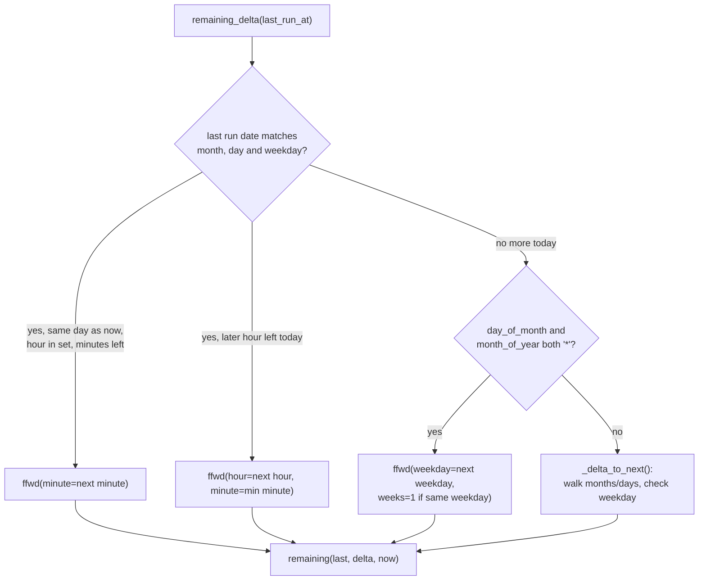

## Overview

A schedule object answers one question for the beat scheduler: given when this entry last ran, is it due now, and how long until it should be checked again? `celery/schedules.py` provides three implementations of that contract: `schedule` (a fixed interval), `crontab` (cron-style fields) and `solar` (sunrise, sunset and other sun events at a location), all derived from `BaseSchedule`. The scheduler in [[Periodic Tasks with Beat]] stores one per `ScheduleEntry` and calls `is_due(last_run_at)` on each tick.

Sources: [celery/schedules.py:1-24](repo://celery/schedules.py#L1-L24), [celery/beat.py:161-163](repo://celery/beat.py#L161-L163)

The date arithmetic behind these classes, such as timezone conversion, rounding, and "fast-forward" deltas, lives in `celery/utils/time.py` (`remaining`, `delta_resolution`, `ffwd`, `maybe_make_aware`, `localize`, `weekday`, `yearmonth`).

Sources: [celery/schedules.py:16-17](repo://celery/schedules.py#L16-L17), [celery/utils/time.py:184-250](repo://celery/utils/time.py#L184-L250)

## The schedule contract

### is_due and schedstate

Every schedule returns a `schedstate(is_due, next)` named tuple from `is_due(last_run_at)`. `is_due` says whether to send the task now; `next` is the number of seconds until the scheduler should check again. `(True, 20)` means "run now, check again in 20 seconds"; `(False, 12.3)` means "not yet, check in 12.3 seconds". The `next` value only has to be approximate: beat caps its sleep at `beat_max_loop_interval`, which therefore also bounds how long a changed schedule takes to be noticed.

Sources: [celery/schedules.py:24-24](repo://celery/schedules.py#L24-L24), [celery/schedules.py:138-173](repo://celery/schedules.py#L138-L173)

### BaseSchedule

`BaseSchedule(nowfun=None, app=None)` defines the shared plumbing. `now()` returns `nowfun()` if one was given, otherwise `app.now()`; the `app` property falls back to `current_app` when no app is bound. `tz` is cached from `app.timezone` and `utc_enabled` from `enable_utc`. `maybe_make_aware(dt)` turns a naive datetime into an aware one in `self.tz`, treating it as UTC by default. `to_local(dt)` converts to the system local zone only when `enable_utc` is off. Subclasses must implement `remaining_estimate(last_run_at)` and `is_due(last_run_at)`.

Sources: [celery/schedules.py:65-108](repo://celery/schedules.py#L65-L108)

`app.now()` is the current UTC time converted to `app.timezone`, and `app.timezone` is the `timezone` setting if set, otherwise UTC when `enable_utc` is true and the local system zone when it is false.

Sources: [celery/app/base.py:1197-1200](repo://celery/app/base.py#L1197-L1200), [celery/app/base.py:1619-1632](repo://celery/app/base.py#L1619-L1632)

### maybe_schedule

`maybe_schedule(s, relative=False, app=None)` is how `ScheduleEntry` accepts loose values: an `int` or `float` becomes `timedelta(seconds=s)`, a `timedelta` becomes `schedule(s, relative, app=app)`, and an existing schedule object just gets its `app` attribute set. `None` passes through unchanged.

Sources: [celery/schedules.py:703-714](repo://celery/schedules.py#L703-L714), [celery/beat.py:126-126](repo://celery/beat.py#L126-L126)

## Interval schedules

`schedule(run_every, relative=False, nowfun=None, app=None)` runs every `run_every`, given as seconds or a `timedelta` (normalised with `maybe_timedelta`). `remaining_estimate` calls `remaining(last_run_at, run_every, now, relative)` with both times made aware. `is_due` returns `(True, self.seconds)` once the remaining time hits zero, so the next check is one full interval later; otherwise it returns `(False, remaining_seconds)`.

Sources: [celery/schedules.py:111-193](repo://celery/schedules.py#L111-L193)

`remaining()` computes `start + ends_in` and subtracts now after converting both to UTC, so the result is real elapsed time even across DST changes in a non-UTC zone. With `relative=True` the end date is first rounded by `delta_resolution` to the interval's unit: an interval of a day or more rounds down to the day, an hour or more to the hour, a minute or more to the minute.

Sources: [celery/utils/time.py:191-250](repo://celery/utils/time.py#L191-L250)

```python
from datetime import timedelta
from celery.schedules import schedule

every_30s = schedule(30)                                       # float/int seconds
every_hour = schedule(timedelta(hours=1), relative=True)       # aligned to the hour
```

Sources: [celery/schedules.py:125-130](repo://celery/schedules.py#L125-L130)

Two `schedule` objects are equal when their `run_every` match, and a `schedule` also compares equal to a bare `timedelta` of the same length. Beat relies on this equality to decide whether the schedule changed.

Sources: [celery/schedules.py:178-185](repo://celery/schedules.py#L178-L185), [celery/beat.py:366-379](repo://celery/beat.py#L366-L379)

## crontab

### Fields and parsing

`crontab(minute='*', hour='*', day_of_week='*', day_of_month='*', month_of_year='*', **kwargs)` keeps the original specs (for `repr` and pickling) and expands each one into a set of integers with `_expand_cronspec`. An `int` becomes a one-element set, a `str` is parsed by `crontab_parser`, a set or other iterable is used as is, and anything else raises `TypeError`. Every value is then range-checked and an out-of-range value raises `ValueError` with "Invalid crontab pattern".

Sources: [celery/schedules.py:401-414](repo://celery/schedules.py#L401-L414), [celery/schedules.py:433-478](repo://celery/schedules.py#L433-L478)

| Field | Range | Notes |
| --- | --- | --- |
| `minute` | 0-59 | e.g. `'*/15'`, `'1,13,30-45,50-59/2'` |
| `hour` | 0-23 | e.g. `'*/3'`, `'0,8-17/2'` |
| `day_of_week` | 0-6, Sunday = 0 | names allowed: `'mon-fri'`; `'*/2'` means days divisible by two |
| `day_of_month` | 1-31 | e.g. `'2-30/2'`, `'1-7,15-21'` |
| `month_of_year` | 1-12 | names allowed; e.g. `'*/3'` |

Sources: [celery/schedules.py:334-380](repo://celery/schedules.py#L334-L380), [celery/schedules.py:409-413](repo://celery/schedules.py#L409-L413)

`crontab_parser(max_, min_)` splits a spec on commas and matches each part, in order, against range-with-step (`a-b/n`), range (`a-b`), star-with-step (`*/n`) and bare `*`; anything else is a single number. Ranges whose end is below the start wrap around (for example `'22-2'` for hours). `_expand_number` accepts integers, month names via `yearmonth` and weekday names via `weekday` (both match on the first three letters), and raises `ParseException` for empty parts, empty step filters and negative numbers.

Sources: [celery/schedules.py:250-320](repo://celery/schedules.py#L250-L320), [celery/utils/time.py:263-290](repo://celery/utils/time.py#L263-L290)

`crontab.from_string('m h dom mon dow')` builds a crontab from a standard five-field cron line. It splits on single spaces and reorders the fields into the constructor's `(minute, hour, day_of_week, day_of_month, month_of_year)` order.

Sources: [celery/schedules.py:416-431](repo://celery/schedules.py#L416-L431)

```python
from celery.schedules import crontab

crontab()                                    # every minute
crontab(minute=0, hour=0)                    # daily at midnight
crontab(minute=0, hour='*/3')                # every three hours
crontab(minute=30, hour=7, day_of_week='mon-fri')
crontab(0, 0, day_of_month='1-7,15-21', day_of_week=1)  # 1st and 3rd Monday
crontab.from_string('*/15 9-17 * * 1-5')
```

Sources: [celery/schedules.py:401-431](repo://celery/schedules.py#L401-L431)

> [!NOTE]
> A run date must match all three of `day_of_week`, `day_of_month` and `month_of_year`. Unlike classic cron, which ORs day-of-week and day-of-month when both are restricted, Celery requires both to match.

Sources: [celery/schedules.py:391-398](repo://celery/schedules.py#L391-L398), [celery/schedules.py:579-583](repo://celery/schedules.py#L579-L583)

### Computing the next run

`remaining_delta(last_run_at)` works out the next fire time as an `ffwd` delta relative to `last_run_at`, trying progressively coarser steps:

Sources: [celery/schedules.py:572-577](repo://celery/schedules.py#L572-L577)



Sources: [celery/schedules.py:572-639](repo://celery/schedules.py#L572-L639)

When day-of-month or month-of-year is restricted, `_delta_to_next` walks the sorted day and month lists with `bisect`, rolling over to the next month and year when a date does not exist (such as 31 February) or is before the last run, and advances day by day until the weekday also matches. It gives up with `RuntimeError("unable to rollover, time specification is probably invalid")` after 2000 attempts.

Sources: [celery/schedules.py:480-555](repo://celery/schedules.py#L480-L555)

`ffwd` is an add-only `relativedelta`: adding it to a date replaces the given absolute fields (year, month, hour, minute and so on), clamps the day to the month's length, then moves forward to the requested `weekday` and adds `weeks`. `remaining_estimate` passes the result to `remaining()` to get a `timedelta`.

Sources: [celery/utils/time.py:404-445](repo://celery/utils/time.py#L404-L445), [celery/schedules.py:630-639](repo://celery/schedules.py#L630-L639)

### is_due and the starting deadline

`crontab.is_due` is due when the remaining time from `last_run_at` is zero or negative. When it is due, the `next` value is recomputed from `now()` so the next check aims at the following slot rather than at a stale one.

Sources: [celery/schedules.py:641-688](repo://celery/schedules.py#L641-L688)

If `beat_cron_starting_deadline` is set (seconds), `is_due` steps forward from `last_run_at` through each missed slot to find the latest one that should have run. If that slot is more than the deadline in the past, the entry is reported as not due and `next` points at the next future slot. Without the setting, a beat that was down over a scheduled time sends the task once on startup; with it, runs missed by too long are skipped.

Sources: [celery/schedules.py:656-688](repo://celery/schedules.py#L656-L688), [celery/app/defaults.py:81-81](repo://celery/app/defaults.py#L81-L81)

## solar

`solar(event, lat, lon, **kwargs)` schedules on astronomical events computed by the optional `ephem` package, which is imported in the constructor. Valid events are `dawn_astronomical`, `dawn_nautical`, `dawn_civil`, `sunrise`, `solar_noon`, `sunset`, `dusk_civil`, `dusk_nautical` and `dusk_astronomical`. An unknown event, latitude outside -90..90 or longitude outside -180..180 raises `ValueError`.

Sources: [celery/schedules.py:717-807](repo://celery/schedules.py#L717-L807)

Each event maps to an `ephem.Observer` horizon (for example `-0:34` for sunrise/sunset, `-6` for civil twilight), a method (`next_rising`, `next_transit` or `next_setting`) and whether to use the sun's centre. The observer is built once, with elevation and pressure set to 0.

Sources: [celery/schedules.py:758-818](repo://celery/schedules.py#L758-L818)

`remaining_estimate` sets the observer's date to `last_run_at` in UTC and asks for the next event after it. If `ephem` raises `CircumpolarError` (the sun does not rise or set that day, near the poles), it checks again one minute after the next anti-transit. The delta is the event time minus `now()`. `is_due` follows the same shape as crontab: due when the remaining time is zero, and in that case the next check is computed from now.

Sources: [celery/schedules.py:828-878](repo://celery/schedules.py#L828-L878)

```python
from celery.schedules import solar

app.conf.beat_schedule = {
    'open-blinds-at-sunrise': {
        'task': 'home.tasks.open_blinds',
        'schedule': solar('sunrise', -37.81753, 144.96715),
    },
}
```

Sources: [celery/schedules.py:792-818](repo://celery/schedules.py#L792-L818)

## Timezones and nowfun

The `last_run_at` values stored by beat may be naive or aware. Every schedule first passes them through `maybe_make_aware`, which treats a naive value as UTC and localises it to the app timezone; an aware value is left alone. `localize` only converts values whose `tzinfo` is UTC, and `make_aware` resolves ambiguous and non-existent DST wall times (taking the earlier of the two folds, or shifting an imaginary time forward).

Sources: [celery/schedules.py:80-82](repo://celery/schedules.py#L80-L82), [celery/utils/time.py:363-401](repo://celery/utils/time.py#L363-L401)

`timezone` in `celery/utils/time.py` is a `_Zone` singleton. Its `local` property uses the system zone (falling back to a `LocalTimezone` when it cannot be detected), `utc` is `ZoneInfo('UTC')`, and `to_local_fallback` is what `BaseSchedule.to_local` uses when `enable_utc` is off.

Sources: [celery/utils/time.py:121-181](repo://celery/utils/time.py#L121-L181), [celery/schedules.py:100-103](repo://celery/schedules.py#L100-L103)

Passing `nowfun` replaces the clock used by a schedule. That is useful in tests, or to evaluate a crontab in a zone other than the app's.

Sources: [celery/schedules.py:67-72](repo://celery/schedules.py#L67-L72)

```python
from datetime import datetime
from zoneinfo import ZoneInfo
from celery.schedules import crontab

def now_in_tokyo():
    return datetime.now(ZoneInfo('Asia/Tokyo'))

nightly_tokyo = crontab(hour=2, minute=0, nowfun=now_in_tokyo)
```

Sources: [celery/schedules.py:401-414](repo://celery/schedules.py#L401-L414), [celery/schedules.py:67-72](repo://celery/schedules.py#L67-L72)

> [!WARNING]
> `PersistentScheduler` clears its stored schedule (and every `last_run_at`) when the `timezone` or `enable_utc` setting changes between runs, so changing timezone resets run history.

Sources: [celery/beat.py:545-556](repo://celery/beat.py#L545-L556)

## Writing a custom schedule

### Required methods

A custom schedule subclasses `BaseSchedule` and implements `is_due(last_run_at)` returning a `schedstate`, plus `remaining_estimate(last_run_at)`. Beat pickles entries into the shelve store, so the class should define `__reduce__` (as `schedule`, `crontab` and `solar` do) and `__eq__`, since `ScheduleEntry` equality, and therefore beat's change detection, compares schedules. `BaseSchedule.__eq__` only compares `nowfun`.

Sources: [celery/schedules.py:65-108](repo://celery/schedules.py#L65-L108), [celery/schedules.py:183-185](repo://celery/schedules.py#L183-L185), [celery/beat.py:186-198](repo://celery/beat.py#L186-L198)

```python
from datetime import timedelta
from celery.schedules import BaseSchedule, schedstate

class every_n_seconds(BaseSchedule):
    def __init__(self, seconds, **kwargs):
        self.seconds = seconds
        super().__init__(**kwargs)

    def remaining_estimate(self, last_run_at):
        last = self.maybe_make_aware(last_run_at)
        return (last + timedelta(seconds=self.seconds)) - self.now()

    def is_due(self, last_run_at):
        rem = max(self.remaining_estimate(last_run_at).total_seconds(), 0)
        if rem == 0:
            return schedstate(True, self.seconds)
        return schedstate(False, rem)

    def __reduce__(self):
        return self.__class__, (self.seconds,)
```

Sources: [celery/schedules.py:24-24](repo://celery/schedules.py#L24-L24), [celery/schedules.py:65-82](repo://celery/schedules.py#L65-L82), [celery/schedules.py:168-173](repo://celery/schedules.py#L168-L173)
