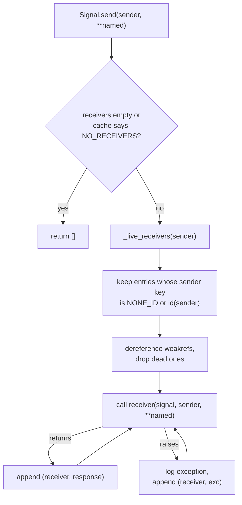
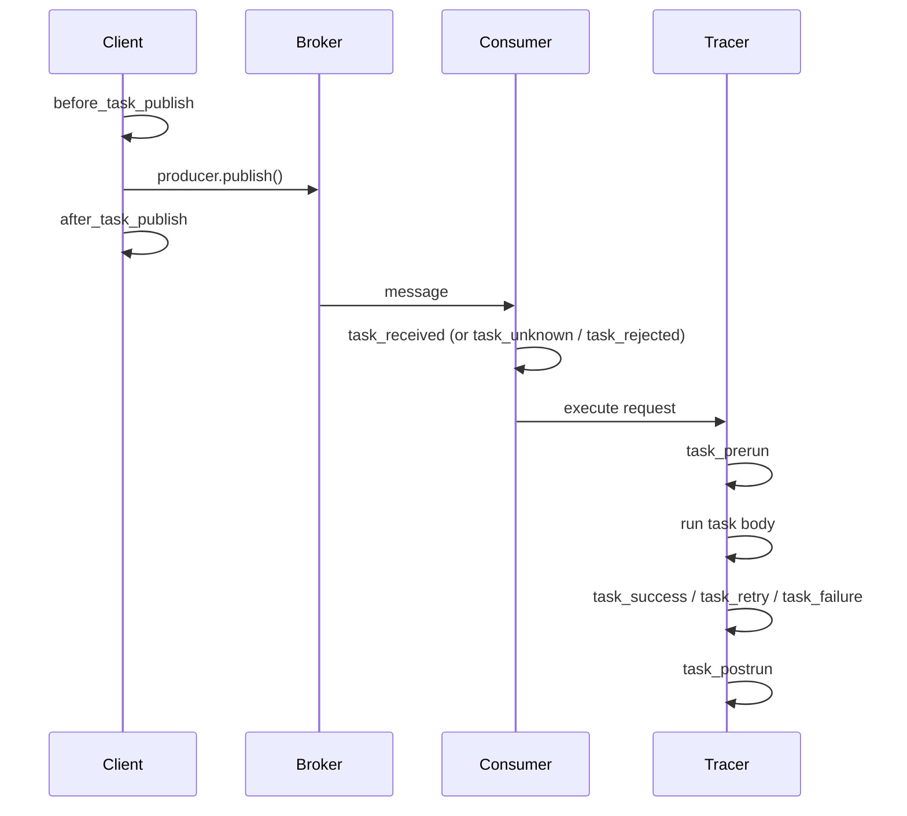

## Overview

Signals let code outside Celery hook into the life of a task, a worker, beat and the logging setup without subclassing anything. `celery.signals` defines one module-level `Signal` object per hook; Celery's own code calls `.send()` on it at the matching point, and every function you `connect` to it is called with keyword arguments describing the event.

Sources: [celery/signals.py:1-28](repo://celery/signals.py#L1-L28)

The dispatcher itself lives in `celery.utils.dispatch` and is a fork of Django's signal implementation with a few Celery changes: `send` never raises, receivers can be connected lazily to an app proxy, and a `retry` option keeps re-running a failing receiver. Celery uses signals internally too: the Django fixup connects to `import_modules`, `worker_init`, `task_prerun`, `task_postrun` and `worker_process_init` to manage database connections, and `app.autodiscover_tasks` defers its work to `import_modules`. Logging hooks are covered in more depth in [[Logging]].

Sources: [celery/utils/dispatch/__init__.py:1-4](repo://celery/utils/dispatch/__init__.py#L1-L4), [celery/utils/dispatch/signal.py:258-290](repo://celery/utils/dispatch/signal.py#L258-L290), [celery/fixups/django.py:86-89](repo://celery/fixups/django.py#L86-L89), [celery/fixups/django.py:156-163](repo://celery/fixups/django.py#L156-L163), [celery/app/base.py:822-826](repo://celery/app/base.py#L822-L826)

## Connecting receivers

### connect as a call or a decorator

`Signal.connect` accepts either a callable as its first positional argument or only options. When the first argument is callable it is connected right away; otherwise `connect` returns a decorator. Both forms return the function, so decorating does not replace it.

Sources: [celery/utils/dispatch/signal.py:110-186](repo://celery/utils/dispatch/signal.py#L110-L186)

```python
from celery.signals import task_success, worker_ready

@task_success.connect
def on_success(sender=None, result=None, **kwargs):
    print(f'{sender.name} returned {result!r}')

@worker_ready.connect(weak=False, dispatch_uid='announce-ready')
def announce(sender=None, **kwargs):
    print('worker ready', sender)

def on_add_success(sender=None, **kwargs):
    ...

task_success.connect(on_add_success, sender=add)  # only for the `add` task
```

Sources: [celery/utils/dispatch/signal.py:144-186](repo://celery/utils/dispatch/signal.py#L144-L186), [celery/signals.py:54-57](repo://celery/signals.py#L54-L57), [celery/signals.py:112](repo://celery/signals.py#L112)

### Options

| Option | Default | Effect |
| --- | --- | --- |
| `sender` | `None` | Only call the receiver when `send` is given this sender. `None` means any sender. A `PromiseProxy` sender (for example an unevaluated app or task proxy) defers the connection until the proxy is evaluated. |
| `weak` | `True` | Store a weak reference. Bound methods use `WeakMethod` so the method object is not collected straight away; a `weakref.finalize` marks the signal as having dead receivers when the target dies. |
| `dispatch_uid` | `None` | Hashable id used instead of the function's `id()` to build the lookup key. Connecting twice with the same uid and sender is a no-op. |
| `retry` | `False` | Wrap the receiver in `retry_over_time` so any exception is logged and the receiver retried. Forces `weak=False` and, without a uid, sets the uid to the original function's id. |

Sources: [celery/utils/dispatch/signal.py:144-216](repo://celery/utils/dispatch/signal.py#L144-L216), [celery/utils/dispatch/signal.py:32-61](repo://celery/utils/dispatch/signal.py#L32-L61)

### Lookup keys and duplicates

Every connection is stored as `(lookup_key, receiver)` in `Signal.receivers`. The key is `(dispatch_uid, id(sender))` when a uid is given, `(receiver._dispatch_uid, id(sender))` for retry-wrapped functions, and `(id(receiver), id(sender))` otherwise. `_make_id` unwraps `Proxy` objects first, uses strings and bytes as they are (so a task name works as a sender), and uses `__func__` for bound methods so all bound copies of one method share an id.

Sources: [celery/utils/dispatch/signal.py:21-64](repo://celery/utils/dispatch/signal.py#L21-L64)

```python
        with self.lock:
            self._clear_dead_receivers()
            for r_key, _ in self.receivers:
                if r_key == lookup_key:
                    break
            else:
                self.receivers.append((lookup_key, receiver))
            self.sender_receivers_cache.clear()
```

Sources: [celery/utils/dispatch/signal.py:207-214](repo://celery/utils/dispatch/signal.py#L207-L214)

Before any of that, `_connect_signal` asserts the receiver is callable and raises `ValueError('Signal receiver must accept keyword arguments.')` if `fun_accepts_kwargs` is false. Write every receiver with a trailing `**kwargs`: senders may pass arguments beyond `providing_args` (for example `task_postrun` also passes `state`).

Sources: [celery/utils/dispatch/signal.py:188-192](repo://celery/utils/dispatch/signal.py#L188-L192), [celery/app/trace.py:655-660](repo://celery/app/trace.py#L655-L660)

### Disconnecting

`disconnect(receiver=None, sender=None, dispatch_uid=None)` rebuilds the same lookup key and deletes the first matching entry, returning `True` when something was removed. Passing `weak` only emits a `CDeprecationWarning`. Weakly connected receivers never need disconnecting: once the target is collected, `_remove_receiver` sets `_dead_receivers` and the next `connect`, `disconnect` or `send` prunes them under the lock.

Sources: [celery/utils/dispatch/signal.py:218-253](repo://celery/utils/dispatch/signal.py#L218-L253), [celery/utils/dispatch/signal.py:292-301](repo://celery/utils/dispatch/signal.py#L292-L301), [celery/utils/dispatch/signal.py:342-350](repo://celery/utils/dispatch/signal.py#L342-L350)

## Sending and send_robust

`send(sender, **named)` returns an empty list immediately when there are no receivers. Otherwise it resolves the live receivers for that sender and calls each one as `receiver(signal=self, sender=sender, **named)`. An exception from a receiver is logged with `logger.exception('Signal handler %r raised: %r', ...)` and stored as that receiver's response; the remaining receivers still run. The result is a list of `(receiver, response)` pairs.

Sources: [celery/utils/dispatch/signal.py:258-289](repo://celery/utils/dispatch/signal.py#L258-L289)



Sources: [celery/utils/dispatch/signal.py:273-340](repo://celery/utils/dispatch/signal.py#L273-L340)

> [!IMPORTANT]
> Unlike Django, Celery's `send` already catches receiver errors, and `send_robust` is just an alias (`send_robust = send`). A failing receiver therefore never breaks task publishing or execution; check the returned pairs if you need to know. `Loader.import_default_modules` does exactly that for `import_modules` and re-raises any exception it finds, because logging is not configured yet at that point.

Sources: [celery/utils/dispatch/signal.py:290](repo://celery/utils/dispatch/signal.py#L290), [celery/loaders/base.py:97-105](repo://celery/loaders/base.py#L97-L105)

With `use_caching=True` the per-sender receiver list is stored in a `WeakKeyDictionary` (`NO_RECEIVERS` when empty) and cleared on every connect or disconnect. None of the built-in signals enable caching. `has_listeners(sender)` reports whether any live receiver would run.

Sources: [celery/utils/dispatch/signal.py:87-102](repo://celery/utils/dispatch/signal.py#L87-L102), [celery/utils/dispatch/signal.py:255-256](repo://celery/utils/dispatch/signal.py#L255-L256), [celery/utils/dispatch/signal.py:303-330](repo://celery/utils/dispatch/signal.py#L303-L330)

Hot paths avoid the call when nobody listens: the task sender and the tracer grab `signal.receivers` when they are built and skip `send` while that list is empty. `Heart` goes further and decides once, in its constructor, whether to send `heartbeat_sent` at all, so connect that receiver before the worker starts.

Sources: [celery/app/amqp.py:485-497](repo://celery/app/amqp.py#L485-L497), [celery/app/trace.py:104-106](repo://celery/app/trace.py#L104-L106), [celery/app/trace.py:410-412](repo://celery/app/trace.py#L410-L412), [celery/worker/heartbeat.py:35-41](repo://celery/worker/heartbeat.py#L35-L41)

## Task signals

The `sender` column is what `send` is called with, and therefore what a `sender=` filter must match.

Sources: [celery/app/amqp.py:558-579](repo://celery/app/amqp.py#L558-L579), [celery/app/trace.py:565-572](repo://celery/app/trace.py#L565-L572)

| Signal | Arguments | Sender | When it fires |
| --- | --- | --- | --- |
| `before_task_publish` | `body`, `exchange`, `routing_key`, `headers`, `properties`, `declare`, `retry_policy` | task name (str) | In the client, just before `producer.publish`; receivers may mutate `headers` and `properties`. |
| `after_task_publish` | `body`, `exchange`, `routing_key`, `headers` | task name (str) | In the client, right after `producer.publish` returns. |
| `task_sent` | `task_id`, `task`, `args`, `kwargs`, `eta`, `taskset` | task name (str) | Deprecated alias fired after publishing; use `after_task_publish`. |
| `task_received` | `request` | consumer | In the worker strategy once a message is turned into a `Request` and is not revoked or expired. |
| `task_prerun` | `task_id`, `task`, `args`, `kwargs` | task | In the tracer before the task body runs. |
| `task_success` | `result` | task | In the tracer after a successful return, after `on_success`. |
| `task_retry` | `request`, `reason`, `einfo` | task | When the task raised `Retry` (from the tracer), or when the worker re-queues a cancelled task (`einfo=None`). |
| `task_failure` | `task_id`, `exception`, `args`, `kwargs`, `traceback`, `einfo` | task | When the body raised (tracer), on a hard time limit, a `Reject` without requeue, or a lost worker process. |
| `task_postrun` | `task_id`, `task`, `args`, `kwargs`, `retval`, `state` | task | In the tracer's `finally`, always, after the result is stored. |
| `task_internal_error` | `task_id`, `args`, `kwargs`, `request`, `exception`, `traceback`, `einfo` | task | When an exception escapes the tracer itself, outside the task body. |
| `task_revoked` | `request`, `terminated`, `signum`, `expired` | task | When the worker marks a request revoked (revoked id, expired, or terminated). |
| `task_rejected` | `message`, `exc` | consumer | When the consumer rejects a message of unknown format (`exc=None`) or an invalid task message. |
| `task_unknown` | `message`, `exc`, `name`, `id` | consumer | When a message names a task that is not registered; the result is first marked `NotRegistered`. |

Sources: [celery/signals.py:30-94](repo://celery/signals.py#L30-L94), [celery/app/amqp.py:558-591](repo://celery/app/amqp.py#L558-L591), [celery/worker/strategy.py:162-165](repo://celery/worker/strategy.py#L162-L165), [celery/app/trace.py:565-572](repo://celery/app/trace.py#L565-L572), [celery/app/trace.py:632-660](repo://celery/app/trace.py#L632-L660), [celery/app/trace.py:220-227](repo://celery/app/trace.py#L220-L227), [celery/app/trace.py:262-271](repo://celery/app/trace.py#L262-L271), [celery/app/trace.py:676-720](repo://celery/app/trace.py#L676-L720), [celery/worker/request.py:55-60](repo://celery/worker/request.py#L55-L60), [celery/worker/request.py:452-469](repo://celery/worker/request.py#L452-L469), [celery/worker/request.py:546-570](repo://celery/worker/request.py#L546-L570), [celery/worker/request.py:650-663](repo://celery/worker/request.py#L650-L663), [celery/worker/request.py:705-718](repo://celery/worker/request.py#L705-L718), [celery/worker/consumer/consumer.py:672-714](repo://celery/worker/consumer/consumer.py#L672-L714)

The order inside one execution follows the tracer: prerun, body, then success or retry or failure, then postrun. Execution itself is described in [[Task Execution and Tracing]].

Sources: [celery/app/trace.py:565-662](repo://celery/app/trace.py#L565-L662)



Sources: [celery/app/amqp.py:558-579](repo://celery/app/amqp.py#L558-L579), [celery/worker/strategy.py:162-165](repo://celery/worker/strategy.py#L162-L165), [celery/worker/consumer/consumer.py:672-714](repo://celery/worker/consumer/consumer.py#L672-L714), [celery/app/trace.py:565-662](repo://celery/app/trace.py#L565-L662)

## Worker and process signals

| Signal | Arguments | Sender | When it fires |
| --- | --- | --- | --- |
| `celeryd_init` | `instance`, `conf`, `options` | worker hostname (str) | In `Worker.on_before_init`, when `celery worker` starts building the worker; connect with `sender='name@host'` to configure one node. |
| `celeryd_after_setup` | `instance`, `conf` | worker hostname (str) | In `Worker.on_start`, after queues from `-Q` are set up and before messages are purged. |
| `import_modules` | none | app | When the loader imports default modules; `autodiscover_tasks` hooks in here. |
| `worker_init` | none | `WorkController` | In `WorkController.setup_instance`, before bootsteps are built. |
| `worker_ready` | none | consumer | When the consumer is fully started and the worker logs "ready". |
| `heartbeat_sent` | none | `Heart` | Before every `worker-heartbeat` event, only if it had receivers when `Heart` was built. |
| `worker_before_create_process` | none | `AsynPool` | In the parent, before each prefork child is created. |
| `worker_process_init` | none | `None` | In each prefork child after app setup and tracer rebuild; also once by the solo pool. |
| `worker_process_shutdown` | `pid`, `exitcode` | `None` | When a prefork child process exits. |
| `worker_shutting_down` | `sig`, `how`, `exitcode` | worker hostname (str) | In the main process when a shutdown signal (SIGTERM, SIGINT, SIGQUIT) is handled; `how` is `Warm` or `Cold`. |
| `worker_shutdown` | none | `WorkController` | At the end of a warm stop of the worker. |

Sources: [celery/signals.py:96-115](repo://celery/signals.py#L96-L115), [celery/apps/worker.py:98-103](repo://celery/apps/worker.py#L98-L103), [celery/apps/worker.py:126-136](repo://celery/apps/worker.py#L126-L136), [celery/apps/worker.py:180-182](repo://celery/apps/worker.py#L180-L182), [celery/apps/worker.py:288-315](repo://celery/apps/worker.py#L288-L315), [celery/loaders/base.py:97-105](repo://celery/loaders/base.py#L97-L105), [celery/worker/worker.py:120-127](repo://celery/worker/worker.py#L120-L127), [celery/worker/worker.py:198-199](repo://celery/worker/worker.py#L198-L199), [celery/worker/worker.py:245-252](repo://celery/worker/worker.py#L245-L252), [celery/worker/heartbeat.py:35-48](repo://celery/worker/heartbeat.py#L35-L48), [celery/concurrency/asynpool.py:490-493](repo://celery/concurrency/asynpool.py#L490-L493), [celery/concurrency/prefork.py:80-93](repo://celery/concurrency/prefork.py#L80-L93), [celery/concurrency/solo.py:16-20](repo://celery/concurrency/solo.py#L16-L20)

`worker_process_init` runs inside the child, so it is the place to open per-process resources such as database connections; the Django fixup uses it for that. Pools and children are described in [[Concurrency Pools]] and the start sequence in [[Worker Architecture and Bootsteps]].

Sources: [celery/concurrency/prefork.py:60-82](repo://celery/concurrency/prefork.py#L60-L82), [celery/fixups/django.py:156-163](repo://celery/fixups/django.py#L156-L163)

## Logging, beat, eventlet and CLI signals

| Signal | Arguments | Sender | When it fires |
| --- | --- | --- | --- |
| `setup_logging` | `loglevel`, `logfile`, `format`, `colorize` | `None` | In `Logging.setup_logging_subsystem`. If any receiver is connected, Celery skips its own logging configuration entirely. |
| `after_setup_logger` | `logger`, `loglevel`, `logfile`, `format`, `colorize` | `None` | After Celery configured the root logger (only when `setup_logging` had no receivers). |
| `after_setup_task_logger` | `logger`, `loglevel`, `logfile`, `format`, `colorize` | `None` | After `setup_task_loggers` configured the `celery.task` logger. |
| `beat_init` | none | `Service` | When `Service.start` begins. |
| `beat_embedded_init` | none | `Service` | Additionally, when beat runs embedded in a worker (`-B`). |
| `eventlet_pool_started` | none | eventlet `TaskPool` | In `on_start`, after the green pool is created. |
| `eventlet_pool_apply` | `target`, `args`, `kwargs` | eventlet `TaskPool` | For every task handed to the green pool. |
| `eventlet_pool_preshutdown` | none | eventlet `TaskPool` | In `on_stop`, before waiting for greenlets. |
| `eventlet_pool_postshutdown` | none | eventlet `TaskPool` | In `on_stop`, after all greenlets finished. |
| `user_preload_options` | `app`, `options` | the decorated command | When a CLI command wrapped by `handle_preload_options` runs and the app registered preload options. |

Sources: [celery/signals.py:117-154](repo://celery/signals.py#L117-L154), [celery/app/log.py:98-133](repo://celery/app/log.py#L98-L133), [celery/app/log.py:176-181](repo://celery/app/log.py#L176-L181), [celery/beat.py:633-641](repo://celery/beat.py#L633-L641), [celery/concurrency/eventlet.py:110-125](repo://celery/concurrency/eventlet.py#L110-L125), [celery/bin/base.py:143-158](repo://celery/bin/base.py#L143-L158)

```python
from celery.signals import setup_logging

@setup_logging.connect
def configure_logging(loglevel=None, logfile=None, **kwargs):
    import logging.config
    logging.config.dictConfig(MY_LOGGING_CONFIG)
```

Sources: [celery/app/log.py:98-106](repo://celery/app/log.py#L98-L106), [celery/signals.py:118-123](repo://celery/signals.py#L118-L123)

> [!NOTE]
> `task_sent`, `import_modules` and `user_preload_options` exist in `celery.signals` but are not listed in its `__all__`, so `from celery.signals import *` does not export them; import them by name.

Sources: [celery/signals.py:16-28](repo://celery/signals.py#L16-L28), [celery/signals.py:88-94](repo://celery/signals.py#L88-L94), [celery/signals.py:107](repo://celery/signals.py#L107), [celery/signals.py:150-154](repo://celery/signals.py#L150-L154)

## Defining your own signals

Any code can create a `Signal(name=..., providing_args=...)`. `providing_args` is kept as a set purely for documentation and `repr`; `send` does not check the keyword arguments against it. Celery's test helpers do this: `celery.contrib.testing.worker` defines `test_worker_starting`, `test_worker_started` and `test_worker_stopped`, and `start_worker` sends the first and last around the embedded test worker (see [[Testing Celery Applications]]).

Sources: [celery/utils/dispatch/signal.py:73-93](repo://celery/utils/dispatch/signal.py#L73-L93), [celery/utils/dispatch/signal.py:352-358](repo://celery/utils/dispatch/signal.py#L352-L358), [celery/contrib/testing/worker.py:16-28](repo://celery/contrib/testing/worker.py#L16-L28), [celery/contrib/testing/worker.py:115-137](repo://celery/contrib/testing/worker.py#L115-L137)

```python
from celery.utils.dispatch import Signal

order_shipped = Signal(name='order_shipped', providing_args={'order_id'})

responses = order_shipped.send(sender=None, order_id=42)
for receiver, response in responses:
    if isinstance(response, Exception):
        ...
```

Sources: [celery/utils/dispatch/__init__.py:1-4](repo://celery/utils/dispatch/__init__.py#L1-L4), [celery/utils/dispatch/signal.py:258-290](repo://celery/utils/dispatch/signal.py#L258-L290)
