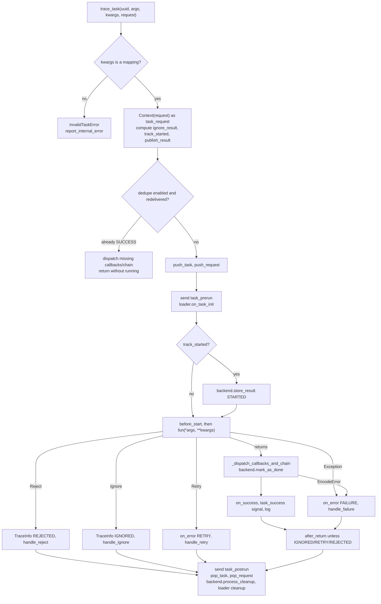

## Overview

`celery/app/trace.py` is the inner loop of the worker: the code that actually calls a task's `run` method, records the outcome in the result backend, fires signals and handlers, and dispatches whatever comes next (link callbacks, the next chain step, chord bookkeeping). The module comment explains why it is written as one large closure per task instead of small classes: the earlier design "only resulted in bad performance and horrible tracebacks".

Sources: [celery/app/trace.py:1-46](repo://celery/app/trace.py#L1-L46)

The same tracer serves two callers. In a worker, `Request` sends `fast_trace_task` or `trace_task_ret` into the pool, and the pool process calls the task's cached `__trace__` closure. For eager execution (`Task.apply`), `Task.apply` builds a tracer with `eager=True` and wraps its return value in an `EagerResult`. Message handling before this point is covered in [[Task Requests and Strategies]] and [[Consumer and Message Handling]]; the task API itself is in [[Tasks]].

Sources: [celery/worker/request.py:350-372](repo://celery/worker/request.py#L350-L372), [celery/app/task.py:937-951](repo://celery/app/task.py#L937-L951)

## Building the tracer

### What build_tracer precomputes

`build_tracer(name, task, loader=None, hostname=None, store_errors=True, Info=TraceInfo, eager=False, propagate=False, app=None, ...)` returns the `trace_task` closure. Everything that does not change per call is resolved once:

Sources: [celery/app/trace.py:344-347](repo://celery/app/trace.py#L344-L347)

- `fun` is `task.run` unless the task class overrides `__call__` (checked with `task_has_custom`, an MRO lookup that stops at the base `Task`), which saves a stack frame per call.
- `deduplicate_successful_tasks` is true only when late acks are on (`task_acks_late` or `task.acks_late`), `worker_deduplicate_successful_tasks` is set, and the backend is persistent.
- `task_before_start`, `task_on_success` and `task_after_return` are bound only if the task overrides them, so the default no-op handlers cost nothing.
- The request and task stacks' `push`/`pop`, the receiver lists of `task_prerun`, `task_postrun` and `task_success`, `logger.isEnabledFor(logging.INFO)` and `canvas.maybe_signature` are all bound to locals.

Sources: [celery/app/trace.py:344-415](repo://celery/app/trace.py#L344-L415), [celery/app/trace.py:131-134](repo://celery/app/trace.py#L131-L134)

### Where tracers are built

A tracer is cached on the task as `task.__trace__`. The consumer rebuilds it for every registered task in `update_strategies`, and each prefork child does the same in `process_initializer` after the app is finalized. The module-level `trace_task(task, uuid, args, kwargs, request=None, **opts)` builds `task.__trace__` lazily if it is still `None`.

Sources: [celery/worker/consumer/consumer.py:716-721](repo://celery/worker/consumer/consumer.py#L716-L721), [celery/concurrency/prefork.py:67-79](repo://celery/concurrency/prefork.py#L67-L79), [celery/app/trace.py:689-700](repo://celery/app/trace.py#L689-L700)

## Execution path

### Flow of one call

The closure returns a `trace_ok_t(retval, info, runtime, retstr)` named tuple. `info` is `None` on success and a `TraceInfo` otherwise, and the pool entry points turn that into `(1, R, T)` for a failure or `(0, Rstr, T)` for a success.

Sources: [celery/app/trace.py:120](repo://celery/app/trace.py#L120), [celery/app/trace.py:752-754](repo://celery/app/trace.py#L752-L754)



Sources: [celery/app/trace.py:475-580](repo://celery/app/trace.py#L475-L580), [celery/app/trace.py:581-686](repo://celery/app/trace.py#L581-L686)

### Setting up the request

The request dict is wrapped in a `celery.app.task.Context` with `called_directly=False`. `get_actual_ignore_result` lets the request's `ignore_result` override the task's attribute, but only when it was set on the instance: `Context` defines `ignore_result = False` at class level, so the function inspects `req.__dict__` to tell "explicitly False" from "not set". From that it derives `track_started` (never when eager) and `publish_result` (eager results are stored only when `task.store_eager_result` is set).

Sources: [celery/app/trace.py:157-176](repo://celery/app/trace.py#L157-L176), [celery/app/trace.py:497-506](repo://celery/app/trace.py#L497-L506)

### Deduplicating redelivered tasks

When deduplication is active and the message has `delivery_info['redelivered']`, the tracer first checks the in-process `successful_requests` set and then the backend state via `AsyncResult(task_request.id).state`. If the task already succeeded it logs "Task already completed successfully." and does not run the body. It still re-dispatches callbacks and the chain from the stored result if the stored metadata has no `children`, since an empty `children` means the first run crashed before dispatching them. A dispatch failure here becomes `Reject(exc, requeue=True)`.

Sources: [celery/app/trace.py:508-561](repo://celery/app/trace.py#L508-L561)

## Outcomes and state transitions

### State per outcome

Each way out of the task body maps to a state from `celery/states.py`, and only some of them write to the backend:

Sources: [celery/states.py:126-142](repo://celery/states.py#L126-L142)

| Outcome | State | Backend call | Handlers and signals |
| --- | --- | --- | --- |
| Return value | `SUCCESS` | `mark_as_done(uuid, retval, request, publish_result)` | `on_success`, `task_success`, `after_return` |
| `Retry` raised | `RETRY` | `mark_as_retry` if `store_errors` | `on_retry`, `task_retry`; errbacks not called |
| Other `Exception` | `FAILURE` | `mark_as_failure(..., store_result=store_errors, call_errbacks=...)` | `on_failure`, `task_failure`, `after_return` |
| `Ignore` raised | `IGNORED` | none | logged at INFO only |
| `Reject` raised | `REJECTED` | none | logged at WARN; the worker rejects the message |
| Body started, `track_started` on | `STARTED` | `store_result(uuid, {'pid', 'hostname'}, STARTED)` | none |

Sources: [celery/app/trace.py:575-660](repo://celery/app/trace.py#L575-L660), [celery/app/trace.py:188-282](repo://celery/app/trace.py#L188-L282)

`IGNORED`, `RETRY` and `REJECTED` form `IGNORE_STATES`, which is why `after_return` is skipped for them. `task_postrun` is sent in a `finally` block, so it fires for every outcome, including Ignore and Reject, with the final `retval` and `state`.

Sources: [celery/app/trace.py:107-114](repo://celery/app/trace.py#L107-L114), [celery/app/trace.py:649-663](repo://celery/app/trace.py#L649-L663)

### The state constants

`READY_STATES` is `SUCCESS`, `FAILURE` and `REVOKED`; `EXCEPTION_STATES` adds `RETRY` to the failure-like states; `PROPAGATE_STATES` (`FAILURE`, `REVOKED`) are those whose exceptions are re-raised to callers. `RECEIVED` and `REJECTED` are only used in events. The `state` string subclass compares by the `PRECEDENCE` list, where an unknown custom state ranks below `SUCCESS` and `FAILURE` but above every other built-in state.

Sources: [celery/states.py:61-151](repo://celery/states.py#L61-L151)

## Error handling

### TraceInfo

`TraceInfo` holds just `state` and `retval` (`__slots__`). `on_error` builds one and calls `handle_error_state`, which first decides `store_errors`: with ignored results it follows `task.store_errors_even_if_ignored`; when eager it is true only with `store_eager_result`; otherwise it is `not eager`. It then dispatches to `handle_retry` or `handle_failure` by state. If the tracer was built with `propagate=True` (as `Task.apply(throw=True)` does), `on_error` re-raises instead.

Sources: [celery/app/trace.py:179-204](repo://celery/app/trace.py#L179-L204), [celery/app/trace.py:417-424](repo://celery/app/trace.py#L417-L424)

`handle_failure` converts the exception with `get_pickleable_exception` and `get_pickleable_etype`, so only picklable exceptions go to the parent process and the backend, then calls `mark_as_failure`, `task.on_failure`, sends `task_failure` and logs. `handle_retry` stores `reason.exc` (the original exception inside the `Retry`) rather than the `Retry` itself. Each handler ends with `traceback_clear`, which calls `tb_frame.clear()` along the traceback chain so frames and their locals can be garbage collected (Issue #8882).

Sources: [celery/app/trace.py:212-282](repo://celery/app/trace.py#L212-L282), [celery/app/trace.py:314-341](repo://celery/app/trace.py#L314-L341)

### Task predicates

`Retry`, `Ignore` and `Reject` derive from `TaskPredicate` in `celery/exceptions.py`. `Retry` carries `message`, `exc`, `when` and `sig`; when it wraps an exception, it stores a picklable copy plus a `safe_repr` string. `Reject` carries `reason` and `requeue`. `Task.apply` uses `Retry.sig` to re-run eagerly with `retries + 1`.

Sources: [celery/exceptions.py:141-200](repo://celery/exceptions.py#L141-L200), [celery/app/task.py:943-951](repo://celery/app/task.py#L943-L951)

### Log policies

`_log_error` picks a `log_policy_t` with `get_log_policy`: `Reject` is logged at WARN with traceback, `Ignore` at INFO, internal errors at CRITICAL, exceptions listed in `task.throws` at INFO as "raised expected" without traceback, and everything else at ERROR as "raised unexpected". The log record's `extra['data']` carries the context dict for custom handlers.

Sources: [celery/app/trace.py:87-102](repo://celery/app/trace.py#L87-L102), [celery/app/trace.py:137-147](repo://celery/app/trace.py#L137-L147), [celery/app/trace.py:284-311](repo://celery/app/trace.py#L284-L311)

### Errors outside the task body

The outer `try` catches failures in the tracer itself (for example `InvalidTaskError` for non-mapping kwargs, or a failing signal handler). `MemoryError` and `Reject` propagate. Any other exception sends the `task_internal_error` signal, re-raises in eager mode, and otherwise becomes `report_internal_error`: a `RuntimeWarning` "Exception raised outside body" plus an `ExceptionInfo(internal=True)` return value, with the task still marked as failed through `on_error`.

Sources: [celery/app/trace.py:673-684](repo://celery/app/trace.py#L673-L684), [celery/app/trace.py:703-733](repo://celery/app/trace.py#L703-L733), [celery/app/trace.py:791-801](repo://celery/app/trace.py#L791-L801)

## Callbacks, chains and chords after success

### Dispatch order

On success, callbacks and the next chain step are sent before the result is stored, so that `mark_as_done` records the children and `result.children` is populated. `_dispatch_callbacks_and_chain` does the sending:

Sources: [celery/app/trace.py:610-618](repo://celery/app/trace.py#L610-L618)

- One callback: `maybe_signature(callbacks[0]).apply_async((retval,), parent_id=uuid, root_id=root_id, priority=...)`.
- Several callbacks: group callbacks are applied one by one (groups store their own trail, Issue #1936), and all plain signatures are wrapped in one `group(...)` and applied together.
- Chain: the last element of `request.chain` is the next step. It is applied with the remaining list as `chain=chain[:-1]`, so a chain travels as a reversed stack in the message.

Sources: [celery/app/trace.py:426-473](repo://celery/app/trace.py#L426-L473), [celery/app/trace.py:610-627](repo://celery/app/trace.py#L610-L627)

`parent_id` is the current task id and `root_id` comes from the request, or is the current id when there is none. The parent's `delivery_info['priority']` is forwarded only when `task_inherit_parent_priority` is enabled. The docstring notes that dispatch is not atomic: a Reject and redelivery may resend callbacks, which is acceptable under at-least-once delivery.

Sources: [celery/app/trace.py:564-566](repo://celery/app/trace.py#L564-L566), [celery/app/trace.py:435-438](repo://celery/app/trace.py#L435-L438)

### Chord and errback handling in the backend

Chord progress is driven from the backend. `mark_as_done` stores the result unless the request ignores it, then calls `on_chord_part_return` if `request.chord` is set. `mark_as_failure` does the same for chord members, then walks `request.chain` and stores the exception on each remaining chain element (descending into a chord step's body), so that waiters on the end of a failed chain do not hang. Finally it calls the errbacks. An `EncodeError` raised while storing a successful result is turned into a failure by the tracer. Chord mechanics are described in [[Canvas: Signatures and Workflows]] and [[Result Backends]].

Sources: [celery/backends/base.py:180-252](repo://celery/backends/base.py#L180-L252), [celery/app/trace.py:628-631](repo://celery/app/trace.py#L628-L631)

## Signals

The tracer sends these signals, all with the task as `sender`. Handlers are described in [[Signals]].

Sources: [celery/app/trace.py:104-106](repo://celery/app/trace.py#L104-L106)

| Signal | When | Main arguments |
| --- | --- | --- |
| `task_prerun` | after the request is pushed, before `on_task_init` | `task_id`, `task`, `args`, `kwargs` |
| `task_success` | after `mark_as_done` and `on_success` | `result` |
| `task_retry` | in `handle_retry` | `request`, `reason`, `einfo` |
| `task_failure` | in `handle_failure` | `task_id`, `exception`, `args`, `kwargs`, `traceback`, `einfo` |
| `task_postrun` | always, in `finally` | `task_id`, `task`, `args`, `kwargs`, `retval`, `state` |
| `task_internal_error` | error outside the body | `task_id`, `request`, `exception`, `traceback`, `einfo` |

Sources: [celery/app/trace.py:569-573](repo://celery/app/trace.py#L569-L573), [celery/app/trace.py:635-638](repo://celery/app/trace.py#L635-L638), [celery/app/trace.py:226-227](repo://celery/app/trace.py#L226-L227), [celery/app/trace.py:267-271](repo://celery/app/trace.py#L267-L271), [celery/app/trace.py:655-660](repo://celery/app/trace.py#L655-L660), [celery/app/trace.py:712-721](repo://celery/app/trace.py#L712-L721)

`task_prerun`, `task_postrun` and `task_success` are only sent when their receiver lists are non-empty. Those lists are bound when the tracer is built, so connect handlers before the worker builds the tracers, for example at import time.

Sources: [celery/app/trace.py:410-412](repo://celery/app/trace.py#L410-L412)

```python
from celery.signals import task_postrun

@task_postrun.connect
def log_outcome(sender=None, task_id=None, state=None, retval=None, **kwargs):
    print(f"{sender.name}[{task_id}] finished in state {state}")
```

Sources: [celery/app/trace.py:655-660](repo://celery/app/trace.py#L655-L660)

## Pool entry points and worker optimizations

### trace_task_ret and fast_trace_task

Both functions take the raw message parts (`name`, `uuid`, `request`, `body`, `content_type`, `content_encoding`) and run in the pool process. They decode the body with kombu's `loads` against the accepted content types, merge `args`, `kwargs`, `hostname`, `is_eager=False` and the embedded options into the request dict, and call the task's tracer. `trace_task_ret` looks up `current_app`, `app.tasks[name]`, `accept_content` and the hostname on every call. `fast_trace_task` reads the task registry, the prepared accept set and the hostname from the module-level `_localized` list and calls `tasks[task].__trace__` directly.

Sources: [celery/app/trace.py:735-788](repo://celery/app/trace.py#L735-L788)

`Request.execute_using_pool` chooses between them with `app.use_fast_trace_task`. If `_localized` is empty, `fast_trace_task` raises a `RuntimeError` that explains the usual cause: the process was spawned rather than forked (for example prefork on Windows), so `setup_worker_optimizations` never ran there.

Sources: [celery/worker/request.py:356-369](repo://celery/worker/request.py#L356-L369), [celery/app/trace.py:760-774](repo://celery/app/trace.py#L760-L774)

### setup_worker_optimizations

`setup_worker_optimizations(app, hostname=None)` is called by the worker and by prefork children re-executed after fork (`FORKED_BY_MULTIPROCESSING`). It installs stack protection, makes the app both current and default (so threads without an app use the worker's app), finalizes the app, fills `_localized`, and sets `app.use_fast_trace_task = True`. `reset_worker_optimizations` undoes the patch and the flag.

Sources: [celery/app/trace.py:804-844](repo://celery/app/trace.py#L804-L844), [celery/concurrency/prefork.py:67-74](repo://celery/concurrency/prefork.py#L67-L74)

Stack protection handles one edge case. The tracer calls `task.run` directly unless `__call__` is overridden, but a custom `__call__` that calls `super().__call__` would then push a second request onto the stack. `_install_stack_protection` replaces `BaseTask.__call__` with `__protected_call__`, which runs `self.run` directly the first time it sees the single, unprotected, non-direct request the tracer pushed.

Sources: [celery/app/trace.py:847-873](repo://celery/app/trace.py#L847-L873)
