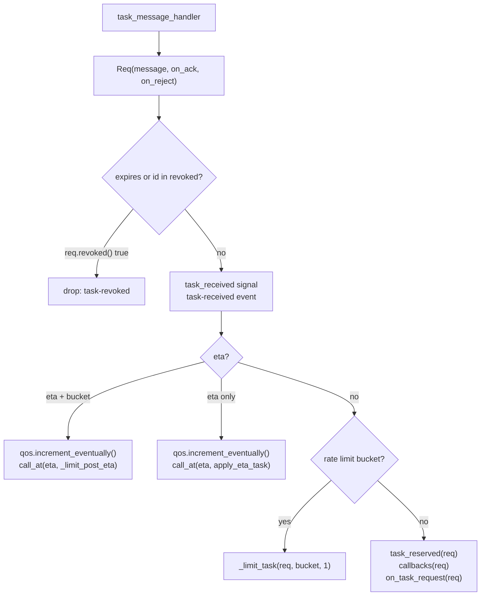
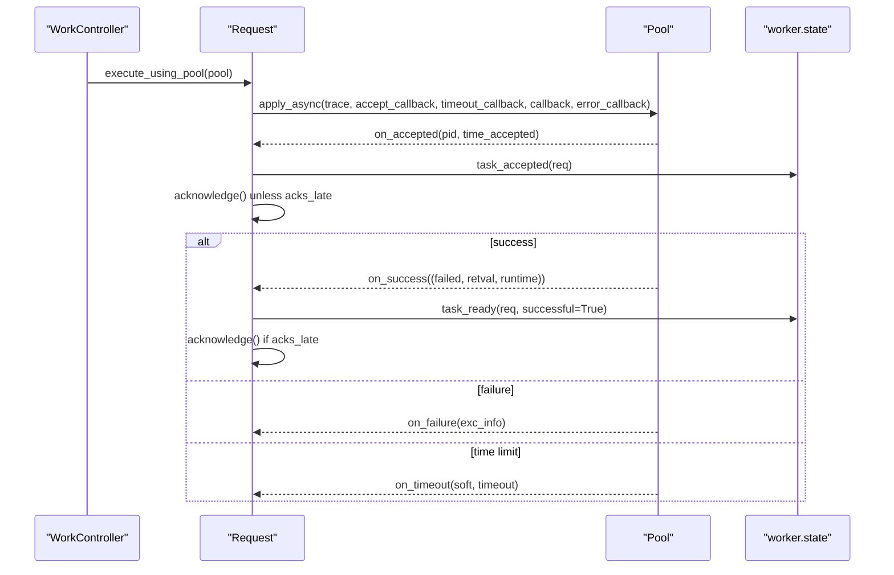

## Overview

Between a broker message arriving and a task running in the pool, the worker turns each message into a `Request`. A per-task strategy, built once per task type, decides whether the request runs now, waits for its ETA on the timer, or queues behind a rate limit. The `Request` then sends the call to the pool and reacts to its outcome by acknowledging, rejecting or requeueing the message and storing results for failures that happen outside the task. Module-level state in `celery.worker.state` tracks which requests are reserved, active or revoked.

Sources: [celery/worker/strategy.py:99-131](repo://celery/worker/strategy.py#L99-L131), [celery/worker/request.py:1-5](repo://celery/worker/request.py#L1-L5), [celery/worker/state.py:1-5](repo://celery/worker/state.py#L1-L5)

This page starts where `on_task_received` in [[Consumer and Message Handling]] has found the strategy for a message, and ends where the pool calls back. What happens inside the pool process (tracing, result storage on success, retries) is in [[Task Execution and Tracing]].

Sources: [celery/worker/consumer/consumer.py:748-780](repo://celery/worker/consumer/consumer.py#L748-L780), [celery/worker/request.py:341-372](repo://celery/worker/request.py#L341-L372)

## The default strategy

### Building the handler

`Task.start_strategy` instantiates `Task.Strategy`, by default `celery.worker.strategy:default`, with the task, the app and the consumer. `Consumer.update_strategies` calls it for every registered task when the `Tasks` step starts. `default` runs once and caches what each message needs in local variables: the event dispatcher, `timer.call_at`, the rate-limit bucket lookup, `consumer.on_task_request`, the revoked set, and a `Request` subclass made by `create_request_cls` for this task and pool. It returns the inner `task_message_handler`.

Sources: [celery/app/task.py:222-225](repo://celery/app/task.py#L222-L225), [celery/app/task.py:520-521](repo://celery/app/task.py#L520-L521), [celery/worker/consumer/consumer.py:716-721](repo://celery/worker/consumer/consumer.py#L716-L721), [celery/worker/strategy.py:99-131](repo://celery/worker/strategy.py#L99-L131)

> [!NOTE]
> The docstring calls strategies an optimization that is "not very easy to override". Customize `Task.Request` rather than `Task.Strategy` when you only need different request behaviour.

Sources: [celery/worker/strategy.py:103-108](repo://celery/worker/strategy.py#L103-L108)

### Handling one message

`task_message_handler(message, body, ack, reject, callbacks)` runs for every task message:

Sources: [celery/worker/strategy.py:132-209](repo://celery/worker/strategy.py#L132-L209)

1. Normalize the message. A protocol 2 message leaves the body undecoded (`decoded=False`) so only the pool process deserializes it. A body with `args` goes through `hybrid_to_proto2`, and a protocol 1 body through `proto1_to_proto2`.
2. Build the `Req` with the ack and reject promises as `on_ack` and `on_reject`.
3. Log `Task name[id] received` (`LOG_RECEIVED`) at `INFO`, passing the id, name, argument reprs and ETA as `extra` for custom log handlers.
4. If the request has `expires`, or its id is in `revoked`, call `req.revoked()`, which drops it if it is revoked or expired.
5. Send the `task_received` signal and, if the task sends events, a `task-received` event.
6. Convert the ETA to a timestamp. A value that overflows rejects the message without requeue.
7. Route it: ETA and rate limit, ETA only, rate limit only, or immediate.

Sources: [celery/worker/strategy.py:132-209](repo://celery/worker/strategy.py#L132-L209), [celery/app/trace.py:53-55](repo://celery/app/trace.py#L53-L55)



Sources: [celery/worker/strategy.py:162-208](repo://celery/worker/strategy.py#L162-L208)

### Protocol conversion

Protocol 1 put everything in the body. `proto1_to_proto2` checks that `args` and `kwargs` exist and that `kwargs` is a mapping, raising `InvalidTaskError` otherwise. It adds `argsrepr` and `kwargsrepr`, maps the old `taskset` field to `group`, and returns `((args, kwargs, embed), body, True, utc)`, where `embed` holds `callbacks`, `errbacks` and `chord`. `hybrid_to_proto2` does the same for a body carrying `args` next to protocol 2 headers, rebuilding a full header dict and letting the real message headers override it.

Sources: [celery/worker/strategy.py:25-96](repo://celery/worker/strategy.py#L25-L96)

## ETA, countdown and rate limits

### ETA and countdown

A countdown arrives as an absolute `eta` header. The strategy converts it with `to_system_tz` for UTC messages, or with the app timezone otherwise, and schedules the request on the consumer timer with `call_at(eta, apply_eta_task, (req,), priority=6)`. The request is not yet reserved, but the prefetch count is raised by one, so waiting for an ETA does not take a slot from tasks that can run now. When the timer fires, `apply_eta_task` reserves the request, hands it to `on_task_request` and lowers the prefetch count again.

Sources: [celery/worker/strategy.py:178-201](repo://celery/worker/strategy.py#L178-L201), [celery/worker/consumer/consumer.py:659-663](repo://celery/worker/consumer/consumer.py#L659-L663)

> [!WARNING]
> ETA tasks live in worker memory until they run, and each one grows the prefetch window. `worker_eta_task_limit` caps how far the `QoS` object may grow.

Sources: [celery/worker/consumer/tasks.py:54-57](repo://celery/worker/consumer/tasks.py#L54-L57)

### Rate limits

`Consumer.reset_rate_limits` gives every task with a `rate_limit` a kombu `TokenBucket(limit, capacity=1)`, and `None` otherwise. The buckets are skipped when `worker_disable_rate_limits` is on. `_limit_task` appends `(request, tokens)` to the bucket and runs `_schedule_bucket_request`, which pops requests while tokens are available and passes them to the pool. When the bucket is empty it puts the request back at the head, keeping the order, and asks the timer to call again after `bucket.expected_time(tokens)`. A rotating priority from 0 to 9 keeps several buckets from starving each other.

Sources: [celery/worker/consumer/consumer.py:296-364](repo://celery/worker/consumer/consumer.py#L296-L364), [celery/worker/strategy.py:190-203](repo://celery/worker/strategy.py#L190-L203)

A request with both an ETA and a rate limit waits on the timer first; `_limit_post_eta` then lowers the prefetch count and puts it in the bucket. `WorkController.reload` and the `rate_limit` control command both rebuild the buckets with `reset_rate_limits`.

Sources: [celery/worker/consumer/consumer.py:361-364](repo://celery/worker/consumer/consumer.py#L361-L364), [celery/worker/worker.py:269-279](repo://celery/worker/worker.py#L269-L279), [celery/worker/control.py:259-285](repo://celery/worker/control.py#L259-L285)

```python
from celery import Celery

app = Celery('proj')

@app.task(rate_limit='10/m')   # one TokenBucket per worker for this task
def fetch(url):
    ...
```

Sources: [celery/worker/consumer/consumer.py:296-303](repo://celery/worker/consumer/consumer.py#L296-L303)

## The Request object

### What a request holds

`Request.__init__` copies the message headers into `_request_dict` and keeps the body undecoded unless the strategy already decoded it. It reads the id, the task name (or `shadow` for display), `root_id`, `parent_id`, `timelimit`, `argsrepr` and `kwargsrepr`. `eta` and `expires` are parsed from ISO 8601 and made timezone-aware with the app timezone, and an unparsable value raises `InvalidTaskError`, which the consumer turns into a rejected message. It also records the delivery info (exchange, routing key, priority, redelivered) and the `reply_to` and `correlation_id` properties that RPC result backends need.

Sources: [celery/worker/request.py:90-175](repo://celery/worker/request.py#L90-L175)

`ignore_result` comes from the message header if present, falling back to the task. `store_errors` is true unless results are ignored, or when `store_errors_even_if_ignored` is set.

Sources: [celery/worker/request.py:128-131](repo://celery/worker/request.py#L128-L131), [celery/worker/request.py:291-294](repo://celery/worker/request.py#L291-L294)

### The per-task subclass

`create_request_cls(base, task, pool, ...)` subclasses `Task.Request` and binds the pool's `apply_async`, the task's default time limits, `acks_late` and the events flag into closures. Its `execute_using_pool` and `on_success` match the base methods but avoid attribute lookups on every task. A custom request class set through `Task.Request` is the base of this subclass, so its own hooks still run.

Sources: [celery/worker/request.py:818-874](repo://celery/worker/request.py#L818-L874), [celery/worker/strategy.py:126-128](repo://celery/worker/strategy.py#L126-L128)

```python
from celery import Task
from celery.worker.request import Request

class LoggingRequest(Request):
    def on_timeout(self, soft, timeout):
        super().on_timeout(soft, timeout)
        print('timed out:', self.id)

class LoggingTask(Task):
    Request = LoggingRequest
```

Sources: [celery/app/task.py:222-225](repo://celery/app/task.py#L222-L225), [celery/worker/request.py:529-533](repo://celery/worker/request.py#L529-L533)

## Execution in the pool

`WorkController._process_task` calls `req.execute_using_pool(pool)`. The request checks `revoked()` once more and raises `TaskRevokedError` if so, which the worker catches to release the pool semaphore. Otherwise it calls `pool.apply_async` with `fast_trace_task` (or `trace_task_ret`), the task name, id, request dict, raw body, content type and encoding, and four callbacks. The time limits from the message `timelimit` header take precedence over the task's `time_limit` and `soft_time_limit`. A weak reference to the pool result is kept for later termination.

Sources: [celery/worker/worker.py:223-231](repo://celery/worker/worker.py#L223-L231), [celery/worker/request.py:341-372](repo://celery/worker/request.py#L341-L372)



Sources: [celery/worker/request.py:341-372](repo://celery/worker/request.py#L341-L372), [celery/worker/request.py:515-611](repo://celery/worker/request.py#L515-L611)

`on_accepted` runs when a pool process picks the job up. It records the process id and converts the monotonic accept time to wall-clock `time_start`, moves the request into `active_requests`, acknowledges the message now unless the task is `acks_late`, and sends `task-started`. If a terminate was requested before the process started, it is applied here.

Sources: [celery/worker/request.py:515-527](repo://celery/worker/request.py#L515-L527)

`on_success` receives `(failed, retval, runtime)`. A `failed` result is forwarded to `on_failure` with `return_ok=True`, and a `SystemExit` or `KeyboardInterrupt` from the child is re-raised. Otherwise the request becomes ready and successful, is acknowledged if `acks_late`, and sends `task-succeeded`.

Sources: [celery/worker/request.py:596-611](repo://celery/worker/request.py#L596-L611)

## Acknowledgement and failure handling

### acknowledge and reject

`acknowledge()` calls the `on_ack` promise once and sets `acknowledged`. `reject(requeue=False)` calls `on_reject` once, marks the request acknowledged and sends `task-rejected`. Both are no-ops on an already acknowledged request, so whichever path runs first wins.

Sources: [celery/worker/request.py:730-740](repo://celery/worker/request.py#L730-L740)

### on_failure

`on_failure(exc_info)` marks the request ready, then branches on the exception:

Sources: [celery/worker/request.py:622-630](repo://celery/worker/request.py#L622-L630)

| Exception | Behaviour |
| --- | --- |
| `Terminated` | Announces `task-revoked` (reason `terminated`) unless already cancelled or revoked. |
| `MemoryError` | Re-raised as `MemoryError('Process got: ...')`. |
| `Reject` | With `requeue=False`, stores a `FAILURE` result and sends `task_failure` first; then `reject(requeue=exc.requeue)`. |
| `Ignore` | Acknowledged. |
| `Retry` | `on_retry`: acknowledged if `acks_late`, `task-retried` event. |
| other, `acks_late` | `WorkerLostError` with `reject_on_worker_lost`, or a time limit with `acks_on_timeout` false: requeue. Else ack if `acks_on_failure` (or `acks_on_timeout`), else reject without requeue. |
| other, not `acks_late` | Already acknowledged in `on_accepted`. |

Sources: [celery/worker/request.py:630-696](repo://celery/worker/request.py#L630-L696)

Unless the message was requeued, the parent process then stores the failure with `backend.mark_as_failure` and sends `task_failure`, for a lost worker or whenever the child could not report the failure itself (`return_ok` false). A `task-failed` event follows, except for requeued messages. During a cold shutdown (`state.should_terminate`) this reporting is suppressed, because the tasks are being cancelled on purpose.

Sources: [celery/worker/request.py:698-728](repo://celery/worker/request.py#L698-L728)

> [!CAUTION]
> `task_reject_on_worker_lost` with `acks_late` requeues a task whose process died, for example after an OOM kill. A task that always kills its process will then loop between workers.

Sources: [celery/app/task.py:348-359](repo://celery/app/task.py#L348-L359), [celery/worker/request.py:678-690](repo://celery/worker/request.py#L678-L690)

### Time limits

The pool calls `on_timeout(soft, timeout)`. A soft limit only logs a warning in the parent. For a hard limit the parent does the reporting itself: it marks the request ready, stores `TimeLimitExceeded` as the result, runs the task's `on_failure` and any custom `after_return`, sends `task_failure` and a `task-failed` event, and clears the synthetic traceback to avoid leaking frames. For `acks_late` tasks it then acknowledges the message if `acks_on_timeout`, or requeues it. None of this runs during a cold shutdown.

Sources: [celery/worker/request.py:529-594](repo://celery/worker/request.py#L529-L594)

## Revocation, termination and cancellation

`revoked()` is checked when the message arrives and again before it goes to the pool. It returns true if the request already announced its revocation, if `expires` has passed (`maybe_expire` adds the id to `revoked`), if the id is in `state.revoked`, or if one of its `stamped_headers` matches a value in `state.revoked_stamps`. A revoked request is announced with `_announce_revoked`: ready, `task-revoked` event, `REVOKED` result (stored only if `store_errors`), acknowledgement, and the `task_revoked` signal.

Sources: [celery/worker/request.py:408-414](repo://celery/worker/request.py#L408-L414), [celery/worker/request.py:457-509](repo://celery/worker/request.py#L457-L509)

The `revoke` control command adds the ids to `state.revoked` and, with `terminate=True`, calls `request.terminate(pool, signal)`. If the job has started, `terminate` sends the signal to the pool process and announces it as terminated. If not, it stores `_terminate_on_ack` so `on_accepted` terminates it as soon as it starts. See [[Remote Control and Inspection]].

Sources: [celery/worker/control.py:214-238](repo://celery/worker/control.py#L214-L238), [celery/worker/request.py:416-426](repo://celery/worker/request.py#L416-L426)

`cancel(pool, emit_retry=True)` is used on connection loss and during cold shutdown. It kills a started job and announces `task-cancelled` instead of a revoke. With `emit_retry`, it marks the result as `RETRY`, calls the task's `on_retry`, and sends `task_retry`. The request is flagged `_already_cancelled`, so the `Terminated` failure that follows does not also mark it as revoked.

Sources: [celery/worker/request.py:428-455](repo://celery/worker/request.py#L428-L455), [celery/worker/request.py:630-646](repo://celery/worker/request.py#L630-L646)

## Worker state

### Request bookkeeping

`celery.worker.state` is module-global so every component of a worker sees the same view. Three helpers move requests through it:

Sources: [celery/worker/state.py:48-74](repo://celery/worker/state.py#L48-L74)

| Structure | Updated by | Contents |
| --- | --- | --- |
| `requests` | `task_reserved`, `task_accepted`, `task_ready` | Dict of id to `Request` for everything reserved. |
| `reserved_requests` | `task_reserved`, `task_ready` | `WeakSet` of requests handed to the pool or waiting for it. |
| `active_requests` | `task_accepted`, `task_ready` | `WeakSet` of requests a pool process has accepted. |
| `successful_requests` | `task_ready(successful=True)` | `LimitedSet` of ids (`CELERY_WORKER_SUCCESSFUL_MAX`, default 1000). |
| `total_count`, `all_total_count` | `task_accepted` | Accepted counts per task name and overall. |
| `revoked` | revoke command, `maybe_expire`, Mingle | `LimitedSet` of ids (`CELERY_WORKER_REVOKES_MAX`, default 50000, expiring after `CELERY_WORKER_REVOKE_EXPIRES` seconds, default 10800). |
| `revoked_stamps` | revoke by stamped headers | Header name to revoked values. |

Sources: [celery/worker/state.py:34-130](repo://celery/worker/state.py#L34-L130)

`should_stop` and `should_terminate` are the shutdown flags that signal handlers set, and `maybe_shutdown()` turns them into `WorkerShutdown` or `WorkerTerminate` inside the consumer loops.

Sources: [celery/worker/state.py:73-93](repo://celery/worker/state.py#L73-L93)

### Persistent state

With `--statedb` (`worker_state_db`), the `StateDB` step creates `Persistent(state, filename, app.clock)` and registers `save` with `atexit`. On creation `Persistent` opens a `shelve` file, merges the stored revoked ids into `state.revoked` (reading the zlib-compressed v3 `zrevoked` key, or the older `revoked` formats), purges expired entries, and adjusts the logical clock. `sync()` writes the compressed revoked set and the advanced clock back. Only revoked ids and the clock are stored, so revokes survive a restart.

Sources: [celery/worker/components.py:208-218](repo://celery/worker/components.py#L208-L218), [celery/worker/state.py:192-288](repo://celery/worker/state.py#L192-L288)

## Configuration

These task and worker settings change how requests are acknowledged and limited. Each can also be set per task as the matching attribute (`acks_late`, `acks_on_failure`, `acks_on_timeout`, `reject_on_worker_lost`, `time_limit`, `soft_time_limit`, `rate_limit`); see [[Tasks]].

Sources: [celery/app/task.py:305-359](repo://celery/app/task.py#L305-L359), [celery/app/task.py:428-443](repo://celery/app/task.py#L428-L443)

| Setting | Default | Effect on requests |
| --- | --- | --- |
| `task_acks_late` | `False` | Acknowledge after the task returns instead of in `on_accepted`. |
| `task_acks_on_failure` | `True` (via `task_acks_on_failure_or_timeout`) | Late-ack tasks that fail are acknowledged rather than discarded. |
| `task_acks_on_timeout` | `True` (via `task_acks_on_failure_or_timeout`) | Late-ack tasks that hit the hard limit are acknowledged rather than requeued. |
| `task_reject_on_worker_lost` | `None` | Requeue late-ack tasks whose process died. |
| `task_time_limit`, `task_soft_time_limit` | `None` | Hard and soft limits passed to the pool. |
| `worker_disable_rate_limits` | `False` | Skip the token buckets. |
| `worker_state_db` | `None` | File for persistent revokes. |

Sources: [celery/app/defaults.py:262-320](repo://celery/app/defaults.py#L262-L320), [celery/app/defaults.py:325-375](repo://celery/app/defaults.py#L325-L375)
