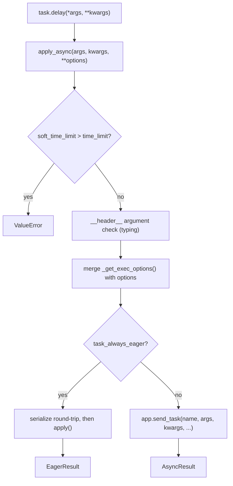

## Overview

A task is a callable that Celery can send as a message and run in a worker. Every task is an instance of a subclass of `celery.app.task.Task`: the `@app.task` decorator builds that subclass from a plain function, registers one instance per name in the app's `TaskRegistry`, and fills unset class attributes from configuration when the class is bound to the app. Calling the task object runs it in-process; `delay` and `apply_async` publish a message instead.

Sources: [celery/app/task.py:206-231](repo://celery/app/task.py#L206-L231), [celery/app/base.py:590-633](repo://celery/app/base.py#L590-L633)

This page covers defining and calling tasks, retries and the request context. How the worker runs a task and stores its state is described in [[Task Execution and Tracing]], how the message is built and routed in [[Messaging and Routing]], and how tasks compose in [[Canvas: Signatures and Workflows]].

Sources: [celery/app/task.py:495-534](repo://celery/app/task.py#L495-L534)

## Defining tasks

### The task decorator

`app.task` accepts a function directly or keyword options. With `shared=True` (the default) it also registers a constructor with `connect_on_app_finalize`, so every app created later gets the task too. With `lazy=True` (the default) on an app that is not yet finalized it returns a `PromiseProxy` that creates the task on first use; `app.finalize()` evaluates all pending proxies and binds every registered task.

Sources: [celery/app/base.py:515-585](repo://celery/app/base.py#L515-L585), [celery/app/base.py:657-677](repo://celery/app/base.py#L657-L677)

`_task_from_fun` derives the name with `gen_task_name` (module plus function name, using `app.main` when the module is `__main__`), then creates a class with `type(fun.__name__, (base,), ...)` whose `run` is the function. Without `bind=True`, `run` is a `staticmethod`, so the function does not receive the task instance; with it, the first argument is `self`. Every extra decorator option becomes a class attribute, and `__header__` holds a signature checker built by `head_from_fun`.

Sources: [celery/app/base.py:587-633](repo://celery/app/base.py#L587-L633), [celery/utils/imports.py:122-141](repo://celery/utils/imports.py#L122-L141)

```python
from celery import Celery, shared_task

app = Celery('proj')

@app.task
def add(x, y):
    return x + y

@app.task(bind=True, name='proj.fetch', max_retries=5, acks_late=True,
          rate_limit='10/m', time_limit=60, soft_time_limit=50)
def fetch(self, url):
    return self.request.id

@shared_task(ignore_result=True)
def cleanup():
    ...
```

Sources: [celery/app/base.py:515-585](repo://celery/app/base.py#L515-L585), [celery/app/__init__.py:24-75](repo://celery/app/__init__.py#L24-L75)

`shared_task` is for libraries that do not know the app: it registers the task with every current and future app and returns a `Proxy` that looks the task up in the current app's registry on each access.

Sources: [celery/app/__init__.py:48-75](repo://celery/app/__init__.py#L48-L75)

### Class-based tasks

A custom base class passed as `base=` (or set as `app.Task`) supplies shared behaviour such as handlers. Tasks written as classes are registered with `app.register_task`, which instantiates the class, generates a name if needed, applies auto-retry and binds it.

Sources: [celery/app/base.py:635-652](repo://celery/app/base.py#L635-L652)

### Binding and configuration defaults

`Task.bind(app)` is a classmethod run when the task meets its app. For every pair in `from_config` whose attribute is still `None` it copies the setting, so `serializer` comes from `task_serializer`, `acks_late` from `task_acks_late` and so on. `typing` defaults to `app.strict_typing`, `acks_on_failure` and `acks_on_timeout` fall back to `acks_on_failure_or_timeout` and then `True`, annotations are applied on the first bind, a thread-local `request_stack` is created and `on_bound` is called.

Sources: [celery/app/task.py:396-455](repo://celery/app/task.py#L396-L455)

## Task options

The table lists class attributes (also accepted as decorator keyword arguments) and the setting that supplies the default when the attribute is `None`.

Sources: [celery/app/task.py:396-411](repo://celery/app/task.py#L396-L411)

| Attribute | Default | From setting | Meaning |
| --- | --- | --- | --- |
| `name` | generated | | Registry key and message `task` field |
| `typing` | `None` | `app.strict_typing` | Check call arguments against the signature |
| `max_retries` | `3` | | Retry limit; `None` retries forever |
| `default_retry_delay` | `180` | | Seconds before a retry without `countdown`/`eta` |
| `rate_limit` | `None` | `task_default_rate_limit` | `'100/s'`, `'100/m'`, `'100/h'` |
| `ignore_result` | `None` | `task_ignore_result` | Do not store state or return value |
| `store_errors_even_if_ignored` | `None` | `task_store_errors_even_if_ignored` | Store failures despite `ignore_result` |
| `serializer` | `None` | `task_serializer` | Kombu serializer name |
| `time_limit` / `soft_time_limit` | `None` | `task_time_limit` / `task_soft_time_limit` | Hard and soft limits in seconds |
| `track_started` | `None` | `task_track_started` | Report `STARTED` |
| `acks_late` | `None` | `task_acks_late` | Acknowledge after the task runs |
| `acks_on_failure` / `acks_on_timeout` | `None` | `task_acks_on_failure` / `task_acks_on_timeout` | Ack late tasks that fail or time out |
| `reject_on_worker_lost` | `None` | `task_reject_on_worker_lost` | Requeue when the child process dies |
| `priority` | `None` | `task_default_priority` | Default message priority |
| `expires` | `None` | | Default expiry for sent messages |
| `throws` | `()` | | Expected exceptions, not logged as errors |
| `trail` | `True` | | Record child results in `request.children` |
| `send_events` | `True` | | Emit monitoring events for this task |
| `backend` | `None` | `app.backend` | Result backend override |
| `Strategy` / `Request` | dotted paths | | Worker-side strategy and request classes |

Sources: [celery/app/task.py:221-300](repo://celery/app/task.py#L221-L300), [celery/app/task.py:300-380](repo://celery/app/task.py#L300-L380), [celery/app/task.py:1261-1270](repo://celery/app/task.py#L1261-L1270)

## Calling tasks

### delay and apply_async

`delay(*args, **kwargs)` is `apply_async(args, kwargs)`. `apply_async` first rejects a `soft_time_limit` larger than `time_limit`, then, if `typing` is on, calls `__header__` with the arguments so a wrong call raises `TypeError` in the caller. It merges the task's cached execution options (`queue`, `routing_key`, `exchange`, `priority`, `expires`, `serializer`, `delivery_mode`, `compression`, time limits) under the call's options, sets `ignore_result` and `priority` defaults, and hands everything to `app.send_task` with `task_type=self`.

Sources: [celery/app/task.py:31-36](repo://celery/app/task.py#L31-L36), [celery/app/task.py:523-534](repo://celery/app/task.py#L523-L534), [celery/app/task.py:659-708](repo://celery/app/task.py#L659-L708), [celery/app/task.py:1256-1259](repo://celery/app/task.py#L1256-L1259)



Sources: [celery/app/task.py:659-708](repo://celery/app/task.py#L659-L708)

Commonly used `apply_async` options are `countdown`, `eta`, `expires`, `queue`, `exchange`, `routing_key`, `priority`, `serializer`, `compression`, `link` and `link_error` (callback signatures), `headers`, `task_id`, `shadow`, `retry` and `retry_policy` for publishing, `producer`/`connection`, `ignore_result` and `add_to_parent`. Any other keyword is passed to `kombu.Producer.publish`.

Sources: [celery/app/task.py:540-658](repo://celery/app/task.py#L540-L658)

```python
result = add.apply_async((2, 2), countdown=10, queue='math',
                         link=add.s(16), expires=300)
result.get(timeout=30)
```

Sources: [celery/app/task.py:536-558](repo://celery/app/task.py#L536-L558), [celery/app/task.py:974-986](repo://celery/app/task.py#L974-L986)

`shadow_name(args, kwargs, options)` can be overridden (or passed as a decorator option) to change the name shown in logs and monitoring. `s()`, `si()`, `signature()`, `chunks()`, `map()` and `starmap()` build signatures instead of sending.

Sources: [celery/app/task.py:710-729](repo://celery/app/task.py#L710-L729), [celery/app/task.py:962-1001](repo://celery/app/task.py#L962-L1001)

### Eager execution with apply

`apply` runs the task in the calling process and blocks. It builds a request dict with `is_eager=True`, the parent and root ids taken from the task currently on `_task_stack`, the time limits and `delivery_info`, then runs it through `build_tracer(..., eager=True, propagate=throw)`, where `throw` defaults to `task_eager_propagates`. If the task asked to retry, `apply` re-runs the retry signature with `retries + 1`; otherwise it returns an `EagerResult` holding the value or exception and the state.

Sources: [celery/app/task.py:869-951](repo://celery/app/task.py#L869-L951)

With `task_always_eager` enabled, `apply_async` takes the eager path but first serializes and deserializes the arguments with the configured serializer, so an argument that would not survive a real message fails the same way in tests. The `apply` call runs inside `denied_join_result()`.

Sources: [celery/app/task.py:682-701](repo://celery/app/task.py#L682-L701)

> [!NOTE]
> Calling the task object directly (`add(2, 2)`) does not go through `apply`: `__call__` pushes the task on `_task_stack`, pushes a `Context` with only `args` and `kwargs`, and calls `run`. The request then has `called_directly=True`.

Sources: [celery/app/task.py:495-502](repo://celery/app/task.py#L495-L502), [celery/app/task.py:1234-1238](repo://celery/app/task.py#L1234-L1238)

## The request context

`Task.request` returns the top of `request_stack`, a `Context` describing the current invocation, or a default empty `Context` when the task is not running. Its attributes include `id`, `args`, `kwargs`, `retries`, `is_eager`, `eta`, `expires`, `hostname`, `delivery_info`, `reply_to`, `correlation_id`, `root_id`, `parent_id`, `group`, `group_index`, `chord`, `chain`, `callbacks`, `errbacks`, `timelimit`, `headers`, `origin` and the stamping fields.

Sources: [celery/app/task.py:75-114](repo://celery/app/task.py#L75-L114), [celery/app/task.py:1244-1254](repo://celery/app/task.py#L1244-L1254)

`Context.update` keeps `time_limit` and `soft_time_limit` in sync whenever a `timelimit` pair is set, and when no `headers` are given the constructor collects every non-Celery key as custom headers. `as_execution_options()` turns the request back into `apply_async` options (ids, group, chord, chain, links, limits, retries); it strips RabbitMQ `x-death` headers so that re-publishing does not trip dead-letter cycle detection.

Sources: [celery/app/task.py:116-195](repo://celery/app/task.py#L116-L195)

## Retrying

### Task.retry

`retry` re-sends the current task and raises `Retry` so the worker records the `RETRY` state instead of failure. The steps follow.

Sources: [celery/app/task.py:812-817](repo://celery/app/task.py#L812-L817)

1. Increment `request.retries`; a `max_retries` argument overrides the class limit for this call only (stored as `override_max_retries`).
2. If the request was `called_directly`, re-raise `exc` (or a plain `Retry`) without sending.
3. Use `default_retry_delay` as the countdown when neither `countdown` nor `eta` is given.
4. Build the new signature with `signature_from_request`, which reuses the request's execution options and delivery info so the retry goes back to the same queue.
5. If the limit is exceeded, raise `exc` or `MaxRetriesExceededError`.
6. Otherwise publish the signature (eager requests skip this and let `apply` re-run it); a publishing error becomes `Reject(exc, requeue=False)`.
7. Raise the `Retry` exception, or return it when `throw=False`.

Sources: [celery/app/task.py:731-753](repo://celery/app/task.py#L731-L753), [celery/app/task.py:756-867](repo://celery/app/task.py#L756-L867)

```python
@app.task(bind=True, default_retry_delay=30)
def post(self, payload):
    try:
        send(payload)
    except ConnectionError as exc:
        raise self.retry(exc=exc, countdown=60)
```

Sources: [celery/app/task.py:760-776](repo://celery/app/task.py#L760-L776)

`Retry` stores the message, a pickleable copy of `exc` with its `repr`, `when` (the ETA or countdown), `is_eager` and the signature `sig`; its string form reads like `Retry in 60s: ...`.

Sources: [celery/exceptions.py:145-187](repo://celery/exceptions.py#L145-L187)

### Automatic retries

`add_autoretry_behaviour` runs at registration and wraps `run` when `autoretry_for` is set (as an attribute or decorator option). The wrapper lets `Ignore`, `Retry` and anything in `dont_autoretry_for` propagate, and for an exception in `autoretry_for` calls `task.retry(exc=exc, **retry_kwargs)`. With `retry_backoff` the countdown is `min(retry_backoff_max, factor * 2 ** retries)`, randomised in `[0, countdown]` when `retry_jitter` is true (the default); `retry_backoff_max` defaults to 600 seconds. The original function is kept as `_orig_run`, which also prevents wrapping twice.

Sources: [celery/app/autoretry.py:8-66](repo://celery/app/autoretry.py#L8-L66), [celery/utils/time.py:463-477](repo://celery/utils/time.py#L463-L477)

```python
@app.task(autoretry_for=(IOError,), dont_autoretry_for=(FileNotFoundError,),
          retry_kwargs={'max_retries': 5}, retry_backoff=2,
          retry_backoff_max=120)
def read_remote(path):
    ...
```

Sources: [celery/app/autoretry.py:10-31](repo://celery/app/autoretry.py#L10-L31)

## Handlers and other task methods

The worker calls handler methods that a base class may override: `before_start(task_id, args, kwargs)`, `on_success(retval, task_id, args, kwargs)`, `on_retry(exc, task_id, args, kwargs, einfo)`, `on_failure(exc, task_id, args, kwargs, einfo)` and `after_return(status, retval, task_id, args, kwargs, einfo)`; their return values are ignored.

Sources: [celery/app/task.py:1135-1209](repo://celery/app/task.py#L1135-L1209)

| Method | Purpose |
| --- | --- |
| `update_state(task_id, state, meta)` | Store a custom state through the backend, defaulting to the current task id |
| `send_event(type_, **fields)` | Send a custom monitoring event using `task_publish_retry_policy` |
| `replace(sig)` | Replace the running task with `sig`, keeping its id, callbacks, group and chain; raises `Ignore` when not eager |
| `add_to_chord(sig, lazy=False)` | Add a task to the current chord (requires a backend that supports it) |
| `AsyncResult(task_id)` | Result object bound to this task's backend |

Sources: [celery/app/task.py:953-960](repo://celery/app/task.py#L953-L960), [celery/app/task.py:1003-1027](repo://celery/app/task.py#L1003-L1027), [celery/app/task.py:1029-1133](repo://celery/app/task.py#L1029-L1133), [celery/app/task.py:1211-1227](repo://celery/app/task.py#L1211-L1227)

Tasks pickle to their name and module through `__reduce__`; `_unpickle_task_v2` imports the module and fetches the task from the current app's registry, so tasks can be passed as arguments to other tasks under the `pickle` serializer.

Sources: [celery/app/task.py:506-514](repo://celery/app/task.py#L506-L514), [celery/app/registry.py:65-68](repo://celery/app/registry.py#L65-L68)

## Task registry

`app.tasks` finalizes the app and returns its `TaskRegistry`, a `dict` from name to task instance. Looking up a missing name raises `NotRegistered` through `__missing__`. `register` requires a `name`, instantiates a class if needed and applies auto-retry; `unregister` accepts a name or a task.

Sources: [celery/app/registry.py:12-47](repo://celery/app/registry.py#L12-L47), [celery/app/base.py:1601-1609](repo://celery/app/base.py#L1601-L1609)

## Annotations

The `task_annotations` setting changes task attributes from configuration. `prepare` turns each entry into a `MapAnnotation` when it is a dict, a lazily instantiated object when it is a dotted path, or keeps an object as is. When a task is first bound, `annotate` applies the first match for the task's name and then the `'*'` entry; a key starting with `@` wraps the named method through `add_around` instead of replacing an attribute.

Sources: [celery/app/annotations.py:18-52](repo://celery/app/annotations.py#L18-L52), [celery/app/task.py:477-493](repo://celery/app/task.py#L477-L493), [celery/app/base.py:1462-1464](repo://celery/app/base.py#L1462-L1464)

```python
app.conf.task_annotations = {
    'proj.tasks.add': {'rate_limit': '10/s'},
    '*': {'acks_late': True},
}
```

Sources: [celery/app/annotations.py:18-31](repo://celery/app/annotations.py#L18-L31)

## Built-in tasks

`celery/app/builtins.py` registers tasks on every app through `connect_on_app_finalize`, each with `shared=False, lazy=False`.

Sources: [celery/app/builtins.py:1-23](repo://celery/app/builtins.py#L1-L23)

| Name | Role |
| --- | --- |
| `celery.backend_cleanup` | Calls `app.backend.cleanup()` to remove expired results |
| `celery.accumulate` | Collects arguments, used by `Task.replace` with a group |
| `celery.chord_unlock` | Polls a chord header for backends without native chords; `max_retries=None`, retried every `result_chord_retry_interval` |
| `celery.map` / `celery.starmap` | Apply a task to each item of an iterable |
| `celery.chunks` | Split an iterable into chunks of tasks |
| `celery.group` / `celery.chain` / `celery.chord` | Kept only for backwards compatibility; `celery.chain` raises `NotImplementedError` |

Sources: [celery/app/builtins.py:12-130](repo://celery/app/builtins.py#L12-L130), [celery/app/builtins.py:133-186](repo://celery/app/builtins.py#L133-L186)
