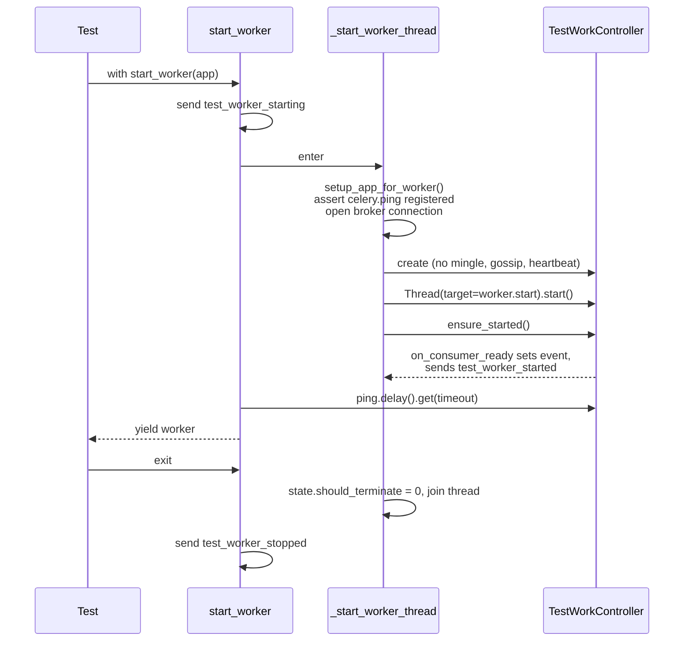

## Overview

Celery ships its own testing toolkit so applications can test tasks without a production broker. `celery.contrib.pytest` provides pytest fixtures that build an isolated app and start an embedded worker; `celery.contrib.testing` holds the pieces those fixtures use (`TestApp`, `start_worker`, `TestWorkController`) plus helpers for integration tests (`Manager`) and unit tests (`TaskMessage`, `ContextMock`). For tests that should not run a worker at all, the `task_always_eager` setting executes tasks inline in the caller.

Sources: [celery/contrib/pytest.py:1-51](repo://celery/contrib/pytest.py#L1-L51), [celery/contrib/testing/app.py:1-65](repo://celery/contrib/testing/app.py#L1-L65), [celery/contrib/testing/worker.py:1-30](repo://celery/contrib/testing/worker.py#L1-L30)

Celery's own suites use the same fixtures: the unit tests import `celery_app` and friends from `celery.contrib.pytest`, and the integration tests import `celery_session_worker` and `celery_worker`. Task execution itself is described in [[Task Execution and Tracing]], and the worker that the embedded worker subclasses in [[Worker Architecture and Bootsteps]].

Sources: [t/unit/conftest.py:23-23](repo://t/unit/conftest.py#L23-L23), [t/integration/conftest.py:9-9](repo://t/integration/conftest.py#L9-L9)

## Enabling the pytest plugin

Celery's `setup.py` registers only the `celery` console script, not a pytest entry point, so the fixtures are enabled explicitly. Either list the module as a plugin or import the fixtures into `conftest.py`, as Celery's own test suites do. The `celery[pytest]` extra installs the separate `pytest-celery` package.

Sources: [setup.py:155-159](repo://setup.py#L155-L159), [requirements/extras/pytest.txt:1-1](repo://requirements/extras/pytest.txt#L1-L1), [t/integration/conftest.py:9-9](repo://t/integration/conftest.py#L9-L9)

```python
# conftest.py
pytest_plugins = ("celery.contrib.pytest",)
```

Sources: [celery/contrib/pytest.py:22-29](repo://celery/contrib/pytest.py#L22-L29)

`pytest_configure` registers the `celery` marker, so `@pytest.mark.celery(...)` produces no unknown-marker warning and appears in `pytest --markers`.

Sources: [celery/contrib/pytest.py:22-29](repo://celery/contrib/pytest.py#L22-L29)

## Fixtures

### Configuration fixtures

These session-scoped fixtures return defaults and exist to be overridden in your `conftest.py`. Overriding one changes every app or worker fixture that depends on it.

Sources: [celery/contrib/pytest.py:53-169](repo://celery/contrib/pytest.py#L53-L169), [celery/contrib/pytest.py:188-191](repo://celery/contrib/pytest.py#L188-L191)

| Fixture | Default | Used for |
| --- | --- | --- |
| `celery_config` | `{}` | Settings merged into the test app's configuration |
| `celery_parameters` | `{}` | Keyword arguments passed to the `Celery` constructor |
| `celery_enable_logging` | `False` | When true, the test app keeps the normal logging class |
| `use_celery_app_trap` | `False` | Install the app trap (see below) |
| `celery_includes` | `()` | Modules imported before the worker starts (tasks, signal handlers) |
| `celery_class_tasks` | `[]` | Class-based tasks registered on the session app |
| `celery_worker_pool` | `'solo'` | Pool used by the embedded worker, for example `'prefork'` |
| `celery_worker_parameters` | `{}` | Keyword arguments passed to `WorkController`, for example `queues` |

Sources: [celery/contrib/pytest.py:53-169](repo://celery/contrib/pytest.py#L53-L169), [celery/contrib/pytest.py:188-191](repo://celery/contrib/pytest.py#L188-L191)

### App fixtures

`celery_app` (function scope) and `celery_session_app` (session scope) both read the closest `celery` marker on the test node, merge its keyword arguments over `celery_config`, and build the app through `_create_app`, which calls `TestApp(set_as_current=False, ...)` inside `setup_default_app`. The session app additionally makes itself the default and current app unless the trap is enabled; `celery_app` does not, and the `depends_on_current_app` fixture calls `celery_app.set_current()` for tests that need it.

Sources: [celery/contrib/pytest.py:32-81](repo://celery/contrib/pytest.py#L32-L81), [celery/contrib/pytest.py:172-216](repo://celery/contrib/pytest.py#L172-L216)

> [!NOTE]
> The marker is read with `request.node.get_closest_marker`. For `celery_session_app` the request belongs to the session, so a marker on an individual test does not reach it; per-test overrides work with `celery_app`.

Sources: [celery/contrib/pytest.py:64-81](repo://celery/contrib/pytest.py#L64-L81), [celery/contrib/pytest.py:172-185](repo://celery/contrib/pytest.py#L172-L185)

### Worker fixtures

`celery_worker` and `celery_session_worker` import every module in `celery_includes` through the app's loader, then enter `start_worker(app, pool=celery_worker_pool, **celery_worker_parameters)` and yield the running worker. The session variant also registers `celery_class_tasks`. Both skip starting a worker (and yield nothing) when the `NO_WORKER` environment variable is set.

Sources: [celery/contrib/pytest.py:16-16](repo://celery/contrib/pytest.py#L16-L16), [celery/contrib/pytest.py:84-105](repo://celery/contrib/pytest.py#L84-L105), [celery/contrib/pytest.py:194-210](repo://celery/contrib/pytest.py#L194-L210)

```python
import pytest
from celery.contrib.testing.tasks import ping  # noqa: registers celery.ping

@pytest.fixture(scope="session")
def celery_config():
    return {"broker_url": "memory://", "result_backend": "cache+memory://"}

@pytest.mark.celery(result_backend="cache+memory://")
def test_add(celery_app, celery_worker):
    @celery_app.task
    def add(x, y):
        return x + y

    celery_worker.reload()
    assert add.delay(2, 2).get(timeout=10) == 4
```

Sources: [celery/contrib/pytest.py:137-145](repo://celery/contrib/pytest.py#L137-L145), [celery/contrib/pytest.py:172-210](repo://celery/contrib/pytest.py#L172-L210)

> [!TIP]
> A task defined inside the test body is registered after the worker has started. `WorkController.reload()` calls `consumer.update_strategies()`, which is why the example calls `celery_worker.reload()` before sending. Tasks defined at module level and listed in `celery_includes` need no reload.

Sources: [celery/worker/worker.py:269-278](repo://celery/worker/worker.py#L269-L278), [celery/contrib/pytest.py:194-210](repo://celery/contrib/pytest.py#L194-L210)

## TestApp and the app trap

### TestApp defaults

`TestApp()` creates a `Celery` instance named `celery.tests` (unless a name is given) and calls `add_defaults` with a deep copy of `DEFAULT_TEST_CONFIG` overlaid by your `config`. It imports `celery.contrib.testing.tasks` first so `celery.ping` is registered as a shared task. Passing `broker=` or `backend=` drops the corresponding default so the explicit argument wins.

Sources: [celery/contrib/testing/app.py:47-65](repo://celery/contrib/testing/app.py#L47-L65)

```python
DEFAULT_TEST_CONFIG = {
    'worker_hijack_root_logger': False,
    'worker_log_color': False,
    'accept_content': {'json'},
    'enable_utc': True,
    'timezone': 'UTC',
    'broker_url': 'memory://',
    'result_backend': 'cache+memory://',
    'broker_heartbeat': 0,
}
```

Sources: [celery/contrib/testing/app.py:10-20](repo://celery/contrib/testing/app.py#L10-L20)

The in-memory transport and the `cache+memory://` backend let the whole round trip (publish, consume, store result) happen inside one process. `worker_hijack_root_logger=False` keeps pytest's own log capture intact.

Sources: [celery/contrib/testing/app.py:10-20](repo://celery/contrib/testing/app.py#L10-L20)

### UnitLogging

Unless `enable_logging=True`, `TestApp` passes `log=UnitLogging`, a subclass of the app's normal logging class whose constructor sets `already_setup = True`. That makes the app believe logging is configured, so creating a test app never reconfigures the test runner's handlers.

Sources: [celery/contrib/testing/app.py:39-56](repo://celery/contrib/testing/app.py#L39-L56)

### set_trap and setup_default_app

`setup_default_app(app, use_trap)` records the current app, the default app, `_state._on_app_finalizers` and `_state._apps`, yields, and restores all of them afterwards, closing the test app if it was not the previously current one. With `use_trap=True` it runs the body inside `set_trap`, which installs a `Trap` object as both the default app and the thread-local current app. Any attribute access on `Trap` raises `RuntimeError('Test depends on current_app')`, so code that silently falls back to `current_app` instead of using the app it was given fails loudly.

Sources: [celery/contrib/testing/app.py:23-36](repo://celery/contrib/testing/app.py#L23-L36), [celery/contrib/testing/app.py:68-112](repo://celery/contrib/testing/app.py#L68-L112)

```python
@pytest.fixture(scope="session")
def use_celery_app_trap():
    return True
```

Sources: [celery/contrib/pytest.py:53-61](repo://celery/contrib/pytest.py#L53-L61)

## Embedded worker

### start_worker flow

`start_worker` is a context manager that runs a real `WorkController` in a daemon thread of the test process. It sends `test_worker_starting`, starts the thread through `_start_worker_thread`, optionally proves the worker works by calling the `celery.ping` task, yields the worker, and always sends `test_worker_stopped` on exit.

Sources: [celery/contrib/testing/worker.py:99-136](repo://celery/contrib/testing/worker.py#L99-L136)



Sources: [celery/contrib/testing/worker.py:81-192](repo://celery/contrib/testing/worker.py#L81-L192)

`_start_worker_thread` first runs `setup_app_for_worker`, which finalizes the app, makes it current and default, and resets `app.log` so logging is set up at the requested `loglevel`. It opens a connection (honouring the `TEST_BROKER` environment variable as hostname) to fail fast when the broker is unreachable. The worker is created with an anonymous node name, `without_mingle=True`, `without_gossip=True` and, unless overridden, `without_heartbeat=True`; `ready_callback` is forced to `None` so the class's own `on_consumer_ready` is used. After `ensure_started()` returns it calls `_set_task_join_will_block(False)` so tests may call `.get()` on results.

Sources: [celery/contrib/testing/worker.py:139-178](repo://celery/contrib/testing/worker.py#L139-L178), [celery/contrib/testing/worker.py:219-225](repo://celery/contrib/testing/worker.py#L219-L225)

| Parameter | Default | Meaning |
| --- | --- | --- |
| `concurrency` | `1` | Pool size |
| `pool` | `'solo'` | Pool implementation |
| `loglevel` | `WORKER_LOGLEVEL` env var, else `'error'` | Worker log level |
| `logfile` | `None` | Log file |
| `perform_ping_check` | `True` | Require `celery.ping` and wait for `'pong'` |
| `ping_task_timeout` | `10.0` | Seconds to wait for the ping result |
| `shutdown_timeout` | `10.0` | Seconds to wait for the thread to exit |
| `**kwargs` | | Passed to `WorkController` (`hostname`, `queues`, ...) |

Sources: [celery/contrib/testing/worker.py:14-14](repo://celery/contrib/testing/worker.py#L14-L14), [celery/contrib/testing/worker.py:99-116](repo://celery/contrib/testing/worker.py#L99-L116)

### Shutdown and errors

On exit `_start_worker_thread` sets `celery.worker.state.should_terminate = 0`; any value other than `None` or `False` makes `maybe_shutdown()` raise `WorkerTerminate` in the worker thread. It then joins the thread for `shutdown_timeout` seconds. If the thread is still alive it raises `RuntimeError` advising a larger `shutdown_timeout`. A failed ping check surfaces as an `AssertionError` or a result `TimeoutError` before the test body runs.

Sources: [celery/contrib/testing/worker.py:129-132](repo://celery/contrib/testing/worker.py#L129-L132), [celery/contrib/testing/worker.py:180-192](repo://celery/contrib/testing/worker.py#L180-L192), [celery/worker/state.py:88-93](repo://celery/worker/state.py#L88-L93)

### TestWorkController

`TestWorkController` adds a `threading.Event` that `on_consumer_ready` sets once the consumer blueprint has started, and `ensure_started()` waits on it. When the pool is prefork it creates a `billiard.Queue`, installs `tblib` pickling support if available, and starts a `QueueListener` so log records from forked children are forwarded to the parent's root logger; `start()` attaches a `QueueHandler` filtered to records from other processes. The class sets `__test__ = False` so pytest does not collect it.

Sources: [celery/contrib/testing/worker.py:30-96](repo://celery/contrib/testing/worker.py#L30-L96)

The module defines three signals, useful for hooking test setup or teardown to the worker lifecycle.

Sources: [celery/contrib/testing/worker.py:16-27](repo://celery/contrib/testing/worker.py#L16-L27)

| Signal | Sender | Arguments |
| --- | --- | --- |
| `test_worker_starting` | app | none |
| `test_worker_started` | app | `worker`, `consumer` |
| `test_worker_stopped` | app | `worker` (may be `None` if start failed) |

Sources: [celery/contrib/testing/worker.py:16-27](repo://celery/contrib/testing/worker.py#L16-L27), [celery/contrib/testing/worker.py:117-136](repo://celery/contrib/testing/worker.py#L117-L136)

The `ping` task in `celery.contrib.testing.tasks` is a `shared_task` named `celery.ping` that returns `'pong'`.

Sources: [celery/contrib/testing/tasks.py:1-9](repo://celery/contrib/testing/tasks.py#L1-L9)

## Integration test helpers: Manager

`Manager(app, **kwargs)` wraps an app with polling helpers from `ManagerMixin`. `_init_manager` stores `block_timeout` (default 30 minutes), `no_join`, output streams, and the connection's recoverable errors.

Sources: [celery/contrib/testing/manager.py:27-38](repo://celery/contrib/testing/manager.py#L27-L38), [celery/contrib/testing/manager.py:234-239](repo://celery/contrib/testing/manager.py#L234-L239)

| Method | Behaviour |
| --- | --- |
| `wait_for(fun, catch, ...)` | Calls `fun` through kombu's `retry_over_time`, retrying while it raises one of `catch` (default 10 retries, interval 0.1 growing by 0.5); optional warning and `errback` per retry |
| `ensure_not_for_a_while(fun, catch, ...)` | Inverse: succeeds only if `fun` keeps raising `catch`; raises `AssertionError('Should not have happened: ...')` otherwise |
| `join(r, propagate=False, max_retries=10)` | Gets a result or `ResultSet`, printing which ids are still missing on each timeout; raises `AssertionError('Test failed: Missing task results')` |
| `assert_received(ids)` | Waits until every id is `reserved`, `active` or `ready` on some worker |
| `assert_accepted(ids)` | Waits until every id is `active` or `ready` |
| `assert_result_tasks_in_progress_or_completed(results)` | Waits until every result is `STARTED` or `SUCCESS` |
| `query_tasks(ids)` / `query_task_states(ids)` | Uses `inspect().query_task` and groups ids by state |
| `wait_until_idle()` | Purges queues until empty, then polls `inspect().active()` until no task is active |

Sources: [celery/contrib/testing/manager.py:48-152](repo://celery/contrib/testing/manager.py#L48-L152), [celery/contrib/testing/manager.py:154-232](repo://celery/contrib/testing/manager.py#L154-L232)

The `assert_*` helpers share one mechanism: `true_or_raise` turns a false predicate into a `Sentinel` exception, and `wait_for` retries on `Sentinel`. Retry policy options such as `max_retries` pass through `**policy`.

Sources: [celery/contrib/testing/manager.py:173-209](repo://celery/contrib/testing/manager.py#L173-L209)

```python
from celery.contrib.testing.manager import Manager

def test_accepted(celery_session_app, celery_session_worker):
    manager = Manager(celery_session_app)
    res = add.delay(1, 1)
    manager.assert_accepted([res.id], max_retries=20)
    assert manager.join(res) == 2
```

Sources: [celery/contrib/testing/manager.py:109-152](repo://celery/contrib/testing/manager.py#L109-L152), [celery/contrib/testing/manager.py:234-239](repo://celery/contrib/testing/manager.py#L234-L239)

## Unit test mocks

`celery.contrib.testing.mocks` builds fake messages for testing consumers and request handling without a broker.

Sources: [celery/contrib/testing/mocks.py:1-8](repo://celery/contrib/testing/mocks.py#L1-L8)

- `TaskMessage(name, id=None, args=(), kwargs=None, callbacks=None, errbacks=None, chain=None, shadow=None, utc=None, **options)` returns a `Mock` shaped like a protocol 2 message: headers carry `id`, `task`, `shadow` and any extra options, and the body is the JSON-serialised `(args, kwargs, embed)` tuple, also exposed as `payload`.
- `TaskMessage1(...)` builds the older protocol 1 layout, with everything in the payload.
- `task_message_from_sig(app, sig, utc=True)` freezes a signature and converts its options: `link` and `link_error` become callbacks and errbacks, `countdown` becomes an ISO `eta` relative to `app.now()`, and a numeric `expires` becomes an ISO timestamp.
- `ContextMock(*args, **kwargs)` is a `Mock` usable in a `with` statement: `__enter__` returns the mock itself and `__exit__` returns `None` so exceptions are not swallowed.

Sources: [celery/contrib/testing/mocks.py:11-111](repo://celery/contrib/testing/mocks.py#L11-L111), [celery/contrib/testing/mocks.py:114-137](repo://celery/contrib/testing/mocks.py#L114-L137)

```python
from celery.contrib.testing.mocks import task_message_from_sig

message = task_message_from_sig(app, add.s(2, 2).set(countdown=10))
assert message.headers["task"] == add.name
```

Sources: [celery/contrib/testing/mocks.py:79-111](repo://celery/contrib/testing/mocks.py#L79-L111)

## Eager mode

### task_always_eager

With `task_always_eager=True`, `Task.apply_async` never contacts the broker. It still round-trips the arguments through the configured serializer (so non-serialisable arguments fail as they would in production) and then calls `Task.apply()`, which runs the task in the calling thread and returns an `EagerResult`. The request built by `apply` has `is_eager=True`, which other components check; the Django fix-up, for example, skips closing database connections for eager tasks.

Sources: [celery/app/task.py:682-706](repo://celery/app/task.py#L682-L706), [celery/app/task.py:869-951](repo://celery/app/task.py#L869-L951), [celery/fixups/django.py:194-203](repo://celery/fixups/django.py#L194-L203)

### Related settings

| Setting | Default | Effect |
| --- | --- | --- |
| `task_always_eager` | `False` | `apply_async` and `delay` run the task locally through `apply()` |
| `task_eager_propagates` | `False` | Default for `apply(throw=...)`: re-raise the task's exception instead of returning a failed `EagerResult` (old name `celery_eager_propagates_exceptions`) |
| `task_store_eager_result` | `False` | Store eager results in the result backend as well |

Sources: [celery/app/defaults.py:275-294](repo://celery/app/defaults.py#L275-L294), [celery/app/task.py:887-893](repo://celery/app/task.py#L887-L893), [celery/app/task.py:409-409](repo://celery/app/task.py#L409-L409)

```python
app.conf.update(task_always_eager=True, task_eager_propagates=True)

result = add.delay(2, 2)  # runs immediately, returns EagerResult
assert result.get() == 4
```

Sources: [celery/app/task.py:682-701](repo://celery/app/task.py#L682-L701), [celery/app/task.py:887-893](repo://celery/app/task.py#L887-L893)

> [!WARNING]
> Eager mode skips routing, the worker, acknowledgement and retries through the broker, and the `apply_async` call runs under `denied_join_result`. Use it for fast unit tests of task logic; use the embedded worker fixtures to exercise the real messaging path.

Sources: [celery/app/task.py:699-701](repo://celery/app/task.py#L699-L701)
