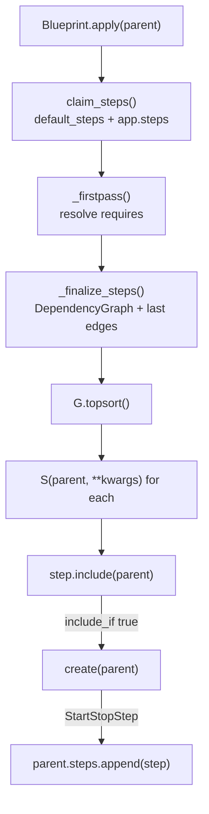
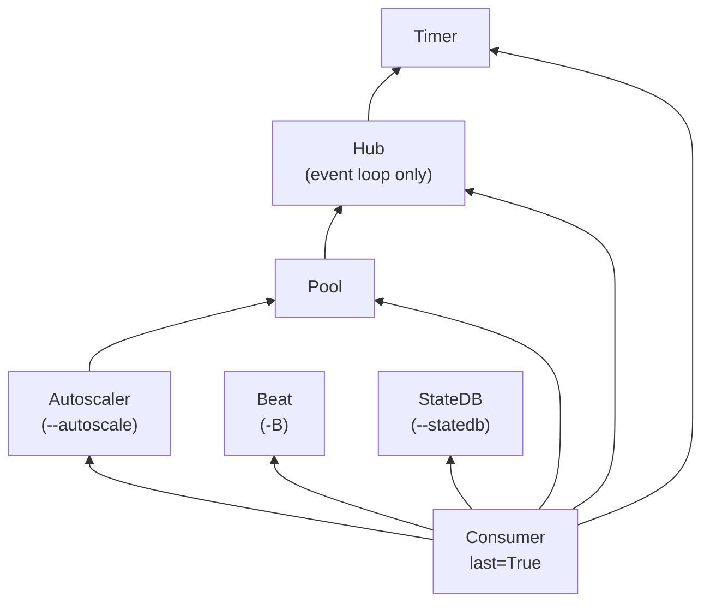
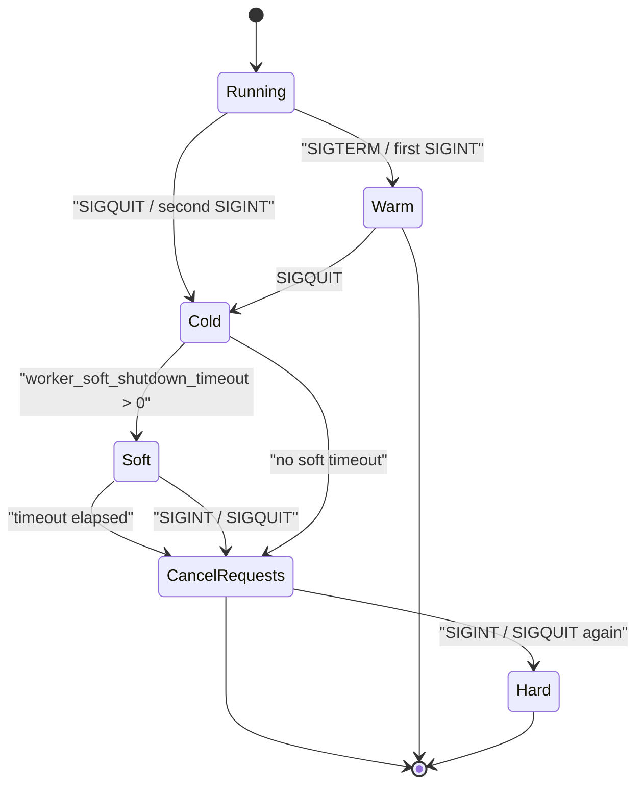

## Overview

A Celery worker is not one monolithic object: it is a `WorkController` whose parts (timer, event loop, pool, embedded beat, state database, consumer) are bootsteps. Each bootstep is a small class that declares what it needs, and a `Blueprint` sorts them into a dependency graph, creates them and starts and stops them in order. The same machinery runs a second blueprint inside the consumer, which is covered in [[Consumer and Message Handling]].

Sources: [celery/worker/worker.py:1-13](repo://celery/worker/worker.py#L1-L13), [celery/bootsteps.py:74-107](repo://celery/bootsteps.py#L74-L107)

Two layers sit on top of each other. `celery.worker.worker.WorkController` is a bare worker with no global side effects apart from `celery.worker.state`, usable in-process. `celery.apps.worker.Worker` subclasses it to become the program `celery worker` runs: it sets up logging, prints the banner and installs the signal handlers that turn `SIGTERM`, `SIGINT` and `SIGQUIT` into warm, cold and soft shutdowns.

Sources: [celery/apps/worker.py:1-8](repo://celery/apps/worker.py#L1-L8), [celery/apps/worker.py:91-127](repo://celery/apps/worker.py#L91-L127)

## Starting a worker

The `worker` command builds `app.Worker(...)` with the parsed options, calls `start()`, and exits with `worker.exitcode`. Everything between those two calls is the bootstep machinery.

Sources: [celery/bin/worker.py:358-367](repo://celery/bin/worker.py#L358-L367)

`WorkController.__init__` runs a fixed sequence of hooks so subclasses can act before and after the defaults are read:

Sources: [celery/worker/worker.py:90-99](repo://celery/worker/worker.py#L90-L99)

1. `app.loader.init_worker()` lets the loader prepare the process.
2. `on_before_init(**kwargs)`: the `Worker` program applies trace optimizations, sends `celeryd_init` and checks privileges against `accept_content`.
3. `setup_defaults(**kwargs)` resolves every option against its setting with `app.either`, so an explicit argument wins over configuration.
4. `on_after_init(**kwargs)` reads stdout redirection and colour options.
5. `setup_instance(**prepare_args(**kwargs))` selects queues, imports `include` modules, picks the concurrency (`cpu_count()`, or 2 when it cannot be detected), decides whether to use the event loop, sends `worker_init`, and finally builds and applies the worker blueprint.

Sources: [celery/worker/worker.py:90-139](repo://celery/worker/worker.py#L90-L139), [celery/apps/worker.py:94-120](repo://celery/apps/worker.py#L94-L120)

The event loop is used only when kombu detects the default (non-green) environment, the transport implements asynchronous I/O, and the platform is not Windows. This choice decides whether the `Hub` step is included and which consumer loop runs.

Sources: [celery/worker/worker.py:239-242](repo://celery/worker/worker.py#L239-L242)

`setup_queues` turns the `-Q` and `-X` options into `app.amqp.queues.select` and `deselect` calls. A name missing from `task_queues` raises `ImproperlyConfigured` with a hint about `task_create_missing_queues`. When `worker_direct` is on, the worker also consumes from its own per-node queue.

Sources: [celery/worker/worker.py:49-60](repo://celery/worker/worker.py#L49-L60), [celery/worker/worker.py:167-181](repo://celery/worker/worker.py#L167-L181)

## Bootsteps and Blueprints

### Step classes

`celery.bootsteps` defines three base classes. Each step gets its `name` from the `StepType` metaclass (the module plus the class name, unless set) and a `label` used in logs and graphs.

Sources: [celery/bootsteps.py:266-301](repo://celery/bootsteps.py#L266-L301)

| Class | Behaviour | Added to `parent.steps` |
| --- | --- | --- |
| `Step` | `__init__(parent)` runs when the blueprint is applied; `create(parent)` runs if `include_if(parent)` is true. Nothing is started or stopped. | No |
| `StartStopStep` | Keeps what `create` returns in `self.obj`, and forwards `start`, `stop` and `terminate` to it (`terminate` falls back to `stop`). | Yes, when included |
| `ConsumerStep` | A `StartStopStep` that requires the consumer `Connection`, opens a channel, and calls `consume()` on every consumer `get_consumers(channel)` returns. `stop` cancels them; `shutdown` closes their channels. | Yes, when included |

Sources: [celery/bootsteps.py:266-354](repo://celery/bootsteps.py#L266-L354), [celery/bootsteps.py:355-415](repo://celery/bootsteps.py#L355-L415)

### Inclusion and dependencies

Four class attributes control how a step joins a blueprint. `requires` lists steps that must start first, as classes or `module:Class` strings, and all of them must be in the same blueprint. `enabled` is the default answer of `include_if`, and steps commonly set it in `__init__` from an option. `conditional` only changes how the step is drawn. `last` marks the one step that must start after every other.

Sources: [celery/bootsteps.py:297-336](repo://celery/bootsteps.py#L297-L336)

```python
def include_if(self, parent):
    """Return true if bootstep should be included.

    You can define this as an optional predicate that decides whether
    this step should be created.
    """
    return self.enabled
```

Sources: [celery/bootsteps.py:322-328](repo://celery/bootsteps.py#L322-L328)

### Building the graph

`Blueprint.apply(parent)` turns the set of step types into ordered instances. `claim_steps` resolves every entry of `default_steps` plus the user steps with `symbol_by_name`. `_firstpass` walks `requires` breadth-first and adds steps that were only named as a dependency. `_finalize_steps` builds a `DependencyGraph`, adds an edge from the `last` step to every other node, and returns `G.topsort()`, so dependencies come before the steps that need them. An unresolvable name becomes `KeyError('unknown bootstep: ...')`. Each sorted class is instantiated with `(parent, **kwargs)`, and then `include(parent)` is called on each instance in order.

Sources: [celery/bootsteps.py:186-256](repo://celery/bootsteps.py#L186-L256)



Sources: [celery/bootsteps.py:186-256](repo://celery/bootsteps.py#L186-L256), [celery/bootsteps.py:333-339](repo://celery/bootsteps.py#L333-L339), [celery/bootsteps.py:378-383](repo://celery/bootsteps.py#L378-L383)

### Blueprint lifecycle

A blueprint moves through the states `initializing`, `running` (`RUN`), `closing` (`CLOSE`) and `terminating` (`TERMINATE`). `start(parent)` sets `RUN`, calls `on_start`, then starts each entry of `parent.steps` in order and counts them in `started`. `stop(parent, terminate=False)` does nothing if it is already closing; if the blueprint never finished starting (`started != len(parent.steps)`) it just marks itself terminated. Otherwise it calls `close` on every step, then `stop` (or `terminate`) on every step in reverse order with errors logged rather than raised, calls `on_stopped`, and sets `shutdown_complete` so `join()` can return.

Sources: [celery/bootsteps.py:23-26](repo://celery/bootsteps.py#L23-L26), [celery/bootsteps.py:109-184](repo://celery/bootsteps.py#L109-L184)

`send_all(parent, method)` is the general broadcast: it calls the named method on every step that defines it, in reverse unless `reverse=False`. `WorkController.register_with_event_loop` uses it to hand the hub to each step, and `info()` merges every step's `info()` into the `stats` reply.

Sources: [celery/bootsteps.py:122-153](repo://celery/bootsteps.py#L122-L153), [celery/worker/worker.py:214-218](repo://celery/worker/worker.py#L214-L218), [celery/worker/worker.py:326-334](repo://celery/worker/worker.py#L326-L334)

## The worker blueprint

### Default worker steps

`WorkController.Blueprint` is named `Worker` and lists seven default steps. User steps registered in `app.steps['worker']` are merged in by `setup_instance`.

Sources: [celery/worker/worker.py:76-88](repo://celery/worker/worker.py#L76-L88), [celery/worker/worker.py:129-139](repo://celery/worker/worker.py#L129-L139)

| Step | Kind | Requires | Included when | What it does |
| --- | --- | --- | --- | --- |
| `Timer` | `Step` | | always | Sets `w.timer`: a kombu `Timer(max_interval=10.0)` with the event loop, otherwise `worker_timer` or the pool's own `Timer` class. |
| `Hub` | `StartStopStep` | `Timer` | `w.use_eventloop` | Gets or creates the kombu event loop (or the transport's `requires_hub`), swaps the app clock and billiard pool locks for `DummyLock`. |
| `Pool` | `StartStopStep` | `Hub` | always | Parses `--autoscale`, builds the pool from `pool_cls` with limits and `max_tasks_per_child`, and sets `w.process_task`. |
| `Beat` | `StartStopStep` | | `beat=True` (`-B`) | Embeds `celery.beat.EmbeddedService`; refuses eventlet and gevent pools. |
| `StateDB` | `Step` | | `w.statedb` set | Creates `state.Persistent` and registers its `save` with `atexit`. |
| `Autoscaler` | `StartStopStep` | `Pool` | `w.autoscale` set | Starts the autoscaler; with the event loop it is driven by `hub.call_repeatedly` instead of a thread. |
| `Consumer` | `StartStopStep`, `last=True` | all others | always | Builds `w.consumer` with the prefetch count and starts the consumer blueprint. |

Sources: [celery/worker/components.py:32-115](repo://celery/worker/components.py#L32-L115), [celery/worker/components.py:181-246](repo://celery/worker/components.py#L181-L246), [celery/worker/autoscale.py:31-58](repo://celery/worker/autoscale.py#L31-L58)



Sources: [celery/worker/components.py:56-115](repo://celery/worker/components.py#L56-L115), [celery/worker/components.py:221-224](repo://celery/worker/components.py#L221-L224), [celery/worker/autoscale.py:31-36](repo://celery/worker/autoscale.py#L31-L36), [celery/bootsteps.py:235-249](repo://celery/bootsteps.py#L235-L249)

`celery graph bootsteps` prints this graph in dot format; by default it also joins in the consumer blueprint with `connect_with`.

Sources: [celery/bin/graph.py:18-30](repo://celery/bin/graph.py#L18-L30), [celery/bootsteps.py:214-216](repo://celery/bootsteps.py#L214-L216)

### Pool and prefetch wiring

The `Pool` step decides how tasks reach the pool. With the event loop (and not on Windows) it creates a `LaxBoundedSemaphore` sized to `min_concurrency`. If `worker_pool_putlocks` is on and the pool uses a semaphore, `w.process_task` becomes `_process_task_sem`, which acquires the semaphore before `req.execute_using_pool(self.pool)`. A `TaskRevokedError` from the request releases the slot again.

Sources: [celery/worker/components.py:138-172](repo://celery/worker/components.py#L138-L172), [celery/worker/worker.py:220-231](repo://celery/worker/worker.py#L220-L231)

The `Consumer` step computes the initial prefetch count as `max_concurrency * prefetch_multiplier` under autoscaling, or `concurrency * prefetch_multiplier` otherwise, and passes `w.process_task` as the consumer's `on_task_request` callback.

Sources: [celery/worker/components.py:221-246](repo://celery/worker/components.py#L221-L246)

## WorkController lifecycle

`start()` runs `blueprint.start(self)`. The consumer step is last and its `start` blocks in the consumer loop, so `start()` returns only when the worker stops. Exceptions are translated:

Sources: [celery/worker/worker.py:201-203](repo://celery/worker/worker.py#L201-L203), [celery/worker/consumer/consumer.py:857-869](repo://celery/worker/consumer/consumer.py#L857-L869)

| Raised during start | Result |
| --- | --- |
| `WorkerTerminate` | `terminate()` (cold) |
| any `Exception` | logged as `Unrecoverable error`, then `stop(exitcode=EX_FAILURE)` |
| `SystemExit` (including `WorkerShutdown`) | `stop(exitcode=exc.code)` |
| `KeyboardInterrupt` | `stop(exitcode=EX_FAILURE)` |

Sources: [celery/worker/worker.py:201-212](repo://celery/worker/worker.py#L201-L212)

`stop()` is the warm shutdown: if the blueprint is running it asks the consumer to close and, unless called from a signal handler on a pool that is not signal-safe, runs `_shutdown(warm=True)`. It always sends `worker_shutdown`. `terminate()` is the cold variant and passes `terminate=True` to `blueprint.stop`, which makes each step call `terminate` instead of `stop`. `_shutdown` wraps the stop and join in a 5-second default socket timeout.

Sources: [celery/worker/worker.py:244-267](repo://celery/worker/worker.py#L244-L267)

The blueprint callbacks tie the lifecycle to the process: `on_start` creates the pidfile lock, `on_close` calls `app.loader.shutdown_worker()`, and `on_stopped` stops the timer, shuts the consumer down and releases the pidlock.

Sources: [celery/worker/worker.py:150-165](repo://celery/worker/worker.py#L150-L165)

`reload(modules, reload=False)` imports task modules that are not loaded yet (or reloads them with `reload=True`), then rebuilds the consumer's strategies, resets rate limits and calls `pool.restart()` when the pool supports it. The `pool_restart` remote control command uses this path.

Sources: [celery/worker/worker.py:269-294](repo://celery/worker/worker.py#L269-L294), [celery/worker/control.py:570-574](repo://celery/worker/control.py#L570-L574)

## The Worker program

`Worker.on_init_blueprint` sets up logging before the steps are built. Its `on_start` extends the base hook in this order: create the pidlock, send `celeryd_after_setup` (the place to change queues after `-Q` was applied), purge messages when `--purge` was given, print the banner unless `--quiet`, set the process title to `-active-`, install the signal handlers, and redirect stdout and stderr to the logger when `worker_redirect_stdouts` is on and logging is not custom.

Sources: [celery/apps/worker.py:122-166](repo://celery/apps/worker.py#L122-L166)

The banner lists the node name, version, platform, app, transport and result backend URIs, concurrency with pool name (or `{min=..., max=...}` under autoscaling), task events, and the queues. At `INFO` level a `[tasks]` section lists the registered tasks, and at `DEBUG` the built-in `celery.*` tasks too.

Sources: [celery/apps/worker.py:52-71](repo://celery/apps/worker.py#L52-L71), [celery/apps/worker.py:198-252](repo://celery/apps/worker.py#L198-L252)

When the consumer is ready for the first time, `on_consumer_ready` sends the `worker_ready` signal and logs `<hostname> ready.`

Sources: [celery/apps/worker.py:180-182](repo://celery/apps/worker.py#L180-L182)

## Shutdown signals

### Signal handlers

`install_platform_tweaks` installs the handlers from `on_start`. Each shutdown handler built by `_shutdown_handler` runs its callback in the `MainProcess`, prints the shutdown type, sends `worker_shutting_down`, and then sets `state.should_stop` (warm) or `state.should_terminate` (cold). The consumer loop raises `WorkerShutdown` or `WorkerTerminate` the next time it calls `maybe_shutdown()`.

Sources: [celery/apps/worker.py:254-274](repo://celery/apps/worker.py#L254-L274), [celery/apps/worker.py:288-316](repo://celery/apps/worker.py#L288-L316), [celery/worker/state.py:88-93](repo://celery/worker/state.py#L88-L93)

| Signal | Handler | Effect |
| --- | --- | --- |
| `SIGTERM` | `install_worker_term_handler` | Warm shutdown. With `REMAP_SIGTERM == "SIGQUIT"` it is a cold shutdown instead. |
| `SIGINT` (Ctrl+C) | `install_worker_int_handler` | Warm shutdown with exit code `EX_FAILURE`; `on_SIGINT` rebinds `SIGINT` to the cold handler so a second Ctrl+C goes cold. |
| `SIGQUIT` | `install_worker_term_hard_handler` | Cold shutdown through `on_cold_shutdown`. |
| `SIGHUP` | `install_worker_restart_handler` | Only when not attached to a terminal: warm stop, then `os.execv` the same command line at exit. On macOS it only warns. |
| `SIGUSR1` | `install_cry_handler` | Prints the stack trace of every thread (not on PyPy). |
| `SIGUSR2` | `install_rdb_handler` | Opens a remote debugger, only if `CELERY_RDBSIG` is set. |

Sources: [celery/apps/worker.py:433-523](repo://celery/apps/worker.py#L433-L523)

### Cold and soft shutdown

`on_cold_shutdown` first rebinds `SIGINT` and `SIGQUIT` to `during_soft_shutdown`. It then calls `worker.wait_for_soft_shutdown()`, which sleeps `worker_soft_shutdown_timeout` seconds when that is positive and tasks are active (or always, with `worker_enable_soft_shutdown_on_idle`). This gives running tasks a bounded warm period. After the wait it cancels the task consumer so requeued messages are not redelivered to this worker, calls `consumer.cancel_active_requests()`, sets `state.should_terminate`, and stops the pool so finished tasks can still run `on_success`.

Sources: [celery/apps/worker.py:369-430](repo://celery/apps/worker.py#L369-L430), [celery/worker/worker.py:412-435](repo://celery/worker/worker.py#L412-L435)

A further `SIGINT` or `SIGQUIT` during that wait reaches `during_soft_shutdown`. It cancels the unacked requests at once and installs `on_hard_shutdown`, so the next signal raises `WorkerTerminate(EX_FAILURE)` and the process exits by force.

Sources: [celery/apps/worker.py:319-366](repo://celery/apps/worker.py#L319-L366)



Sources: [celery/apps/worker.py:288-316](repo://celery/apps/worker.py#L288-L316), [celery/apps/worker.py:369-466](repo://celery/apps/worker.py#L369-L466)

## Adding a custom bootstep

Add a step class to `app.steps['worker']` or `app.steps['consumer']`; both are sets on the app that the blueprints merge with their `default_steps`. A worker step receives the `WorkController` as `parent`, and a consumer step receives the `Consumer`. Because `StartStopStep.start` only forwards to `self.obj`, override `start` and `stop` directly when the step itself is the service.

Sources: [celery/app/base.py:370-370](repo://celery/app/base.py#L370-L370), [celery/bootsteps.py:355-383](repo://celery/bootsteps.py#L355-L383), [celery/worker/consumer/consumer.py:250-255](repo://celery/worker/consumer/consumer.py#L250-L255)

```python
from celery import Celery, bootsteps

app = Celery('proj')

class InfoStep(bootsteps.StartStopStep):
    requires = {'celery.worker.components:Pool'}

    def __init__(self, worker, **kwargs):
        self.enabled = True   # read by include_if()

    def start(self, worker):
        print('pool is', worker.pool)

    def stop(self, worker):
        print('worker stopping')

app.steps['worker'].add(InfoStep)
```

Sources: [celery/bootsteps.py:297-336](repo://celery/bootsteps.py#L297-L336), [celery/worker/components.py:101-115](repo://celery/worker/components.py#L101-L115)

> [!NOTE]
> Every name in `requires` must resolve to a step of the same blueprint. A worker step cannot require a consumer step, and an unknown name fails `apply` with `unknown bootstep`.

Sources: [celery/bootsteps.py:306-308](repo://celery/bootsteps.py#L306-L308), [celery/bootsteps.py:246-249](repo://celery/bootsteps.py#L246-L249)

## Configuration

`setup_defaults` maps keyword arguments to these settings; the argument wins when both are given. See [[Configuration and Settings]] for the full list.

Sources: [celery/worker/worker.py:351-410](repo://celery/worker/worker.py#L351-L410)

| Setting | Default | Used by |
| --- | --- | --- |
| `worker_concurrency` | CPU count | `Pool`, prefetch count |
| `worker_pool` | `prefork` | `Pool` (`-P`) |
| `worker_consumer` | `celery.worker.consumer:Consumer` | `Consumer` step |
| `worker_timer`, `worker_timer_precision` | pool timer, `1.0` | `Timer` |
| `worker_prefetch_multiplier` | `4` | `Consumer` step |
| `worker_pool_putlocks`, `worker_pool_restarts` | `True`, `False` | `Pool`, `reload` |
| `worker_state_db` | none | `StateDB` |
| `worker_autoscaler` | `celery.worker.autoscale:Autoscaler` | `Autoscaler` |
| `worker_lost_wait` | `10.0` | pool `lost_worker_timeout` |
| `worker_soft_shutdown_timeout`, `worker_enable_soft_shutdown_on_idle` | `0.0`, `False` | `wait_for_soft_shutdown` |
| `worker_redirect_stdouts`, `worker_redirect_stdouts_level` | `True`, `WARNING` | `Worker.on_start` |
| `worker_direct` | `False` | `setup_queues` |

Sources: [celery/app/defaults.py:325-375](repo://celery/app/defaults.py#L325-L375)
