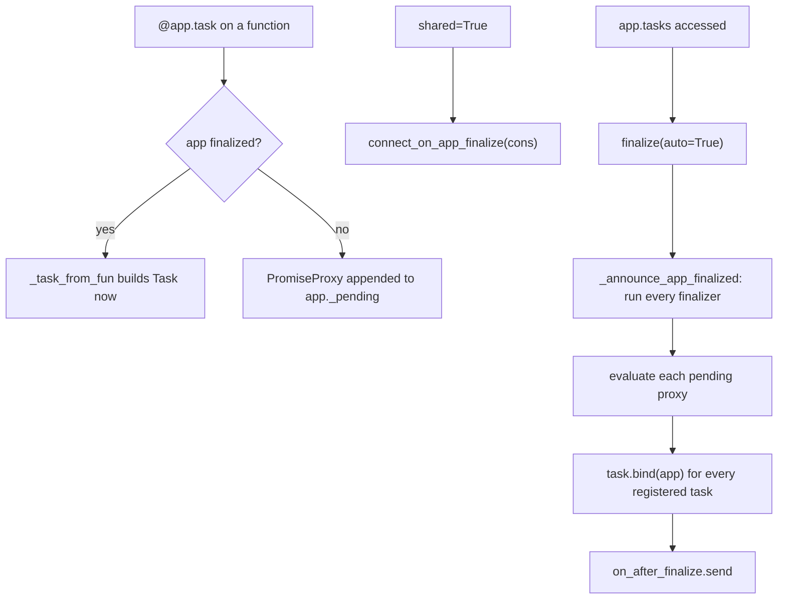

## Overview

Every Celery program starts with an instance of `celery.app.base.Celery`, usually called `app`. It owns the configuration, the task registry, the broker connection pool and the helper objects that publish messages, store results, send events and broadcast control commands. Nothing in Celery reads global settings directly: workers, beat, the CLI and tasks all reach their configuration through an app.

Sources: [celery/app/base.py:252-341](repo://celery/app/base.py#L252-L341)

The app is designed to be cheap to create and to defer work. Constructor arguments are stored, not applied; configuration is read on first access; the task registry is filled when the app is finalized; and each subsystem is created the first time something asks for it. This page follows that lifecycle. Where settings come from is described in [[Configuration and Loaders]], and the task classes the registry holds in [[Defining Tasks]].

Sources: [celery/app/base.py:343-434](repo://celery/app/base.py#L343-L434)

## Construction

`Celery.__init__` records the class names of its collaborators (`amqp_cls`, `events_cls`, `log_cls`, `control_cls`, `task_cls`, `registry_cls`, and a loader taken from the `CELERY_LOADER` environment variable or `celery.loaders.app:AppLoader`). Settings passed as keywords, including `broker` and `backend`, go into `_preconf`, a dict of pre-configuration changes; `_preconf_set_by_auto` remembers which keys came from these shortcuts so that a configuration module can still override them.

Sources: [celery/app/base.py:343-400](repo://celery/app/base.py#L343-L400), [celery/app/base.py:436-450](repo://celery/app/base.py#L436-L450)

`app.conf` is created as a `Settings` object wrapping a `PendingConfiguration`. Writes go straight to `_preconf`, but the first read of any key calls `_finalize_pending_conf`, which loads the real configuration. That is why `app.conf.update(...)` before `config_from_object` is kept rather than lost.

Sources: [celery/app/base.py:208-250](repo://celery/app/base.py#L208-L250), [celery/app/base.py:402-406](repo://celery/app/base.py#L402-L406)

The constructor then instantiates the fix-ups (by default only `celery.fixups.django:fixup`, which does nothing outside Django), makes the app current for this thread when `set_as_current` is true, creates the app signals and registers the app in a weak set of live apps.

Sources: [celery/app/base.py:82-84](repo://celery/app/base.py#L82-L84), [celery/app/base.py:408-434](repo://celery/app/base.py#L408-L434)

| Signal | Sent when |
| --- | --- |
| `on_configure` | Configuration is about to be loaded |
| `on_after_configure` | Configuration is loaded; receives `source` |
| `on_after_finalize` | All pending tasks are evaluated and bound |
| `on_after_fork` | A child process was forked; pools were reset |

Sources: [celery/app/base.py:321-341](repo://celery/app/base.py#L321-L341), [celery/app/base.py:419-428](repo://celery/app/base.py#L419-L428)

## The current and default app

`celery._state` keeps two notions of "the app". The current app is thread-local: `_tls.current_app` is set by every app created with `set_as_current=True`, so it is the last app instantiated in that thread. The default app is process-wide and is created on demand as a fallback `Celery('default')` with no fix-ups and the `default` loader. `current_app` is a `Proxy` that resolves to the current app, else the default app, on every attribute access.

Sources: [celery/_state.py:64-118](repo://celery/_state.py#L64-L118), [celery/_state.py:138-142](repo://celery/_state.py#L138-L142)

The same module holds the task stack. `push_current_task`/`pop_current_task` maintain a `LocalStack` of executing tasks, `current_task` proxies its top, and `get_current_worker_task` walks the stack to find the innermost task that the worker started (skipping tasks called directly as functions). `send_task` uses this to fill `parent_id` and `root_id` of tasks sent from inside a task.

Sources: [celery/_state.py:73-136](repo://celery/_state.py#L73-L136), [celery/app/base.py:1502-1514](repo://celery/app/base.py#L1502-L1514)

> [!TIP]
> Setting `CELERY_TRACE_APP` makes `app_or_default` raise when code falls back to the default app in the main process, which finds library code that forgets to pass `app=` through. `C_STRICT_APP` and `C_WARN_APP` do the same for `get_current_app`.

Sources: [celery/_state.py:107-118](repo://celery/_state.py#L107-L118), [celery/_state.py:163-197](repo://celery/_state.py#L163-L197)

## Finalization

Finalizing an app turns task declarations into registered task instances. It happens once, under `_finalize_mutex`, either explicitly with `app.finalize()` or automatically the first time `app.tasks` is read (unless the app was created with `autofinalize=False`, in which case auto-finalization raises `RuntimeError('Contract breach: app not finalized')`).

Sources: [celery/app/base.py:657-677](repo://celery/app/base.py#L657-L677), [celery/app/base.py:1601-1609](repo://celery/app/base.py#L1601-L1609)

Sources: [celery/app/base.py:554-585](repo://celery/app/base.py#L554-L585), [celery/app/base.py:657-677](repo://celery/app/base.py#L657-L677), [celery/_state.py:43-52](repo://celery/_state.py#L43-L52)

The decorator registers a finalizer callback for every task by default (`shared=True`), so any app finalized later in the process gets its own copy of the task. Built-in tasks such as `celery.chord_unlock` and `celery.backend_cleanup` use the same `connect_on_app_finalize` hook. The `PromiseProxy` returned before finalization evaluates itself on first use and then caches the real task, so code that only imports a task module never builds classes.

Sources: [celery/app/base.py:554-570](repo://celery/app/base.py#L554-L570), [celery/local.py:282-358](repo://celery/local.py#L282-L358)

`shared_task` takes this further for libraries that do not know which app will use them. It registers the finalizer, adds the task immediately to every already-finalized app, and returns a `Proxy` that looks the task up in the current app's registry on every access.

Sources: [celery/app/__init__.py:24-76](repo://celery/app/__init__.py#L24-L76)

## Configuration loading

`_load_config` sends `on_configure`, applies a `config_source` given to the constructor, merges the loader's configuration with `_preconf` through `detect_settings` (which also decides between old upper-case and new lower-case setting names), and swaps the result into the existing `Settings` object in place so that references taken earlier stay valid. It then evaluates defaults added lazily with `add_defaults`, registers periodic tasks queued by `add_periodic_task` before configuration existed, and sends `on_after_configure`. [[Configuration and Loaders]] explains the sources in detail.

Sources: [celery/app/base.py:1230-1280](repo://celery/app/base.py#L1230-L1280)

## Subsystems created on demand

Each helper is created on first access and cached. Classes that need to know their app (the task base class, results, the worker programs) are produced by `subclass_with_self`, which creates a subclass with the app stored in a class attribute, so `app.AsyncResult(task_id)` needs no `app=` argument.

Sources: [celery/app/base.py:1335-1375](repo://celery/app/base.py#L1335-L1375)

| Attribute | Object | Page |
| --- | --- | --- |
| `app.conf` | `Settings` | [[Configuration and Loaders]] |
| `app.loader` | `AppLoader` or the configured loader | [[Configuration and Loaders]] |
| `app.tasks` | `TaskRegistry` (finalizes the app) | [[Defining Tasks]] |
| `app.Task` | Base task class bound to this app | [[Defining Tasks]] |
| `app.amqp` | `celery.app.amqp.AMQP`: queues, router, message creation | [[Publishing Task Messages]] |
| `app.backend` | Result backend from `result_backend` | [[Result Backends]] |
| `app.control` | `Control`: broadcast and inspect | [[Remote Control and Inspection]] |
| `app.events` | `Events`: dispatcher, receiver, state | [[Events and Monitoring]] |
| `app.log` | `Logging` | [[Logging]] |
| `app.Worker`, `app.WorkController` | Worker program and embeddable worker | [[Worker Startup and Bootsteps]] |
| `app.Beat` | Beat program | [[Periodic Tasks with Beat]] |
| `app.AsyncResult`, `app.GroupResult` | Result classes | [[Task Results]] |

Sources: [celery/app/base.py:1430-1500](repo://celery/app/base.py#L1430-L1500), [celery/app/base.py:1534-1609](repo://celery/app/base.py#L1534-L1609)

The backend is an exception to plain caching. `_get_backend` resolves the class from the `result_backend` URL; if the instance declares `thread_safe` it is cached on the app, otherwise each thread keeps its own instance in `app._local`.

Sources: [celery/app/base.py:1224-1228](repo://celery/app/base.py#L1224-L1228), [celery/app/base.py:1539-1563](repo://celery/app/base.py#L1539-L1563)

## Connections and producers

The app distinguishes the broker URL used for consuming (`broker_read_url`) from the one used for publishing (`broker_write_url`); both fall back to `broker_url`. `connection_for_read` and `connection_for_write` build a lazy kombu `Connection` from that URL and the `broker_*` settings (user, password, vhost, SSL, transport options, failover strategy, connect timeout).

Sources: [celery/app/base.py:1043-1127](repo://celery/app/base.py#L1043-L1127)

Publishing code does not open connections itself. `app.pool` is a kombu connection pool limited by `broker_pool_limit`, and `amqp.producer_pool` is a producer pool on top of it. `connection_or_acquire` and `producer_or_acquire` return a `FallbackContext`: inside a `with` block they use the connection or producer passed in, or acquire one from the pool and release it afterwards. When every slot is busy for longer than `broker_pool_acquire_timeout`, acquisition raises `OperationalError` with a message that names both settings.

Sources: [celery/app/base.py:1131-1191](repo://celery/app/base.py#L1131-L1191), [celery/app/base.py:1488-1500](repo://celery/app/base.py#L1488-L1500)

## Forking and pickling

Connection pools must not be shared with a forked child. The first time `app.pool` is built, `_ensure_after_fork` registers `_after_fork_cleanup_app` with multiprocessing's after-fork hook; in the child, `_after_fork` drops the connection pool and the producer pool and sends `on_after_fork`.

Sources: [celery/app/base.py:118-124](repo://celery/app/base.py#L118-L124), [celery/app/base.py:460-464](repo://celery/app/base.py#L460-L464), [celery/app/base.py:1282-1288](repo://celery/app/base.py#L1282-L1288)

An app can be pickled, which the prefork pool relies on when it cannot fork. `__reduce__` pickles only the constructor keywords from `__reduce_keys__`: the main name, the configuration changes (not the defaults), the class names and the config source. `_unpickle_app_v2` rebuilds the app with `set_as_current=False`. Subclasses that override `__reduce_args__` keep the older positional protocol through `AppPickler`.

Sources: [celery/app/base.py:1391-1428](repo://celery/app/base.py#L1391-L1428), [celery/app/utils.py:289-324](repo://celery/app/utils.py#L289-L324)

## Cleanup and use as a context manager

`app.close()` drops the connection pool and removes the app from the registry of live apps. The app supports `with Celery(set_as_current=False) as app:` for short-lived apps, which calls `close()` on exit.

Sources: [celery/app/base.py:466-478](repo://celery/app/base.py#L466-L478), [celery/app/base.py:1382-1386](repo://celery/app/base.py#L1382-L1386)
