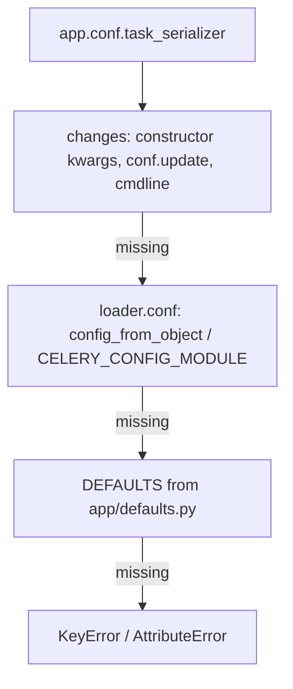

## Overview

A Celery app's settings come from several layers: keyword arguments to the constructor, values assigned to `app.conf`, a configuration object or module, command-line arguments, a few environment variables, and the built-in defaults. This page explains how those layers are stacked into one `Settings` object, how setting names are validated and translated, and how loaders read configuration modules and import task modules. [[The Celery Application]] covers when configuration is loaded during the app's lifecycle; Django's settings-based variant is in [[Django Integration]].

Sources: [celery/app/base.py:1247-1280](repo://celery/app/base.py#L1247-L1280), [celery/app/utils.py:232-286](repo://celery/app/utils.py#L232-L286)

## Configuration sources

The app offers three methods to point it at configuration. None of them reads anything at once unless forced or the app is already configured: they record the source, which `_load_config` applies when a setting is first read.

Sources: [celery/app/base.py:703-748](repo://celery/app/base.py#L703-L748)

| Method | What it takes |
| --- | --- |
| `config_from_object(obj, silent=False, force=False, namespace=None)` | A module, class or object, or the dotted name of one (`'proj.celeryconfig'` or `'proj.settings:Config'`) |
| `config_from_envvar(name, silent=False, force=False)` | The name of an environment variable holding a module name; raises `ImproperlyConfigured` if unset unless `silent` |
| `config_from_cmdline(argv, namespace='celery')` | `key=value` strings, merged immediately into `app.conf` |
| `add_defaults(d_or_fun)` | A dict or a callable returning one, added as a default layer (lazily if not yet configured) |

Sources: [celery/app/base.py:679-748](repo://celery/app/base.py#L679-L748)

```python
app = Celery('proj')
app.conf.update(task_serializer='json')        # kept: written to the pending layer
app.config_from_object('proj.celeryconfig')    # read later, on first access
app.conf.broker_url                            # triggers loading
```

Sources: [celery/app/base.py:208-250](repo://celery/app/base.py#L208-L250), [celery/app/base.py:703-725](repo://celery/app/base.py#L703-L725)

A string passed to `config_from_object` is imported by the loader's `_smart_import`: a `module:attr` path goes through `symbol_by_name`; otherwise it is tried as a module first and then as `module.attribute`. The object is turned into a mapping with `force_mapping`, so a module's or class's attributes become settings. A key named `override_backends` in that object replaces the loader's backend aliases.

Sources: [celery/loaders/base.py:119-145](repo://celery/loaders/base.py#L119-L145)

## How the layers stack

`detect_settings` builds the final `Settings`, a `ConfigurationView` (a `ChainMap` with attribute access). The first map holds changes (`_preconf`, the constructor keywords and pending writes), then the loader's configuration, then a deep copy of the defaults. Lookups go through the maps in that order; writes always land in the changes map.

Sources: [celery/app/utils.py:279-286](repo://celery/app/utils.py#L279-L286), [celery/utils/collections.py:353-405](repo://celery/utils/collections.py#L353-L405)



Sources: [celery/utils/collections.py:384-401](repo://celery/utils/collections.py#L384-L401), [celery/app/utils.py:232-286](repo://celery/app/utils.py#L232-L286)

A handful of settings are properties on `Settings` that consult the environment before the maps. `CELERY_BROKER_URL`, `CELERY_BROKER_READ_URL`, `CELERY_BROKER_WRITE_URL` and `CELERY_RESULT_BACKEND` win over any configured value; the CLI's `-b` and `--result-backend` options work by setting these variables. `task_default_exchange` and `task_default_routing_key` fall back to `task_default_queue`, and `timezone` falls back to Django's `TIME_ZONE`.

Sources: [celery/app/utils.py:84-131](repo://celery/app/utils.py#L84-L131), [celery/bin/celery.py:123-133](repo://celery/bin/celery.py#L123-L133)

## Namespaces and setting names

### Prefixes

`config_from_object(..., namespace='CELERY')` sets a prefix on the view. Every lookup of `broker_url` then first tries `CELERY_BROKER_URL` (matching the case of the prefix) and then the bare key. This is how a Django settings module can hold Celery settings next to its own without clashes.

Sources: [celery/app/base.py:720-721](repo://celery/app/base.py#L720-L721), [celery/utils/collections.py:367-382](repo://celery/utils/collections.py#L367-L382)

### Old and new names

Celery 4 renamed the upper-case settings (`CELERY_TASK_SERIALIZER`, `CELERYD_CONCURRENCY`, `BROKER_URL`) to lower-case names grouped by namespace (`task_serializer`, `worker_concurrency`, `broker_url`). `detect_settings` counts how many keys of each style the configuration uses and picks the majority style, translating the constructor's keys to match. If the minority keys have no counterpart in the chosen style it raises `ImproperlyConfigured` with a list of renames. A namespace prefix always forces the new style. Settings in the old style are recorded as deprecated and produce warnings.

Sources: [celery/app/utils.py:232-286](repo://celery/app/utils.py#L232-L286), [celery/app/utils.py:197-209](repo://celery/app/utils.py#L197-L209)

## The defaults table

### Declaring options

`celery/app/defaults.py` declares every setting once, as an `Option` with a default, a type, and the old names it replaces, nested in `Namespace` groups (`broker`, `result`, `task`, `worker`, `beat`, `event`, `redis`, `database`, `security` and one per backend). `flatten` walks that tree to produce `DEFAULTS` (`broker_url`, `task_serializer`…) and the two maps between old and new keys.

Sources: [celery/app/defaults.py:42-108](repo://celery/app/defaults.py#L42-L108), [celery/app/defaults.py:378-413](repo://celery/app/defaults.py#L378-L413)

The `Option.type` drives conversion of string values, used when settings come from the command line. `find(name, namespace)` locates an option by short or full name, which `app.conf.find_option` and `find_value_for_key` expose.

Sources: [celery/app/defaults.py:49-59](repo://celery/app/defaults.py#L49-L59), [celery/app/defaults.py:427-447](repo://celery/app/defaults.py#L427-L447), [celery/app/utils.py:141-170](repo://celery/app/utils.py#L141-L170)

### Settings given on the command line

Extra arguments after `celery worker` (for example `celery -A proj worker -- broker.pool_limit=20`) are passed to `app.config_from_cmdline(ctx.args, namespace='worker')`. The loader's `cmdline_config_parser` lower-cases each key, turns dots into underscores, expands a leading `_` or `.` to the given namespace, and converts the value with the option's type. A `(json)`, `(list)`, `(dict)` or `(tuple)` prefix on the value parses it as JSON instead.

Sources: [celery/loaders/base.py:161-206](repo://celery/loaders/base.py#L161-L206), [celery/bin/worker.py:328-335](repo://celery/bin/worker.py#L328-L335)

## Inspecting configuration

`app.conf.humanize()` and `table()` list the changed settings (or all of them with `with_defaults=True`), masking values whose keys look secret (`API`, `TOKEN`, `KEY`, `SECRET`, `PASS`, `DATABASE`…). `celery report` prints this together with versions, through `app.bugreport()`.

Sources: [celery/app/utils.py:37-40](repo://celery/app/utils.py#L37-L40), [celery/app/utils.py:181-195](repo://celery/app/utils.py#L181-L195), [celery/bin/celery.py:166-172](repo://celery/bin/celery.py#L166-L172)

## Loaders

### Choosing a loader

A loader decides where configuration comes from when the app has no explicit source, which modules are imported to find tasks, and what happens around worker start, child process start and each task. The app's loader class is resolved by `get_loader_cls` from an alias or a dotted path.

Sources: [celery/loaders/__init__.py:1-18](repo://celery/loaders/__init__.py#L1-L18), [celery/loaders/base.py:33-81](repo://celery/loaders/base.py#L33-L81)

| Loader | Alias | Used by | Configuration source |
| --- | --- | --- | --- |
| `AppLoader` | `app` | Every app you create | Only what `config_from_object` sets; otherwise the module named by `CELERY_CONFIG_MODULE` if that variable is set |
| `Loader` | `default` | The fallback default app | `CELERY_CONFIG_MODULE` or a `celeryconfig` module; missing module gives empty settings (warns if `C_WNOCONF` is set) |

Sources: [celery/loaders/app.py:1-8](repo://celery/loaders/app.py#L1-L8), [celery/loaders/default.py:1-44](repo://celery/loaders/default.py#L1-L44), [celery/loaders/base.py:208-216](repo://celery/loaders/base.py#L208-L216)

The `--loader` CLI option sets `CELERY_LOADER`, which the app consults before its own `loader_cls`.

Sources: [celery/app/base.py:436-442](repo://celery/app/base.py#L436-L442), [celery/bin/celery.py:123-125](repo://celery/bin/celery.py#L123-L125)

### Importing task modules

A worker must import every module that defines tasks before it consumes messages, or it rejects messages for tasks it does not know. `WorkController` calls `loader.init_worker()`, which runs `import_default_modules` once: it sends the `import_modules` signal (which runs lazy autodiscovery), then imports the loader's `builtin_modules`, the `imports` setting and the `include` setting. Exceptions returned by signal receivers are re-raised there, since logging is not set up yet and they would otherwise vanish.

Sources: [celery/loaders/base.py:83-117](repo://celery/loaders/base.py#L83-L117), [celery/loaders/base.py:223-229](repo://celery/loaders/base.py#L223-L229), [celery/worker/worker.py:89-93](repo://celery/worker/worker.py#L89-L93)

### Autodiscovery

`app.autodiscover_tasks(packages, related_name='tasks', force=False)` finds a `tasks` module in each listed package. By default it is lazy: it connects to the `import_modules` signal so discovery runs when the worker imports its default modules. With no packages it asks the fix-ups (the Django fix-up returns the installed apps). `packages` may be a callable, evaluated at discovery time.

Sources: [celery/app/base.py:782-844](repo://celery/app/base.py#L782-L844)

`find_related_module` imports the package, then `package.tasks`. A `ModuleNotFoundError` for exactly that module name means the package has no tasks module and is skipped; any other import error came from inside the module and is raised. A module-level flag guards against recursion when a task module itself triggers discovery.

Sources: [celery/loaders/base.py:239-278](repo://celery/loaders/base.py#L239-L278)
