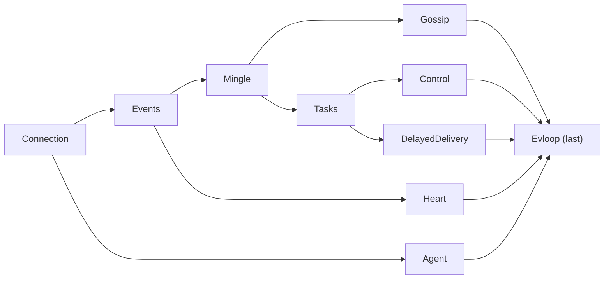
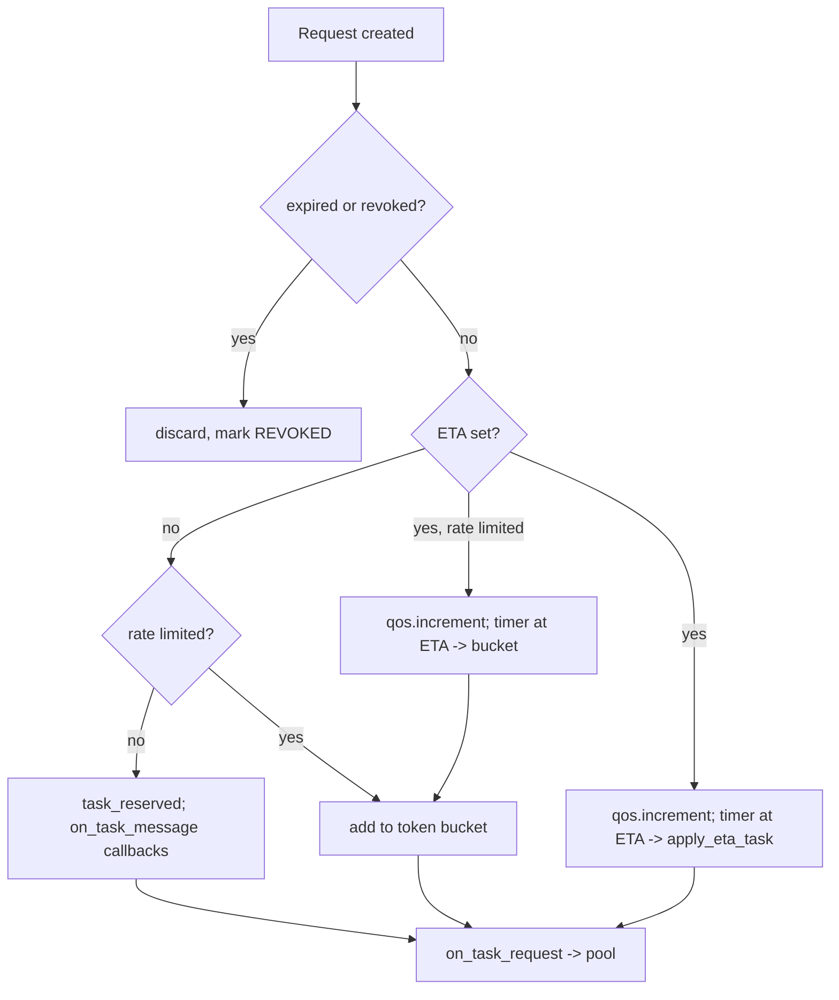

## Overview

The consumer is the part of the worker that talks to the broker. It owns the consuming connection, receives task messages, turns each into a `Request` and decides when that request may run: now, at its ETA, or when its rate limit allows. It also limits how many unacknowledged messages the broker sends (prefetch), reconnects after connection loss, and hosts the other broker-facing services: monitoring events, worker heartbeats, the remote-control mailbox and clock synchronization with other workers.

Sources: [celery/worker/consumer/consumer.py:145-255](repo://celery/worker/consumer/consumer.py#L145-L255)

The consumer is created as the last step of the worker blueprint ([[Worker Startup and Bootsteps]]) and is itself a blueprint of steps. Once a request is handed to the pool, [[Task Execution and Tracing]] takes over.

Sources: [celery/worker/components.py:221-246](repo://celery/worker/components.py#L221-L246)

## The consumer blueprint

### Steps

The consumer's `Blueprint` lists ten default steps plus any in `app.steps['consumer']`. Their `requires` declarations give this start order:

Sources: [celery/worker/consumer/consumer.py:171-189](repo://celery/worker/consumer/consumer.py#L171-L189)

Sources: [celery/worker/consumer/events.py:15-18](repo://celery/worker/consumer/events.py#L15-L18), [celery/worker/consumer/mingle.py:13-24](repo://celery/worker/consumer/mingle.py#L13-L24), [celery/worker/consumer/gossip.py:23-30](repo://celery/worker/consumer/gossip.py#L23-L30), [celery/worker/consumer/tasks.py:20-23](repo://celery/worker/consumer/tasks.py#L20-L23), [celery/worker/consumer/control.py:18-21](repo://celery/worker/consumer/control.py#L18-L21), [celery/worker/consumer/consumer.py:857-872](repo://celery/worker/consumer/consumer.py#L857-L872)

| Step | Does | Disabled by |
| --- | --- | --- |
| `Connection` | Opens `c.connection` with `connect()`, retrying | |
| `Events` | Creates the event dispatcher; flushes events buffered while disconnected | no task events, gossip or heartbeat |
| `Mingle` | Asks other workers (`hello`) for their logical clock and revoked ids | `--without-mingle`; transports other than AMQP, Redis, GC Pub/Sub |
| `Gossip` | Consumes worker events to track other nodes and run elections | `--without-gossip`; transports other than AMQP, Redis |
| `Heart` | Sends `worker-online`, then `worker-heartbeat` every 2 s, then `worker-offline` | `--without-heartbeat` |
| `Tasks` | Builds strategies, sets QoS and creates the task consumer | |
| `Control` | Starts the pidbox for remote-control commands | `worker_enable_remote_control=False`; no fanout support |
| `DelayedDelivery` | Sets up RabbitMQ native delayed delivery | no quorum queues |
| `Agent` | Starts a `cell` actor agent | unset `worker_agent` |
| `Evloop` | Runs the message loop (never returns while running) | |

Sources: [celery/worker/consumer/connection.py:13-45](repo://celery/worker/consumer/connection.py#L13-L45), [celery/worker/consumer/events.py:15-55](repo://celery/worker/consumer/events.py#L15-L55), [celery/worker/consumer/mingle.py:13-76](repo://celery/worker/consumer/mingle.py#L13-L76), [celery/worker/consumer/gossip.py:23-79](repo://celery/worker/consumer/gossip.py#L23-L79), [celery/worker/consumer/heart.py:10-36](repo://celery/worker/consumer/heart.py#L10-L36), [celery/worker/heartbeat.py:25-61](repo://celery/worker/heartbeat.py#L25-L61), [celery/worker/consumer/control.py:18-32](repo://celery/worker/consumer/control.py#L18-L32), [celery/worker/consumer/agent.py:9-21](repo://celery/worker/consumer/agent.py#L9-L21)

Mingle runs once per (re)start with a one-second `inspect.hello` broadcast, so a worker joining a cluster learns which tasks were revoked while it was away and advances its Lamport clock. Gossip and Heart feed the event stream described in [[Events and Monitoring]]; Control is covered in [[Remote Control and Inspection]], and DelayedDelivery in [[Routing and Queues]].

Sources: [celery/worker/consumer/mingle.py:36-76](repo://celery/worker/consumer/mingle.py#L36-L76)

### The Tasks step

`Tasks.start` calls `update_strategies`, which builds, for every registered task, a strategy (a closure produced by the task's `Strategy`, by default `celery.worker.strategy:default`) and a tracer, stored in `task.__trace__`. It then sets the initial prefetch with `basic_qos`, creates the task consumer for the selected queues with `on_decode_error`, and wraps prefetch updates in a kombu `QoS` object capped by `worker_eta_task_limit`. With `worker_disable_prefetch` on a Redis broker, the channel's `can_consume` is patched to refuse new messages while as many tasks are reserved as the pool has processes.

Sources: [celery/worker/consumer/tasks.py:29-83](repo://celery/worker/consumer/tasks.py#L29-L83), [celery/worker/consumer/consumer.py:716-721](repo://celery/worker/consumer/consumer.py#L716-L721)

## Connecting and reconnecting

### Connection retries

`Consumer.connect()` gets a read connection with the negotiated heartbeat (`broker_heartbeat`, used only with the event loop or green pools) and registers it with the hub. `ensure_connected` retries with kombu's `ensure_connection` up to `broker_connection_max_retries` (default 100), logging each attempt (or the failover to the next URL) and calling `maybe_shutdown` between attempts so a shutdown signal still works. On the first connection `broker_connection_retry_on_startup` decides whether to retry; afterwards `broker_connection_retry` does.

Sources: [celery/worker/consumer/consumer.py:549-622](repo://celery/worker/consumer/consumer.py#L549-L622), [celery/worker/consumer/consumer.py:231-237](repo://celery/worker/consumer/consumer.py#L231-L237)

### The restart loop

`Consumer.start()` loops while the blueprint is not stopping: it starts the blueprint and, when a connection error (or a channel error, with `broker_channel_error_retry`) escapes, restarts it. A restart limiter logs "Frequent restarts detected" and sleeps a second if more than five restarts happen within a second. If retrying is disabled the worker shuts down with exit code 1; "too many open files" (`EMFILE`) terminates it.

Sources: [celery/worker/consumer/consumer.py:366-413](repo://celery/worker/consumer/consumer.py#L366-L413)

After a connection that had been working breaks, `on_connection_error_after_connected`:

Sources: [celery/worker/consumer/consumer.py:419-491](repo://celery/worker/consumer/consumer.py#L419-L491)

1. Collects and closes the broken connection with a bounded socket timeout, so cleanup cannot hang.
2. With `worker_cancel_long_running_tasks_on_connection_loss`, cancels running `acks_late` tasks that are not yet acknowledged: their messages will be redelivered by the broker anyway, and running them twice is worse. Otherwise it warns that this will become the default.
3. With `worker_enable_prefetch_count_reduction`, lowers the initial prefetch by the number of active tasks so the new connection does not receive more than the pool can take; each later ack raises it again by one multiplier until it is back at the maximum. With per-consumer QoS (quorum queues) this reduction is skipped, because the broker would never apply the restoration.

Sources: [celery/worker/consumer/consumer.py:788-815](repo://celery/worker/consumer/consumer.py#L788-L815)

`on_close` then discards reserved but inactive requests (their delivery tags are tied to the dead channel) and flushes the pool's internal queues, and the blueprint restarts.

Sources: [celery/worker/consumer/consumer.py:532-547](repo://celery/worker/consumer/consumer.py#L532-L547)

## The message loop

### asynloop

With the event loop enabled, `Evloop` runs `asynloop`. It installs the task handler as the consumer's `on_message`, enables AMQP heartbeat checks on the hub's timer, registers the worker's and consumer's steps with the hub, starts consuming and calls `on_ready` (which sends `worker_ready`). On the first start it fails with `WorkerLostError` if the pool processes could not start. Each iteration checks the shutdown flags, raises a recorded heartbeat error, applies pending QoS changes (only between reads, so remote-control commands get priority), and advances the hub's loop by one step.

Sources: [celery/worker/loops.py:28-130](repo://celery/worker/loops.py#L28-L130)

### synloop

Transports without asynchronous I/O, and eventlet or gevent pools, use `synloop`: a blocking loop that runs deferred operations (acks queued with `call_soon`), then `drain_events(timeout=2.0)`. Acknowledgements bypass the deferral through `call_soon_ack`, so with `acks_late` the next message is not delayed until unrelated traffic arrives.

Sources: [celery/worker/loops.py:133-183](repo://celery/worker/loops.py#L133-L183), [celery/worker/consumer/consumer.py:257-294](repo://celery/worker/consumer/consumer.py#L257-L294)

Either loop resets the hub and clears its timers when it exits with an error, so stale callbacks from the old connection cannot fire after reconnecting.

Sources: [celery/worker/loops.py:100-130](repo://celery/worker/loops.py#L100-L130)

## From message to request

### create_task_handler

`on_task_received(message)` reads the task name from the `task` header (protocol 2). Messages without headers are decoded and read as protocol 1. Then:

Sources: [celery/worker/consumer/consumer.py:723-786](repo://celery/worker/consumer/consumer.py#L723-L786)

| Situation | Handling |
| --- | --- |
| Not a task message | Logged as unknown, rejected, `task_rejected` signal |
| Task name not registered | Logged with the body, rejected, `FAILURE` with `NotRegistered` stored, `task-failed` event, `task_unknown` signal |
| Malformed (`InvalidTaskError`) or disallowed content type | Logged, rejected, `task_rejected` signal |
| Decode error | Logged critically and acknowledged |
| Known task | Strategy called with ack and reject promises |

Sources: [celery/worker/consumer/consumer.py:672-714](repo://celery/worker/consumer/consumer.py#L672-L714), [celery/worker/consumer/consumer.py:516-530](repo://celery/worker/consumer/consumer.py#L516-L530)

The ack and reject callbacks are promises that run `message.ack_log_error`/`reject_log_error` on the consumer's thread, and after a reconnect also restore the prefetch count step by step.

Sources: [celery/worker/consumer/consumer.py:753-780](repo://celery/worker/consumer/consumer.py#L753-L780)

### The default strategy

The strategy is built once per task with everything it needs cached in local variables, and its `task_message_handler` runs for every message:

Sources: [celery/worker/strategy.py:98-130](repo://celery/worker/strategy.py#L98-L130)

1. Converts protocol 1 or hybrid bodies to protocol 2.
2. Creates the `Request` with the message, ack/reject callbacks, hostname, event dispatcher and decoded headers; the body stays serialized until the pool runs it.
3. Logs `Received task`, and returns early if the request is expired or revoked.
4. Sends the `task_received` signal and, if task events are on, a `task-received` event.
5. Converts the ETA to a timestamp in system time (rejecting the message if it cannot), and looks up the task's rate-limit bucket.
6. Dispatches the request as shown below.

Sources: [celery/worker/strategy.py:132-208](repo://celery/worker/strategy.py#L132-L208)

Sources: [celery/worker/strategy.py:166-208](repo://celery/worker/strategy.py#L166-L208)

## ETA tasks and prefetch

A message with an ETA is acknowledged only after it runs, so it occupies a prefetch slot for the whole wait. To keep the pool fed meanwhile, the strategy calls `qos.increment_eventually()` before scheduling it on the timer, and `apply_eta_task` decrements again when it fires and hands the request over. `worker_eta_task_limit` caps how far the prefetch can grow this way. With quorum queues, prefetch cannot grow, which is why native delayed delivery exists ([[Routing and Queues]]).

Sources: [celery/worker/strategy.py:192-201](repo://celery/worker/strategy.py#L192-L201), [celery/worker/consumer/consumer.py:659-663](repo://celery/worker/consumer/consumer.py#L659-L663), [celery/worker/consumer/tasks.py:54-57](repo://celery/worker/consumer/tasks.py#L54-L57)

The prefetch count starts at `concurrency × worker_prefetch_multiplier` (default 4). When the autoscaler or the `pool_grow`/`pool_shrink` commands change the pool size, `_update_prefetch_count` adjusts it by the change times the multiplier.

Sources: [celery/worker/components.py:227-230](repo://celery/worker/components.py#L227-L230), [celery/worker/consumer/consumer.py:305-327](repo://celery/worker/consumer/consumer.py#L305-L327)

## Rate limits

Each task with a `rate_limit` gets a `TokenBucket` with capacity 1 and the configured fill rate; tasks without one have no bucket. A rate-limited request is added to its bucket, and `_schedule_bucket_request` moves requests to the pool while tokens are available. When the bucket is empty it puts the request back at the head (preserving order) and schedules itself on the timer after the bucket's expected wait. Rate limits are per worker, not cluster-wide, and `worker_disable_rate_limits` turns them off. The `rate_limit` control command changes a task's limit at run time and calls `reset_rate_limits`.

Sources: [celery/worker/consumer/consumer.py:296-364](repo://celery/worker/consumer/consumer.py#L296-L364)

## Shutdown helpers

`cancel_active_requests()` is used during cold shutdown and after connection loss. It cancels every running request that is not `acks_late`, and every `acks_late` request not yet acknowledged unless it already succeeded. Cancelled `acks_late` tasks are left to the broker to redeliver without emitting a retry.

Sources: [celery/worker/consumer/consumer.py:823-854](repo://celery/worker/consumer/consumer.py#L823-L854)
