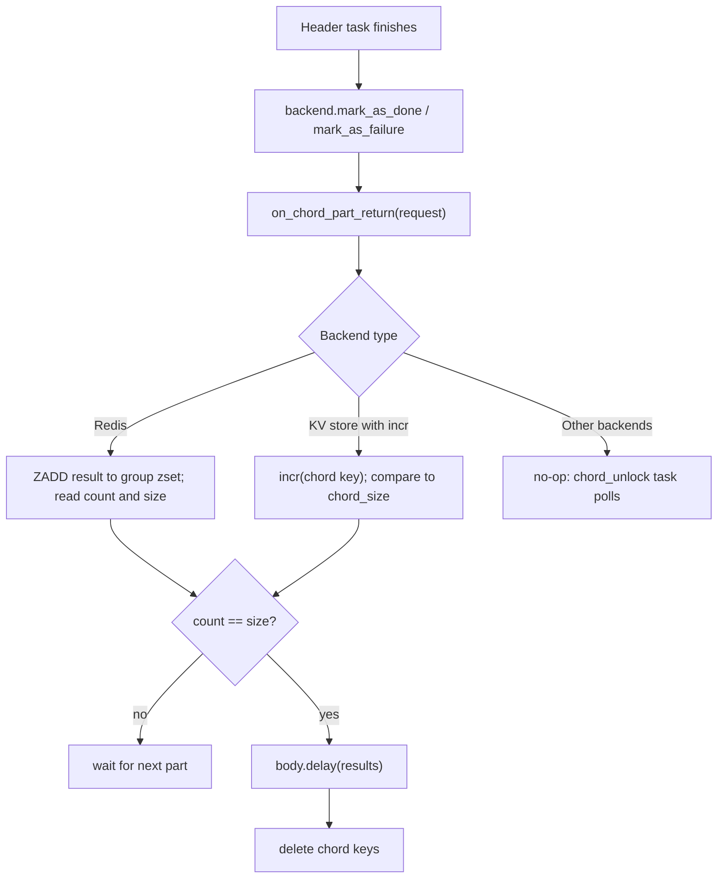

## Overview

A group runs several signatures in parallel and returns a `GroupResult` for all of them. A chord is a group (the header) plus a callback (the body) that runs once with the list of all header results. Groups need nothing from the result backend; chords do, because some process must notice when the last header task finishes. Celery has no coordinator process for this: each header task reports to the backend when it ends, and the backend triggers the body when the count is complete, either with an atomic counter (Redis and other key-value stores) or with a polling task (`celery.chord_unlock`) for other backends.

Sources: [celery/canvas.py:1492-1520](repo://celery/canvas.py#L1492-L1520), [celery/canvas.py:1971-1996](repo://celery/canvas.py#L1971-L1996), [celery/backends/base.py:832-867](repo://celery/backends/base.py#L832-L867)

Signatures, freezing and chains are explained in [[Signatures and Chains]]; reading group results in [[Task Results]]; backend storage in [[Result Backends]].

Sources: [celery/canvas.py:1890-1895](repo://celery/canvas.py#L1890-L1895)

## Groups

### Creating a group

`group(sig1, sig2, ...)`, `group([sigs])` or `group(sig for ...)` creates a signature for the `celery.group` task with the members in `kwargs['tasks']`. A generator is wrapped in `regen`, so it is consumed lazily and only once. Options given to the group apply to every member. `group.skew(start, stop, step)` sets increasing countdowns on the members to stagger them.

Sources: [celery/canvas.py:1580-1593](repo://celery/canvas.py#L1580-L1593), [celery/canvas.py:1609-1614](repo://celery/canvas.py#L1609-L1614)

```python
from celery import group

res = group(add.s(i, i) for i in range(10))()
res.get()    # [0, 2, 4, ..., 18]
```

Sources: [celery/canvas.py:1503-1507](repo://celery/canvas.py#L1503-L1507)

### Sending a group

`group.apply_async(args, kwargs, **options)` does the following:

Sources: [celery/canvas.py:1616-1650](repo://celery/canvas.py#L1616-L1650)

1. Rejects `link` and `link_error` with `TypeError`: a callback on a whole group is a chord, and errbacks belong on the members.
2. Runs `apply` in eager mode; returns a frozen empty `GroupResult` if there are no tasks.
3. `_freeze_gid` picks the group id (an explicit `task_id`, else a new UUID) and merges options without overriding protected keys.
4. `_prepared` clones each member, recursively flattens nested groups, prepends the partial args to mutable members, and freezes each one with `group_id`, `root_id` and its `group_index`.
5. `_apply_tasks` publishes every member through one acquired producer and attaches each result to a `barrier` promise.
6. Builds `GroupResult(group_id, results, ready_barrier=p)`, adds it to the parent task's children if called from a task, and returns it.

Sources: [celery/canvas.py:1714-1761](repo://celery/canvas.py#L1714-L1761), [celery/canvas.py:1763-1837](repo://celery/canvas.py#L1763-L1837)

Each member keeps its `group_id` and `group_index` in its message headers. The index records the member's position, so results can be returned in order even when tasks finish out of order.

Sources: [celery/canvas.py:1759-1761](repo://celery/canvas.py#L1759-L1761), [celery/app/amqp.py:372-373](repo://celery/app/amqp.py#L372-L373)

### Groups in other workflows

A group combined with `|` becomes a chord: `group(...) | sig` is `chord(group, body=sig)`, and inside a chain a group followed by another step is upgraded the same way (see [[Signatures and Chains]]). A group's `link(sig)` is a compatibility shim that adds an immutable callback to the first member only.

Sources: [celery/canvas.py:1598-1607](repo://celery/canvas.py#L1598-L1607), [celery/canvas.py:1691-1712](repo://celery/canvas.py#L1691-L1712)

## Chords

### Creating a chord

`chord(header, body)` stores the header as a list or group in `kwargs['header']` and the body in `kwargs['body']`; `chord(header)(body)` supplies the body at call time. The body receives the list of header results as its first argument, in header order. `chord | sig` appends `sig` to the body, making the body a chain.

Sources: [celery/canvas.py:2064-2092](repo://celery/canvas.py#L2064-L2092)

```python
from celery import chord

res = chord([add.s(2, 2), add.s(4, 4)])(xsum.s())
res.get()   # 12
```

Sources: [celery/canvas.py:1982-1995](repo://celery/canvas.py#L1982-L1995)

### Running a chord

`apply_async` merges partial args, clones the body with the call options, wraps the header in a group, and calls `run` (or `apply` in eager mode). `run` then:

Sources: [celery/canvas.py:2153-2177](repo://celery/canvas.py#L2153-L2177)

1. Picks the group id from the header's `task_id` or a new UUID.
2. Freezes the body with its own id, `group_id` and `root_id`.
3. Removes `chain`, `chord` and `task_id` from the options so they do not leak into header tasks.
4. Freezes the header tasks with `chord=body`, so each header message carries the body signature in its `chord` field.
5. Calls `backend.apply_chord(...)` to prepare the join, then sends the header group.
6. With an empty header, sends the body immediately with `[]`.
7. Sets the body result's `parent` to the header's `GroupResult` and returns the body result.

Sources: [celery/canvas.py:2226-2286](repo://celery/canvas.py#L2226-L2286)

Every backend first checks `ensure_chords_allowed`; the disabled backend raises `NotImplementedError`, so chords require a result backend.

Sources: [celery/backends/base.py:861-867](repo://celery/backends/base.py#L861-L867), [celery/backends/base.py:1263-1272](repo://celery/backends/base.py#L1263-L1272)

### Chord size

The backend must know how many results to wait for. While sending the header, `_apply_tasks` adds up `_chord._descend(sig)` for each member: 1 for a simple task, the sum for a nested group, the size of the last non-empty element for a chain (its final task is what completes), and the size of the body for a nested chord. When it reaches the last member it calls `backend.set_chord_size(group_id, size)`, peeking one element ahead so a generator header need not be consumed in advance.

Sources: [celery/canvas.py:1787-1826](repo://celery/canvas.py#L1787-L1826), [celery/canvas.py:2190-2224](repo://celery/canvas.py#L2190-L2224)

## Completing a chord

### The completion hook

When a header task finishes, the tracer stores its result through `mark_as_done` or `mark_as_failure`. Both call `on_chord_part_return(request, state, result)` when `request.chord` is set. `mark_as_revoked` does the same, so a revoked header task still counts.

Sources: [celery/backends/base.py:180-199](repo://celery/backends/base.py#L180-L199), [celery/backends/base.py:306-313](repo://celery/backends/base.py#L306-L313)



Sources: [celery/backends/redis.py:593-686](repo://celery/backends/redis.py#L593-L686), [celery/backends/base.py:1188-1256](repo://celery/backends/base.py#L1188-L1256), [celery/backends/base.py:832-833](repo://celery/backends/base.py#L832-L833)

### Redis

The Redis backend keeps three keys per group: `.j` holds each finished part's encoded `(tid, state, result)`, by default in a sorted set scored by `group_index` (or a list when `result_chord_ordered` is false); `.s` holds the chord size; `.t` holds extra parts added by `Task.add_to_chord`. Each part runs one pipeline that adds its result and reads the count, size and extra count, refreshing expiry on all keys. The part that brings the count to `size + extra` reads all stored results in order, decodes them (raising `ChordError` if any part failed), sends `callback.delay(results)` and deletes the keys. No `GroupResult` needs saving unless a header member is itself a group, in which case `apply_chord` saves it so nested structure is kept.

Sources: [celery/backends/redis.py:554-591](repo://celery/backends/redis.py#L554-L591), [celery/backends/redis.py:593-686](repo://celery/backends/redis.py#L593-L686)

### Key-value stores with incr

Other key-value backends that implement atomic `incr` (memcached, for example) use `_apply_chord_incr` to save the `GroupResult` up front. In `on_chord_part_return`, they restore it, increment the chord key, and when the value equals `chord_size` (or the group length) join the group's results, send the body and delete both the group and the counter. Otherwise they refresh the counter's expiry.

Sources: [celery/backends/base.py:964-980](repo://celery/backends/base.py#L964-L980), [celery/backends/base.py:1183-1256](repo://celery/backends/base.py#L1183-L1256)

### The chord_unlock fallback

Backends without `incr` (databases, RPC and others) use the base `apply_chord`, which schedules `celery.chord_unlock` with the header results as tuples, routed to the body's queue and priority. That task checks `GroupResult.ready()` and, if not ready, retries itself every `result_chord_retry_interval` seconds with no retry limit. When ready it joins the results (natively if supported), with `result_chord_join_timeout`, and sends the body.

Sources: [celery/backends/base.py:838-867](repo://celery/backends/base.py#L838-L867), [celery/app/builtins.py:36-98](repo://celery/app/builtins.py#L36-L98)

> [!NOTE]
> `chord_unlock` occupies a worker slot briefly on every retry and adds latency of up to one retry interval. Prefer a backend with native chord support (Redis) for chord-heavy workloads.

Sources: [celery/app/builtins.py:47-73](repo://celery/app/builtins.py#L47-L73)

### Adding to a running chord

`self.add_to_chord(sig)` inside a header task sets `sig`'s group, index, chord and root ids from the current request, freezes it, tells the backend to expect one more part, and sends it (unless `lazy=True`). Only the Redis backend implements `add_to_chord`; others raise `NotImplementedError`.

Sources: [celery/app/task.py:1097-1119](repo://celery/app/task.py#L1097-L1119), [celery/backends/redis.py:554-555](repo://celery/backends/redis.py#L554-L555), [celery/backends/base.py:829-830](repo://celery/backends/base.py#L829-L830)

## Errors in chords

### A header task fails

When the join finds a failed part, the backend builds a `ChordError` ("Dependency `<id>` raised ...") with the original exception as its cause and calls `chord_error_from_stack(body, exc)`. That calls the body's errbacks through a synthetic request and marks the body as failed with the chord error, so callers waiting on the chord's result see the failure instead of hanging. If the body is a group, every task in it is revoked, has its errbacks called and is marked failed with the original exception, and the group itself is marked failed.

Sources: [celery/backends/base.py:325-420](repo://celery/backends/base.py#L325-L420), [celery/backends/base.py:1232-1242](repo://celery/backends/base.py#L1232-L1242)

### Failures inside chained header members

A header member may be a chain whose last step is the one the chord counts. When an earlier step fails, `mark_as_failure` walks the remaining chain stored in the request: it stores the failure for each later step that has an id, calls `on_chord_part_return` for any step that belongs to a chord, and descends into chord bodies, so the enclosing chord is completed with an error instead of waiting for a step that will never run.

Sources: [celery/backends/base.py:196-252](repo://celery/backends/base.py#L196-L252)

### Errbacks on chords

`chord.link_error(errback)` always attaches the errback to the body. With `task_allow_error_cb_on_chord_header = True` it is also attached (as an immutable clone) to every header task; with the default `False` a pending-deprecation warning announces that this will change, and only nested chords in the header receive it. `chord.link(callback)` links to the body.

Sources: [celery/canvas.py:2298-2341](repo://celery/canvas.py#L2298-L2341), [celery/app/defaults.py:323](repo://celery/app/defaults.py#L323)

## Eager groups and chords

In eager mode `group.apply` runs each member with `apply` and returns a `GroupResult` of `EagerResult`s; `chord.apply` applies the header, gets its results, and applies the body with them.

Sources: [celery/canvas.py:1652-1662](repo://celery/canvas.py#L1652-L1662), [celery/canvas.py:2179-2188](repo://celery/canvas.py#L2179-L2188)
