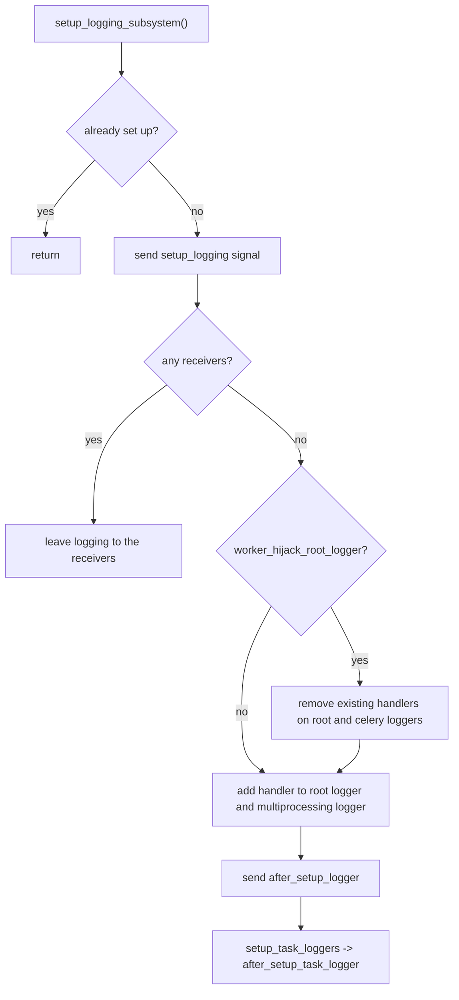

## Overview

Celery uses the standard `logging` module. The worker and beat programs configure it once at start-up through `app.log` (`celery.app.log.Logging`): a handler on the root logger with the worker log format, a separate handler on the `celery.task` logger whose format includes the running task's name and id, and optionally redirection of `print` output into the log. Applications can let Celery do this, extend it, or replace it entirely with their own configuration.

Sources: [celery/app/log.py:1-59](repo://celery/app/log.py#L1-L59)

## How logging is set up

### Entry points

The worker program calls `app.log.setup(loglevel, logfile, colorize=..., hostname=...)` while initializing its blueprint; beat calls it before starting its service; prefork children call it again in their initializer with the level and file passed through environment variables. `setup` calls `setup_logging_subsystem`, redirects stdout/stderr if asked and nothing else handled logging, exports `CELERY_LOG_LEVEL` and `CELERY_LOG_FILE` for child processes, turns on display of Celery deprecation warnings, and routes Python warnings into logging.

Sources: [celery/app/log.py:61-85](repo://celery/app/log.py#L61-L85), [celery/apps/worker.py:184-190](repo://celery/apps/worker.py#L184-L190), [celery/apps/beat.py:86-91](repo://celery/apps/beat.py#L86-L91), [celery/concurrency/prefork.py:58-66](repo://celery/concurrency/prefork.py#L58-L66)

### setup_logging_subsystem

The subsystem is configured once per process (`Logging._setup`); later calls return immediately. A `--logfile` containing `%n`/`%h` placeholders is expanded with the node name first ([[Running Multiple Workers with celery multi]]).

Sources: [celery/app/log.py:87-96](repo://celery/app/log.py#L87-L96)



Sources: [celery/app/log.py:87-146](repo://celery/app/log.py#L87-L146)

When Celery configures logging itself:

Sources: [celery/app/log.py:103-131](repo://celery/app/log.py#L103-L131)

1. With `worker_hijack_root_logger` (the default) it removes all handlers already on the root, `celery`, `celery.task` and `celery.redirected` loggers, so earlier configuration by the application does not produce duplicate lines.
2. It adds one handler to the root logger: a `WatchedFileHandler` for `--logfile` (so external log rotation works), otherwise a stream handler on the real `stderr`, formatted with `worker_log_format` by a `ColorFormatter`, and sets the level.
3. It configures billiard's multiprocessing logger the same way, at `ERROR` unless the `MP_LOG` environment variable is set.
4. It sends `after_setup_logger` with the root logger, so receivers can add handlers.
5. It configures the `celery.task` logger with `worker_task_log_format` and the `TaskFormatter`, makes it not propagate to the root, and sends `after_setup_task_logger`.

Sources: [celery/app/log.py:148-181](repo://celery/app/log.py#L148-L181), [celery/app/log.py:213-237](repo://celery/app/log.py#L213-L237)

A logger that already has a real handler is left alone, except for handlers marked `_rudimentary_setup`, so setting up twice never stacks handlers.

Sources: [celery/app/log.py:213-237](repo://celery/app/log.py#L213-L237)

### Formats and colours

| Setting | Default |
| --- | --- |
| `worker_log_format` | `[%(asctime)s: %(levelname)s/%(processName)s] %(message)s` |
| `worker_task_log_format` | `[%(asctime)s: %(levelname)s/%(processName)s] %(task_name)s[%(task_id)s]: %(message)s` |
| `worker_log_color` | Colour when logging to a terminal without a log file |
| `worker_hijack_root_logger` | `True` |
| `worker_redirect_stdouts` / `worker_redirect_stdouts_level` | `True` / `WARNING` |

Sources: [celery/app/defaults.py:14-18](repo://celery/app/defaults.py#L14-L18), [celery/app/defaults.py:346-370](repo://celery/app/defaults.py#L346-L370)

`ColorFormatter` colours whole lines by level (debug blue, warning yellow, error red, critical magenta) when colour is on, which by default means no log file, `stderr` is a TTY, and not Windows; `--no-color` turns it off. `TaskFormatter` fills `task_name` and `task_id` from the current task, or `???` outside a task.

Sources: [celery/utils/log.py:123-175](repo://celery/utils/log.py#L123-L175), [celery/app/log.py:32-43](repo://celery/app/log.py#L32-L43), [celery/app/log.py:199-211](repo://celery/app/log.py#L199-L211)

## Using your own logging configuration

There are three levels of control:

Sources: [celery/app/log.py:98-131](repo://celery/app/log.py#L98-L131)

- Connect to `setup_logging` and configure logging yourself (for example with `logging.config.dictConfig`). Because a receiver exists, Celery adds no handlers at all.
- Keep Celery's setup and adjust it in `after_setup_logger`/`after_setup_task_logger` receivers, for example to add a JSON or syslog handler.
- Set `worker_hijack_root_logger = False` to keep handlers configured before the worker started, with Celery's handler added alongside.

Sources: [celery/signals.py:117-135](repo://celery/signals.py#L117-L135)

```python
from logging.config import dictConfig
from celery.signals import setup_logging

@setup_logging.connect
def configure_logging(**kwargs):
    dictConfig(LOGGING)
```

Sources: [celery/app/log.py:98-103](repo://celery/app/log.py#L98-L103)

[[Signals]] lists the arguments these signals receive.

Sources: [celery/signals.py:117-135](repo://celery/signals.py#L117-L135)

## Loggers in application code

### get_task_logger

Inside tasks use `celery.utils.log.get_task_logger(__name__)`. It returns a logger whose parent is `celery.task`, so its records go through the task handler and carry the task name and id, without propagating a second time through the root logger. The names `celery` and `celery.task` are reserved and raise `RuntimeError`.

Sources: [celery/utils/log.py:17-36](repo://celery/utils/log.py#L17-L36), [celery/utils/log.py:97-113](repo://celery/utils/log.py#L97-L113)

```python
from celery.utils.log import get_task_logger

logger = get_task_logger(__name__)

@app.task
def add(x, y):
    logger.info('Adding %s + %s', x, y)
    return x + y
```

Sources: [celery/utils/log.py:109-113](repo://celery/utils/log.py#L109-L113)

`celery.utils.log.get_logger(name)` is used inside Celery: it makes the logger a child of `celery` unless it already sits under the root or `celery`. Worker internals log to `celery.worker`, the tracer to `celery.app.trace`, beat to `celery.beat`.

Sources: [celery/utils/log.py:72-106](repo://celery/utils/log.py#L72-L106)

### Task log lines

The tracer logs `Task <name>[<id>] received`, `succeeded in <runtime>s: <result>`, `retry: <exc>`, and failures according to a log policy: unexpected exceptions at `ERROR` with traceback, exceptions listed in the task's `throws` at `INFO` without traceback, rejections at `WARNING`, ignored tasks at `INFO`, and errors outside the task body at `CRITICAL`. Each record also carries a `data` dict in `extra` with the id, name, args, kwargs and outcome, for structured log handlers.

Sources: [celery/app/trace.py:40-102](repo://celery/app/trace.py#L40-L102), [celery/app/trace.py:137-147](repo://celery/app/trace.py#L137-L147), [celery/app/trace.py:284-311](repo://celery/app/trace.py#L284-L311)

## Redirecting stdout and stderr

With `worker_redirect_stdouts` (on by default), the worker replaces `sys.stdout` and `sys.stderr` with a `LoggingProxy` writing to the `celery.redirected` logger at `worker_redirect_stdouts_level`, so `print()` in tasks ends up in the log. The proxy strips trailing newlines, protects against recursion when a handler writes back to stderr, and writes directly to the real `stderr` while inside a signal handler, where logging is unsafe. Redirection is skipped when a `setup_logging` receiver took over.

Sources: [celery/app/log.py:78-85](repo://celery/app/log.py#L78-L85), [celery/app/log.py:183-197](repo://celery/app/log.py#L183-L197), [celery/utils/log.py:178-260](repo://celery/utils/log.py#L178-L260), [celery/apps/worker.py:146-147](repo://celery/apps/worker.py#L146-L147)

## Per-process log files

In a prefork worker each child is a separate process writing to the same handler. A `--logfile` containing `%i` or `%I` is expanded to the child's pool index, and children reconfigure logging so that each writes its own file (`worker-1.log`, `worker-2.log`…), which avoids interleaved writes on platforms where that matters.

Sources: [celery/concurrency/prefork.py:58-66](repo://celery/concurrency/prefork.py#L58-L66), [celery/utils/nodenames.py:88-114](repo://celery/utils/nodenames.py#L88-L114), [celery/utils/log.py:293-295](repo://celery/utils/log.py#L293-L295)
