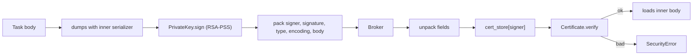

## Overview

A worker executes whatever its broker delivers, so anyone who can publish to the broker can run task code with arbitrary arguments. Celery limits this in two layers. The first is a whitelist of content types the worker and result backend will deserialize (`accept_content`, `result_accept_content`), which keeps unsafe formats such as pickle from being decoded by default. The second, optional, is the `auth` serializer: messages are signed with a private key and workers verify them against a store of trusted X.509 certificates before decoding. This page covers both. Transport-level protection (TLS to the broker) is configured through `broker_use_ssl`, described in [[The Celery Application]].

Sources: [celery/app/defaults.py:13](repo://celery/app/defaults.py#L13), [celery/app/defaults.py:67-68](repo://celery/app/defaults.py#L67-L68), [celery/security/serialization.py:20-78](repo://celery/security/serialization.py#L20-L78)

## Content-type whitelists

### accept_content

`accept_content` defaults to `('json',)`. The worker's task consumer is created with `accept=app.conf.accept_content`, and kombu refuses to decode a message whose content type is not in that list. Such a message triggers the consumer's `on_decode_error`, which logs it at critical level with its headers and body and acknowledges it so it is not redelivered forever.

Sources: [celery/app/defaults.py:13](repo://celery/app/defaults.py#L13), [celery/app/amqp.py:317-324](repo://celery/app/amqp.py#L317-L324), [celery/worker/consumer/consumer.py:516-530](repo://celery/worker/consumer/consumer.py#L516-L530)

### result_accept_content

Result backends decode stored results with their own whitelist: an explicit `accept` argument, else `result_accept_content`, else `accept_content`. Results travel through a different store than tasks and may need a different policy, for example accepting `pickle` from a trusted database while tasks stay JSON-only.

Sources: [celery/backends/base.py:150-155](repo://celery/backends/base.py#L150-L155)

> [!WARNING]
> Adding `pickle` to `accept_content` lets anyone who can publish to the broker execute code in the worker during deserialization. Prefer JSON and, if the broker is shared, message signing.

Sources: [celery/app/defaults.py:13](repo://celery/app/defaults.py#L13)

## Enabling message signing

### Settings

Signing needs four settings and two serializer choices. `setup_security` refuses to run unless both `task_serializer = 'auth'` and `accept_content = ['auth']` are set, because signing without verifying protects nothing.

Sources: [celery/security/__init__.py:26-34](repo://celery/security/__init__.py#L26-L34), [celery/security/__init__.py:53-56](repo://celery/security/__init__.py#L53-L56)

| Setting | Meaning |
| --- | --- |
| `security_key` | Path to the PEM private key used to sign |
| `security_key_password` | Password for the key, if encrypted |
| `security_certificate` | Path to the PEM certificate matching the key |
| `security_cert_store` | Directory or glob of trusted certificates used to verify |
| `security_digest` | Hash algorithm, default `sha256` |

Sources: [celery/app/defaults.py:239-247](repo://celery/app/defaults.py#L239-L247)

```python
app.conf.update(
    security_key='/etc/ssl/private/worker.key',
    security_certificate='/etc/ssl/certs/worker.pem',
    security_cert_store='/etc/ssl/certs/*.pem',
    task_serializer='auth',
    event_serializer='auth',
    accept_content=['auth'],
)
app.setup_security()
```

Sources: [celery/app/base.py:750-780](repo://celery/app/base.py#L750-L780)

### setup_security

`app.setup_security(allowed_serializers=None, key=None, key_password=None, cert=None, store=None, digest='sha256', serializer='json')` performs the global setup. Importing `celery.security` fails with `ImproperlyConfigured` if the `cryptography` package is missing.

Sources: [celery/app/base.py:750-780](repo://celery/app/base.py#L750-L780), [celery/security/__init__.py:38-41](repo://celery/security/__init__.py#L38-L41)

1. Calls kombu's `disable_insecure_serializers(allowed_serializers)`, which unregisters decoders for every serializer except the allowed ones (JSON by default), process-wide.
2. Checks `task_serializer` and `accept_content` as above.
3. Reads key, password, certificate, store and digest from the arguments or settings; raises `ImproperlyConfigured` if key, certificate or store is missing.
4. Reads the key and certificate files and calls `register_auth`, which builds a `SecureSerializer` and registers it in kombu's serializer registry as `auth` with content type `application/data`.
5. Makes `auth` kombu's default serializer.

Sources: [celery/security/__init__.py:44-70](repo://celery/security/__init__.py#L44-L70), [celery/security/serialization.py:80-90](repo://celery/security/serialization.py#L80-L90)

The `serializer` argument is the inner format: the task body is first serialized with it (JSON by default) and the result is signed.

Sources: [celery/security/serialization.py:23-46](repo://celery/security/serialization.py#L23-L46)

## How signing works

### Serializing

`SecureSerializer.serialize(data)` encodes the data with the inner serializer, signs the encoded bytes with the private key, and packs five fields: the signer id (the certificate's issuer and serial number), the signature, the inner content type, the inner encoding, and the body. Fields are joined with the separator `\x00\x01` after base64-encoding the signer and signature, and the whole package is base64-encoded again.

Sources: [celery/security/serialization.py:31-66](repo://celery/security/serialization.py#L31-L66), [celery/security/certificate.py:61-63](repo://celery/security/certificate.py#L61-L63)

Signing the serialized bytes rather than the decoded object is deliberate: the receiver verifies the signature before it decodes anything, so a malicious payload never reaches the inner deserializer.

Sources: [celery/security/serialization.py:39-46](repo://celery/security/serialization.py#L39-L46)

### Verifying

`deserialize(data)` unpacks the fields (splitting at most four times, so the body may contain anything), looks up the signer in the certificate store and verifies the signature over the body. Only then does it call kombu's `loads` with the inner content type and `force=True`, bypassing the accept list for the inner format since the outer `auth` type was already accepted.

Sources: [celery/security/serialization.py:48-77](repo://celery/security/serialization.py#L48-L77)



Sources: [celery/security/serialization.py:31-77](repo://celery/security/serialization.py#L31-L77)

### Keys and certificates

Only RSA is supported: `PrivateKey` and `Certificate` reject any other key type with `Non-RSA keys are not supported` or `Non-RSA certificates are not supported`. Both signing and verification use RSA-PSS padding with MGF1 over the configured digest and the maximum salt length. The digest name is mapped to a `cryptography` hash class by upper-casing it (`sha256` → `hashes.SHA256`).

Sources: [celery/security/key.py:9-34](repo://celery/security/key.py#L9-L34), [celery/security/certificate.py:31-73](repo://celery/security/certificate.py#L31-L73), [celery/security/utils.py:13-16](repo://celery/security/utils.py#L13-L16)

### The certificate store

`FSCertStore(path)` loads every file matching the path (a directory means every file in it) as a certificate. It refuses to start with an expired certificate or with two certificates with the same issuer and serial number, raising `SecurityError` in both cases. Lookups of an unknown signer also raise `SecurityError('Unknown certificate: ...')`.

Sources: [celery/security/certificate.py:76-113](repo://celery/security/certificate.py#L76-L113)

## What happens on failure

Every cryptography error inside signing, verification and loading passes through `reraise_errors`, which re-raises it as `celery.exceptions.SecurityError` with a message such as `Bad signature: ...` or `Unable to deserialize: ...`, keeping the original traceback.

Sources: [celery/security/utils.py:19-28](repo://celery/security/utils.py#L19-L28)

In a worker, a message that fails verification fails to decode, so it goes through `on_decode_error`: it is logged as a critical decode error and acknowledged, and the task never runs. A `SecurityError` raised while the worker starts (for example an expired certificate in the store) is caught by `celery worker`, printed, and ends the process with exit code 1.

Sources: [celery/worker/consumer/consumer.py:516-530](repo://celery/worker/consumer/consumer.py#L516-L530), [celery/bin/worker.py:369-371](repo://celery/bin/worker.py#L369-L371)
