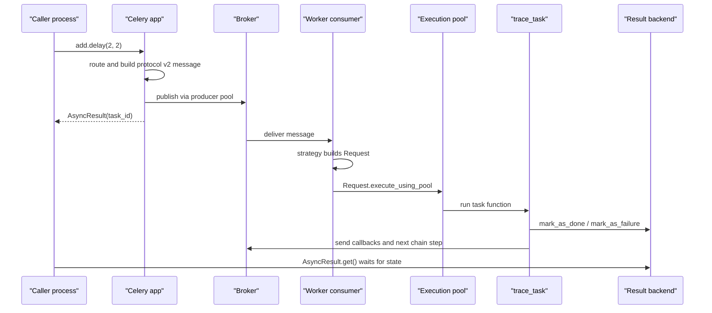

## Overview

Celery is a distributed task queue for Python. An application defines plain functions as tasks; calling a task publishes a message to a broker (RabbitMQ, Redis, SQS and the other transports kombu supports), and one or more worker processes consume those messages, run the function and optionally store its return value in a result backend where the caller can read it. The package exposes its public names (`Celery`, `Task`, `shared_task`, `chain`, `group`, `chord`, `signature`) lazily from the top-level `celery` module, so `import celery` stays cheap until a name is used.

Sources: [celery/__init__.py:36-41](repo://celery/__init__.py#L36-L41), [celery/__init__.py:154-180](repo://celery/__init__.py#L154-L180)

The same code base contains both sides of that exchange: the client API used by a web process to send work, and the worker, beat scheduler, monitor and command-line tools that run it. Every one of them starts from one `Celery` application object that holds the configuration and the task registry.

Sources: [celery/app/base.py:252-286](repo://celery/app/base.py#L252-L286)

## Parts of the project

| Area | What it does | Page |
| --- | --- | --- |
| Application | The `Celery` object: configuration, task registry, lazily built subsystems | [[The Celery Application]] |
| Configuration | Settings, defaults, loaders, task module discovery | [[Configuration and Loaders]] |
| Tasks | `@app.task`, the `Task` class, request context and handlers | [[Defining Tasks]] |
| Failure handling | `retry`, `autoretry_for`, exception types and task states | [[Retries, Errors and Task States]] |
| Publishing | `apply_async` → `send_task` → task message protocol → broker | [[Publishing Task Messages]] |
| Routing | Queues, exchanges, routers, quorum queues and delayed delivery | [[Routing and Queues]] |
| Security | Serializer whitelists and signed messages | [[Message Signing and Security]] |
| Canvas | Signatures, chains, callbacks | [[Signatures and Chains]] |
| Parallel workflows | Groups and chords | [[Groups and Chords]] |
| Stamping | Custom headers stamped through a workflow | [[Canvas Stamping]] |
| Results | `AsyncResult`, `GroupResult`, waiting and propagation | [[Task Results]] |
| Result backends | Storing states and return values | [[Result Backends]], [[Backend Catalogue]] |
| Worker | `WorkController`, bootsteps, startup and shutdown | [[Worker Startup and Bootsteps]] |
| Consumer | Receiving messages, ETA, rate limits, prefetch | [[Consumer and Message Handling]] |
| Execution | `Request`, the tracer, acknowledgements, time limits | [[Task Execution and Tracing]] |
| Pools | prefork, threads, solo, eventlet, gevent | [[Concurrency Pools]] |
| Remote control | Broadcast commands, `inspect`, revoke | [[Remote Control and Inspection]] |
| Beat | Periodic task scheduler | [[Periodic Tasks with Beat]] |
| Events | Monitoring event stream and in-memory cluster state | [[Events and Monitoring]] |
| Signals | Hooks into task, worker and app lifecycle | [[Signals]] |
| CLI | The `celery` command and `celery multi` | [[Command-Line Interface]], [[Running Multiple Workers with celery multi]] |
| Logging | Worker and task loggers | [[Logging]] |
| Integrations | Django and test helpers | [[Django Integration]], [[Testing Utilities]] |

Sources: [celery/app/base.py:309-317](repo://celery/app/base.py#L309-L317), [celery/worker/worker.py:72-85](repo://celery/worker/worker.py#L72-L85)

## The main flow

Sources: [celery/app/task.py:683-708](repo://celery/app/task.py#L683-L708), [celery/app/base.py:931-1041](repo://celery/app/base.py#L931-L1041), [celery/worker/strategy.py:132-208](repo://celery/worker/strategy.py#L132-L208), [celery/worker/request.py:341-372](repo://celery/worker/request.py#L341-L372), [celery/app/trace.py:580-630](repo://celery/app/trace.py#L580-L630), [celery/result.py:249-268](repo://celery/result.py#L249-L268)

1. `Task.delay` calls `apply_async`, which merges the task's default execution options and either runs the task in-process (when `task_always_eager` is set) or hands it to `app.send_task`. [[Defining Tasks]] covers the task object and [[Publishing Task Messages]] the send path.
2. `send_task` asks the router for a queue and exchange, then builds the message with `amqp.create_task_message`; [[Routing and Queues]] explains the routing decision.
3. The message is published through a pooled kombu producer, and the caller immediately gets an `AsyncResult` holding the task id ([[Task Results]]).
4. In the worker, the consumer's per-task strategy turns each delivered message into a `Request`, applying ETA scheduling, revocation and rate limits first ([[Consumer and Message Handling]]).
5. The request is submitted to the execution pool, which runs `trace_task` in a child process, thread or greenlet ([[Concurrency Pools]], [[Task Execution and Tracing]]).
6. The tracer calls the task function, sends any linked callbacks and the next step of a chain ([[Signatures and Chains]]), and stores the outcome through the backend ([[Result Backends]]).
7. `AsyncResult.get` waits on the backend, either by polling or by a push subscription, and re-raises the remote exception when the task failed.

Sources: [celery/app/task.py:523-535](repo://celery/app/task.py#L523-L535), [celery/app/amqp.py:326-418](repo://celery/app/amqp.py#L326-L418), [celery/app/trace.py:605-630](repo://celery/app/trace.py#L605-L630)

## Design decisions

### Lazy application and tasks

Decorating a function with `@app.task` does not build the task class immediately: unless the app is already finalized, the decorator returns a `PromiseProxy` and queues it in `app._pending`. `finalize()` evaluates every pending proxy and binds all registered tasks to the app, and it runs on first access to `app.tasks`. This lets a module declare tasks before configuration exists, and lets `shared_task` attach the same function to every app that is created later.

Sources: [celery/app/base.py:554-585](repo://celery/app/base.py#L554-L585), [celery/app/base.py:657-677](repo://celery/app/base.py#L657-L677), [celery/app/base.py:1601-1609](repo://celery/app/base.py#L1601-L1609)

The same idea applies to the app's subsystems: `amqp`, `control`, `events`, `loader` and `log` are `cached_property` objects created on first use, and `conf` loads configuration only when first read. A process that only sends tasks never builds the event or control machinery. [[The Celery Application]] follows this lifecycle.

Sources: [celery/app/base.py:1534-1599](repo://celery/app/base.py#L1534-L1599)

### Pluggable components by name

Backends, pools, loaders and the app's helper classes are all named by strings and resolved with `symbol_by_name`. Result backends are chosen from the URL scheme through `BACKEND_ALIASES` (also extensible with the `celery.result_backends` entry-point namespace); worker pools come from the `ALIASES` table, with `CELERY_CUSTOM_WORKER_POOL` naming an out-of-tree pool. A deployment changes storage or concurrency by configuration alone.

Sources: [celery/app/backends.py:15-69](repo://celery/app/backends.py#L15-L69), [celery/concurrency/__init__.py:11-48](repo://celery/concurrency/__init__.py#L11-L48)

### Bootstep blueprints

The worker is not one class with a fixed start method: it is a `Blueprint` of `Step` classes, each declaring the steps it `requires`. `Blueprint.apply` loads the steps, sorts them topologically with a `DependencyGraph` and creates them in that order, so users can add their own steps through `app.steps['worker']` or `app.steps['consumer']`. [[Worker Startup and Bootsteps]] describes the graph.

Sources: [celery/bootsteps.py:186-249](repo://celery/bootsteps.py#L186-L249), [celery/worker/worker.py:123-140](repo://celery/worker/worker.py#L123-L140)

### kombu as the transport layer

Celery does not talk to brokers itself. `app.amqp` wraps kombu's `Connection`, `Producer` and `Consumer`, and every transport detail (AMQP, Redis, SQS, in-memory) comes from kombu. The worker only checks whether the transport implements asynchronous I/O to decide whether to run its event loop.

Sources: [celery/app/amqp.py:225-271](repo://celery/app/amqp.py#L225-L271), [celery/worker/worker.py:236-239](repo://celery/worker/worker.py#L236-L239)

### Task message protocol v2

A task message keeps metadata in headers (`task`, `id`, `eta`, `expires`, `retries`, `root_id`, `parent_id`, `stamps`) and puts only `(args, kwargs, embed)` in the body, where `embed` carries callbacks, errbacks, the remaining chain and the chord. Workers can route, revoke and log a message without deserializing its arguments, and the worker still accepts protocol 1 and hybrid messages by converting them. `task_protocol` picks the format.

Sources: [celery/app/amqp.py:257-268](repo://celery/app/amqp.py#L257-L268), [celery/app/amqp.py:366-418](repo://celery/app/amqp.py#L366-L418), [celery/worker/strategy.py:25-95](repo://celery/worker/strategy.py#L25-L95)

### Early monkey patching

Eventlet and gevent must patch the standard library before anything else imports it, so `maybe_patch_concurrency` scans `argv` for `-P`/`--pool` at import time of the CLI and applies the patch before the app is loaded. [[Concurrency Pools]] explains when to pick each pool.

Sources: [celery/__init__.py:117-150](repo://celery/__init__.py#L117-L150)
