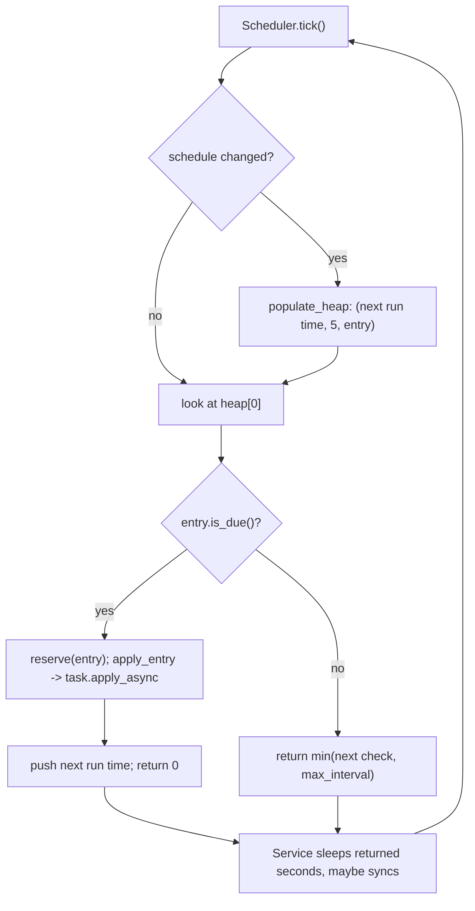

## Overview

`celery beat` is the scheduler that sends tasks at fixed intervals or calendar times. It does not execute anything itself: when an entry is due, it publishes an ordinary task message, and workers run it like any other task. Beat keeps each entry's last run time and run count in a schedule store (a local `shelve` file by default) so that a restart does not resend or skip tasks.

Sources: [celery/beat.py:612-660](repo://celery/beat.py#L612-L660), [celery/beat.py:505-610](repo://celery/beat.py#L505-L610)

> [!WARNING]
> Run exactly one beat per schedule. Two beat processes with the same schedule send every task twice.

Sources: [celery/beat.py:393-418](repo://celery/beat.py#L393-L418)

## Defining the schedule

### beat_schedule

The `beat_schedule` setting maps an entry name to a dict with `task` (a task name), `schedule` (a number of seconds, a `timedelta`, or a schedule object), and optional `args`, `kwargs`, `options` (any `apply_async` options such as `queue` or `expires`) and `relative`.

Sources: [celery/beat.py:82-128](repo://celery/beat.py#L82-L128), [celery/schedules.py:703-714](repo://celery/schedules.py#L703-L714)

```python
from celery.schedules import crontab

app.conf.beat_schedule = {
    'cleanup-every-30s': {
        'task': 'tasks.cleanup',
        'schedule': 30.0,
    },
    'report-weekday-mornings': {
        'task': 'tasks.report',
        'schedule': crontab(hour=7, minute=30, day_of_week='mon-fri'),
        'args': ('daily',),
        'options': {'queue': 'reports', 'expires': 3600},
    },
}
```

Sources: [celery/schedules.py:323-415](repo://celery/schedules.py#L323-L415)

Arguments wrapped in `BeatLazyFunc(func, *args)` are evaluated each time the task is sent instead of once at configuration time, for example to pass the current date.

Sources: [celery/beat.py:50-78](repo://celery/beat.py#L50-L78), [celery/beat.py:201-216](repo://celery/beat.py#L201-L216)

### add_periodic_task

`app.add_periodic_task(schedule, sig, args=(), kwargs=(), name=None, **opts)` adds an entry from a signature, typically inside an `on_after_configure` handler. The key is `name` or the signature's `repr`; adding the same unnamed signature twice replaces the first entry and logs a warning. Calls made before the app is configured are queued and applied when configuration loads.

Sources: [celery/app/base.py:1295-1333](repo://celery/app/base.py#L1295-L1333), [celery/app/base.py:1273-1277](repo://celery/app/base.py#L1273-L1277)

```python
@app.on_after_configure.connect
def setup_periodic_tasks(sender, **kwargs):
    sender.add_periodic_task(10.0, ping.s('hello'), name='ping every 10s')
```

Sources: [celery/app/base.py:1295-1310](repo://celery/app/base.py#L1295-L1310)

## Schedule types

### schedule (intervals)

`schedule(run_every, relative=False)` runs every `run_every`. Numbers and `timedelta`s in `beat_schedule` are converted to it by `maybe_schedule`. `is_due(last_run_at)` returns `(True, run_every_seconds)` when the interval has elapsed, else `(False, seconds_remaining)`. With `relative=True` the run time is rounded to the interval's resolution (for example, on the hour for an hourly schedule).

Sources: [celery/schedules.py:111-173](repo://celery/schedules.py#L111-L173), [celery/schedules.py:703-714](repo://celery/schedules.py#L703-L714)

### crontab

`crontab(minute, hour, day_of_week, day_of_month, month_of_year)` accepts cron syntax in each field: lists, ranges, steps (`*/15`, `1-30/2`) and day names (`mon-fri`). Each field is expanded to a set of integers by `crontab_parser`. `crontab.from_string('30 7 * * 1-5')` parses a full five-field cron expression. A day must match both the day-of-week and day-of-month fields, unlike classic cron.

Sources: [celery/schedules.py:196-300](repo://celery/schedules.py#L196-L300), [celery/schedules.py:401-432](repo://celery/schedules.py#L401-L432)

`crontab.is_due` computes the time remaining until the next matching minute after `last_run_at`. If beat was down and missed runs, the entry is due once when it restarts. Setting `beat_cron_starting_deadline` (seconds) prevents that: if the most recent missed run is older than the deadline, the entry is not due and simply waits for its next time.

Sources: [celery/schedules.py:641-688](repo://celery/schedules.py#L641-L688)

### solar

`solar(event, lat, lon)` runs at astronomical events at a location: `sunrise`, `sunset`, `solar_noon`, and civil, nautical or astronomical dawn and dusk. It uses the `ephem` library (the `solar` extra) to compute the next occurrence.

Sources: [celery/schedules.py:717-830](repo://celery/schedules.py#L717-L830)

### Custom schedules

Any `BaseSchedule` subclass that implements `is_due(last_run_at)` returning `(is_due, next_check_seconds)` and `remaining_estimate` can be used. Schedules take their notion of "now" and timezone from the app (`app.now()`, `timezone`, `enable_utc`), or from a `nowfun`.

Sources: [celery/schedules.py:65-108](repo://celery/schedules.py#L65-L108)

## The scheduler

### Entries

Each entry is a `ScheduleEntry` holding the task name, schedule, args, kwargs, options, `last_run_at` and `total_run_count`. `next(entry)` returns a copy with `last_run_at` set to now and the count increased. Entries compare equal when their editable fields (task, schedule, args, kwargs, options) match, which is how the scheduler detects schedule changes.

Sources: [celery/beat.py:82-198](repo://celery/beat.py#L82-L198)

### Merging configuration with the store

On start, `setup_schedule` merges `beat_schedule` into the stored schedule: entries no longer configured are removed, existing entries get their editable fields updated (keeping `last_run_at` and the run count), and new ones are added. `install_default_entries` adds `celery.backend_cleanup` at 04:00 daily when results expire and the backend cannot expire them itself ([[Result Backends]]).

Sources: [celery/beat.py:423-425](repo://celery/beat.py#L423-L425), [celery/beat.py:458-472](repo://celery/beat.py#L458-L472), [celery/beat.py:268-277](repo://celery/beat.py#L268-L277)

### The tick loop



Sources: [celery/beat.py:310-364](repo://celery/beat.py#L310-L364), [celery/beat.py:633-655](repo://celery/beat.py#L633-L655)

The scheduler keeps a min-heap keyed by each entry's next run time. `tick()` rebuilds the heap whenever the schedule differs from the last one seen, then checks only the earliest entry. If it is due, the entry is reserved (its `last_run_at` and count are updated first, so an exception while sending does not cause an endless resend loop), the task is sent, and the next occurrence is pushed; `tick` returns 0 to be called again at once. Otherwise it returns how long to sleep, capped by `beat_max_loop_interval` (300 s by default) so that schedule changes are noticed. A 10 ms negative drift makes beat wake slightly early.

Sources: [celery/beat.py:292-308](repo://celery/beat.py#L292-L308), [celery/beat.py:326-364](repo://celery/beat.py#L326-L364), [celery/beat.py:389-418](repo://celery/beat.py#L389-L418), [celery/beat.py:43](repo://celery/beat.py#L43)

### Sending

`apply_async(entry)` evaluates lazy arguments, then calls `task.apply_async(args, kwargs, producer=..., **options)` if the task is registered in beat's process, or `app.send_task(name, ...)` if not, so beat does not need to import task code. Errors are wrapped in `SchedulingError` and logged by `apply_entry`; beat continues with the next entry. Beat uses one producer on a write connection established with retries ([[Publishing Task Messages]]).

Sources: [celery/beat.py:279-290](repo://celery/beat.py#L279-L290), [celery/beat.py:393-421](repo://celery/beat.py#L393-L421), [celery/beat.py:474-498](repo://celery/beat.py#L474-L498)

### Syncing state

The schedule store is synced every `sync_every` (3 minutes) or after `beat_sync_every` sent tasks, whichever comes first, and on shutdown.

Sources: [celery/beat.py:241-245](repo://celery/beat.py#L241-L245), [celery/beat.py:381-387](repo://celery/beat.py#L381-L387), [celery/beat.py:427-439](repo://celery/beat.py#L427-L439)

## PersistentScheduler

The default scheduler (`beat_scheduler = 'celery.beat:PersistentScheduler'`) stores entries in a `shelve` database at `beat_schedule_filename` (`celerybeat-schedule`). On start it opens the file, and if the file is corrupted it deletes every variant (`.db`, `.dat`, `.bak`, `.dir`) and starts fresh. It also resets the stored schedule when the `timezone` or `enable_utc` settings changed since the last run, or when the file comes from an old format, since stored times would be wrong.

Sources: [celery/app/defaults.py:73-82](repo://celery/app/defaults.py#L73-L82), [celery/beat.py:505-610](repo://celery/beat.py#L505-L610)

Other schedulers plug in with `-S`/`--scheduler` or `beat_scheduler`, by dotted path or by an alias registered under the `celery.beat_schedulers` entry-point group (for example a database-backed scheduler from `django-celery-beat`).

Sources: [celery/beat.py:666-679](repo://celery/beat.py#L666-L679)

## Running beat

### Standalone

`celery -A proj beat` (options `-s/--schedule`, `-S/--scheduler`, `--max-interval`, `-l`, `--detach`, `--pidfile`) builds `app.Beat`, which initializes the loader and finalizes the app, sets the process title, creates a pid lock if asked, prints a banner, sets up logging and a default socket timeout, installs `SIGTERM`/`SIGINT` handlers that sync the schedule before exiting, and starts the `Service`. The service sends `beat_init`, loops on `tick()`, and syncs and closes the scheduler on exit.

Sources: [celery/bin/beat.py:13-45](repo://celery/bin/beat.py#L13-L45), [celery/apps/beat.py:40-118](repo://celery/apps/beat.py#L40-L118), [celery/apps/beat.py:129-160](repo://celery/apps/beat.py#L129-L160), [celery/beat.py:633-664](repo://celery/beat.py#L633-L664)

### Embedded in a worker

`celery worker -B` adds the `Beat` bootstep, which starts an `EmbeddedService`: a separate child process (sending `beat_embedded_init`) when multiprocessing is available, otherwise a daemon thread with a one-second max interval so it can stop promptly. It is convenient for development but ties the single beat to one worker, and it is refused with eventlet and gevent pools ([[Worker Startup and Bootsteps]]).

Sources: [celery/beat.py:682-738](repo://celery/beat.py#L682-L738), [celery/worker/components.py:181-205](repo://celery/worker/components.py#L181-L205)
