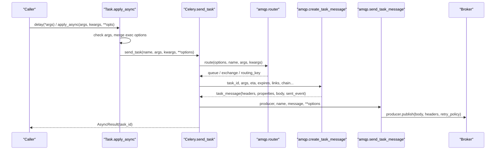

## Overview

Calling a task asynchronously produces exactly one broker message. Three layers build it: `Task.apply_async` merges the task's own options and decides between eager execution and sending; `Celery.send_task` resolves routing, expiry and parent links and creates the message; and the `AMQP` helper (`app.amqp`) formats the message in the configured protocol and publishes it through a pooled kombu producer. This page follows that path. Choosing the queue and exchange is covered in [[Routing and Queues]], and the worker side of the message in [[Consumer and Message Handling]].

Sources: [celery/app/task.py:659-708](repo://celery/app/task.py#L659-L708), [celery/app/base.py:846-867](repo://celery/app/base.py#L846-L867), [celery/app/base.py:1006-1041](repo://celery/app/base.py#L1006-L1041), [celery/app/amqp.py:225-271](repo://celery/app/amqp.py#L225-L271)

Sources: [celery/app/task.py:683-708](repo://celery/app/task.py#L683-L708), [celery/app/base.py:931-1041](repo://celery/app/base.py#L931-L1041), [celery/app/amqp.py:506-606](repo://celery/app/amqp.py#L506-L606)

## apply_async

### Validation

`delay(*args, **kwargs)` is `apply_async(args, kwargs)` with no options. `apply_async` first validates the call:

Sources: [celery/app/task.py:523-535](repo://celery/app/task.py#L523-L535)

- It raises `ValueError` if the task's `soft_time_limit` exceeds its `time_limit`.
- When `typing` is on, it calls the task's generated `__header__` with the arguments so a wrong signature raises `TypeError` here (see [[Defining Tasks]]).
- It computes a shadow name with `shadow_name(args, kwargs, options)`, a hook that lets a generic task appear under a more specific name in logs and monitoring.

Sources: [celery/app/task.py:659-673](repo://celery/app/task.py#L659-L673), [celery/app/task.py:710-729](repo://celery/app/task.py#L710-L729)

### Option merging

It then merges the task's cached execution options (queue, routing key, exchange, priority, expires, serializer, compression, time limits) under the caller's options, defaults `ignore_result` from the task and `priority` from the task's `priority` attribute.

Sources: [celery/app/task.py:675-681](repo://celery/app/task.py#L675-L681)

### Eager mode

With `task_always_eager`, no message is sent. `apply_async` still serializes the arguments with the selected serializer and deserializes them back, so code that passes unserializable objects fails in tests the same way it would in production. It then calls `self.apply(...)` inside `denied_join_result()` and returns an `EagerResult`. `send_task` called directly ignores `task_always_eager` and warns with `AlwaysEagerIgnored`, because it may name a task this process does not have.

Sources: [celery/app/task.py:683-701](repo://celery/app/task.py#L683-L701), [celery/app/base.py:868-872](repo://celery/app/base.py#L868-L872)

## send_task

### Entry point

`app.send_task(name, args, kwargs, **options)` is the public entry for sending a task by name, including tasks defined in another code base. `apply_async` calls it with `task_type=self` and `result_cls=self.AsyncResult`.

Sources: [celery/app/base.py:846-867](repo://celery/app/base.py#L846-L867), [celery/app/task.py:702-708](repo://celery/app/task.py#L702-L708)

### Option resolution

When called without `task_type`, `send_task` looks the name up in the app's internal registry without finalizing the app, and if found, merges that task's non-`None` execution options under the caller's. The lookup uses the raw registry so sending a task that only exists remotely never forces finalization.

Sources: [celery/app/base.py:874-910](repo://celery/app/base.py#L874-L910)

`time_limit`, `soft_time_limit` and `expires` are explicit arguments of `create_task_message`, so they are popped out of `options`. A sentinel (`_OMITTED`) distinguishes "not passed" from an explicit `None`, which clears a task-level default.

Sources: [celery/app/base.py:912-929](repo://celery/app/base.py#L912-L929)

### Routing, ETA and expiry

`router.route(options, route_name or name, args, kwargs, task_type)` fills in `queue`, `exchange` and `routing_key`. When the message has a countdown or ETA and the broker uses RabbitMQ quorum queues, the message is redirected to the `celery_delayed_27` topic exchange with a routing key that encodes the delay; [[Routing and Queues]] explains native delayed delivery.

Sources: [celery/app/base.py:930-964](repo://celery/app/base.py#L930-L964)

`expires` may be seconds, a `datetime` or an ISO string; it is converted to seconds from now and set as the AMQP `expiration` property, so the broker can drop the message. A negative value is clamped to 0 with a warning: per RabbitMQ semantics the message then expires unless a consumer can take it immediately.

Sources: [celery/app/base.py:966-989](repo://celery/app/base.py#L966-L989)

### Parent and root ids

If `root_id` or `parent_id` is missing and the call happens inside a worker task, they are taken from the current worker task's request: the parent is the running task, and the root is that task's root (or itself). With `task_inherit_parent_priority`, the child also inherits the parent's delivery priority. These ids let monitors rebuild a workflow's tree.

Sources: [celery/app/base.py:991-1002](repo://celery/app/base.py#L991-L1002)

### Publishing and the result

`send_task` calls `amqp.create_task_message(...)`, removes stamp values from `options` (they are now in the headers), wraps a passed `connection` in a producer, and acquires a producer from the pool. Inside `_reraise_as_library_errors()` (so transport errors surface as kombu's `OperationalError`), it calls `backend.on_task_call(P, task_id)` unless results are ignored, which lets the RPC backend declare its reply queue and the Redis backend subscribe before the task can finish. Then it publishes with `amqp.send_task_message`.

Sources: [celery/app/base.py:1006-1029](repo://celery/app/base.py#L1006-L1029), [celery/backends/rpc.py:217-223](repo://celery/backends/rpc.py#L217-L223), [celery/backends/redis.py:501-503](repo://celery/backends/redis.py#L501-L503)

Finally it creates the result object with `ignored` set from `ignore_result` and, when called inside a task with `add_to_parent=True`, appends it to the parent's `request.children` through `add_trail`. Stored with the parent's result, these children let `AsyncResult.children` and `collect()` walk the subtasks.

Sources: [celery/app/base.py:1030-1041](repo://celery/app/base.py#L1030-L1041), [celery/app/task.py:1229-1232](repo://celery/app/task.py#L1229-L1232)

## The task message

### Protocol selection

`AMQP.create_task_message` is the protocol function selected by `task_protocol` (default `2`). Both protocols return a `task_message` tuple of `(headers, properties, body, sent_event)`.

Sources: [celery/app/amqp.py:257-268](repo://celery/app/amqp.py#L257-L268), [celery/app/defaults.py:295](repo://celery/app/defaults.py#L295)

### Protocol 2

`as_task_v2` converts `countdown` into an absolute ETA in the app's timezone, converts numeric `expires` to a timestamp, renders ISO strings, computes `argsrepr`/`kwargsrepr` with `saferepr` (truncated to 1024 characters) for logs, and defaults `root_id` to the task id. It raises `TypeError` if `args` is not a list or tuple or `kwargs` is not a mapping.

Sources: [celery/app/amqp.py:326-365](repo://celery/app/amqp.py#L326-L365), [celery/app/amqp.py:250-255](repo://celery/app/amqp.py#L250-L255)

| Part | Contents |
| --- | --- |
| headers | `lang`, `task`, `id`, `shadow`, `eta`, `expires`, `group`, `group_index`, `retries`, `timelimit`, `root_id`, `parent_id`, `argsrepr`, `kwargsrepr`, `origin`, `ignore_result`, `replaced_task_nesting`, `stamped_headers`, `stamps` |
| properties | `correlation_id` (the task id), `reply_to` (the app's thread oid) |
| body | `(args, kwargs, {callbacks, errbacks, chain, chord})` |
| sent_event | Fields for a `task-sent` event, only when `task_send_sent_event` is on |

Sources: [celery/app/amqp.py:366-418](repo://celery/app/amqp.py#L366-L418), [celery/app/base.py:1007-1015](repo://celery/app/base.py#L1007-L1015)

Keeping everything except the arguments in headers is deliberate: a worker can log, revoke, expire and schedule a message without deserializing the body, and the body can be signed or encrypted as a unit (see [[Message Signing and Security]]). The embedded `chain` is the list of signatures still to run after this task, which is how [[Signatures and Chains]] avoids a coordinator.

Sources: [celery/app/amqp.py:366-404](repo://celery/app/amqp.py#L366-L404)

### Protocol 1

`as_task_v1` puts everything in a single body dict (`task`, `id`, `args`, `kwargs`, `eta`, `expires`, `utc`, `callbacks`, `errbacks`, `timelimit`, `taskset`, `chord`) and sends no headers. It exists for interoperability with very old workers; current workers convert protocol 1 and hybrid messages to protocol 2 on receipt.

Sources: [celery/app/amqp.py:420-478](repo://celery/app/amqp.py#L420-L478), [celery/worker/strategy.py:25-95](repo://celery/worker/strategy.py#L25-L95)

## send_task_message

### Publish steps

`send_task_message` is a closure built once per app by `_create_task_sender`, capturing the defaults it needs (publish retry settings, delivery mode, default exchange and routing key, serializer, compression, signal receivers) so each publish does little work.

Sources: [celery/app/amqp.py:485-505](repo://celery/app/amqp.py#L485-L505)

For each message it:

Sources: [celery/app/amqp.py:506-552](repo://celery/app/amqp.py#L506-L552)

1. Merges extra `headers` into the message headers and any leftover options into the AMQP properties.
2. Resolves the queue: the default queue when neither a queue nor an exchange is given, or a `Queue` object looked up by name in `app.amqp.queues`.
3. Picks the delivery mode from the queue's exchange or `task_default_delivery_mode` (2, persistent).
4. For a direct exchange without both exchange and routing key, publishes to the default (anonymous) exchange with the queue name as routing key; otherwise uses the queue's exchange and routing key.
5. Declares the queue on publish (unless it is a `Broadcast` queue), so the first message creates the queue.
6. Merges the caller's `retry_policy` into `task_publish_retry_policy`.
7. Sends `before_task_publish`, calls `producer.publish(...)` with serializer, compression, retry policy and headers, then sends `after_task_publish`.
8. Publishes the `task-sent` event if requested, through an event dispatcher that reuses the same producer.

Sources: [celery/app/amqp.py:506-606](repo://celery/app/amqp.py#L506-L606)

### Publish retries

`task_publish_retry` (default on) makes kombu retry a publish that fails with a connection error, following `task_publish_retry_policy`: up to 3 retries, starting immediately, waiting 0.2 s more each time, at most 1 s. Pass `retry=False` or a `retry_policy` to `apply_async` to change it per call. When retries are exhausted, `apply_async` raises `kombu.exceptions.OperationalError`.

Sources: [celery/app/defaults.py:296-305](repo://celery/app/defaults.py#L296-L305), [celery/app/amqp.py:553-576](repo://celery/app/amqp.py#L553-L576)

### Producers and pools

`app.amqp.producer_pool` is a kombu producer pool for the write connection, sized like the connection pool (`broker_pool_limit`, default 10). `producer_or_acquire` reuses a producer passed by the caller or borrows one from the pool for the duration of the publish. Passing `producer=` to many `apply_async` calls avoids repeated pool acquisition when sending in bulk; groups do this internally.

Sources: [celery/app/amqp.py:635-642](repo://celery/app/amqp.py#L635-L642), [celery/app/base.py:1162-1189](repo://celery/app/base.py#L1162-L1189)

## Signals around publishing

| Signal | Sender | When |
| --- | --- | --- |
| `before_task_publish` | Task name | Before `producer.publish`; receives body, exchange, routing key, headers, properties, declare list; may modify headers |
| `after_task_publish` | Task name | After a successful publish |
| `task_sent` | Task name | Deprecated equivalent of `after_task_publish` |

Sources: [celery/app/amqp.py:558-592](repo://celery/app/amqp.py#L558-L592)

All of these are only sent when receivers are connected, to keep the publish path cheap. [[Signals]] lists every signal.

Sources: [celery/app/amqp.py:491-497](repo://celery/app/amqp.py#L491-L497)
