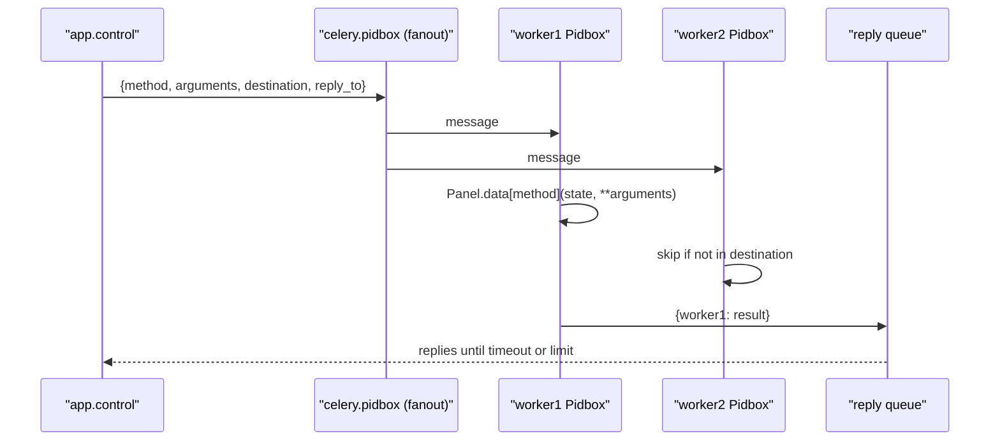

## Overview

Running workers can be queried and commanded over the broker. A client sends a command name and arguments to a fanout exchange; every worker (or only those named as destinations) runs the matching handler and, if asked, sends a reply back to the client's reply queue. Inspect commands read state without side effects (`active`, `reserved`, `stats`, `registered`); control commands change it (`revoke`, `rate_limit`, `pool_grow`, `add_consumer`, `shutdown`). The client side is `app.control` (`celery.app.control`), the worker side is the command registry in `celery.worker.control`, and the transport is kombu's pidbox (`Mailbox`).

Sources: [celery/app/control.py:1-13](repo://celery/app/control.py#L1-L13), [celery/worker/control.py:39-74](repo://celery/worker/control.py#L39-L74)

## The mailbox

### Client side

`Control.__init__` creates a `Mailbox` on the fanout exchange named by `control_exchange` (`celery`), using the app's accepted content types and task serializer and the app's producer pool. Its queues are short-lived by default: messages expire after `control_queue_ttl` (300 s), unused queues after `control_queue_expires` (10 s), and queues are exclusive and not durable. Asking for both durable and exclusive queues raises `ImproperlyConfigured`.

Sources: [celery/app/control.py:426-456](repo://celery/app/control.py#L426-L456), [celery/app/defaults.py:151-157](repo://celery/app/defaults.py#L151-L157)

`broadcast(command, arguments, destination=None, reply=False, timeout=1.0, limit=None, callback=None, pattern=None, matcher=None)` acquires a connection and calls the mailbox's `_broadcast`. With `reply=True` it collects replies for `timeout` seconds, or until `limit` replies arrive, calling `callback` for each. `destination` restricts the command to a list of node names; `pattern` and `matcher` select nodes by glob or regular expression.

Sources: [celery/app/control.py:755-790](repo://celery/app/control.py#L755-L790)

### Worker side

The consumer's `Control` bootstep starts a `Pidbox` when `worker_enable_remote_control` is on and the transport supports fanout exchanges. The pidbox creates a mailbox `Node` named after the worker, with the registry `Panel.data` as its handlers and a state object holding the app, hostname and consumer, and listens on its own channel. For each message it advances the logical clock, dispatches to the handler, and logs (and resets the channel on) any handler error. Under eventlet or gevent a `gPidbox` runs the same loop in a green thread with its own connection.

Sources: [celery/worker/consumer/control.py:18-32](repo://celery/worker/consumer/control.py#L18-L32), [celery/worker/pidbox.py:20-81](repo://celery/worker/pidbox.py#L20-L81), [celery/worker/pidbox.py:83-126](repo://celery/worker/pidbox.py#L83-L126)



Sources: [celery/app/control.py:755-790](repo://celery/app/control.py#L755-L790), [celery/worker/pidbox.py:25-53](repo://celery/worker/pidbox.py#L25-L53)

### Replies

Replies are lists of `{nodename: value}` dicts. `flatten_reply` merges them into one dict and warns with `DuplicateNodenameWarning` when two workers answer with the same name, which means two workers were started with the same `-n`. `Inspect._prepare` returns the single node's value when one destination was given, and filters by pattern when one was used.

Sources: [celery/app/control.py:38-63](repo://celery/app/control.py#L38-L63), [celery/app/control.py:94-117](repo://celery/app/control.py#L94-L117)

## The command registry

### Registering commands

`Panel` is a global registry. `@inspect_command(...)` and `@control_command(...)` register a function under its name (and an optional alias) with metadata: type, visibility, default timeout, help text, CLI signature, argument converters and the variadic argument name. Handlers receive the pidbox state first and return a value or `{'ok': ...}`/`{'error': ...}`. Applications can register their own commands the same way, as long as the module is imported by the worker.

Sources: [celery/worker/control.py:25-74](repo://celery/worker/control.py#L25-L74)

```python
from celery.worker.control import control_command

@control_command(args=[('n', int)], signature='[N=1]')
def increase_prefetch_count(state, n=1):
    state.consumer.qos.increment_eventually(n)
    return {'ok': 'prefetch count incremented'}
```

Sources: [celery/worker/control.py:51-74](repo://celery/worker/control.py#L51-L74)

### Inspect commands

| Command | Returns |
| --- | --- |
| `ping` | `pong` (0.2 s default timeout) |
| `stats` | Uptime, pid, clock, task counts, pool and broker info, rusage |
| `active` | Requests currently running |
| `reserved` | Requests received but not yet running |
| `scheduled` | ETA requests waiting on the timer |
| `revoked` | Ids in the revoked set |
| `registered` | Registered task names, optionally with attributes |
| `query_task <ids>` | State (`active`, `reserved`, `ready`) and info of given ids |
| `active_queues` | Queues being consumed |
| `conf` | Configuration (without defaults unless asked) |
| `clock`, `report`, `memsample`, `memdump`, `objgraph` | Diagnostics |

Sources: [celery/worker/control.py:79-131](repo://celery/worker/control.py#L79-L131), [celery/worker/control.py:325-329](repo://celery/worker/control.py#L325-L329), [celery/worker/control.py:399-490](repo://celery/worker/control.py#L399-L490), [celery/worker/control.py:631-637](repo://celery/worker/control.py#L631-L637)

On the client, `app.control.inspect(destination=..., timeout=...)` returns an `Inspect` whose methods (`active()`, `stats()`, `registered()`…) send the corresponding command with `reply=True`.

Sources: [celery/app/control.py:73-151](repo://celery/app/control.py#L73-L151), [celery/app/control.py:457-460](repo://celery/app/control.py#L457-L460)

### Control commands

| Command | Effect |
| --- | --- |
| `revoke <ids> [terminate, signal]` | Add ids to the revoked set and mark them `REVOKED`; with `terminate`, signal running ones |
| `terminate <signal> <ids>` | `revoke` with `terminate=True` |
| `revoke_by_stamped_headers` | Revoke by stamp values ([[Canvas Stamping]]) |
| `rate_limit <task> <rate>` | Change a task's rate limit and rebuild buckets |
| `time_limit <task> <soft> [hard]` | Change a task's time limits |
| `enable_events` / `disable_events` | Toggle task events |
| `heartbeat` | Send a heartbeat event now |
| `add_consumer <queue>` / `cancel_consumer <queue>` | Start or stop consuming a queue |
| `pool_grow [n]` / `pool_shrink [n]` | Resize the pool (refused with autoscale) |
| `autoscale [max [min]]` | Change autoscaler limits |
| `pool_restart` | Reload modules and restart the pool (needs `worker_pool_restarts`) |
| `shutdown` | Warm shutdown via `WorkerShutdown` |

Sources: [celery/worker/control.py:134-252](repo://celery/worker/control.py#L134-L252), [celery/worker/control.py:255-322](repo://celery/worker/control.py#L255-L322), [celery/worker/control.py:344-378](repo://celery/worker/control.py#L344-L378), [celery/worker/control.py:541-628](repo://celery/worker/control.py#L541-L628)

`app.control` exposes each as a method (`revoke`, `rate_limit`, `time_limit`, `add_consumer`, `pool_grow`, `autoscale`, `shutdown`, `ping`…) that calls `broadcast` with the right arguments. `purge()` is different: it does not talk to workers, it deletes all messages from the task queues through a task consumer and returns how many were removed.

Sources: [celery/app/control.py:462-479](repo://celery/app/control.py#L462-L479), [celery/app/control.py:488-511](repo://celery/app/control.py#L488-L511), [celery/app/control.py:560-666](repo://celery/app/control.py#L560-L666), [celery/app/control.py:667-753](repo://celery/app/control.py#L667-L753)

## Revocation

### The revoked set

Revoking does not remove a message from the broker. Each worker adds the ids to `worker_state.revoked`, a `LimitedSet` capped at 50,000 entries (`CELERY_WORKER_REVOKES_MAX`) whose entries expire after three hours (`CELERY_WORKER_REVOKE_EXPIRES`) once the cap is exceeded. The handler also stores `REVOKED` in the result backend for each id. When a revoked message is later received, or a reserved one is about to run, the request sees its id in the set and discards it ([[Task Execution and Tracing]]).

Sources: [celery/worker/state.py:34-71](repo://celery/worker/state.py#L34-L71), [celery/worker/control.py:214-242](repo://celery/worker/control.py#L214-L242)

With `terminate=True`, requests already running are signalled (`TERM` by default, or the given signal) through the pool. Termination is meant for stuck tasks: the signal goes to the process, which may by then be running a different task.

Sources: [celery/worker/control.py:226-238](repo://celery/worker/control.py#L226-L238), [celery/worker/request.py:416-426](repo://celery/worker/request.py#L416-L426)

### Sharing and persisting revokes

Because the set lives in worker memory, two mechanisms keep it across workers and restarts. At start-up the Mingle step sends a hidden `hello` command; other workers merge the newcomer's revoked ids and reply with theirs and their clock ([[Consumer and Message Handling]]). With `--statedb`, the `Persistent` state stores the revoked set (compressed and pickled) and the logical clock in a `shelve` file, loads it at start and saves it at exit.

Sources: [celery/worker/control.py:381-396](repo://celery/worker/control.py#L381-L396), [celery/worker/state.py:192-288](repo://celery/worker/state.py#L192-L288), [celery/worker/components.py:208-218](repo://celery/worker/components.py#L208-L218)

## Command-line tools

`celery status`, `celery inspect <command>` and `celery control <command>` wrap the client. All accept `-t/--timeout` (default 1 s), `-d/--destination` (comma-separated node names) and `-j/--json`. Command names are checked against the registry (`--list` shows them), positional arguments are converted with each command's argument metadata, and each reply is printed as it arrives. If no worker replies in time, the command exits with `EX_UNAVAILABLE`.

Sources: [celery/bin/control.py:99-151](repo://celery/bin/control.py#L99-L151), [celery/bin/control.py:153-262](repo://celery/bin/control.py#L153-L262)

```bash
celery -A proj inspect active -d celery@worker1
celery -A proj control rate_limit tasks.add 10/m
celery -A proj control revoke 8f3c... --json
```

Sources: [celery/bin/control.py:178-208](repo://celery/bin/control.py#L178-L208), [celery/bin/control.py:236-262](repo://celery/bin/control.py#L236-L262)

[[Command-Line Interface]] lists the other subcommands.

Sources: [celery/bin/celery.py:181-185](repo://celery/bin/celery.py#L181-L185)
