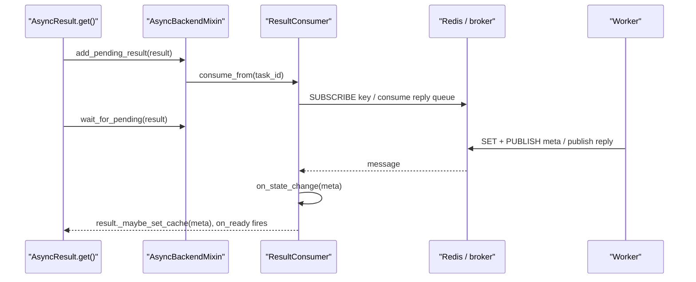

## Overview

A result backend stores each task's state, return value or exception, traceback and optional metadata, so that callers can read them through `AsyncResult` ([[Task Results]]). It also does bookkeeping for workflows: it calls errbacks, propagates failures through chains, and counts chord parts ([[Groups and Chords]]). The worker writes through the backend in the tracer, and clients read through it.

Sources: [celery/backends/base.py:108-165](repo://celery/backends/base.py#L108-L165), [celery/app/trace.py:625-627](repo://celery/app/trace.py#L625-L627)

All backends share one base class, `celery.backends.base.Backend`, and differ in how they store a record and how a client waits for one. This page describes that shared machinery and the two waiting models; [[Backend Catalogue]] describes each concrete backend.

Sources: [celery/backends/base.py:879-962](repo://celery/backends/base.py#L879-L962), [celery/backends/asynchronous.py:225-313](repo://celery/backends/asynchronous.py#L225-L313)

## Selecting a backend

### From the result_backend setting

`app.backend` is built from `result_backend` (or the `backend` constructor argument). `backends.by_url` takes the URL scheme as an alias: `redis://...` selects `RedisBackend`, `db+postgresql://...` splits on `+` and selects `DatabaseBackend` with the rest as its URL. The alias is looked up in `BACKEND_ALIASES`, in the loader's `override_backends`, and in packages registered under the `celery.result_backends` entry-point group; a dotted class path works too. An unknown name raises `ImproperlyConfigured`. With no setting, the `disabled` backend is used, which raises `NotImplementedError` on any read and refuses chords.

Sources: [celery/app/backends.py:15-69](repo://celery/app/backends.py#L15-L69), [celery/app/base.py:1224-1228](repo://celery/app/base.py#L1224-L1228), [celery/backends/base.py:1263-1281](repo://celery/backends/base.py#L1263-L1281)

### Per-thread instances

A backend that does not declare `thread_safe` (set from `result_backend_thread_safe`) is created once per thread, because most client libraries are not safe to share. A task can also carry its own `backend`, which overrides the app's for that task's results.

Sources: [celery/app/base.py:1539-1563](repo://celery/app/base.py#L1539-L1563), [celery/backends/base.py:157-161](repo://celery/backends/base.py#L157-L161), [celery/app/task.py:1261-1270](repo://celery/app/task.py#L1261-L1270)

## Writing results

### The mark_as_* methods

The tracer never calls storage directly; it calls state-specific helpers that also do the workflow bookkeeping.

Sources: [celery/backends/base.py:176-199](repo://celery/backends/base.py#L176-L199), [celery/backends/base.py:306-323](repo://celery/backends/base.py#L306-L323)

| Method | Stores | Also |
| --- | --- | --- |
| `mark_as_started(id, **meta)` | `STARTED` with pid and hostname | |
| `mark_as_done(id, result, request)` | `SUCCESS` (unless the request ignores results) | `on_chord_part_return` if part of a chord |
| `mark_as_failure(id, exc, traceback, request)` | `FAILURE` | Chord part return; failure stored for remaining chain steps; errbacks called |
| `mark_as_retry(id, exc, traceback)` | `RETRY` | |
| `mark_as_revoked(id, reason, request)` | `REVOKED` with `TaskRevokedError` | Chord part return |

Sources: [celery/backends/base.py:176-253](repo://celery/backends/base.py#L176-L253), [celery/backends/base.py:306-323](repo://celery/backends/base.py#L306-L323)

### store_result and the result record

`store_result(task_id, result, state, traceback, request)` encodes the result and calls the backend's `_store_result` under the retry policy described below. `_get_result_meta` builds the record: `status`, `result`, `traceback`, `children` (the results of tasks this task sent, as tuples), `date_done` for ready states, and `group_id`/`parent_id` when known. With `result_extended = True` it adds `name`, `args`, `kwargs`, `worker`, `retries`, `queue` and any stamps, which `AsyncResult.name`, `.args` and the others read.

Sources: [celery/backends/base.py:581-630](repo://celery/backends/base.py#L581-L630), [celery/backends/base.py:673-693](repo://celery/backends/base.py#L673-L693)

### Serializing values and exceptions

Values are encoded with `result_serializer` (JSON by default). A result that is itself a result object is stored as its tuple form unless the serializer is pickle. Exceptions are stored natively only with pickle; with any other serializer `prepare_exception` stores a dict of `exc_type`, `exc_message` (the args) and `exc_module`.

Sources: [celery/backends/base.py:447-455](repo://celery/backends/base.py#L447-L455), [celery/backends/base.py:528-576](repo://celery/backends/base.py#L528-L576)

When reading, `exception_to_python` rebuilds the exception: it looks the type up in the named module (supporting qualified nested names), creates a stand-in class in `celery.exceptions` if the module is not importable, and instantiates it with the stored args. It raises `SecurityError` if the named object is not an exception class, because a crafted record such as `{exc_module: 'os', exc_type: 'system'}` would otherwise call an arbitrary function.

Sources: [celery/backends/base.py:457-526](repo://celery/backends/base.py#L457-L526)

Decoding uses the backend's accept list: `result_accept_content`, falling back to `accept_content` ([[Message Signing and Security]]).

Sources: [celery/backends/base.py:546-556](repo://celery/backends/base.py#L546-L556)

## Reading results

### get_task_meta and the cache

`get_task_meta(task_id)` returns the record, consulting a local LRU cache first and caching only `SUCCESS` records (size `result_cache_max`; the default `-1` disables the cache). A missing record reads as `{'status': 'PENDING', 'result': None}`, which is why unknown ids look pending. `task_result_exists` asks whether any record is stored. When `task_always_eager` is on and eager results are not stored, reads warn that there is nothing to read.

Sources: [celery/backends/base.py:146-148](repo://celery/backends/base.py#L146-L148), [celery/backends/base.py:723-783](repo://celery/backends/base.py#L723-L783)

### Polling backends

Backends built on `SyncBackendMixin` wait by polling. `wait_for` reads the record every `interval` seconds until its state is ready or `timeout` passes, and `iter_native` delegates to `get_many` for a set of ids.

Sources: [celery/backends/base.py:879-955](repo://celery/backends/base.py#L879-L955)

### Asynchronous backends

The RPC and Redis backends mix in `AsyncBackendMixin`: results are pushed to the client, and a `ResultConsumer` receives them. `add_pending_result` registers the `AsyncResult` and tells the consumer to listen for its id (Redis subscribes to the task's key channel; RPC listens on the process's reply queue). `wait_for_pending` drains events until the result's `on_ready` promise is fulfilled, then re-raises failures as needed.

Sources: [celery/backends/asynchronous.py:225-313](repo://celery/backends/asynchronous.py#L225-L313)

Sources: [celery/backends/asynchronous.py:397-449](repo://celery/backends/asynchronous.py#L397-L449), [celery/backends/redis.py:175-200](repo://celery/backends/redis.py#L175-L200), [celery/backends/redis.py:532-539](repo://celery/backends/redis.py#L532-L539)

`on_state_change` handles each incoming record. For a ready state it finds the pending result and fills its cache; a result that arrives before anyone registered for it is kept in a bounded buffer (`_pending_messages`) and picked up by the next `add_pending_result`. To avoid that race, `send_task` calls `backend.on_task_call` before publishing, so the subscription or reply queue exists before the task can finish ([[Publishing Task Messages]]).

Sources: [celery/backends/asynchronous.py:260-276](repo://celery/backends/asynchronous.py#L260-L276), [celery/backends/asynchronous.py:427-449](repo://celery/backends/asynchronous.py#L427-L449), [celery/app/base.py:1025-1028](repo://celery/app/base.py#L1025-L1028)

### Drainers

Waiting runs through a drainer chosen by `detect_environment()`. The default drainer loops on `drain_events` with a one-second timeout, calling `on_interval` and stopping when the promise is ready or the overall timeout passes (raising `TimeoutError`). Under eventlet or gevent, a greenlet drains continuously and waiters block on an event that is set after each drain, so many greenlets can wait on results without each polling. Connection errors during a drain trigger the consumer's reconnect; if reconnecting fails, `RuntimeError` asks for a restart.

Sources: [celery/backends/asynchronous.py:58-135](repo://celery/backends/asynchronous.py#L58-L135), [celery/backends/asynchronous.py:164-222](repo://celery/backends/asynchronous.py#L164-L222), [celery/backends/asynchronous.py:330-370](repo://celery/backends/asynchronous.py#L330-L370)

## Key-value store backends

### Keys and storage

`BaseKeyValueStoreBackend` turns the result API into `get`, `mget`, `set`, `delete`, `incr` and `expire` calls, which concrete stores (Redis, memcached, Consul, Azure, S3, GCS, filesystem and others) implement. Records live under `celery-task-meta-<id>`, saved groups under `celery-taskset-meta-<id>` and chord counters under `chord-unlock-<id>`; `global_keyprefix` in `result_backend_transport_options` prefixes all of them so several apps can share one store.

Sources: [celery/backends/base.py:964-1052](repo://celery/backends/base.py#L964-L1052)

### Never overwrite success

`_store_result` reads the current record first and does nothing if it is already `SUCCESS`. A task redelivered after a lost connection, or run twice by two workers, therefore cannot replace a successful result with a later failure or `STARTED`.

Sources: [celery/backends/base.py:1116-1138](repo://celery/backends/base.py#L1116-L1138)

### get_many

`get_many(ids, timeout, interval)` yields cached ready results first, then repeatedly `mget`s the remaining keys, yields the ready ones, and sleeps `interval` between rounds until all are ready, `timeout` passes or `max_iterations` is reached. This is what `ResultSet.join_native` uses ([[Task Results]]).

Sources: [celery/backends/base.py:1075-1111](repo://celery/backends/base.py#L1075-L1111)

## Retries on backend errors

### Retry loop

With `result_backend_always_retry = True`, every store, read, forget and group operation runs through `_ensure_retryable`. If the backend says an exception is safe to retry (`exception_safe_to_retry`, which concrete backends override, for example to accept Redis connection errors), it sleeps with exponential backoff and full jitter between `result_backend_base_sleep_between_retries_ms` and `result_backend_max_sleep_between_retries_ms`, up to `result_backend_max_retries` times, calling the `on_backend_retryable_error` hook before each attempt. When retries run out it raises `BackendStoreError` or `BackendGetMetaError`. Without the setting, errors propagate immediately.

Sources: [celery/backends/base.py:632-671](repo://celery/backends/base.py#L632-L671), [celery/backends/base.py:732-744](repo://celery/backends/base.py#L732-L744), [celery/backends/redis.py:487-490](repo://celery/backends/redis.py#L487-L490)

### Transport-level retries

Some backends also retry at the client level: Redis wraps `set` in `ensure`, which retries connection errors with `retry_policy` (overridable in `result_backend_transport_options`) and logs each attempt. The RPC backend publishes results with `retry=True` and its own retry policy.

Sources: [celery/backends/redis.py:492-530](repo://celery/backends/redis.py#L492-L530), [celery/backends/rpc.py:254-271](repo://celery/backends/rpc.py#L254-L271)

## Result expiry

`result_expires` (default one day) is passed to every backend as `expires`. Backends with `supports_autoexpire` let the store expire records (Redis `SETEX`, memcached TTLs, DynamoDB TTL, Cassandra `entry_ttl`, RPC messages). For the others, `celery beat` installs a `celery.backend_cleanup` entry that runs daily at 04:00 and calls `backend.cleanup()`, which the database, MongoDB, ArangoDB and filesystem backends implement by deleting old records. Setting `result_expires` to `None` or `0` disables both.

Sources: [celery/app/defaults.py:216-219](repo://celery/app/defaults.py#L216-L219), [celery/backends/base.py:123-126](repo://celery/backends/base.py#L123-L126), [celery/beat.py:268-277](repo://celery/beat.py#L268-L277), [celery/app/builtins.py:12-23](repo://celery/app/builtins.py#L12-L23)

## Settings

| Setting | Default | Meaning |
| --- | --- | --- |
| `result_backend` | none | Backend URL or alias |
| `result_serializer` | `json` | Serializer for stored records |
| `result_accept_content` | `accept_content` | Accepted types when reading |
| `result_expires` | 1 day | Expiry of stored results |
| `result_extended` | `False` | Store task name, args, worker, queue |
| `result_cache_max` | `-1` | Local cache size (disabled) |
| `result_persistent` | backend default | Persistent messages for RPC |
| `result_chord_retry_interval` | `1.0` | `chord_unlock` retry interval |
| `result_chord_join_timeout` | `3.0` | Timeout when joining chord results |
| `result_backend_always_retry` | `False` | Enable the retry loop |
| `result_backend_transport_options` | `{}` | Backend-specific options (`global_keyprefix`, `retry_policy`…) |

Sources: [celery/app/defaults.py:205-230](repo://celery/app/defaults.py#L205-L230)
