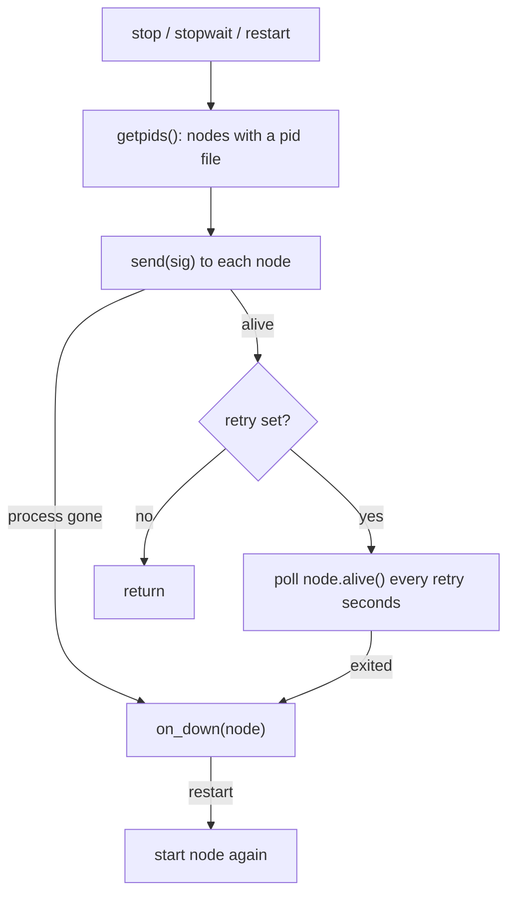

## Overview

`celery multi` starts, stops and restarts several worker nodes on one machine from a single command line, which is how init scripts and systemd units commonly manage Celery. It does not supervise the workers: each node is started as an independent daemon (`celery worker --detach`), tracked through its pid file, and stopped by sending it a signal. The command is implemented by `MultiTool` in `celery.bin.multi`; the node model (`Node`, `Cluster`, `MultiParser`) is in `celery.apps.multi`.

Sources: [celery/bin/multi.py:1-101](repo://celery/bin/multi.py#L1-L101), [celery/apps/multi.py:122-134](repo://celery/apps/multi.py#L122-L134)

For containerized deployments the repository also ships a Helm chart and Docker files, described at the end of this page.

Sources: [helm-chart/values.yaml:1-13](repo://helm-chart/values.yaml#L1-L13)

## Commands

`celery multi COMMAND NODES [OPTIONS]`:

Sources: [celery/bin/multi.py:247-260](repo://celery/bin/multi.py#L247-L260)

| Command | Does |
| --- | --- |
| `start` | Start every node as a detached worker; exit code 1 if any failed |
| `stop` | Send `SIGTERM` (or `-SIG`) to each node and return immediately |
| `stopwait` | Send the signal and wait until every node has exited |
| `restart` | Stop each node, waiting, and start it again as soon as it is down |
| `kill` | Send `SIGKILL` to every node |
| `show` | Print the full command line for each node without running it |
| `names` | Print the node names |
| `get NAME` | Print one node's arguments |
| `expand TEMPLATE` | Expand `%n`/`%h`-style placeholders for each node |
| `help` | Show the examples |

Sources: [celery/bin/multi.py:289-342](repo://celery/bin/multi.py#L289-L342)

The stop signal is taken from the last `-SIGNAME` or `-N` argument, defaulting to `SIGTERM` (warm shutdown, see [[Worker Startup and Bootsteps]]). `--nosplash`, `--quiet` and `--verbose` adjust output.

Sources: [celery/bin/multi.py:344-357](repo://celery/bin/multi.py#L344-L357), [celery/bin/multi.py:262-287](repo://celery/bin/multi.py#L262-L287)

Because `-A` is a global option in Celery 5, the click wrapper moves the arguments that came before `multi` to after it, so `celery -A proj multi start 3` still passes `-A proj` to each node. `celery multi` is also excluded from the early monkey patching done by the entry point, since it only spawns processes.

Sources: [celery/bin/multi.py:463-480](repo://celery/bin/multi.py#L463-L480), [celery/__main__.py:10-15](repo://celery/__main__.py#L10-L15)

## Naming nodes

### Node lists and ranges

The positional arguments name the nodes. A single number `N` creates `N` nodes named `celery1` … `celeryN` (the prefix is set with `--range-prefix`); otherwise each word is a node name. Names without `@` get `@<hostname>` appended, where the hostname is `--hostname`/`-n` or the machine's name; `--prefix` and `--suffix` change the generated names. Names may use `%h` for the hostname.

Sources: [celery/apps/multi.py:285-332](repo://celery/apps/multi.py#L285-L332), [celery/apps/multi.py:28-39](repo://celery/apps/multi.py#L28-L39)

```console
$ celery multi show 3 -A proj -c 3
celery worker -A proj -n celery1@myhost -c 3 ...
celery worker -A proj -n celery2@myhost -c 3 ...
celery worker -A proj -n celery3@myhost -c 3 ...
```

Sources: [celery/bin/multi.py:28-33](repo://celery/bin/multi.py#L28-L33)

### Per-node options

Options apply to every node, but an option suffixed with `:selector` applies only to some: `-c:1 10` to the first node, `-Q:1-3 images,video` to nodes 1 to 3 (ranges work when nodes were given as a number), `-c:image,video 10` to named nodes. `NamespacedOptionParser` collects options into a default set and per-selector namespaces, and `MultiParser` maps numeric indexes to node names and expands lists and ranges before merging each node's namespace over the defaults. Everything after `--` is passed through unchanged.

Sources: [celery/apps/multi.py:70-119](repo://celery/apps/multi.py#L70-L119), [celery/apps/multi.py:334-364](repo://celery/apps/multi.py#L334-L364), [celery/bin/multi.py:62-101](repo://celery/bin/multi.py#L62-L101)

### Placeholders

Option values are expanded per node with `node_format`: `%n` (or `%N`) is the short node name, `%h` the full node name (`name@host`), `%d` the host part, and `%i`/`%I` the pool process index (`0`/empty in the main process, `N`/`-N` in a child), which lets each prefork child write its own log file.

Sources: [celery/apps/multi.py:42-51](repo://celery/apps/multi.py#L42-L51), [celery/utils/nodenames.py:82-114](repo://celery/utils/nodenames.py#L82-L114), [celery/concurrency/prefork.py:58-66](repo://celery/concurrency/prefork.py#L58-L66)

## Nodes and the cluster

### Node

A `Node` builds its command line once. It sets `-n` to the node name and defaults `--pidfile` to `/var/run/celery/%n.pid`, `--logfile` to `/var/log/celery/%n%I.log` and `--executable` to the current Python, creating the directories if needed. Global options (`-A`, `-b`, `--result-backend`, `--loader`, `--config`, `--workdir`, `-C`, `-q`) are moved before the `worker` subcommand, as the CLI requires. The default command is `python -m celery worker --detach`.

Sources: [celery/apps/multi.py:122-190](repo://celery/apps/multi.py#L122-L190)

`start()` runs the command with `Popen` and waits for it, which returns as soon as the detached worker has forked into the background; a negative exit code means the launcher was killed by a signal. A node's `pid` is read from its pid file, and `send(sig)` signals it, treating a missing process (`ESRCH`) as down.

Sources: [celery/apps/multi.py:192-233](repo://celery/apps/multi.py#L192-L233), [celery/apps/multi.py:247-265](repo://celery/apps/multi.py#L247-L265)

### Cluster

`Cluster` is a list of nodes with lifecycle operations and callback hooks that `MultiTool` uses for its terminal output (`> Starting nodes...`, `OK`, `DOWN`).

Sources: [celery/apps/multi.py:367-404](repo://celery/apps/multi.py#L367-L404), [celery/bin/multi.py:373-460](repo://celery/bin/multi.py#L373-L460)



Sources: [celery/apps/multi.py:423-496](repo://celery/apps/multi.py#L423-L496)

`stop` sends the signal and returns; `stopwait` and `restart` poll with `kill(pid, 0)` every 2 seconds until each node is gone, and `restart` starts each node again as soon as it is down, so nodes restart one by one as they finish their current tasks. Nodes without a pid file are reported as down without being signalled.

Sources: [celery/apps/multi.py:431-483](repo://celery/apps/multi.py#L431-L483), [celery/apps/multi.py:491-496](repo://celery/apps/multi.py#L491-L496)

> [!IMPORTANT]
> Options are not stored anywhere. `stop` and `restart` must be given the same node names and `--pidfile` pattern as `start`, or they cannot find the pid files.

Sources: [celery/bin/multi.py:17-28](repo://celery/bin/multi.py#L17-L28)

## Containers and Kubernetes

### Helm chart

`helm-chart/` deploys workers as a Kubernetes `Deployment` (four replicas by default) of the `celery/celery` image. Configuration comes from a ConfigMap of environment variables (at least `CELERY_BROKER_URL`, which the app reads directly) and an optional Secret, and a change to the ConfigMap rolls the pods through a checksum annotation. Liveness and readiness probes run a Python one-liner that inspects worker stats and checks that the pod's hostname is among the responding nodes; `<APP>` in the probe must be replaced with the application module.

Sources: [helm-chart/values.yaml:1-74](repo://helm-chart/values.yaml#L1-L74), [helm-chart/templates/deployment.yaml:1-53](repo://helm-chart/templates/deployment.yaml#L1-L53), [helm-chart/templates/configmap.yaml:1-8](repo://helm-chart/templates/configmap.yaml#L1-L8), [celery/app/utils.py:100-105](repo://celery/app/utils.py#L100-L105)

In Kubernetes each pod runs one worker, so `celery multi` is not used there; scaling is done with replicas, and graceful termination relies on the worker's handling of `SIGTERM` (see the soft shutdown options in [[Worker Startup and Bootsteps]]).

Sources: [helm-chart/templates/deployment.yaml:9-14](repo://helm-chart/templates/deployment.yaml#L9-L14), [celery/apps/worker.py:433-441](repo://celery/apps/worker.py#L433-L441)

### Docker development environment

`docker/docker-compose.yml` is a development and test environment for Celery itself, not a production template: it builds a `celery/celery:dev` image with the source tree mounted, and starts RabbitMQ, Redis, a local DynamoDB and Azurite so the integration tests can run against real brokers and backends. A separate `docs` service builds and serves the Sphinx documentation.

Sources: [docker/docker-compose.yml:1-48](repo://docker/docker-compose.yml#L1-L48)
