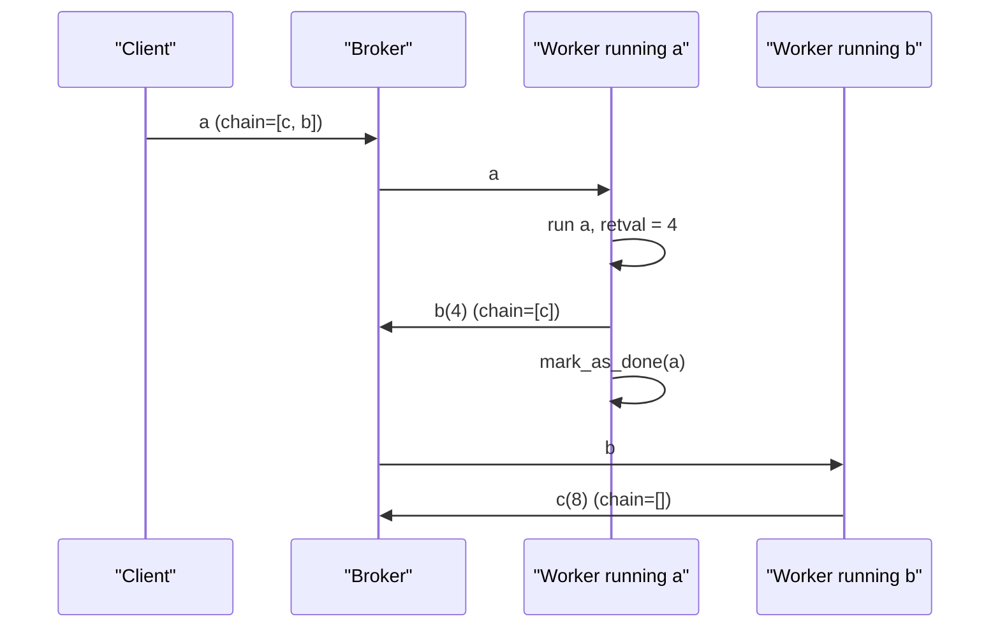

## Overview

The canvas (`celery.canvas`) lets you compose tasks into workflows without writing a coordinator. Its building block is the signature: a description of one task call (task name, arguments, execution options) that can be stored, serialized into a message, and called later. Signatures carry callbacks, and a chain is a sequence of signatures where each task's return value becomes the first argument of the next. A chain needs no process watching it: the first task's message carries the rest of the chain, and each worker sends the next step when its task succeeds.

Sources: [celery/canvas.py:233-288](repo://celery/canvas.py#L233-L288), [celery/canvas.py:1322-1368](repo://celery/canvas.py#L1322-L1368)

This page covers signatures, callbacks, chains and the map/chunks helpers. Parallel primitives (`group`, `chord`) are in [[Groups and Chords]], and custom headers that follow a workflow are in [[Canvas Stamping]].

Sources: [celery/canvas.py:1492-1524](repo://celery/canvas.py#L1492-L1524)

## Signatures

### A dict that describes a call

`Signature` subclasses `dict` with the keys `task`, `args`, `kwargs`, `options`, `subtask_type` and `immutable`. Being a plain dict is what lets a signature travel inside a JSON message as a callback or chain step. Attribute accessors (`sig.args`, `sig.options`, `sig.id` for `options['task_id']`) read the dict keys.

Sources: [celery/canvas.py:323-345](repo://celery/canvas.py#L323-L345), [celery/canvas.py:865-874](repo://celery/canvas.py#L865-L874)

Signatures are usually created from a task: `add.signature((2, 2), countdown=10)`, the shortcut `add.s(2, 2)`, or `add.si(2, 2)` for an immutable one. `celery.signature('tasks.add', args=(2, 2))` works with only a task name, which is useful for calling tasks defined in another code base. `.set(**options)` adds execution options and returns the signature for chaining.

Sources: [celery/app/task.py:962-986](repo://celery/app/task.py#L962-L986), [celery/canvas.py:539-549](repo://celery/canvas.py#L539-L549), [celery/canvas.py:2395-2409](repo://celery/canvas.py#L2395-L2409)

### Rebuilding from a dict

When a signature comes back out of a message it is a plain dict. `Signature.from_dict` looks at `subtask_type` and dispatches to the registered subclass (`chain`, `group`, `chord`, `xmap`, `xstarmap`, `chunks`), registered with `@Signature.register_type()`. `maybe_signature` does this for values that may be `None`, a dict or a signature. The task class is resolved lazily from `app.tasks` the first time `sig.type` is read; if the task is not registered locally, `apply_async` falls back to `app.send_task` by name.

Sources: [celery/canvas.py:296-321](repo://celery/canvas.py#L296-L321), [celery/canvas.py:843-863](repo://celery/canvas.py#L843-L863), [celery/canvas.py:2415-2439](repo://celery/canvas.py#L2415-L2439)

### Partial application and immutability

Calling a signature with extra arguments merges them in `_merge`: extra positional args are prepended to the stored ones, extra kwargs update the stored kwargs, and options override stored options. This is how a callback receives its parent's result: the worker calls `callback.apply_async((retval,))`. An immutable signature (`si()` or `immutable=True`) ignores extra args and kwargs and only merges options.

Sources: [celery/canvas.py:403-443](repo://celery/canvas.py#L403-L443)

Two options are protected from overrides during merging: `group_id` and any stamped header already present, because changing them would disconnect a task from the group or chord waiting on it.

Sources: [celery/canvas.py:290-294](repo://celery/canvas.py#L290-L294), [celery/canvas.py:424-436](repo://celery/canvas.py#L424-L436)

| Call | Effect |
| --- | --- |
| `sig.delay(*a, **kw)` / `sig.apply_async(a, kw, **opts)` | Merge and send |
| `sig(*a, **kw)` | Merge and run the task function in this process |
| `sig.apply(a, kw)` | Merge and run through the eager tracer |
| `sig.clone(a, kw, **opts)` | New signature with merged values and deep-copied options |
| `sig.replace(args=, kwargs=, options=)` | New signature with sections replaced |
| `~sig` | `sig.apply_async().get()` |

Sources: [celery/canvas.py:347-401](repo://celery/canvas.py#L347-L401), [celery/canvas.py:445-471](repo://celery/canvas.py#L445-L471), [celery/canvas.py:524-537](repo://celery/canvas.py#L524-L537), [celery/canvas.py:820-821](repo://celery/canvas.py#L820-L821)

### Freezing

`freeze()` assigns a concrete task id to the signature (keeping one already in `options['task_id']`), records `root_id`, `parent_id`, `group_id`, `group_index` and `chord` when given, sets `reply_to` to the app's thread id, and returns the `AsyncResult` for that id without sending anything. Workflows freeze every member before sending so that results for later steps exist before their tasks are published. Sending a frozen signature twice produces two messages with the same id.

Sources: [celery/canvas.py:473-520](repo://celery/canvas.py#L473-L520)

## Callbacks and errbacks

### Linking

`sig.link(callback)` appends a signature to `options['link']`; `sig.link_error(errback)` appends to `options['link_error']`. Both return the argument, while `on_error(errback)` returns the original signature for fluent use. When sent, these become the message's `callbacks` and `errbacks`.

Sources: [celery/canvas.py:702-746](repo://celery/canvas.py#L702-L746)

### What the worker does with them

On success the tracer calls `_dispatch_callbacks_and_chain` before storing the result, so `result.children` already lists the callbacks. A single callback is applied with the return value as its first argument; several callbacks are sent together as one group (groups among them separately). Each gets the finished task as `parent_id` and keeps the `root_id`. Dispatch is not atomic: if some callbacks are sent and the next one fails, a redelivery may send the first ones again, consistent with at-least-once delivery.

Sources: [celery/app/trace.py:426-473](repo://celery/app/trace.py#L426-L473), [celery/app/trace.py:609-628](repo://celery/app/trace.py#L609-L628)

On failure, the backend's `mark_as_failure` calls the errbacks. An errback task whose function takes more than one argument is called synchronously in the worker as `errback(request, exc, traceback)`; an older-style errback that takes only a task id is sent as a task (in a group) with the failed task's id. Errbacks for tasks not registered in this worker are always sent.

Sources: [celery/backends/base.py:254-305](repo://celery/backends/base.py#L254-L305)

## Chains

### Building a chain

`chain(a, b, c)` and `a | b | c` produce the same `_chain` signature, whose task is `celery.chain` and whose `kwargs['tasks']` holds the steps. The `|` operator flattens nested chains and applies a few rewrites that keep the structure equivalent:

Sources: [celery/canvas.py:759-786](repo://celery/canvas.py#L759-L786), [celery/canvas.py:1371-1382](repo://celery/canvas.py#L1371-L1382)

| Expression | Result |
| --- | --- |
| `sig \| sig` | Two-step chain |
| `chain \| chain` | One flattened chain |
| `chain ending in group \| sig` | The group and `sig` become a chord |
| `chain ending in chord \| sig` | `sig` is appended to the chord body |
| `chain \| group` with one member | The group is unrolled to its single task |

Sources: [celery/canvas.py:960-1006](repo://celery/canvas.py#L960-L1006)

A chain's own `link` callbacks are moved to its last task and its `link_error` errbacks to every task when the chain is unrolled, so they fire at the right moment.

Sources: [celery/canvas.py:1017-1034](repo://celery/canvas.py#L1017-L1034)

```python
from celery import chain

res = chain(add.s(2, 2), add.s(4), mul.s(8))()   # ((2 + 2) + 4) * 8
res.get()          # 64
res.parent.get()   # 8
```

Sources: [celery/canvas.py:1333-1356](repo://celery/canvas.py#L1333-L1356)

### Preparing the steps

`apply_async` runs `self.run(...)` (or `apply` in eager mode). `run` prepends the call's args to the chain's args and calls `prepare_steps`, which walks the steps from last to first:

Sources: [celery/canvas.py:1036-1073](repo://celery/canvas.py#L1036-L1073)

1. Converts dicts to signatures and unrolls single-member groups; skips empty groups in the middle of a chain.
2. Clones each step; the first step receives the chain's partial args.
3. Splices nested chains into the deque of steps.
4. When a group is followed by a step, replaces both with `chord(group, body=next_step)`, reusing the step's frozen id.
5. Freezes each step: the last one with the chain's `task_id`, `group_id`, `group_index` and chord body (so an enclosing group or chord synchronizes on the chain's final task), the others with only `root_id`.
6. Sets each result's `parent` to the previous step's result, so the final `AsyncResult` can walk back with `.parent`.
7. Adds the chain's `link_error` to every step, and to chord bodies.

Sources: [celery/canvas.py:1181-1292](repo://celery/canvas.py#L1181-L1292)

The result is two lists in reverse order: signatures and their results. `run` pops the first step, passes the remaining list as the `chain` option and sends the first step. It returns the result of the last step (or the first step's real result when the chain has one task).

Sources: [celery/canvas.py:1075-1092](repo://celery/canvas.py#L1075-L1092)

### How the chain advances



Sources: [celery/app/trace.py:467-473](repo://celery/app/trace.py#L467-L473), [celery/canvas.py:1176-1185](repo://celery/canvas.py#L1176-L1185)

Because the list is reversed, the worker only needs `chain[-1]` for the next signature and `chain[:-1]` for the rest: after a successful task, `_dispatch_callbacks_and_chain` applies `signature(chain[-1])` with the return value and passes the remaining list along. If a step fails, the chain stops there and the failure is stored for that step; the chain's errbacks, attached to every step, run for the failing one.

Sources: [celery/app/trace.py:467-473](repo://celery/app/trace.py#L467-L473), [celery/canvas.py:1267-1272](repo://celery/canvas.py#L1267-L1272)

Carrying the chain in the message rather than as nested `link` callbacks is the protocol 2 design: deeply nested links made pickle recurse once per step. With protocol 1, or `use_link=True`, chains still link each step to the next as a callback.

Sources: [celery/canvas.py:1157-1165](repo://celery/canvas.py#L1157-L1165), [celery/canvas.py:1259-1262](repo://celery/canvas.py#L1259-L1262)

The options passed to the first step are wrapped in a `ChainMap` so that the `chain` key is never mutated in a shared options dict; mutating it once made sibling tasks in a group inherit each other's chain steps.

Sources: [celery/canvas.py:877-931](repo://celery/canvas.py#L877-L931)

### Eager chains

`chain.apply()` runs each step in-process with `apply`, feeding `last.get()` into the next step and linking results through `parent`.

Sources: [celery/canvas.py:1294-1302](repo://celery/canvas.py#L1294-L1302)

## Replacing a task

`self.replace(sig)` inside a bound task swaps the rest of the task's work for a new signature that inherits the task's identity. It moves the request's callbacks and errbacks onto `sig` (pushing callbacks to the last task if `sig` is a chain), upgrades a group to a chord ending in `celery.accumulate` so it can carry callbacks, freezes `sig` with the current task id, copies `chord`, `group_id`, `group_index` and `root_id`, increments `replaced_task_nesting`, and appends the remaining steps of the current chain. `on_replace` then sends it and raises `Ignore`, so the original task records no result of its own. A replacing signature may not itself be part of a chord, and an empty chain is refused.

Sources: [celery/app/task.py:1029-1095](repo://celery/app/task.py#L1029-L1095), [celery/app/task.py:1211-1227](repo://celery/app/task.py#L1211-L1227)

## Map, starmap and chunks

These helpers process an iterable in one task message rather than one message per item.

Sources: [celery/canvas.py:1385-1407](repo://celery/canvas.py#L1385-L1407)

| Helper | Built with | Runs as |
| --- | --- | --- |
| `xmap(task_sig, it)` | `add.map(it)` | One `celery.map` task calling `task(item)` for every item, sequentially |
| `xstarmap(task_sig, it)` | `add.starmap(it)` | One `celery.starmap` task calling `task(*item)` |
| `chunks(task_sig, it, n)` | `add.chunks(it, n)` | A group of `xstarmap` tasks, each over `n` items |

Sources: [celery/canvas.py:1409-1472](repo://celery/canvas.py#L1409-L1472), [celery/app/builtins.py:101-130](repo://celery/app/builtins.py#L101-L130), [celery/app/task.py:988-1001](repo://celery/app/task.py#L988-L1001)

The map tasks call the task function directly inside the worker, so the items are not separate tasks: no per-item results, retries or events. `chunks` gives parallelism at the chunk level while keeping message counts low; `chunks(...).group()` exposes the underlying group to combine with other primitives.

Sources: [celery/app/builtins.py:101-120](repo://celery/app/builtins.py#L101-L120), [celery/canvas.py:1463-1468](repo://celery/canvas.py#L1463-L1468)
