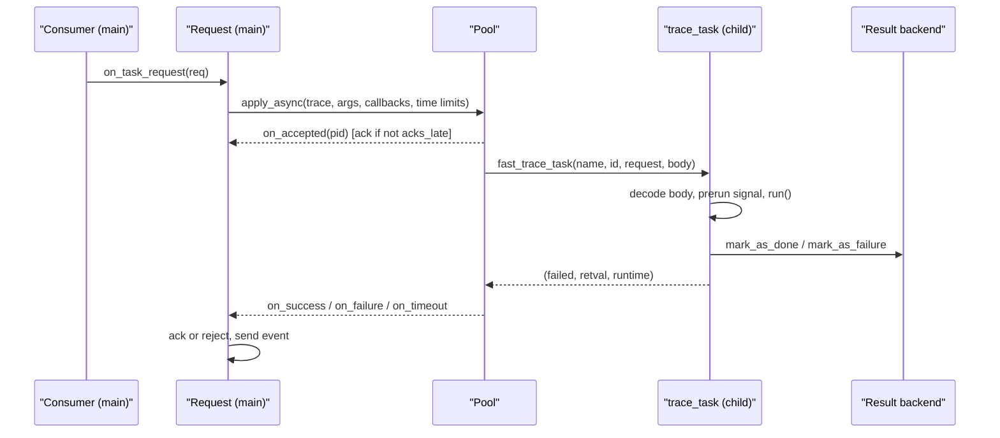

## Overview

Once the consumer has accepted a message ([[Consumer and Message Handling]]), two objects carry it to completion. A `Request` (`celery.worker.request`) lives in the worker's main process: it knows the message, decides when to acknowledge or reject it, enforces revocation and time limits, and reacts to the pool's callbacks. The tracer (`celery.app.trace`) runs inside the pool's child process, thread or greenlet: it deserializes the arguments, calls the task function, and records the outcome through the result backend, firing handlers, signals, callbacks and the next chain step on the way.

Sources: [celery/worker/request.py:67-175](repo://celery/worker/request.py#L67-L175), [celery/app/trace.py:344-370](repo://celery/app/trace.py#L344-L370)

Sources: [celery/worker/request.py:818-874](repo://celery/worker/request.py#L818-L874), [celery/worker/request.py:515-527](repo://celery/worker/request.py#L515-L527), [celery/app/trace.py:757-788](repo://celery/app/trace.py#L757-L788)

## The Request

### What a request holds

`Request.__init__` copies the message headers into `_request_dict`, keeps the body still serialized (protocol 2), and extracts the id, task name (or its `shadow` name for logs), root and parent ids, time limits, `argsrepr`/`kwargsrepr`, and `ignore_result` (falling back to the task's setting). It parses `eta` and `expires` from ISO strings into aware datetimes, raising `InvalidTaskError` for bad values, and records the delivery info (exchange, routing key, priority, redelivered flag), `reply_to` and `correlation_id`. Everything later reads these properties, so most requests never deserialize anything in the main process.

Sources: [celery/worker/request.py:90-175](repo://celery/worker/request.py#L90-L175)

### A request class per task

The strategy does not use `Request` directly. `create_request_cls` builds a subclass per task with that task's default time limits, the pool's `apply_async`, its `acks_late` flag and whether events are enabled captured in a closure, which keeps the per-message path short.

Sources: [celery/worker/request.py:818-874](repo://celery/worker/request.py#L818-L874), [celery/worker/strategy.py:127-128](repo://celery/worker/strategy.py#L127-L128)

### Sending to the pool

`execute_using_pool(pool)` checks `revoked()` first and raises `TaskRevokedError` if so. It then calls `pool.apply_async` with the trace function and `(task name, id, request dict, body, content type, encoding)` as arguments, the soft and hard time limits (the message's, else the task's), and four callbacks: `on_accepted`, `on_timeout`, `on_success` and `on_failure`. A weak reference to the pool's result is kept so a later revoke can terminate it.

Sources: [celery/worker/request.py:832-853](repo://celery/worker/request.py#L832-L853)

### Revocation and expiry

`revoked()` returns true, marks the task `REVOKED`, sends `task-revoked`, acknowledges the message and sends `task_revoked`, when the request has expired, when its id is in the worker's revoked set, or when one of its stamps matches a revoked stamp ([[Canvas Stamping]]). It is checked when the message arrives, when the request is sent to the pool, and again when running inline. An expired request also adds its id to the revoked set.

Sources: [celery/worker/request.py:408-414](repo://celery/worker/request.py#L408-L414), [celery/worker/request.py:457-509](repo://celery/worker/request.py#L457-L509)

`terminate(pool, signal)` sends a signal to the child running the task, or, if the task has not started yet, remembers to do so as soon as it is accepted. `cancel()` is the variant used at shutdown and after connection loss: it kills the job and records a `RETRY` instead of `REVOKED`, so the task is expected to run again.

Sources: [celery/worker/request.py:416-455](repo://celery/worker/request.py#L416-L455), [celery/worker/request.py:526-527](repo://celery/worker/request.py#L526-L527)

## Acknowledgement

### Early and late acks

By default a message is acknowledged when the pool accepts the task (`on_accepted`), so a task whose process crashes is not redelivered: at-most-once execution. With `acks_late`, the ack is deferred until the task finishes, so a crash or connection loss redelivers the message: at-least-once execution, which needs idempotent tasks.

Sources: [celery/worker/request.py:515-527](repo://celery/worker/request.py#L515-L527), [celery/worker/request.py:855-868](repo://celery/worker/request.py#L855-L868)

### Outcomes with acks_late

`on_failure` decides what to do with the message when a late-acked task ends badly:

Sources: [celery/worker/request.py:622-728](repo://celery/worker/request.py#L622-L728)

| Outcome | Message |
| --- | --- |
| Success, retry, `Ignore` | Acknowledged |
| `Reject(requeue=True)` | Rejected and requeued |
| `Reject(requeue=False)` | Rejected; `FAILURE` stored |
| Exception | Acknowledged if `acks_on_failure` (default), else rejected without requeue |
| Hard time limit | Acknowledged if `acks_on_timeout` (default), else requeued |
| Worker process lost | Requeued if `reject_on_worker_lost`, else acknowledged and `FAILURE` stored |
| Terminated by revoke | `REVOKED` stored |

Sources: [celery/worker/request.py:630-711](repo://celery/worker/request.py#L630-L711), [celery/worker/request.py:613-620](repo://celery/worker/request.py#L613-L620)

When the task failed in the pool rather than in the tracer (for example `WorkerLostError`), `on_failure` itself stores the failure and sends `task_failure` and `task-failed`, because the child had no chance to.

Sources: [celery/worker/request.py:698-728](repo://celery/worker/request.py#L698-L728)

## Time limits

The pool enforces two limits per task: `soft_time_limit` raises `SoftTimeLimitExceeded` inside the task, which may catch it to clean up; `time_limit` kills the process running it. Both come from the message (set with `apply_async(time_limit=...)`), else the task class, else `task_time_limit`/`task_soft_time_limit`. The prefork pool enforces both limits; the gevent pool enforces the hard limit with `gevent.Timeout`; the solo, thread and eventlet pools do not enforce them ([[Concurrency Pools]]).

Sources: [celery/worker/request.py:837-848](repo://celery/worker/request.py#L837-L848), [celery/worker/components.py:154-170](repo://celery/worker/components.py#L154-L170), [celery/concurrency/gevent.py:28-39](repo://celery/concurrency/gevent.py#L28-L39)

`on_timeout(soft, timeout)` logs a warning for the soft limit. For the hard limit it stores `FAILURE` with `TimeLimitExceeded`, calls `on_failure`, `after_return` (if overridden), the `task_failure` signal and the `task-failed` event, as a normal failure would, and acknowledges or requeues according to `acks_on_timeout`. During a cold shutdown this bookkeeping is skipped.

Sources: [celery/worker/request.py:529-594](repo://celery/worker/request.py#L529-L594)

## The tracer

### Building it

`build_tracer(name, task, ...)` returns a `trace_task(uuid, args, kwargs, request)` closure, built once per task when the consumer starts and stored in `task.__trace__`. It resolves everything it can up front: the function to call (`task.run` unless the task overrides `__call__`), the loader hooks, which handlers the task overrides, whether any receivers are connected to the prerun, postrun and success signals, and whether duplicate deliveries should be checked.

Sources: [celery/app/trace.py:344-416](repo://celery/app/trace.py#L344-L416), [celery/worker/consumer/consumer.py:716-721](repo://celery/worker/consumer/consumer.py#L716-L721)

### Running a task

For each call the tracer:

Sources: [celery/app/trace.py:475-500](repo://celery/app/trace.py#L475-L500)

1. Builds the task's `Context` from the request dict and decides whether to publish a result: not when results are ignored, and in eager mode only with `store_eager_result`.
2. Skips redelivered tasks that already succeeded, when deduplication is on (see below).
3. Pushes the task and request on the thread-local stacks, sends `task_prerun`, calls the loader's `on_task_init`, and stores `STARTED` with pid and hostname if `track_started`.
4. Calls `before_start`, then the task function.
5. On success, sends callbacks and the next chain step ([[Signatures and Chains]]), then `mark_as_done`; then `on_success`, the `task_success` signal and the `Task ... succeeded in Ns` log line.
6. On `Reject`, `Ignore` or `Retry`, records that outcome; on any other exception, records a failure.
7. Calls `after_return` unless the task was ignored or rejected, sends `task_postrun`, pops the stacks, and runs the backend's and loader's cleanup.

Sources: [celery/app/trace.py:563-670](repo://celery/app/trace.py#L563-L670)

Callbacks are sent before the result is stored so that the stored record already lists them as children. A result that cannot be encoded (`EncodeError`) turns the success into a failure.

Sources: [celery/app/trace.py:609-631](repo://celery/app/trace.py#L609-L631)

### Recording errors

`on_error` wraps the exception in a `TraceInfo` and calls `handle_error_state`. For `RETRY` it stores the retry, calls `on_retry` and sends `task_retry`. For `FAILURE` it converts the exception to a pickleable form, calls `mark_as_failure` (which also calls errbacks and completes chord parts), `on_failure`, `task_failure`, and logs according to the policy: expected exceptions from `throws` without a traceback, others as errors. In eager mode with `propagate`, the exception is re-raised instead. Errors are stored even for ignored results when `store_errors_even_if_ignored` is set.

Sources: [celery/app/trace.py:179-283](repo://celery/app/trace.py#L179-L283), [celery/app/trace.py:417-424](repo://celery/app/trace.py#L417-L424), [celery/app/trace.py:137-147](repo://celery/app/trace.py#L137-L147)

An exception raised by the tracer's own machinery (outside the task body, for example a broken signal handler) is caught by the outer handler: it sends `task_internal_error`, warns "Exception raised outside body", and still records a failure.

Sources: [celery/app/trace.py:673-686](repo://celery/app/trace.py#L673-L686), [celery/app/trace.py:689-732](repo://celery/app/trace.py#L689-L732)

### Deduplicating redelivered tasks

With `acks_late`, a task that succeeded but whose ack was lost is redelivered. If `worker_deduplicate_successful_tasks` is on and the backend is persistent, the tracer checks redelivered messages against the worker's recent successes and the backend's stored state. A task already `SUCCESS` is not run again; if its stored result has no children, the callbacks and chain are dispatched from the stored value so the workflow still continues.

Sources: [celery/app/trace.py:380-382](repo://celery/app/trace.py#L380-L382), [celery/app/trace.py:500-561](repo://celery/app/trace.py#L500-L561)

## Worker optimizations

When the worker program starts, `setup_worker_optimizations` finalizes the app, makes it both current and default (so threads without an app still find it), caches the task registry, accepted content types and hostname in a module-level list, and sets `app.use_fast_trace_task`. The pool then runs `fast_trace_task`, which decodes the body with the cached accept list and calls the prebuilt tracer directly; `trace_task_ret` is the slower general path. Both return `(failed, value, runtime)` to the pool, which the request callbacks unpack. In a spawned (not forked) child the cache is empty and `fast_trace_task` raises an explanatory `RuntimeError`.

Sources: [celery/app/trace.py:735-788](repo://celery/app/trace.py#L735-L788), [celery/app/trace.py:804-831](repo://celery/app/trace.py#L804-L831), [celery/apps/worker.py:94-96](repo://celery/apps/worker.py#L94-L96)

The tracer calls `task.run` directly, bypassing `Task.__call__`. To keep a custom `__call__` that calls `super()` from pushing the request twice, `_install_stack_protection` patches `Task.__call__` so the first such call inside a worker task goes straight to `run`.

Sources: [celery/app/trace.py:847-873](repo://celery/app/trace.py#L847-L873)

## Worker bookkeeping

`celery.worker.state` keeps the worker's view of its tasks: `reserved_requests` (received, not yet running), `active_requests` (running), a bounded set of recent successes, per-task counters and the revoked set. `task_reserved`, `task_accepted` and `task_ready` move requests between them; these sets back `celery inspect reserved`, `active` and `stats` ([[Remote Control and Inspection]]).

Sources: [celery/worker/state.py:48-71](repo://celery/worker/state.py#L48-L71), [celery/worker/state.py:96-129](repo://celery/worker/state.py#L96-L129)

The `Request.execute()` method runs the tracer inline in the current process instead of the pool, acknowledging first unless `acks_late`, and rejecting the message if the task failed. The worker itself always goes through `execute_using_pool`.

Sources: [celery/worker/request.py:374-406](repo://celery/worker/request.py#L374-L406)
