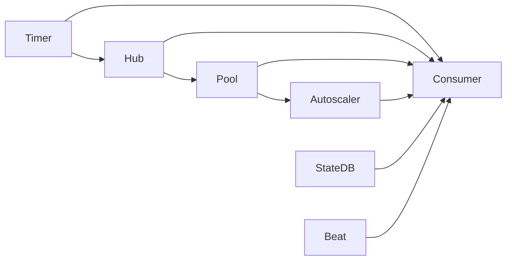

## Overview

A Celery worker is a `WorkController` (`celery.worker.worker`) whose parts are bootsteps: small classes that each create one service (timer, event loop, execution pool, embedded beat, state database, message consumer) and declare which other steps they need. A `Blueprint` sorts the steps by dependency and starts them in order; shutdown runs them in reverse. The `celery worker` command wraps this in `celery.apps.worker.Worker`, which adds what a standalone process needs: logging, the banner, signal handlers and process titles.

Sources: [celery/worker/worker.py:1-12](repo://celery/worker/worker.py#L1-L12), [celery/worker/worker.py:60-85](repo://celery/worker/worker.py#L60-L85), [celery/apps/worker.py:91-104](repo://celery/apps/worker.py#L91-L104)

This page follows the worker from the command line to a running blueprint and back to exit. The consumer step starts a second blueprint of its own, covered in [[Consumer and Message Handling]]; the pool implementations are in [[Concurrency Pools]].

Sources: [celery/worker/components.py:221-246](repo://celery/worker/components.py#L221-L246)

## From the command line to start()

### The worker command

`celery worker` is a click command in `celery.bin.worker`. It applies `--disable-prefetch`, parses extra `key=value` arguments as configuration in the `worker` namespace, re-executes itself in the background with `--detach`, drops privileges for `--uid`/`--gid`, then builds `app.Worker(hostname=..., pool_cls=..., loglevel=..., logfile=..., pidfile=..., statedb=..., **options)` and calls `start()`. Its exit code becomes the process exit code. A `SecurityError` during setup exits with code 1.

Sources: [celery/bin/worker.py:324-371](repo://celery/bin/worker.py#L324-L371)

### Constructing the WorkController

`WorkController.__init__` resolves the node name (`-n`, default `celery@<hostname>`), records the start time, initializes the loader (importing task modules, see [[Configuration and Loaders]]), and calls three hooks around `setup_defaults`, which fills every option from its argument or the matching setting (`worker_concurrency`, `worker_pool`, `worker_prefetch_multiplier`, `task_time_limit`, `worker_max_tasks_per_child` and so on).

Sources: [celery/worker/worker.py:87-95](repo://celery/worker/worker.py#L87-L95), [celery/worker/worker.py:351-410](repo://celery/worker/worker.py#L351-L410)

`setup_instance` then:

Sources: [celery/worker/worker.py:97-140](repo://celery/worker/worker.py#L97-L140)

1. Selects the queues to consume from (`-Q`, `-X`, plus the worker-direct queue if enabled), raising `ImproperlyConfigured` for unknown queues when they cannot be created ([[Routing and Queues]]).
2. Imports `--include` modules and records every task module in `include`, so a re-exec'd process imports them too.
3. Defaults `concurrency` to the CPU count.
4. Decides whether to run the asynchronous event loop: only for the default (non-green) environment, on a transport that supports asynchronous I/O, and not on Windows.
5. Sends `worker_init`, resolves the pool class from its alias, and builds the `Blueprint` from the default steps plus any in `app.steps['worker']`, then calls `blueprint.apply(self)`.

Sources: [celery/worker/worker.py:166-193](repo://celery/worker/worker.py#L166-L193), [celery/worker/worker.py:236-242](repo://celery/worker/worker.py#L236-L242)

### The Worker program hooks

`celery.apps.worker.Worker` overrides the hooks. `on_before_init` applies tracing optimizations, sends `celeryd_init` (the place to configure a worker by node name) and refuses to run as root with pickle enabled. `on_after_init` handles `--purge`, colours and stdout redirection. `on_init_blueprint` sets up logging ([[Logging]]) and finalizes the app. `on_start` sends `celeryd_after_setup`, purges queues if asked, prints the banner (version, transport, results backend, concurrency, queues and, at debug level, the task list), sets the process title and installs signal handlers. `on_consumer_ready` sends `worker_ready` and logs `<hostname> ready.`.

Sources: [celery/apps/worker.py:94-182](repo://celery/apps/worker.py#L94-L182), [celery/apps/worker.py:198-252](repo://celery/apps/worker.py#L198-L252)

## Bootsteps

### Steps and blueprints

A `Step` has a `name` (its qualified class name), `requires` (steps that must start before it), `include_if(parent)` (whether to use it, default `enabled`), and `create(parent)`. A `StartStopStep` keeps the object returned by `create` and is appended to the parent's `steps` list so it is started and stopped; a plain `Step` only runs `create`. Exactly one step per blueprint may set `last = True`.

Sources: [celery/bootsteps.py:266-383](repo://celery/bootsteps.py#L266-L383)

`Blueprint.apply(parent)` loads every step class (resolving dotted names), follows `requires` transitively to pull in steps that were not listed, builds a `DependencyGraph`, adds edges so the `last` step depends on all others, and sorts it topologically. It then instantiates each step in that order (step `__init__` may set attributes on the parent) and calls `include`, which runs `create` for the steps that are enabled.

Sources: [celery/bootsteps.py:186-256](repo://celery/bootsteps.py#L186-L256)

### Worker steps

Sources: [celery/worker/worker.py:72-85](repo://celery/worker/worker.py#L72-L85), [celery/worker/components.py:32-115](repo://celery/worker/components.py#L32-L115), [celery/worker/components.py:221-226](repo://celery/worker/components.py#L221-L226), [celery/worker/autoscale.py:31-58](repo://celery/worker/autoscale.py#L31-L58)

| Step | Requires | Creates |
| --- | --- | --- |
| `Timer` | | `w.timer`: kombu's timer for the event loop, else the pool's timer class running in a thread |
| `Hub` | Timer | `w.hub`, the kombu event loop; only when `use_eventloop` |
| `Pool` | Hub | `w.pool`, the execution pool, with time limits, max tasks/memory per child and a semaphore for the event loop |
| `Autoscaler` | Pool | Grows and shrinks the pool between `--autoscale` limits |
| `Beat` | | An embedded beat service, with `-B` |
| `StateDB` | | `Persistent` state file for revoked ids, with `--statedb` |
| `Consumer` | all (last) | `w.consumer` with prefetch `concurrency × prefetch_multiplier` |

Sources: [celery/worker/components.py:32-100](repo://celery/worker/components.py#L32-L100), [celery/worker/components.py:101-218](repo://celery/worker/components.py#L101-L218), [celery/worker/components.py:221-246](repo://celery/worker/components.py#L221-L246)

The `Pool` step parses `--autoscale max,min` and, under the event loop, wraps task submission in a `LaxBoundedSemaphore` sized to the pool so the consumer never hands the pool more tasks than it has slots. It also sets the process-wide "joining would block" flag from the pool class ([[Task Results]]). The `Beat` step refuses eventlet and gevent pools, and `StateDB` registers the state file to be saved at exit.

Sources: [celery/worker/components.py:101-172](repo://celery/worker/components.py#L101-L172), [celery/worker/components.py:181-218](repo://celery/worker/components.py#L181-L218)

### Adding your own steps

Custom steps are registered with `app.steps['worker'].add(MyStep)` (or `'consumer'` for the consumer blueprint) before the worker starts. A step that `requires` an existing one is placed after it, and its `create`, `start`, `stop` and `terminate` methods receive the worker instance.

Sources: [celery/app/base.py:301-303](repo://celery/app/base.py#L301-L303), [celery/worker/worker.py:132-140](repo://celery/worker/worker.py#L132-L140)

## Running

`WorkController.start()` calls `blueprint.start(self)`, which sets the state to `RUN`, calls `on_start` (creating the pid lock file when `--pidfile` is given) and starts each step in order. The consumer step starts last and does not return while the worker runs: it connects to the broker and enters the message loop ([[Consumer and Message Handling]]). With the event loop, steps and the consumer register their file descriptors and timers on the hub through `register_with_event_loop`.

Sources: [celery/bootsteps.py:109-117](repo://celery/bootsteps.py#L109-L117), [celery/worker/worker.py:149-151](repo://celery/worker/worker.py#L149-L151), [celery/worker/worker.py:197-214](repo://celery/worker/worker.py#L197-L214)

Each delivered task becomes a `Request` that the consumer passes to `w.process_task`, which calls `req.execute_using_pool(self.pool)` (through the semaphore when pool put-locks are on). [[Task Execution and Tracing]] continues from there.

Sources: [celery/worker/worker.py:216-227](repo://celery/worker/worker.py#L216-L227)

## Shutdown

### Signals and flags

Signal handlers do not stop the worker directly. They set `state.should_stop` (warm) or `state.should_terminate` (cold) to an exit code and send `worker_shutting_down`; the message loop calls `maybe_shutdown()` on every iteration, which raises `WorkerShutdown` or `WorkerTerminate` (both `SystemExit` subclasses). `WorkController.start` catches them and calls `stop()` or `terminate()`.

Sources: [celery/apps/worker.py:288-316](repo://celery/apps/worker.py#L288-L316), [celery/worker/state.py:73-93](repo://celery/worker/state.py#L73-L93), [celery/worker/worker.py:197-207](repo://celery/worker/worker.py#L197-L207)

| Signal | Effect |
| --- | --- |
| `SIGTERM` | Warm shutdown: stop consuming, wait for running tasks |
| `SIGINT` (Ctrl+C) | Warm shutdown; a second Ctrl+C escalates to cold |
| `SIGQUIT` | Cold shutdown: optional soft wait, then cancel running tasks |
| Third signal during cold shutdown | Hard shutdown: `WorkerTerminate` immediately |
| `SIGHUP` | Restart by re-executing the same command line (only when detached; not on macOS) |
| `SIGUSR1` | Print the stack of every thread |
| `SIGUSR2` | Open a remote debugger, if `CELERY_RDBSIG` is set |

Sources: [celery/apps/worker.py:254-274](repo://celery/apps/worker.py#L254-L274), [celery/apps/worker.py:319-366](repo://celery/apps/worker.py#L319-L366), [celery/apps/worker.py:369-466](repo://celery/apps/worker.py#L369-L466), [celery/apps/worker.py:469-523](repo://celery/apps/worker.py#L469-L523)

Setting the billiard environment option `REMAP_SIGTERM=SIGQUIT` makes `SIGTERM` start a cold shutdown instead, which suits platforms that send `SIGTERM` and then kill after a short grace period.

Sources: [celery/apps/worker.py:433-441](repo://celery/apps/worker.py#L433-L441)

### Warm shutdown

`stop()` closes the consumer (no new messages), then `blueprint.stop(terminate=False)`: it calls `close` on every step, then `stop` on each in reverse order, so the consumer stops before the pool. The prefork pool's `stop` waits for running tasks to finish. `on_stopped` stops the timer, shuts the consumer down and releases the pid lock; `worker_shutdown` is sent last. A blueprint that never fully started is simply marked terminated.

Sources: [celery/worker/worker.py:244-267](repo://celery/worker/worker.py#L244-L267), [celery/bootsteps.py:128-176](repo://celery/bootsteps.py#L128-L176), [celery/worker/worker.py:156-164](repo://celery/worker/worker.py#L156-L164)

### Cold and soft shutdown

On `SIGQUIT` the handler `on_cold_shutdown` first waits `worker_soft_shutdown_timeout` seconds if it is set and tasks are running (or always, with `worker_enable_soft_shutdown_on_idle`), giving short tasks a chance to finish. It then cancels the task consumer so requeued messages are not redelivered to this worker, cancels all active unacknowledged requests (which requeues `acks_late` tasks), sets `should_terminate`, and stops the pool. `terminate()` then runs `terminate` on every step in reverse. Another `SIGQUIT`/`SIGINT` during this wait cancels requests immediately; a third forces a hard exit.

Sources: [celery/apps/worker.py:338-430](repo://celery/apps/worker.py#L338-L430), [celery/worker/worker.py:412-435](repo://celery/worker/worker.py#L412-L435)

> [!TIP]
> For deployments that kill workers after a grace period, combine `task_acks_late`, `worker_soft_shutdown_timeout` slightly below the grace period, and `REMAP_SIGTERM=SIGQUIT`: short tasks finish, long ones are requeued for another worker.

Sources: [celery/apps/worker.py:369-430](repo://celery/apps/worker.py#L369-L430)

## Reloading and statistics

`WorkController.reload(modules, reload=False)` imports (or force-reloads) task modules, refreshes the consumer's task strategies and rate limits, and restarts the pool if it supports it; the `pool_restart` control command uses it. `stats()` combines uptime, pid, task counts and the logical clock with the `info` of every worker and consumer step and resource usage, which `celery inspect stats` returns ([[Remote Control and Inspection]]).

Sources: [celery/worker/worker.py:269-334](repo://celery/worker/worker.py#L269-L334)
