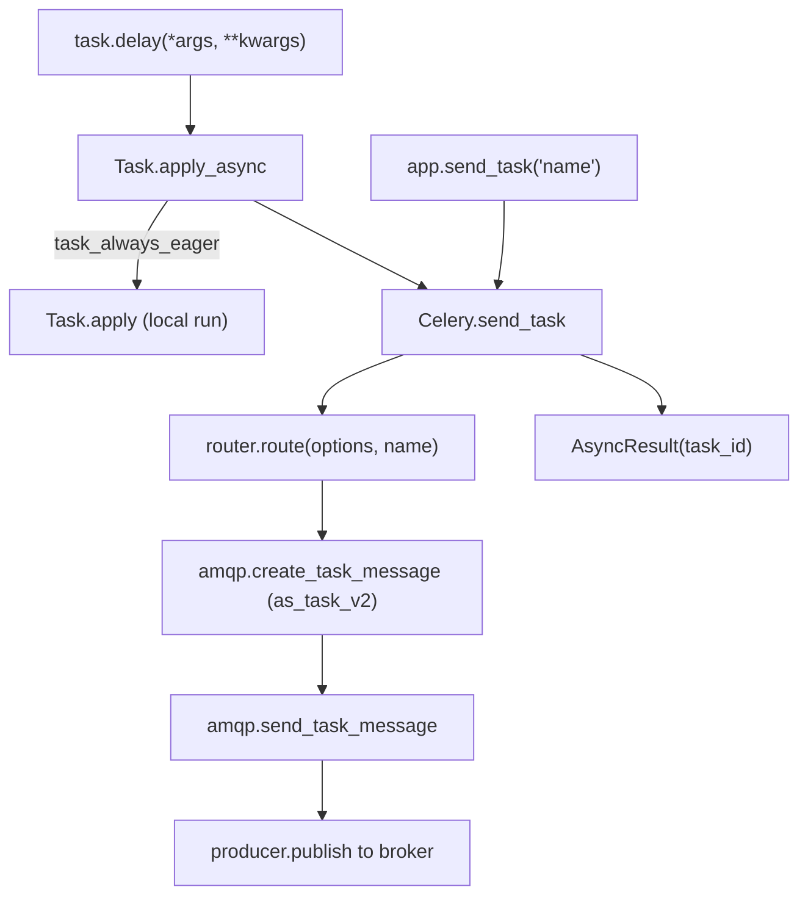

## Overview

Calling a task never runs it in the caller. `delay`, `apply_async` and `app.send_task` all end in one message published to the broker and an `AsyncResult` returned to the caller. This page follows that path: the checks and option merging in `Task.apply_async`, the preparation in `Celery.send_task`, the message that `AMQP.as_task_v2` builds, and the publish in the task sender. How the destination queue is chosen is on [[Routing and Queues]], and what the worker does with the message starts on [[Consumer and Event Loop]].

Sources: [celery/app/task.py:523-535](repo://celery/app/task.py#L523-L535), [celery/app/task.py:653-708](repo://celery/app/task.py#L653-L708)

Sources: [celery/app/task.py:660-708](repo://celery/app/task.py#L660-L708), [celery/app/base.py:934-1041](repo://celery/app/base.py#L934-L1041)

## The calling APIs

`delay(*args, **kwargs)` is `apply_async(args, kwargs)` with no options. `apply_async` takes the arguments as a tuple and a dict plus execution options. `app.send_task(name, args, kwargs, ...)` sends by name and needs no task object, which is how a client sends tasks whose code it does not have. `task.s(...)` and `task.signature(...)` build a reusable description of the call instead of sending it, covered on [[Signatures and Canvas Primitives]].

Sources: [celery/app/task.py:523-535](repo://celery/app/task.py#L523-L535), [celery/app/base.py:846-862](repo://celery/app/base.py#L846-L862)

| Option | Meaning |
| --- | --- |
| `countdown`, `eta` | Earliest run time, relative seconds or an absolute datetime |
| `expires` | Seconds or datetime after which the worker discards the task |
| `queue`, `exchange`, `routing_key`, `priority` | Destination and priority, see [[Routing and Queues]] |
| `serializer`, `compression` | Body encoding; defaults from the task and `task_serializer` |
| `link`, `link_error` | Signatures to run on success or on error |
| `retry`, `retry_policy` | Retry the publish on connection errors |
| `time_limit`, `soft_time_limit` | Override the task's limits for this call |
| `ignore_result`, `add_to_parent`, `headers`, `task_id`, `shadow` | Result storage, parent tracking, custom headers, a chosen id, a display name |

Sources: [celery/app/task.py:538-650](repo://celery/app/task.py#L538-L650)

## Inside apply_async

`apply_async` first refuses a `soft_time_limit` larger than `time_limit`. When the task has `typing` enabled, it calls the generated `__header__` with the arguments, so a wrong number of arguments raises `TypeError` here. It computes the `shadow` name (a display name for logs and monitoring) from `shadow_name`, then merges the task's execution options (`queue`, `routing_key`, `exchange`, `priority`, `expires`, `serializer`, `delivery_mode`, `compression`, `time_limit`, `soft_time_limit`) under the caller's options, so the caller wins. `ignore_result` and the task's `priority` are filled in when not given.

Sources: [celery/app/task.py:653-675](repo://celery/app/task.py#L653-L675), [celery/app/task.py:32-36](repo://celery/app/task.py#L32-L36)

With `task_always_eager`, it serializes and deserializes the arguments with the chosen serializer, so arguments that would fail on a real broker fail here too, then calls `apply()` with a fresh id and joins forbidden. Otherwise it calls `app.send_task` with the task name, the merged options, `result_cls=self.AsyncResult` and `task_type=self`.

Sources: [celery/app/task.py:677-708](repo://celery/app/task.py#L677-L708)

## Inside send_task

### Options and registry defaults

`send_task` generates a UUID when no `task_id` is given and warns that `task_always_eager` has no effect on it. A plain `send_task('name')` call has no `task_type`, so it looks the name up in the app's registry without finalizing the app, and merges that task's non-`None` execution options under the caller's. Unknown names are still sent, because the worker may know the task even if the client does not.

Sources: [celery/app/base.py:863-913](repo://celery/app/base.py#L863-L913)

`time_limit`, `soft_time_limit` and `expires` are explicit parameters of `create_task_message`, so `send_task` pops them from the options. An explicit `None` from the caller clears a task-level default, which is why the sentinel `_OMITTED` distinguishes "not given" from `None`.

Sources: [celery/app/base.py:915-932](repo://celery/app/base.py#L915-L932)

### Routing, delays and expiry

`router.route(options, name, args, kwargs, task_type)` returns the options with `queue`, `exchange` and `routing_key` resolved. When the message has an ETA or countdown and the broker uses quorum queues, `send_task` rewrites the destination to the `celery_delayed_27` topic exchange for native delayed delivery; [[Routing and Queues]] explains that mechanism.

Sources: [celery/app/base.py:934-970](repo://celery/app/base.py#L934-L970)

`expires` becomes the AMQP `expiration` property in seconds. A datetime or ISO string is converted relative to `app.now()`, and an expiry already in the past is set to 0 with a warning, which RabbitMQ treats as "expire unless a consumer takes it immediately".

Sources: [celery/app/base.py:972-994](repo://celery/app/base.py#L972-L994)

### Parent and root ids

When called inside a task the worker is executing, `send_task` takes `root_id` from the parent's root (or the parent's own id) and `parent_id` from the parent's id. These ids let monitors rebuild the tree of tasks a workflow spawned. With `task_inherit_parent_priority`, the child also inherits the priority the parent was delivered with. After publishing, the new `AsyncResult` is added to the parent's `request.children` through `add_trail`, unless `add_to_parent=False`.

Sources: [celery/app/base.py:996-1006](repo://celery/app/base.py#L996-L1006), [celery/app/base.py:1030-1041](repo://celery/app/base.py#L1030-L1041)

### Publishing

`send_task` calls `amqp.create_task_message`, which is `as_task_v2` unless `task_protocol` is 1, and removes stamp values from the options so they travel only as headers. It takes a producer from the pool (or wraps a passed `connection`), lets the result backend prepare for the reply through `backend.on_task_call` unless results are ignored, and calls `amqp.send_task_message`. Library errors from the connection are re-raised as kombu's `OperationalError`.

Sources: [celery/app/base.py:1008-1029](repo://celery/app/base.py#L1008-L1029), [celery/app/amqp.py:266-271](repo://celery/app/amqp.py#L266-L271)

The RPC and Redis backends use `on_task_call` to start listening for the result before the task can finish: RPC declares its reply queue and Redis subscribes to the task's result key, so a fast task's result is not missed.

Sources: [celery/backends/rpc.py:217-223](repo://celery/backends/rpc.py#L217-L223), [celery/backends/redis.py:501-503](repo://celery/backends/redis.py#L501-L503)

## Message protocol version 2

`as_task_v2` validates that `args` is a list or tuple and `kwargs` a mapping, converts `countdown` to an absolute `eta` and numeric `expires` to a datetime in the app's timezone, and serializes both as ISO 8601. It returns a `task_message` named tuple of `headers`, `properties`, `body` and `sent_event`.

Sources: [celery/app/amqp.py:326-360](repo://celery/app/amqp.py#L326-L360), [celery/app/amqp.py:32-33](repo://celery/app/amqp.py#L32-L33)

| Header | Content |
| --- | --- |
| `lang` | Always `py` |
| `task`, `id`, `shadow` | Task name, task id, display name |
| `eta`, `expires` | ISO 8601 times or `None` |
| `group`, `group_index` | Group id and position, for groups and chords |
| `retries` | Number of retries so far |
| `timelimit` | `[time_limit, soft_time_limit]` |
| `root_id`, `parent_id` | Workflow tree ids; `root_id` defaults to the task id |
| `argsrepr`, `kwargsrepr` | `saferepr` of the arguments, at most 1024 characters, for logs and events |
| `origin` | Node name of the sender |
| `ignore_result`, `replaced_task_nesting` | Result storage flag, replacement depth |
| `stamped_headers`, `stamps` | Stamp names and values, see [[Canvas Stamping]] |

Sources: [celery/app/amqp.py:361-391](repo://celery/app/amqp.py#L361-L391)

The properties are `correlation_id` (the task id) and `reply_to` (the caller's per-thread `thread_oid`, used by the RPC backend). The body is a three-tuple `(args, kwargs, embed)`, where `embed` holds `callbacks`, `errbacks`, `chain` and `chord`. Putting everything else in headers means a worker can route, delay, expire and revoke a task without decoding its arguments, and `argsrepr` keeps sensitive arguments out of logs when a task overrides it.

Sources: [celery/app/amqp.py:392-418](repo://celery/app/amqp.py#L392-L418), [celery/app/base.py:1010-1018](repo://celery/app/base.py#L1010-L1018)

`sent_event` is filled only when `task_send_sent_event` is set; it holds the fields of the `task-sent` event. Protocol version 1, still produced by `as_task_v1` and accepted by workers, puts everything in a dict body with no headers.

Sources: [celery/app/amqp.py:401-418](repo://celery/app/amqp.py#L401-L418), [celery/app/amqp.py:420-478](repo://celery/app/amqp.py#L420-L478)

## The task sender

`send_task_message` is built once per app by `_create_task_sender`, which captures configuration and signal receivers in closures so each publish does no lookups. It merges extra `headers` into the message headers and other keyword arguments into the properties.

Sources: [celery/app/amqp.py:485-516](repo://celery/app/amqp.py#L485-L516)

It then resolves the destination. With no queue and no exchange, the default queue is used; a queue name is looked up in `app.amqp.queues`. The delivery mode comes from the option, the queue's exchange or `task_default_delivery_mode` (2, persistent). For a direct exchange without an explicit exchange or routing key, the message goes to the default (anonymous) exchange with the queue name as routing key, which skips a routing hop. The queue is declared on publish unless it is a `Broadcast` queue.

Sources: [celery/app/amqp.py:517-547](repo://celery/app/amqp.py#L517-L547)

Before publishing, the `before_task_publish` signal can still change headers and properties; after, `after_task_publish` is sent, along with the deprecated `task_sent`. `producer.publish` runs with the serializer, compression and retry policy; by default `task_publish_retry` is on with up to 3 retries starting immediately and backing off by 0.2 seconds to at most 1 second. Finally a `task-sent` event is published on the same producer when requested, with the queue, exchange and routing key added.

Sources: [celery/app/amqp.py:549-603](repo://celery/app/amqp.py#L549-L603), [celery/app/defaults.py:296-305](repo://celery/app/defaults.py#L296-L305)

## What the caller gets back

`send_task` returns an instance of `result_cls` (the task's `AsyncResult` class) holding only the task id, with `ignored` set when the result will not be stored. Waiting on it is covered on [[Task Results and AsyncResult]]. A publish that still fails after its retries raises `kombu.exceptions.OperationalError` to the caller; no result is returned and nothing was queued.

Sources: [celery/app/base.py:1030-1041](repo://celery/app/base.py#L1030-L1041), [celery/app/task.py:635-646](repo://celery/app/task.py#L635-L646)
