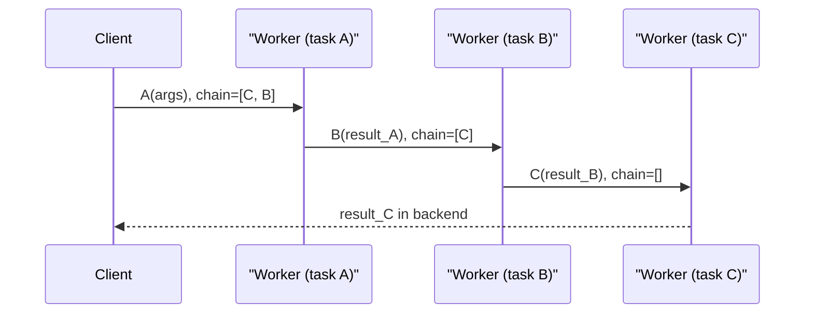

## Overview

Canvas primitives do no work themselves. Calling a chain, group or chord turns the structure into ordinary task messages, decorated with the information each worker needs to continue the workflow: the remaining chain travels inside the message, group members carry a group id and index, and chord members carry the body to call once all of them are done. There is no workflow engine; the workers and the result backend keep a workflow moving one step at a time. This page follows each primitive from `apply_async` to its last task. Building the signatures is on [[Signatures and Canvas Primitives]].

Sources: [celery/canvas.py:1047-1082](repo://celery/canvas.py#L1047-L1082), [celery/canvas.py:1616-1650](repo://celery/canvas.py#L1616-L1650), [celery/canvas.py:2226-2286](repo://celery/canvas.py#L2226-L2286)

## Chains

### Preparing the steps

`chain.apply_async` merges options and calls `run`, or `apply` (each step in sequence, in process) when `task_always_eager` is set. `run` calls `prepare_steps`, which walks the tasks from last to first. Walking backwards means each task is frozen with its final id before the task that precedes it, so the results can be linked (`result.parent`) and the whole result chain exists before anything is sent.

Sources: [celery/canvas.py:1047-1082](repo://celery/canvas.py#L1047-L1082), [celery/canvas.py:1104-1137](repo://celery/canvas.py#L1104-L1137)

While walking, `prepare_steps` normalizes the structure in these steps.

Sources: [celery/canvas.py:1100-1137](repo://celery/canvas.py#L1100-L1137)

1. Dicts become signatures, and a group with one task is unrolled; empty groups in the middle of a chain are skipped.
2. Tasks are cloned; the first task receives the chain's call arguments.
3. A nested chain is flattened by pushing its tasks onto the remaining steps.
4. A group followed by another step becomes a `chord` whose body is that next step, reusing the next step's frozen id, so the following task receives the list of group results.
5. Each task is frozen with the shared `root_id`; the last one also gets the chain's own id, group id and chord, so the chain's `AsyncResult` is the last task's.
6. The chain's `link_error` errbacks are added to every task (and to chord bodies), and a chord step checks that the backend supports chords.

Sources: [celery/canvas.py:1138-1218](repo://celery/canvas.py#L1138-L1218)

### Carrying the chain in the message

`run` pops the first task and sends it with the remaining tasks as the `chain` option, in reverse order. `_prepare_chain_from_options` builds that option in a `ChainMap` instead of mutating the options dict, because the same options are reused for every member when a chain is inside a group; mutating them once made later members run steps that belonged to earlier ones.

Sources: [celery/canvas.py:1074-1082](repo://celery/canvas.py#L1074-L1082), [celery/canvas.py:877-932](repo://celery/canvas.py#L877-L932)

The message body's `embed` carries `chain`. When the task succeeds, the tracer sends `chain[-1]` with the return value as its first argument and `chain[:-1]` as its remaining chain ([[Task Tracing and Execution]]). The chain is never stored anywhere but in the message, so it survives a worker restart only as long as the message does.

Sources: [celery/app/trace.py:454-462](repo://celery/app/trace.py#L454-L462), [celery/app/amqp.py:396-401](repo://celery/app/amqp.py#L396-L401)



Sources: [celery/canvas.py:1074-1082](repo://celery/canvas.py#L1074-L1082), [celery/app/trace.py:454-462](repo://celery/app/trace.py#L454-L462)

With `task_protocol = 1`, or a chain created with `use_link=True`, each step is linked to the next as a `link` callback instead.

Sources: [celery/canvas.py:1063-1066](repo://celery/canvas.py#L1063-L1066), [celery/canvas.py:922-923](repo://celery/canvas.py#L922-L923)

When a step fails, `mark_as_failure` walks the remaining chain in the request and stores the same failure for each later step that has an id, descending into chord bodies, so waiting on the chain's final result raises instead of hanging ([[Task Tracing and Execution]]).

Sources: [celery/backends/base.py:196-252](repo://celery/backends/base.py#L196-L252)

## Groups

`group.apply_async` refuses `link` and `link_error` (use a chord, or set them on members) and runs eagerly with `apply` when `task_always_eager` is set. Otherwise it fixes the group id (an existing `task_id` option, or a new UUID) and calls `_prepared`, which clones each member, flattens nested groups, prepends partial arguments to mutable members, and freezes each one with the group id, root id and its `group_index`.

Sources: [celery/canvas.py:1616-1650](repo://celery/canvas.py#L1616-L1650), [celery/canvas.py:1714-1761](repo://celery/canvas.py#L1714-L1761)

`_apply_tasks` publishes the members over one producer and yields their results. When the group is a chord header, it counts members with `_chord._descend` (a nested group counts its members, a chain counts its last step, a chord counts its body) and calls `backend.set_chord_size` before sending the last member. The `GroupResult` is built with a `barrier` promise that becomes ready when every member's result is ready, and it is added to the parent task's children unless `add_to_parent=False`.

Sources: [celery/canvas.py:1763-1825](repo://celery/canvas.py#L1763-L1825), [celery/canvas.py:2191-2224](repo://celery/canvas.py#L2191-L2224)

A group's own results are not stored as a group unless you call `result.save()`; waiting on them is covered on [[Task Results and AsyncResult]].

Sources: [celery/canvas.py:1630-1635](repo://celery/canvas.py#L1630-L1635)

## Chords

### Sending the header

`chord.apply_async` prepends call arguments to the chord's own, takes the body (from the call or the stored one) and clones it with the call's options, wraps the header in a group, and calls `run`, or `apply` when eager. `run` takes the group id from the header (or a new UUID), applies the chord's options to the body, and freezes the body with that group id. It freezes the header members with `chord=body`, which puts the body into every member's message, then calls `backend.apply_chord` and sends the header. An empty header sends the body at once with an empty list. The body's result gets the header's `GroupResult` as its `parent`.

Sources: [celery/canvas.py:2153-2177](repo://celery/canvas.py#L2153-L2177), [celery/canvas.py:2226-2286](repo://celery/canvas.py#L2226-L2286)

### Joining the header

Every header task that finishes calls `backend.on_chord_part_return(request, state, result)` from `mark_as_done` or `mark_as_failure`, because its request carries `chord`. How the backend decides that the last member has finished depends on its abilities.

Sources: [celery/backends/base.py:180-199](repo://celery/backends/base.py#L180-L199)

| Backend kind | `apply_chord` | Counting | Delivering results |
| --- | --- | --- | --- |
| Redis | Saves the `GroupResult` only if a member is itself a group | Each part adds its encoded result to a sorted set (by `group_index`) and reads the count, the chord size and extra parts in one pipeline | When the count reaches the size, reads the sorted set in order and calls the body |
| Key-value with atomic `incr` (cache, DynamoDB, GCS) | Saves the `GroupResult` | `incr` on a per-group counter key | When the counter equals the size, joins the results and calls the body |
| Others (database, MongoDB, S3 and so on) | Sends `celery.chord_unlock` | The unlock task polls the group | The unlock task calls the body when all are ready |
| RPC, disabled | Raises `NotImplementedError` | | |

Sources: [celery/backends/redis.py:554-660](repo://celery/backends/redis.py#L554-L660), [celery/backends/base.py:969-979](repo://celery/backends/base.py#L969-L979), [celery/backends/base.py:1183-1257](repo://celery/backends/base.py#L1183-L1257), [celery/backends/base.py:838-867](repo://celery/backends/base.py#L838-L867), [celery/backends/rpc.py:214-215](repo://celery/backends/rpc.py#L214-L215)

The Redis scheme needs no polling and keeps results in header order. `result_backend_transport_options={'result_chord_ordered': False}` switches to a list for compatibility with chords started by older versions. `add_to_chord` increments a separate counter so tasks added to a running chord with `Task.add_to_chord` are expected too. All keys expire with the result expiry and are deleted once the body is sent.

Sources: [celery/backends/redis.py:577-660](repo://celery/backends/redis.py#L577-L660)

### Polling with chord_unlock

`fallback_chord_unlock` sends `celery.chord_unlock` with the header's result tuples, routed to the body's queue and priority, after a one-second countdown. The task restores the `GroupResult`, and retries itself every `result_chord_retry_interval` seconds (1 by default) with no retry limit until the group is ready. It then joins the results (natively when the backend supports it) within `result_chord_join_timeout` (3 seconds) and calls `body.delay(results)`. This costs one extra task per poll, so a chord with long header tasks on such a backend produces a steady trickle of retries.

Sources: [celery/backends/base.py:838-859](repo://celery/backends/base.py#L838-L859), [celery/app/builtins.py:37-99](repo://celery/app/builtins.py#L37-L99), [celery/app/defaults.py:224-225](repo://celery/app/defaults.py#L224-L225)

### Errors in a chord

A header task that fails makes the join raise. The backend then finds the failing member for the message (`Dependency <id> raised <exc>`), wraps it in a `ChordError` with the original exception as its cause, and calls `chord_error_from_stack`. That function calls the body's `link_error` errbacks with a reconstructed request and marks the body as failed, so `result.get()` on the chord raises `ChordError`. When the body is itself a group, each of its members is failed so none hangs. A body that cannot be sent is handled the same way, with `Callback error: ...` as the reason.

Sources: [celery/backends/base.py:325-360](repo://celery/backends/base.py#L325-L360), [celery/backends/redis.py:647-660](repo://celery/backends/redis.py#L647-L660), [celery/backends/base.py:1226-1257](repo://celery/backends/base.py#L1226-L1257)

```python
from celery import chord

res = chord([fetch.s(u) for u in urls], merge.s()).on_error(report.s())()
try:
    res.get(timeout=60)
except Exception as exc:   # celery.exceptions.ChordError
    print(exc)             # Dependency <id> raised ...
```

Sources: [celery/canvas.py:735-746](repo://celery/canvas.py#L735-L746), [celery/canvas.py:2298-2341](repo://celery/canvas.py#L2298-L2341)

## Built-in canvas tasks

`celery/app/builtins.py` registers tasks the primitives rely on in workers. `celery.map` and `celery.starmap` loop over their items in one task, calling the task function directly; `celery.chunks` turns its arguments back into a group of `starmap` tasks and sends it; `celery.chord_unlock` is the polling task above; `celery.accumulate` returns its arguments and is used by `Task.replace` when replacing a task with a group. `celery.group`, `celery.chain` and `celery.chord` remain only for messages from older clients: current code builds those in the caller.

Sources: [celery/app/builtins.py:26-132](repo://celery/app/builtins.py#L26-L132), [celery/app/builtins.py:134-186](repo://celery/app/builtins.py#L134-L186)
